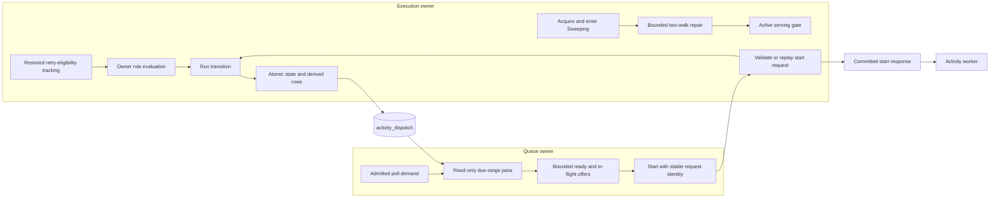

# Design: Durable Activity Dispatch

## Overview

Implement the approved [requirements](requirements.md) as the activity counterpart
of durable workflow dispatch. The durable representation remains
`activity_dispatch`; the queue home discovers and holds bounded offers, while the
execution owner validates and commits start. Discovery and repair are separate:
discovery is read-only and demand-driven; repair runs under an acquisition fence
before serving.

This design is grounded in baseline `bc5fc2070943b640a76dbc0c3147de990f207953`.
The requirements record the initial source inventory. Additional reads for this
design include `route_activity_task_queue`, storage's state-extension codec and
bounded-write helpers, acquisition tracking, peer admission, and the v1.31.0
matching/record-start response paths. The targeted server is v1.31.0; vendored
Temporal API v1.62.11 supplies wire shape only. No Temporal implementation is copied.

## Dependencies and Non-Goals

| Owner | Contract used here |
|---|---|
| [Durable actionable state](../../../docs/architecture/042-durable-actionable-state.md) | Wanted rows equal derived committed state while serving; volatile offers are not authority. |
| [Workflow dispatch](../workflow-dispatch/design.md) | Queue-home acquisition identities, fair bounded discovery slices, offer reservations, and two-walk repair. Its workflow semantics stay unchanged. |
| [Queue-home delivery](../queue-home-delivery/bugfix.md) | Placement lookup, channel cache, worker authorization and peer credentials. This adds the separately reserved activity start path. |
| [Recovery index](../recovery-index/requirements.md) | Candidate coverage and NULL-then-true pagination, including runs with any pending activity. |
| [Lease fencing](../bundle-lease-fence/bugfix.md) | Transaction-local lease validation plus local serving/write barriers. |
| [Activity inputs](../activity-inputs-from-history/bugfix.md) | Input/header remain in scheduled history; ordinary start reads that exact event, eager fresh-schedule start can reuse its committed values. |
| [Activity heartbeat time](../activity-heartbeat-time/requirements.md) | State extensions, precise durable heartbeat restoration and frozen positional layout. |
| [Workflow rules](../workflow-rules/requirements.md) | Rule evaluation at retry eligibility and ordinary start; eager first starts bypass evaluation. |
| [Storage contracts](../storage-contract-tests/design.md) | Shared backend cases, live DSQL receipts, isolated read baselines and cancellation-safe transactions. |

No proactive remote activity offer RPC, general completion/heartbeat forwarding,
standalone CHASM activity redesign, workflow-start request-ID change, dependency
upgrade or new public RPC is included. Activity eligibility tracking below is a
replacement for the existing retry timer, not a redesign of all timeout scanning.
The narrow additional `tokeira-auth` change supplies an activity-start peer audience;
the existing credential document and operator configuration remain the source.

## Architecture



Ordinary delivery must succeed when every post-commit notification is dropped.
Local notifications can wake discovery or admit a due, validated local offer;
they use the same capacity/deduplication accounting. They never persist a backlog
copy. No execution-owner broker is used as the remote queue owner's authority.

## Components and Interfaces

### Shared derivation and storage (`tokeira-storage`)

Add `src/activity_dispatch.rs`, with no I/O in its derivation. Reuse queue digest
encoding from workflow dispatch through a small shared helper, without changing
its existing digest domain or workflow indexes. Representative interfaces:

```rust
pub fn derive_activity_dispatch(
    state: &WorkflowState,
    home: ShardId,
) -> Result<BTreeMap<Uuid, ActivityDispatchRow>, ActivityDispatchDataError>;

async fn list_activity_dispatch_page(
    &self,
    range: &ActivityDiscoveryRange,
    cutoff: OffsetDateTime,
    after: Option<ActivityDispatchPosition>,
    limit: NonZeroU32,
) -> Result<ActivityDispatchPage>;

async fn list_activity_dispatch_home_page(
    &self,
    home: ShardId,
    after: Option<ActivityHomePosition>,
    limit: NonZeroU32,
) -> Result<ActivityHomePage>;

async fn reconcile_activity_dispatch_page(
    &self,
    home: ShardId,
    run: RunKey,
    after: Option<ActivityRepairCursor>,
    fence: WriteFence,
) -> Result<ActivityRepairPage>;
```

The last method reads current state inside each transaction. Its caller supplies
identity/continuation, never a decoded state as repair authority. The cursor holds
`Wanted` or `Existing`, the last UUID key examined in that phase and the observed
transition sequence. A changed sequence restarts that run at `Wanted`; repeated
change consumes the existing bounded acquisition retry budget. An absent run has
only the `Existing` phase. `ActivityRepairPage` reports continuation, examined and
changed counts, and completion. Completion is not permission to serve the home.

Replace operation-driven dispatch maintenance in both stores with desired-set
maintenance. Within the existing fenced run transaction, derive wanted rows from
`transition.next_state`, read existing rows in bounded key pages, and write only
the difference. The desired set includes unaffected activities, so a changed
workflow-level priority/pause/routing value cannot leave their rows stale. Normal
commits do not split their atomic write set into independently visible chunks.
DSQL physical refusal rolls back all state/history/rows; memory retains its
documented lack of physical DSQL limits. This adds metadata reads, not a second
full authoritative-state read on every ordinary commit.

Use the same maintenance in `write_transition` and its paired, successor and
staged-publication callers. Staged reset/bulk work retains the existing publication
barrier: `load_run` must regard an unpublished or logically deleted run as absent
for delivery. Populate new row columns in bounded reset materialization pages;
do not bypass `run_bulk_write`, large-state preparation or their final atomic
publication. The final publication must establish the complete desired set.
Purge continues to delete `activity_dispatch` through its existing run-key path.

### Queue-home discovery (`tokeira-runtime`)

Add an activity source and pass state beside the workflow source in `discovery.rs`,
or in its `activity` submodule. Reuse the page, queue-home and scheduler contracts;
do not copy workflow-specific sticky or logical-sequence decisions into activities.
One node scheduler shares an eight-query permit pool across workflow and activity
sources and rotates eligible ranges fairly. Existing workflow limits remain valid.

**Range selection:** one range per namespace and activity queue family, shared by
all poller deployment/build versions. Every activity candidate is hydrated through
`load_run`; verify that its current derivation matches the observed row, then use
the existing `route_activity_task_queue` resolver. That resolver may choose a
pinned version only if it has this activity queue; otherwise it consults current
activity-queue routing. Its decision can change without a run write. A queue-family
range therefore avoids frozen deployment indexes and still finds work when the
first versioned poller appears. Raw optional fallback coordinates stay in the row
for registry-free embedded operation. No public name limit is introduced.

The pass freezes `cutoff = now` at creation. It carries `(dispatch_at, key)` across
slices until exhaustion; hitting the slice/admission quantum yields the same pass.
It never resets to the head merely because its page produced zero offers. Held,
stale, temporarily ineligible and incompatible candidates advance the cursor. A per-row
read/routing error is logged and skipped for this pass; the next head pass retries
it. Decode ordering keys first: malformed non-key row data becomes a candidate
error carrying that valid position, so later rows remain reachable. A page SQL or
ordering-key decode error cannot safely produce a position: discard that pass and
retry after the discovery period. Liveness assumes finite interruptions.

Reserve capacity before reading. If there is no capacity, park the pass unchanged
until capacity changes or its registration retires. Do not advance past a valid
compatible candidate that was refused solely for capacity. If a page is interrupted,
retain the last actually examined key, not the SQL page's end. Each pass's frozen
cutoff excludes future retries; a later head pass includes newly due rows and
insertions behind the old position.

Register demand before immediate broker take. A drop guard unregisters on every
exit, including cancellation. Retain an idle registration/pass for 30 seconds to
bridge long-poll renewals, with bounded LRU eviction of idle registrations. Active
registrations consume finite permits; excess new ranges return `RESOURCE_EXHAUSTED`
without evicting another active poll. The broker's queue-home generation cancels
retired registrations and prevents an old page from admitting into a replacement.

### Offers and eager start

Add `activity_offers.rs` using the workflow offer reservation/lifecycle pattern,
with the complete incarnation key `(run, activity_id, schedule_event_id, attempt,
stamp)`. Including the schedule event prevents activity-ID reuse from colliding
with a prior schedule's attempt 1. The broker mutex owns ready queues, reservations
and ready/in-flight deduplication as one decision. A take retains the identity until
outcome or expiry. Old completion callbacks carry the acquisition generation and
offer token, so they cannot release a replacement's capacity.

Use existing activity `BrokerPolicy` ordering, fieldwise priority merge, fairness,
worker shutdown and rate selection. `order` remains volatile. Eviction/expiry drops
only an offer; it does not delete an activity row or record a durable acknowledgement.
While capacity is unavailable, durable work stays discoverable. Continuous churn
cannot restart a live pass at its head.

Eager activities start inside the workflow-task completion's transition. This
replaces the post-commit `try_claim_activity_task` path, not just its broker lookup.
Resolve the typed, deployment-wide enable setting (default false), the per-test
conformance override, old-SDK exclusion and scoped worker admission before entering
the pure transition. Preserve `UseWorkflowBuildId` from the proto; the current
translator drops it. In the kernel, select requested activities using the exact
versioning predicate in
`service/history/api/respondworkflowtaskcompleted/workflow_task_completed_handler.go:487-508 @ v1.31.0`:
old versioning is a `use_versioning` stamp with unspecified effective versioning
behavior; a nonempty assigned build ID also requires `UseWorkflowBuildId`. A paused
workflow produces neither eager starts nor activity tasks.

After processing all commands, start only selected activities still present in an
open run. Supply fresh request IDs from the runtime, the completion identity and
the workflow's assigned build ID. Reuse the pure activity-start mutation and receipt
representation within the completion builder; do not invoke a second transition or
the ordinary-start rule evaluator. Preserve retry-policy transient starts and their
later request-ID/identity/time materialization. Build the response from these start
results and the exact scheduling command payloads after commit, without another
history input read (`workflow_task_completed_handler.go:533-622 @ v1.31.0`).

No enqueue operation may survive for an inline-started incarnation. Canonical
row derivation sees the final started state and writes no dispatch row; publication,
discovery and acquisition repair cannot offer it. This matters even when a poll
was waiting before completion. There is no eager count cap; existing command,
payload and response-size admission still apply. Disabling eagerness leaves every
otherwise eligible activity on normal dispatch. A lost response leaves the activity
started until its own applicable timeout, then the normal retry/terminal outcome.
Retry eligibility and ordinary starts still evaluate workflow rules.

Configuration ownership and the deferred ledger update are recorded in
[configuration-policy](../configuration-policy/design.md#completion-inline-start-policy-amendment).
The companion inline workflow-task contract is in
[api-conformance-wft-completion](../api-conformance-wft-completion/design.md#return-new-wft-safety).

### Retry eligibility and workflow rules

Retry eligibility shares the activity timeout scanner's earliest-deadline wake,
including earlier-insert notifications and immediate continuation of unattempted
capped work, so backoff expiry is evaluated at its due time without changing offer
discovery (`service/history/workflow/task_generator.go:567-577 @ v1.31.0`).

Split `prepare_activity_dispatch_publish` into read-only candidate inspection and
execution-owner rule application. Discovery does not suppress an otherwise valid
hint merely because a new workflow rule might pause it: doing so could prevent
the owner from ever seeing the match after its eligibility timer was retired.
Discovery cannot commit a pause or delete a row. Owner start performs the current
rule checks before dispatch to a worker, so a rule created after publication still
wins. An internal broker hint is not a successful worker dispatch.

Retain retry-time evaluation even without pollers. Replace fire-and-forget retry
sleep tasks with an acquisition-scoped eligibility entry derived from the activity's
current schedule and incarnation. Drive these entries from the existing activity
scanner, independently of timeout submissions. Each pass examines at most 64 due
eligibility entries and retains a continuation; a failed entry remains due for a
later pass, so a failing prefix cannot starve later entries. After one successful
eligibility evaluation, retire only that entry revision. A matching rule commits
pause through the owner fence; a non-match performs no durable write. Later start
still reevaluates rules. Acquisition reconstructs eligibility for unstarted retries
and delayed reset/unpause work, including overdue entries. All times come from
durable state, never discovery arrival time.

This is an owner timer/rule obligation, not another dispatch scan: it reads no
`activity_dispatch` range and never fills a foreign broker. Timeout evaluation
retains its existing precedence and budget. Its four timeout kinds and durable
heartbeat restoration are unchanged. See `executeActivityRetryTimerTask` in
`service/history/timer_queue_active_task_executor.go @ v1.31.0` and the sibling
workflow-rule requirements 4.2, 4.10 and 4.11.

## Data Models and Storage Layout

### Row and query positions

| Value | Fields and authority |
|---|---|
| `ActivityIncarnation` | `run_key`, `activity_id`, `schedule_event_id`, `attempt`, `stamp`; from run/activity state, not broker sequence numbers. |
| `ActivityDispatchRow` | Existing UUID `key`; incarnation; execution home; source `QueueKey`; effective priority; source dispatch revision; `dispatch_at`; new queue lookup digest. No payloads, lease, claim or acknowledgement. |
| `ActivityDiscoveryRange` | Stable namespace ID and full activity queue name. Selected worker versions live in demand, not in this storage range. |
| `ActivityDispatchPosition` | `(dispatch_at, key)` in PostgreSQL timestamp/UUID order. Memory uses the same order, not map or activity-name order. |
| `ActivityHomePosition` | `(run_key, key)` under one execution-home prefix; includes stale and legacy rows. |
| `ActivityOffer` | Row identity, execution home, original eligibility time, resolved `DispatchableActivityTask`, queue-home generation and volatile offer token. No credentials retained in the broker. |

Derivation is a total, checked function over decodable state:

| State | Derived result |
|---|---|
| Non-running run, including paused/closed | Empty set. |
| Pending activity with either started marker present, or activity pause info | No row for that slot. Both transient and buffered start sentinels count as started. |
| Unstarted, unpaused activity with `current_attempt_scheduled_at` | One row; a future time is retained. |
| Otherwise-actionable activity with missing schedule, zero attempt, unrepresentable stamp, invalid identity or inconsistent started markers | `ActivityDispatchDataError`; fail commit/repair. Do not guess from an old row, discovery time or original schedule. |
| Activity removed by its owning cancellation/resolution semantics | No row. `cancel_requested` alone is not an invented terminal condition. |

The row's source deployment/build use the current existing activity-over-workflow
fallback coordinates. Effective priority uses the existing fieldwise merge; source
revision comes from durable workflow versioning metadata. Runtime resolution can
produce a different selected target/revision but cannot rewrite the durable row.
The existing `created_at` is diagnostic only; equality, pagination, repair and
conditional removal do not depend on it. `input_data` remains the existing encoded
empty value until a separately reviewed physical-column retirement.

Validate before narrowing numeric fields. In particular, replace saturating stamp
conversion with a checked `u64` to signed database representation. Decode and
collision checks reject a UUID slot key that disagrees with its raw run/activity
coordinates; a hash is never authority to overwrite a different slot.

### Forward-only schema changes

At this baseline the immutable prefix ends at V127. Allocate the next contiguous
migrations at implementation/PR integration time; do not edit that prefix. In order:

1. Add nullable `queue_key TEXT` to `activity_dispatch`, without a default.
2. Create the queue index below asynchronously.
3. Create the complete home index below asynchronously.
4. Drop `idx_activity_dispatch_queue`, whose raw-name key is no longer used.
5. Drop `idx_activity_dispatch_shard`, replaced by the complete home walk.

```sql
ALTER TABLE activity_dispatch ADD COLUMN IF NOT EXISTS queue_key TEXT;

CREATE INDEX ASYNC IF NOT EXISTS idx_activity_dispatch_queue_due
ON activity_dispatch (queue_namespace, queue_key, dispatch_at, key);

CREATE INDEX ASYNC IF NOT EXISTS idx_activity_dispatch_home_key
ON activity_dispatch (shard_id, run_key, key);
```

These are separate migration files/transactions. Keep `idx_activity_dispatch_run_key`
for purge and existing maintenance. No table recreation, dropped activity data or
baseline re-cut is needed. Update the schema contract/digest and build metadata as
one reviewed change; new binaries await both async indexes before readiness.
Legacy NULL `queue_key` rows are enumerated by the home walk and rewritten from
authority before that execution home serves. Discovery never assumes NULL means
unversioned or that a partially repaired home is ready to start work.

`queue_key` is the existing domain-separated, length-prefixed SHA-256 queue digest,
64 lowercase ASCII characters. Return and compare raw namespace/name after lookup;
test collisions with an injected test hasher. The index uses four bounded columns.
[AWS's ALTER TABLE syntax](https://docs.aws.amazon.com/aurora-dsql/latest/userguide/alter-table-syntax-support.html)
supports the additive operation; the [DSQL limits](https://docs.aws.amazon.com/aurora-dsql/latest/userguide/CHAP_quotas.html)
bound index keys, columns, rows and write transactions. These bounds are checked by
the existing validator, schema tests and an executed live migration/plan test, not
assumed from PostgreSQL compatibility. Root/crate migration policy remains stricter
than the generic service feature set.

For first pages, seek the equality prefix with `dispatch_at <= cutoff`, ordered by
`dispatch_at, key`. Deep continuation uses two disjoint key-only seeks:

```text
prefix AND dispatch_at = cursor.time AND key > cursor.key AND dispatch_at <= cutoff
prefix AND dispatch_at > cursor.time AND dispatch_at <= cutoff
```

Bound each branch by the page limit; combine/order and bound the keys once, then
join payloads in that statement's snapshot. This follows the workflow query's
covered-key pattern and avoids an unbounded residual filter on a primary-key tail.
No transaction/connection survives across slices. Raw collisions and all returned
keys count as examined positions. DSQL `EXPLAIN` and deep-page fixtures must prove
the intended index paths; a plausible SQL shape alone is not verification.

### Finite runtime budgets

All new limits are named internal constants, not new operator knobs. Tests can
construct smaller nonzero budgets to explore boundary cases.

| Resource | Limit / behavior |
|---|---|
| Discovery period | 1 second for a new head pass; new demand/capacity can wake sooner. |
| Page and scheduler slice | 64 rows, one page; hydrate serially. |
| Admission quantum | 64 new offers before yielding; continuation survives. |
| Retained offers | 256 per selected activity queue/version; 8,192 per queue home, counting ready, in-flight and reservations. |
| Discovery queries | 8 node-wide across both task kinds. |
| Active activity ranges | 4,096 per home; permit refusal is `RESOURCE_EXHAUSTED`. |
| Idle activity registrations | 4,096 per home, 30-second grace, LRU eviction only among idle entries. |
| Ready retention / in-flight lease | 5 seconds each; expiration affects volatile state only. |
| Owner eligibility work | 64 examinations per scanner tick, continuation retained independently of timeout work. |
| Repair | 64 keys examined, at most 64 mutations and 4 MiB conservatively accounted inserted/updated values per transaction; split earlier for bytes. |
| Legacy disposal | 64 physical keys per slice, using existing write budgets. |
| Owner start RPC | 64 KiB decoded request; 128 MiB encoded response; 8 KiB combined metadata; 32 handlers node-wide, no queued overload waiters. |
| Owner attempt | 10 seconds, at most 3 attempts with the same ID, all within the original poll deadline; never recursively forward at the receiver. |

Bounds are memory/work bounds, not a promise that every backlog clears in one
second. Liveness requires compatible continuing demand, available capacity and
storage, fair scheduling, and a finite number of interruptions for a finite stable
candidate set. Ready eviction and capacity wakeups must not reset a running pass.

## Authoritative Start and Same-Request Recovery

### Durable receipt and format compatibility

Add `WorkflowState.activity_start_receipts`, a `#[serde(skip)]` map keyed by activity
ID. It is runtime-owned metadata persisted in a new frozen state-extension section
(next unused tag is 7 at this baseline). Its entry is:

```rust
struct ActivityStartReceipt {
    request_id: Uuid,
    schedule_event_id: i64,
    attempt: u32,
    offered_stamp: u64,
    worker_identity: WorkerIdentity,
    selected_queue: QueueKey,
    dispatch_revision: i64,
}
```

The entry identifies the consumed offer and the worker/selected routing of that
start. It contains no credentials, input, header, heartbeat payload copy or serialized
poll response. Current activity state already owns start time, started markers and
attempt; immutable history owns scheduled input/header. Encode entries in activity-ID
order; reject duplicate IDs, invalid receipts and trailing/corrupt section bytes.

Write a new hot-state envelope `TKW4` while keeping the positional state layout and
history envelope unchanged. Read TKW3 as a legacy state with no new receipt, preserving
its existing prepared outbound-state interpretation. TKWS/TKW2 retain their existing
checked outbound-preparation gate; accepting a new envelope must not accidentally
mark them prepared. New TKW4 states require explicit receipt validation, but absence
of a receipt for a legacy started activity is valid: it cannot replay an unknown
old internal request and recovers through the existing timeout lifecycle. Old
binaries reject TKW4 instead of dropping required receipts. Preserve all existing
extension sections and large-state preparation paths.

Set the receipt in the same transition as start. Add an optional caller-supplied
request ID to the pure `ActivityStartRequest`; runtime supplies it for ordinary
matching and supplies eager IDs as completion operands. The existing by-ID
synthetic-start path retains its behavior.
Use that ID in materialized and buffered `ActivityTaskStarted` history, and retain it
for later materialization of transient starts. The kernel generates no UUID and
performs no I/O. Reset forks do not inherit a live delivery receipt from their source;
retry, removal and replacement schedules clear the prior entry. Options/pause changes
to an already-started attempt must not manufacture a new start or erase its identity
merely because the current control stamp changes.

### Start sequence

1. The queue owner allocates one request UUID when its poll takes an offer. It keeps
   it across every peer attempt for this match; another poll gets a different UUID.
2. Authorize the worker target and bind namespace/run/queue on the owner. Look up
   placement from the existing directory; the receiver never forwards recursively.
3. Load current authority. A missing, closed, removed or replaced activity is stale.
   For an already-started activity, check the receipt first: the same request,
   schedule, attempt, worker and selected target can recover that start; a different
   request is already-started and not a worker task. Match the receipt's consumed
   stamp to the request, not the post-start stamp. This check precedes unstarted
   pause/stamp gates, following `recordActivityTaskStarted @ v1.31.0`.
4. For an unstarted attempt, validate incarnation, due time, workflow/activity pause,
   current rules and selected routing. Retain the existing deployment-transition
   decisions from `transition_for_polled_activity_task`; do not replace the targeted
   revision rules with a blanket equality-to-latest-registry check. A required pause
   or deployment transition uses an owner-fenced transition and returns no activity.
5. Compute the pure ordinary start and receipt with one owner-chosen timestamp for
   that OCC attempt. Read the exact scheduled input/header once. Construct and size-check the prospective response before
   committing; no user payload is accepted from the internal start request.
6. Commit through the current execution-home serving admission, captured fence and
   expected sequence. On conflict, reread authority and repeat the decision; preserve
   the request UUID. If another call with that UUID won, take the replay branch.
7. Return only committed metadata. Update timeout tracking with the acquisition
   identity and revision so a late callback cannot mutate replacement tracking.

A replay is read-only with respect to workflow transitions, but validates its
authoritative observation and current lease in a short transaction before returning
success. It neither recreates the row nor advances history/transition sequence.
An ownership move may require issuing the opaque token under the current execution
epoch, as existing activity heartbeat/completion validation requires. This changes
no worker-visible attempt or start time and does not make an old epoch token valid.

**Replay response is not a byte-for-byte saved response.** At v1.31.0 the same-request
branch returns the scheduled event, current attempt schedule, merged priority,
original start time and attempt; it returns before filling fresh-start heartbeat,
workflow-type/namespace and retry-policy fields. Matching and frontend forward those
absences. Preserve that distinction in a typed `Started` versus `Replayed` result,
while retaining internal origin data for authorization. Sources:
`service/history/api/recordactivitytaskstarted/api.go`, `recordActivityTaskStarted`;
`service/matching/matching_engine.go`, `createPollActivityTaskQueueResponse`;
`service/frontend/workflow_handler.go`, `PollActivityTaskQueue`, all **@ v1.31.0**.
Requirements 4.6 and 6.5 preserve the existing start and ordinary/eager response;
they do not require inventing fields absent from the targeted replay branch.

If the original poll disappears after a committed start, the receipt does not
assign that start to a new poll. Its normal activity timeout/retry remains the
recovery mechanism. A replay after resolution or a new attempt is stale.

### Internal wire contract and security

Add `ActivityTaskDispatch.StartActivityTask` in a new internal runtime proto file.
It imports the vendored public response type for its payload; do not add fields to
upstream protos or encode payload byte arrays as JSON. Runtime returns domain data;
edge performs the faithful protobuf projection. Local and remote starts share the
same owner decision code and public response mapping.

| Request field | Wire shape and policy |
|---|---|
| `run_key` (1) | 16-byte UUID; bind to authority. |
| `activity_id` (2) | Exact slot string. |
| `schedule_event_id` (3) | Positive int64; exact incarnation match. |
| `attempt` (4) | Positive uint32; exact incarnation match. |
| `stamp` (5) | uint64; checked storage conversion, never saturation. |
| `request_id` (6) | 16-byte UUID; stable across retries of this match. |
| `namespace` (7) | Admitted namespace name; independently resolve and bind. |
| `task_queue` (8) | Selected activity queue name; no sticky queue mode. |
| `deployment` (9), `build_id` (10) | Optional strings; preserve absent versus present-empty. |
| `dispatch_revision` (11) | int64 from selected routing decision; validate by existing revision rules. |
| `worker_identity` (12) | Verbatim admitted worker identity. |
| `scoped_versioned` (13) | Boolean scope hint; never bypass authoritative worker-target authorization. |

| Response field | Wire shape and policy |
|---|---|
| `task` (1) | `temporal.api.workflowservice.v1.PollActivityTaskQueueResponse`; present only on success and populated according to Started/Replayed mode. |
| `origin` (2) | Internal `ActivityStartOrigin`, required for final worker-target authorization. |
| `replayed` (3) | Boolean; tells the adapter which verified response shape applies, not authority to bypass validation. |

`ActivityStartOrigin` fields are stable namespace UUID (1), normal task queue (2),
selected deployment (3) and selected build (4). Task class is fixed to Activity by
the message. Empty version coordinates keep the existing unversioned origin
representation. Validate returned origin, task identity, attempt and requested
namespace before returning to the worker. No endpoint or redirect URI is accepted
from a response.

Give this route a separate `urn:tokeira:activity-start:<cluster-id>` peer audience
in the existing signer/verifier. Put its single bearer token in
`x-tokeira-peer-authorization`, leaving ordinary caller authorization headers for
worker admission. Reject duplicate peer headers, wrong audience/cluster, missing
credentials and oversize combined metadata before body decoding. Caller credentials
come only from the existing authenticator's forwarding selection; strip transport
headers and the incoming peer header, then attach the local purpose-scoped token.
Never cache caller credentials in channels, offers, receipts or logs.

The edge owner repeats worker admission/authorization; a peer grant alone cannot
start work. The public listener's no-peer mode does not expose this route. Embedded
single-node operation uses a direct authorized call and needs no credential file.
Use a separate 32-handler permit pool and byte/timeout limits for this route, not
the 500 ms offer-only handler. A new peer purpose does not require regenerating the
existing protected credential document. Purpose separation gains cross-audience
tests in `tokeira-auth`; public role policy is unchanged.

### Response field accounting

The new transport carries native protobuf bytes and full internal origin. The
following accounts for every current `StartedActivityTask` field and the public
fields this path must preserve or explicitly retain under their existing policy.

| Domain field(s) | Public / internal mapping |
|---|---|
| `run_key` | Internal binding and encoded activity token; never substitute user-visible run ID. |
| `run_id`, `workflow_id` | `workflow_execution.run_id/workflow_id`. |
| `activity_id`, `activity_type` | Identical public identity/type. |
| `task_queue` | Internal origin/authorization; no invented public poll-response field. |
| `token` | Existing activity-token envelope, sealed to stable namespace; epoch from validated owner. |
| `input`, `header` | Scheduled event payloads, byte-preserving native protobuf. |
| `attempt` | Public int32 via checked conversion, not clamped. |
| `workflow_type` | Fresh-start field; absent on targeted same-request replay. |
| `retry_policy`, `heartbeat_details` | Fresh-start values; absent on targeted same-request replay. |
| `scheduled_time` | Original scheduled event time; not discovery arrival. |
| `current_attempt_scheduled_time`, `started_time` | Current attempt schedule and committed start timestamp, including replay. |
| `schedule_to_close_timeout`, `start_to_close_timeout`, `heartbeat_timeout` | Preserve existing successful first-start projection; replay uses scheduled-event values as the pinned matching helper does. |
| `origin` | Complete internal `ActivityStartOrigin`; authorize before returning task. |
| Effective priority | Already used by activity dispatch but absent from baseline `StartedActivityTask`; thread it through the domain/proto projection, including replay, to satisfy the approved priority contract. |
| Workflow namespace | Admitted display name for fresh start, distinct from stable UUID in token; targeted replay leaves the public field empty. |
| Poller scaling | Computed at queue owner by existing policy, never execution-owner ownership evidence. |
| Standalone activity run ID, poller groups and newer proto-only fields | Retain existing policy; no new standalone or newer-version support is claimed. |

Fresh-start field semantics outside this delivery change remain with their owning
specifications. The same-request branch is newly reachable and has dedicated wire
fixtures against the source above. Preflight exact encoded success size, including
origin and envelope overhead, before mutation; repeat on a new OCC decision. Size
failure on a replay cannot undo its prior commit, but must return a bounded error.

## Acquisition Repair and Cutover

### Two walks, bounded per-run work

1. Enter `Sweeping`, capture the acquisition's home/epoch/generation/deadline/fence,
   and drain the existing serving writer barrier.
2. Page recovery candidates through all existing phases. For each run, exhaust the
   `Wanted` repair phase, then its `Existing` phase, before restoring its tracking.
3. Page the complete activity home index by `(run_key, key)`, including rows whose
   run was not a candidate. Reconcile each referenced run. Repeated run encounters
   are harmless; continuation advances from examined physical keys, even if deleted.
4. After workflow, outbound and activity repairs plus required tracking succeed,
   compare the same acquisition identity/cancellation/deadline before marking Active.

Each repair transaction checks the captured lease fence first and locks an existing
hot row with the repository's transaction-local `FOR UPDATE` protocol, then hydrates
its parts and derives from that snapshot. Verify both stored and recomputed execution
home. `Wanted` examines up to 64 desired UUID keys and upserts only mismatches;
`Existing` reads up to 64 stored keys and removes or replaces obsolete versions.
Byte accounting may yield before the key limit; return the last actually processed
key. Do not gather all database rows before writing or equate a read-page limit to
a safe write budget.

An absent hot row can only authorize removal under the observed row's home and
captured fence. A foreign-home row is corruption, not a reason to guess placement.
Deletes compare the observed row version; a concurrent replacement survives or
forces an OCC retry. Locks/fence reads serialize a transaction against run writes;
the non-serving writer barrier excludes same-owner writers between repair pages.
A replacement owner invalidates the old fence. These are both necessary: local
cancellation alone does not protect against ownership change not yet observed.

Capture the fence once; never borrow a replacement's fence during retries. Every
page validates acquisition before and after I/O. Conflicts restart from fresh
authority within the configured retry budget; other failures leave the home
non-serving. No repair cursor is durable, so restart begins at the head. Already
committed row repairs are idempotent. Repair does not append history or advance
the run sequence, and preserves logical-deletion/staged-publication semantics.

### Retirement inventory

| Existing path | Final treatment |
|---|---|
| `commit.rs` and memory transition activity/enqueue row writes | Shared desired-set maintenance, including global run policy changes. |
| Publisher `EnqueueActivityTask` and delayed publication tasks | Install authoritative-time tracking; optional local bounded wake/offer only. Remove correctness dependence on spawned sleeps. |
| Retry timer publication and `reconcile_due_activity_dispatches_once` | Owner eligibility/rule tracking plus queue-home discovery; remove the per-home dispatch range scan. |
| `backlog.rs` grace scanner and drain worker | Stop and remove runtime delivery use for both task kinds. |
| `reprocess_unversioned_activity_backlog` and edge `absorb_unversioned_backlog` | Wake/coalesce demand for the family; keep any needed volatile rerouting, never drain durable copies. |
| `republish_activity_queue` | Bounded discovery wake/slice through the same range state; no repeated unpaginated head refill. |
| Old queue/per-home activity listing methods | Retain only explicitly needed inspection/test adapters; remove runtime delivery callers. Adapt reads to checked row semantics and new indexes. |
| Broker stats / worker-compute inspection | Preserve their existing bounded-observation meaning; do not equate an in-memory offer count to total durable backlog. |
| Legacy workflow backlog disposal | Extend the existing physical-key walker to dispose activity copies with per-slot coverage checks; retain workflow semantics. |
| Reset/purge/placement/successor and repository test doubles | Populate/read the canonical metadata and preserve publication/ownership barriers; include in the inventory test. |
| `BacklogConfig` and `max_dispatch_reconciliations_per_scan` | Remove obsolete runtime settings/call sites and document removal; do not silently repurpose their units. |

The broker-statistics / worker-compute inspection entry uses due `activity_dispatch`
rows, resolved as discovery resolves them. DescribeTaskQueue reads at most four
discovery pages, counting only decoded, matching rows whose current resolved queue
is the requested queue. Worker compute derives due rows from its existing recovery
candidates and counts each row once on its execution owner. Both broker reads exclude
retained offers, so each row counts once, through its row, until its start commits.
This keeps persisted work visible without poll demand, as in
`service/matching/backlog_manager.go:200-207 @ v1.31.0`, while preserving the bounded observation.
Future retries enter matching from `executeActivityRetryTimerTask` in
`service/history/timer_queue_active_task_executor.go:522 @ v1.31.0`.

Legacy disposal examines at most 64 physical keys, including deferred/other-kind
entries. In one read/write transaction, decode the current run and the referenced
activity slot; remove a copy only when that slot's canonical row equals its desired
row, or neither is wanted/present. Missing authoritative run means no work is owed
by this copy; delete the copy without inventing a run or home. Undecodable/unsupported
legacy payloads, invalid state or unequal rows defer that entry and advance the
physical cursor. Connection/query failures abort the slice. Revisit deferred entries
on later head passes after acquisition repairs them. No disposal path enqueues work.

Keep `dispatch_backlog` physically present for this compatibility release, with no
delivery writers/readers and bounded disposal only. Table/index removal is a later
forward-only migration after an empty-table receipt and a release with no legacy
writers. This PR does not authorize a blind DROP or destroy unknown legacy data.

### Upgrade and rollback

Require a stopped-cluster upgrade: stop all old writers, apply the new migrations
and wait for indexes, install the new binaries, then acquire/repair before serving.
Existing peer credential files remain required for controller-managed peers. No
mixed-version safe-serving claim is made. A legacy actionable activity with missing
required timing fails its acquisition with run/activity identity and an actionable
diagnostic; do not seed a guessed retry time or fetch it from backlog.

The existing schema contract prevents an old binary from opening a newer schema;
TKW4 additionally prevents silent receipt loss in unsupported rollback paths. After
new writes, rollback requires a reviewed compatible release or pre-upgrade restore,
not changing a magic value or re-enabling backlog writers. Document these constraints
and the five migration operations in the unreleased change record and operator notes.

## Error Handling

| Condition | Internal result | Caller/serving behavior |
|---|---|---|
| Malformed UUID, zero attempt/event, invalid wire shape | `InvalidActivityStart` | `INVALID_ARGUMENT`; no mutation. |
| Missing/invalid peer or caller authentication | Existing authentication error | `UNAUTHENTICATED`; no run reads before preflight. |
| Wrong grant or unauthorized worker target | Existing authorization error | `PERMISSION_DENIED`; no transition. |
| Run namespace does not match the independently admitted namespace | `ActivityOfferRejected` | Internal stale `NOT_FOUND`; do not expose or mutate another namespace's task. |
| Stale incarnation, missing/closed activity, different already-started request | `ActivityOfferRejected` | Internal `NOT_FOUND` with `x-tokeira-stale-activity-offer`; consume candidate and continue the public poll. |
| Wrong/non-serving owner, missing endpoint, lease loss | `RetryableActivityTaskStart` / `NotShardOwner` / `LeaseFenceLost` | Retryable `UNAVAILABLE`; refresh directory, same request ID. |
| Required rule pause or deployment transition | `ActivityStartSuppressed` | No worker task; owner transition is authoritative; continue poll. |
| Run OCC conflict | Existing conflict result | Retry whole owner decision within existing OCC budget; exhaustion `UNAVAILABLE`. |
| Transport timeout / ambiguous commit | `RetryableActivityTaskStart` | Same-ID retry within attempt/poll bounds; never infer non-commit. |
| Caller cancellation/deadline | Existing cancellation/deadline result | Stop work and release volatile capacity; no durable acknowledgement. |
| Capacity, encoded size or handler limit | `ActivityDispatchCapacity` / `ActivityStartTooLarge` | `RESOURCE_EXHAUSTED`; preflight a new start before mutation. |
| Missing scheduled event or invalid state/receipt/row | `ActivityDispatchDataError` / existing codec error | Owner returns bounded `DATA_LOSS` or existing history error mapping; discovery retries, repair remains non-serving. |
| Transient database/rule-store failure | Existing repository error | No bypass of gates; retry later. No payload/credential text in logs. |
| Repair serialization failure | `ActivityDispatchRepairConflict` | Fresh-state retry with original fence; exhaustion leaves Sweeping. |
| Home mismatch, unsupported legacy state or unrepresentable repair row | `ActivityDispatchRepairError` | Non-serving with offending identity and cause; no skipped success. |
| Ordinary commit exceeds DSQL limits | Existing physical write refusal | Whole transaction rolls back; retain the existing owning API error mapping. |
| Unsupported envelope/schema | Existing compatibility refusal | Startup/load fails explicitly; never drop receipt or outbound metadata. |

## Correctness Properties

Each property is implemented with `proptest`, at least 100 cases, and an independent
fixture/reference oracle. Lifecycle traces use the real kernel and commit paths;
the oracle is a small explicit state model, not another call to the production
deriver. Fixed protocol/schema facts additionally have example tests.

### Property 1: Complete deterministic derivation

*For any* valid generated run/activity state, derivation produces exactly its
wanted rows, including future retries and every field; invalid actionable state
fails explicitly without using prior rows or a clock.

**Validates: Requirements 1.1, 1.2, 1.3, 1.4, 1.6, 1.7**

### Property 2: Atomic activity maintenance

*For any* generated transition and commit/rollback/conflict/fence outcome, state,
history and the complete activity row set are either all updated or unchanged;
paired and staged publication exposes no startable partial state.

**Validates: Requirements 1.1, 1.3, 1.4, 1.5, 4.3, 7.7**

### Property 3: Ordered backend traversal

*For any* finite generated due range, paging both backends returns the same total
order and every eligible key, including tied times, hash collisions and deletion
of a continuation row; future rows remain excluded until a later cutoff.

**Validates: Requirements 2.1, 2.2, 2.5, 2.6, 8.3, 8.6**

### Property 4: Progress through skipped prefixes

*For any* finite stable range and finite interruption trace satisfying the stated
demand/capacity assumptions, repeated bounded slices eventually examine every
candidate even when prefixes are held, incompatible, suppressed or fail hydration.
Capacity pauses preserve the next unexamined candidate and SQL failures retry.

**Validates: Requirements 2.3, 2.4, 2.5, 2.6, 2.7, 2.8, 8.2**

### Property 5: Bounded disposable offers

*For any* generated admission/take/expiry/cancellation trace, each incarnation has
at most one retained entry per acquisition, all named capacities hold, and dropping
volatile state never deletes wanted rows or prevents rediscovery.

**Validates: Requirements 3.1, 3.2, 3.3, 3.4, 3.6**

### Property 6: Acquisition-scoped volatile state

*For any* overlapping queue/execution acquisition trace, retired discovery pages,
offer outcomes and tracking callbacks cannot admit, remove or activate replacement
generation work.

**Validates: Requirements 3.5, 5.8, 8.4**

### Property 7: One authoritative start

*For any* ordinary/remote poll trace, completion-inline selection and stale
incarnations, at most one start commits for a schedule/attempt/stamp under the
execution-home fence. An eager first start belongs to the completion commit alone,
has no dispatch row or offer, and cannot be taken by a waiting poll; no successful
response precedes its commit.

**Validates: Requirements 4.1, 4.2, 4.3, 4.4, 4.5, 8.4, 9.7, 9.8**

### Property 8: Same-request recovery without resurrection

*For any* lost-reply/retry/owner-change trace, retrying the same current start
request preserves attempt/start time and appends no new transition; a competing
request or resolved/replaced attempt cannot recover it as new work. Abandoned
commits remain subject to the ordinary timeout/retry lifecycle.

**Validates: Requirements 4.6, 4.7, 4.8, 4.9, 8.4**

### Property 9: Wire and admission boundaries

*For any* generated request, credential purpose/cluster, scope, encoded size and
cancellation boundary, only a valid independently authorized owner start may mutate
the run; refused requests remain bounded and mutation-free. The response binds to
the admitted namespace, offer and origin.

**Validates: Requirements 4.10, 4.11, 8.5**

### Property 10: Rules at retry eligibility and start

*For any* generated schedule/rule-change/owner-restart trace, no ordinary start
occurs before eligibility or through an effective pause rule; owner retry-eligibility
evaluation also occurs without poll demand. Eager first starts do not evaluate
rules. Discovery performs no authoritative mutation.

**Validates: Requirements 2.9, 6.1, 6.2, 6.3, 6.8, 8.5, 9.9**

### Property 11: Routing and lifecycle preservation

*For any* generated retry, reset, pause, cancellation, options or routing trace,
current activity state and the pinned version/revision rules decide the offered
target and start, while priority/fairness/rate/shutdown policy remains unchanged.
New versioned demand can find previously unversioned work.

**Validates: Requirements 3.7, 4.2, 6.3, 6.4, 6.7, 8.5**

### Property 12: Response and eager preservation

*For any* generated payloads, SDK version, policy, versioning, pause and command
outcomes, ordinary local/remote starts and eager completion results preserve their
applicable response fields and transient/buffered history semantics. Eager results
contain exactly the eligible, authorized surviving starts without a count cap;
disabled execution returns none. Lost responses do not unstart their tasks.

**Validates: Requirements 4.6, 4.10, 6.5, 6.6, 8.5, 9.1–9.13**

### Property 13: Complete bounded repair

*For any* finite mixture of missing, future, incorrect, legacy and orphan activity
rows, completing both acquisition walks yields exact desired equality while every
repair page respects key/write/byte budgets; repair adds no history or run sequence.

**Validates: Requirements 5.1, 5.2, 5.3, 5.4, 5.10, 8.3, 8.6**

### Property 14: Repair serializes against owners and writers

*For any* forced conflict, takeover, deletion/recreation or replacement-row race,
repair cannot overwrite newer authority or borrow a replacement fence; bounded
retries restart from current state under the original acquisition.

**Validates: Requirements 5.4, 5.5, 5.6, 5.8, 8.3, 8.4**

### Property 15: Failed acquisition never serves

*For any* repair-page/decode/write/retry failure or expired acquisition, Active
is not published; a later successful acquisition reconstructs deadlines and makes
already-overdue timeout/eligibility work available without resetting its clock.

**Validates: Requirements 5.1, 5.7, 5.8, 5.9, 6.8**

### Property 16: Receipt encoding and lifecycle

*For any* generated receipt-bearing state and lifecycle trace, current encoding
round-trips exactly without moving the frozen positional payload or losing other
extensions; legacy state has no invented request identity, and retry/reset/removal
cannot carry a receipt into a different attempt/run. Invalid sections fail closed.

**Validates: Requirements 4.6, 4.7, 6.6, 7.3, 7.5, 7.7**

### Property 17: Legacy disposal is bounded and conditional

*For any* generated mixed backlog with repaired/unrepaired/missing/undecodable runs,
bounded physical-key passes delete only covered obsolete copies, preserve deferred
data, traverse skipped prefixes and remain idempotent without enqueueing work.

**Validates: Requirements 7.2, 7.4, 7.5, 7.7**

### Property 18: Delivery survives retirement

*For any* finite generated workload with all legacy publication/spill/drain and
per-home dispatch scans disabled, compatible continuing polls eventually receive
due work or its authoritative lifecycle resolves it; eager/rule/timeout paths and
unrelated task families retain their contracts.

**Validates: Requirements 3.4, 6.8, 7.1, 7.2, 7.7, 8.4, 8.5**

### Property 19: Activity backlog counts durable intent once

*For any* due activity row, DescribeTaskQueue and worker compute count it once while
it is due, whether it is discovered, published again or handed out, and not after
its start commits.

**Validates: Requirements 7.2, 7.7**

## Testing Strategy and Delivery Evidence

| Suite location | Required coverage |
|---|---|
| Storage `activity_dispatch_tests.rs`, memory adapter, DSQL adapter | Properties 1–3, 13–14, 17 against the same oracle; real transaction conflicts and conditional replacement. |
| Runtime discovery/offer tests | Properties 4–6, 19; tiny budgets plus >64-row retained/incompatible prefixes and fair interleaving with workflow demand. |
| Runtime activity/start/eligibility tests | Properties 7–8, 10–12, 15, 18; controlled clocks, channels and acquisition pause points. Park a poll before eager completion and assert the completion is the only start commit, with no row or offer; disabled eagerness is the ordinary-dispatch control. |
| Storage codec and kernel lifecycle/reset tests | Property 16, frozen legacy bytes, TKW3 outbound preparation, TKW4 rejection by old decoder, transient history request IDs. |
| Edge activity-dispatch and auth peer tests | Properties 9 and 12 over real bounded protobuf transport and distinct owner runtimes, including malformed/oversize framing, purpose isolation, old-SDK exclusion, no count cap and lost inline responses. |

The initial retained-full-first-page test must fail on the baseline with a recorded
counterexample before the new discovery replaces that path; keep its model as the
regression oracle. Supplement properties with exact error-code fixtures, all proto
fields, a static retirement-call-site check and mutation-count assertions showing
no backlog writes/claims or foreign discovery writes. Test a run with more than one
repair page, 101+ recovery candidates, split authoritative state, long queue names,
deep time ties and digest collisions. Preserve all sibling storage contracts.

Live DSQL runs are explicit: no unset-URL success counts as evidence. Execute shared
cases for at least 100 generated traces per property entry point, plus physical
limit/plan fixtures under their separate DSQL-only expectations. An isolated remote
start baseline records exact reads for discovery, first owner start, same-ID replay
and post-handoff retry, with autonomous discovery reads reported separately. No
numerical read count is guessed in this design: the implemented SQL operation list
must be frozen in the receipt before claiming a performance result. Query plans
must demonstrate queue-index seeks and bounded home/run-key repair access on
production-shaped data.

Extend the existing handoff model mapping to the activity incarnation and same-ID
replay as an observation, not another Start. Re-run the existing formal checks where
available, recording tools/configuration and exclusions; property and live tests
remain mandatory evidence for the concrete implementation.

Requirements 8.1 and 8.7 are enforced by the property-to-task audit and synchronized
test harness. Requirements 7.6, 8.8 and 8.9 are delivery gates: an unreleased change
record, operator cutover/rollback notes, reproducible source/test/cleanup receipts,
and the complete root §10.4 bar. They are not replaced by a tautological property
test. No deployment is part of this implementation plan.

## Review Status

Design and [tasks](tasks.md) jointly approved on 2 November 2026, following
requirements approval on 1 November 2026. Implementation of the complete cutover
is authorized in one PR. Verification evidence is recorded as tasks complete.
