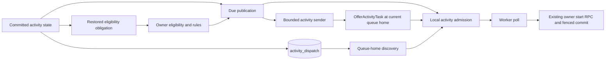

# Design: Activity Queue-Home Delivery

## Overview

Add disposable activity offers to the existing internal transport. The execution owner publishes after commit or
when a restored eligibility obligation becomes due. The queue home acknowledges shared admission; the existing
activity start RPC independently validates and commits. Source facts and checked Temporal behavior are in
[bugfix.md](bugfix.md#evidence-and-reproduction). The pure kernel and authoritative storage contracts are unchanged.

## Dependencies and Non-Goals

| Existing specification | Contract consumed |
| --- | --- |
| [activity-dispatch: Queue-home discovery](../activity-dispatch/design.md#queue-home-discovery-tokeira-runtime) | Canonical rows, complete read-only family traversal and acquisition repair. |
| [activity-dispatch: Offers and eager start](../activity-dispatch/design.md#offers-and-eager-start) | Complete incarnation, receipt protocol, eager exclusion and ordinary start authority. |
| [activity-dispatch: Retry eligibility and workflow rules](../activity-dispatch/design.md#retry-eligibility-and-workflow-rules) | Due-time evaluation and reconstruction; this extends delivery to remote and already-due obligations. |
| [queue-home-delivery: Publication](../queue-home-delivery/design.md#publication-admission-and-acknowledgement) | Nonblocking bounded sender, placement refresh, no admission/start dependency cycle. |
| [queue-home-delivery: Peer authorization and limits](../queue-home-delivery/design.md#peer-authorization-and-limits) | Protected generated credential file, push policy, startup-mode decision, transport and renewal limits. |
| [queue-home-delivery: Ownership](../queue-home-delivery/design.md#ownership-retirement-and-failures) | Generation-scoped retirement and the distinction between lost hints and authoritative starts. |

The [boundaries](bugfix.md#boundaries-and-deferred-work) apply throughout. Reuse introduces no durable format,
migration, row, public field, credential or operator action. Workflow delivery behavior and its budgets remain
unchanged. The activity start wire contract remains unchanged; the additional execution-home hint is volatile
queue-home metadata, not a caller-supplied owner fence.

## Architecture

Admission does not read activity inputs, acquire an execution lane, evaluate mutating workflow rules or await a
start. A reply acknowledges only volatile retention. Discovery neither invokes the sender nor writes rows.
`processActivityTask` releases its workflow lock before matching in
`service/history/transfer_queue_active_task_executor.go @ v1.31.0`; Tokeira likewise separates publication from
start, but uses its canonical row rather than Temporal's matching backlog as the durable recovery representation.

## Components and Interfaces

| Component / representative interface | Responsibility |
| --- | --- |
| Runtime `ActivityQueueOffer::from_state(state, activity, execution_home)` | Build a nonpersistent envelope from the current committed incarnation, then use the existing activity routing resolver. No input/header copy. |
| Runtime `ActivityDelivery::publish(offer, acquisition)` | Local shared admission or immediate bounded sender enqueue; no peer I/O on the publishing lane. |
| Runtime `ActivityOfferSender::try_enqueue(offer, acquisition)` | Queued/coalesced/refused result; coalesce by complete incarnation and captured source acquisition. |
| Runtime `RemoteActivityOfferSink::offer(offer, destination, refresh)` | Provider-agnostic async seam implemented in edge using trusted placement and `PeerChannels`. |
| Edge `ActivityTaskDispatchGrpc::offer_activity_task(request)` | Existing peer push policy, bounded validation, receiver-owned acquisition and activity admission. No recursive forwarding. |
| Runtime `admit_activity_offer(offer, acquisition, source)` | Shared local/push/discovery entry under the activity broker lock. Validate ownership before deduplication and account for bytes as well as slots. |
| Activity retirement worker | Shutdown-tracked cancellation/deadline watchers registered by first admission, reservation or demand, independent of discovery ticks. |

Names identify responsibilities; they do not prescribe an additional abstraction where an existing helper suffices.
The runtime owns scheduling and admission, edge owns transport/authentication, and existing storage owns authority.

### Publication and recovery

The [publication inventory](bugfix.md#publication-inventory) is exhaustive for this change. `publish_routed` uses
its committed image and `route_activity_task_queue` once, preserving the resulting coordinates and revision in
either local or remote delivery. Derive only still-wanted incarnations from the final committed image; skip an
already elapsed schedule deadline rather than creating an invalid hint. First attempts do not acquire a new
schedule-time rule gate; ordinary start keeps its current rule checks. Future eligibility is never admitted early.

Extend the existing `ActivityEligibility` obligation to deliver already-due as well as deferred registrations.
`prepare_activity_dispatch` remains the due-time owner gate. Its validated state supplies routing, priority and
the home hint; it sends through `ActivityDelivery` instead of the local-only broker call. Preserve bounded slices,
deadline wakes, same-incarnation completed descriptors, fresh reads on retry and captured-acquisition checks.
Publication and eligibility may race; shared admission suppresses duplication, and sender completion is never
recorded durably. Do not make every unrelated run transition rearm a completed delivery obligation.

This also covers `commit_activity_retry`, whose direct commit installs tracking but does not call `publish_routed`.
Both failure and timeout retries push once due, including zero backoff or registration after the due time. Existing
rule/timeout suppression remains authoritative. Options updates use their existing kernel enqueue effect and
eligibility tracking; remove their additional direct immediate/delayed publications instead of adding network work
to detached timers. Route every options queue change through the common resolver.

Acquisition repair and staged reset publication restore the same bounded obligations from current state. No
delivery runs while Sweeping or before staged publication becomes visible. After Active, a due obligation wakes
immediately; a future one retains its original due time. Choose this existing eligibility index over a new recovery
sweep. If its activation wake needs wiring, add an activity-only wake; do not alter timeout tracking or workflow
delivery. Discovery remains sufficient even if this reconstruction or every push is interrupted.

### Sender reuse and bounds

Reuse the scheduling mechanism and constants in `workflow_delivery/sender.rs` through an activity adapter with
its own queue/accounting instance: 1,024 retained items, 16 MiB including active work, 32 active calls, eight per
destination, 500 ms per attempt, one second total including queue wait, at most three attempts. Rotate destinations
and publication/recovery sources fairly. Refusal drops only acceleration. Coalescing and retries never extend the
original budget. Capture source acquisition cancellation/deadline; cancel pending work on loss or shutdown.

Choose separate activity accounting over competition for workflow sender capacity, preserving workflow delivery.
Share placement lookup, channel cache, retry/refresh primitives and limits where they fit; exclude sticky fallback
and workflow incarnation logic. Mechanical extraction must preserve existing workflow behavior. If reuse would
require changing that contract, stop and report rather than widening scope.

`NotHome` permits one trusted placement refresh within the same total budget. Transport ambiguity may retry within
that budget; `Full`, `Expired`, `NotDue` and `UNIMPLEMENTED` end this attempt. No endpoint from a response is followed.
Already transmitted hints from a former publisher can be admitted: only the current execution owner's fence can
authorize a start.

### Internal RPC and field policy

Add `OfferActivityTask(OfferActivityTaskRequest) returns (OfferActivityTaskResponse)` to
[ActivityTaskDispatch](../../../proto/tokeira/internal/runtime/v1/activity_dispatch.proto). Choose this service
over a generic task union: activity incarnation and response semantics remain separate, with no workflow RPC change.
An older peer without this method returns gRPC `UNIMPLEMENTED`; discovery covers that delivery. This is internal
method compatibility, not a new claim that all mixed-version deployments are supported.

The proposed field numbers below are local to the new request. Every row is nonpersistent. Required message
presence is validated; unknown protobuf fields follow normal protobuf compatibility, unknown enums do not.

| Field | Validation and interpretation | Failure / effect |
| --- | --- | --- |
| `run_key: bytes = 1` | Exactly 16 UUID bytes, non-nil; current run rechecked at start. | Malformed: `INVALID_ARGUMENT`. |
| `activity_id: string = 2` | Nonempty, bounded by total encoded size; exact slot identity. | Malformed: `INVALID_ARGUMENT`. |
| `schedule_event_id: int64 = 3` | Positive; do not substitute a later activity with the same name. | Malformed: `INVALID_ARGUMENT`; stale incarnation rejected at start. |
| `attempt: uint32 = 4` | Positive, lossless existing attempt representation. | Zero: `INVALID_ARGUMENT`. |
| `stamp: uint64 = 5` | Preserve full width; zero is valid. | Superseded value cannot authorize start. |
| `execution_home: uint32 = 6` | Valid configured home ID; copied from committed state/row. | Out of range: `INVALID_ARGUMENT`; owner derives its own home from loaded authority. |
| `destination_home: uint32 = 7` | Valid home ID; recompute from namespace and queue name and require serving ownership. | Out of range: `INVALID_ARGUMENT`; wrong/non-serving home: `NotHome`. |
| `namespace_id: bytes = 8` | Exactly 16 UUID bytes, non-nil. Start binds it again through worker admission and run state. | Malformed: `INVALID_ARGUMENT`. |
| `selected_queue: OfferQueue = 9` | Required normal activity queue; `name = 1` nonempty; optional `deployment = 2`, `build_id = 3` preserve presence, including present empty values, as existing routing does. | Invalid shape: `INVALID_ARGUMENT`; kind is Activity by method, no sticky/task-kind field. |
| `dispatch_revision: int64 = 10` | Preserve the resolver's signed revision exactly. | Never infer a revision from arrival time; start retains existing routing checks. |
| `dispatch_at: Timestamp = 11` | Required valid original attempt eligibility; seconds/nanos representable by the runtime clock. | Invalid: `INVALID_ARGUMENT`; future: `NotDue`, no retention. |
| `priority: OfferPriority = 12` | Optional existing metadata: `priority_key: int32 = 1`, `fairness_key: string = 2`, `fairness_weight: float = 3`. Preserve absent/default priority and key values without narrowing; zero weight retains unset semantics. Reject nonfinite or negative weights, as existing offer validation does. | Invalid: `INVALID_ARGUMENT`; complete encoded size still bounded. |
| `expires_at: Timestamp = 13` | Required valid absolute hint expiry, after `dispatch_at`; sender chooses at most five seconds from creation, capped by applicable committed schedule deadlines. Receiver clamps to its five-second retention limit. | Invalid shape/order: `INVALID_ARGUMENT`; elapsed: `Expired`. No timeout transition. |

Reuse `OfferQueue` and `OfferPriority` message shapes without changing them. The selected deployment/build and
`dispatch_revision` are the versioning information this activity path already uses. Choose resolved coordinates
over a copied workflow version directive: there is no sticky fallback requiring receiver-side directive operands.
Origin routing uses the same pinned-queue-presence/current/ramping resolver as local publication; stale routing
remains subject to existing start rules and fresh discovery. No new versioning behavior is claimed.

Ordering crosses the wire as priority and fairness inputs plus original eligibility. `DeliveryOrder` is not a
portable sender-assigned fairness position: local publication and discovery supply `order: None`, and the home
assigns its existing fair pass/FIFO tie. Push does the same. Choose home-assigned order over transmitting a foreign
queue's counters; do not use `dispatch_at` to invent a different FIFO policy.

The response has only `outcome = 1`, an activity-specific enum: `UNSPECIFIED = 0` (invalid), `ADMITTED = 1`,
`KNOWN = 2`, `NOT_HOME = 3`, `FULL = 4`, `EXPIRED = 5`, `NOT_DUE = 6`. Unknown values are malformed replies.
`Admitted`/`Known` finish this attempt without removing the dispatch row. Other sender actions are specified above.
There is no redirect endpoint, start result, request ID, publisher epoch, input, header, heartbeat detail or payload.

Use the existing workflow-offer push audience and `PeerOfferEndpoint::enter` policy for this additional exact
method path, with its generated file, signing/renewal, verifier and allowlist. No new audience or credential is
needed. Keep activity-start's separate peer purpose **and** worker admission. Public grants, anonymous mode,
activity-start tokens and outbound-purpose tokens do not authorize a push. Retain 64 KiB requests, 4 KiB replies,
8 KiB authorization metadata and 64 admitted handlers with the existing pre-decode enforcement. No-peer startup
installs no callable push route, sender or credential lifecycle; a request to that absent method is `UNIMPLEMENTED`.

## Data Models and Retirement

`ActivityQueueOffer` wraps the existing `DispatchableActivityTask` with `execution_home`, `dispatch_at` and
`expires_at`. Source identity/priority/revision/due time come from `ActivityDispatchRow` or the equivalent committed
activity; the selected queue comes from the routing resolver. Retained broker metadata carries the home hint into
`ActivityTaskOffer`. Discovery preserves `row.execution_home` instead of losing it through `row.task()`. Rerouting
retains the hint. No field is added to persisted task/state/receipt encodings.

Reuse `ActivityOffers` and its complete incarnation, generation/serial release guards, reservations, 256-per-queue
and 8,192-per-home limits. Add the missing 64 MiB activity hint-byte bound across all local/push/discovery records,
including in-flight records; size refusal never rejects the durable schedule. Scope retention explicitly by home,
acquisition and incarnation so old cleanup cannot affect a replacement or a different colocated home. `Known`
does not extend expiry. Retention ends at the earlier of the existing five-second ready/offer lease and absolute
hint deadline. Lease expiry permits another offer; this is not global exactly-once delivery.

Cancellation already makes `ActivityOffers::take`/`expire` refuse old tokens. What is missing is independent
cleanup, deadline checks and serving-generation checks. Register activity-only watchers using `QueueHome::retired`;
retire that acquisition's ready/in-flight accounting, reservations and registrations/pages under the broker lock.
Admission, reserve and every take/claim recheck `QueueHome::valid` and current serving generation under that lock.
Deadline renewal is reread by the watcher. Replacement cleanup is token-scoped and idempotent; first registration
alone wakes watcher registration. Work already handed to the authoritative start retains the existing poll/receipt
contract; cleanup cannot undo a committed start. No change to in-flight lease extension is needed.

## Reducing start-path reads

`route_activity_start` currently loads the run to derive its home, then the remote owner's
`start_activity_task_inner` loads it again. That latter function computes and directly commits the transition;
normal successful starts do not enter a lane or populate a lane cache. The edge handler adds no run load.

| Conflict-free remote start | Current static count | Provisional target |
| --- | --- | --- |
| Warm execution/admission caches | Queue home 1 + owner 1 = 2 | Queue home 0 + owner 1 = 1 |
| Cold execution/admission caches | Queue home 1 + owner 1 = 2 | Queue home 0 + owner 1 = 1 |

Route directly from the volatile home hint and keep the owner's existing authoritative read. The receiver derives
the actual home from state and verifies serving ownership/fence, namespace, current incarnation and all existing
start gates; a forged hint grants nothing. Placement changes use existing bounded owner attempts. Keep fresh OCC
reloads and same-request replay's separate fenced observation. Do not import workflow's preparation/lane redesign:
the one owner load is already this direct-commit path's floor.

Use the [queue-home counting method](../queue-home-delivery/design.md#counting-method-and-provisional-target):
correlate each logical poll/start across nodes, count every logical `load_run`/`load_run_with_stats` once, and
separately report physical SQL by purpose. Include all failed owner attempts, conflict reloads and any admission
cache misses. Report history input/header reads, registry/rule reads, discovery hydration, publication/recovery
hydration and background reads separately; moving a load out of the start span cannot hide it. Prime caches for
warm cases; use fresh runtimes for cold cases. Measure inline and split state. Same-request replay retains its
observation transaction and is a separate series. Each OCC conflict adds the required fresh owner load.

These counts are source-derived targets, not measured results. Establish the baseline first; if measured required
reads differ, explain the callers and revise the target before implementation. Never remove authorization,
response preflight, incarnation/routing checks, rule observation fencing or receipt validation to meet a budget.

## Dispatch Rules and Model Boundary

All five [durable-actionable-state rules](../../../docs/architecture/042-durable-actionable-state.md#the-five-rules)
hold:

| Rule | Activity push argument |
| --- | --- |
| Durable intent | Existing canonical `activity_dispatch` rows commit with state. Push and acknowledgement write nothing. |
| Level-triggered discovery | Family traversal continues past retained rows and returns to the head with a new cutoff. Loss of every hint remains recoverable under compatible demand and fair available capacity/storage. |
| No consumer contention | Admission, expiration and discovery never update/delete dispatch rows. Owner start/lifecycle transitions keep existing fenced maintenance. |
| One lifecycle authority | Slot `(run, activity)`; incarnation `(schedule event, attempt, stamp)`; discoverer queue home; executor poll through execution owner; remover/replacer authoritative run transition, with existing fenced acquisition repair; retry authority committed attempt schedule; dedup full incarnation within acquisition. |
| Bind outside decisions | Offer carries incarnation/revision; owner reloads and commits with expected sequence and lease fence. Mutating rule/routing decisions retain `ObservedSubmission`'s run/sequence binding. Hint identity or publisher ownership cannot substitute. |

[`40_dispatch_handoff.tla`](../../../spec/tla/40_dispatch_handoff.tla)'s `DeliverNote`/`LoseNote` already model a
disposable activity push under the slot/incarnation mapping in
[activity-dispatch refinement](../../../spec/refinement/activity-dispatch.md). `Discover`, `RetireHome`,
`ExpireLease` and `StartCall` cover the abstract recovery and start-safety obligations. Notifications have no
fairness assumption; prompt push is a concrete test obligation, not a proved latency bound. Authentication, byte
limits, wire compatibility, routing, request receipts and read counts remain outside that model. No model change
or new model-execution claim is required.

## Feature Interactions

| Feature | Activity behavior |
| --- | --- |
| Workflow pause | Canonical derivation excludes paused runs; start suppresses retained hints. Resume publishes only current dispatchable activities, at their existing due times. Kernel `apply_unpause_workflow`; Temporal `ApplyWorkflowExecutionUnpausedEvent` in `service/history/workflow/mutable_state_impl.go @ v1.31.0`. |
| Activity pause | Paused work is not pushed; stale hints cannot defeat owner checks. Unpause/reset produces a new stamped delivery obligation; running/keep-paused reset does not publish a new start. Kernel control functions and `service/history/workflow/activity.go @ v1.31.0`, `PauseActivity`, `UnpauseActivity`, `ResetActivity`. |
| Sticky queues | Activities use their normal activity queue, independent of workflow sticky affinity or its removal. No sticky fields/fallback enter this RPC. `pushActivity` in `service/history/transfer_queue_task_executor_base.go @ v1.31.0`. |
| Transient and speculative workflow tasks | Activity start keeps existing transient-history and speculative-conversion behavior in `start_activity_task_inner`/kernel `start_activity`; it sends no speculative workflow offer. Eager starts selected by completion remain excluded. Existing activity-dispatch start/eager contract applies. |
| Buffered events | Push appends no event. Owner activity start preserves buffering while a workflow task is started and scheduled-input lookup by exact event identity (`start_activity_task_inner`, `read_scheduled_input`). No premature history or payload is returned by admission. |
| Reset | Base-run offers retain the base identity; they cannot start successor work. Staged successor publication restores current activity obligations only after visibility/activation, including copied-history input lookup. `publish_reset`, `track_published_outbound`; Temporal `Rebuild`/`refreshTasksForActivity` anchors in the evidence. |
| Continue-as-new | Closing predecessor makes its rows unwanted and start stale; successor uses its own run key and publishes only activities it schedules. No predecessor offer migrates across runs. Existing `derive_activity_dispatch`, `start_activity_task_inner` and activity-dispatch pair/successor contract apply. |
| Closed runs | Close before start is rejected; close racing commit is resolved by OCC/fencing. An acknowledged offer confers no lifetime extension. Close after committed start retains existing resolution semantics. Temporal `Invoke` in `service/history/api/recordactivitytaskstarted/api.go @ v1.31.0`. |

## Correctness Properties

### Property 1: Prompt delivery with durable recovery

*For any* inventory path and finite fault prefix, due remote work with available transport/capacity SHALL be offered
without discovery; lost/refused pushes SHALL still resolve under a fair suffix with discovery and compatible demand.

**Validates: Requirements 1.1, 1.2, 2.1, 2.2**

### Property 2: Bounded common admission and ordering

*For any* interleaving of local, push and discovery arrivals, THE home SHALL retain at most one incarnation per
acquisition within all byte/count/deadline bounds, ordered by the same routing/priority/fairness policy as local
publication; duplicate arrival SHALL NOT renew its lifetime.

**Validates: Requirements 1.4, 1.5, 1.9, 2.1, 2.4**

### Property 3: Prompt isolated retirement

*For any* cancellation, deadline, replacement or delayed result sequence, THE activity path SHALL refuse old
admission/dequeue immediately and retire old accounting independently of discovery without touching replacements.

**Validates: Requirements 1.6, 1.7, 2.4**

### Property 4: Authorized nonblocking hints

*For any* peer metadata, wire message, owner movement and capacity schedule, THE sender/receiver SHALL enforce
the existing push policy and finite work bounds without waiting for a lane/start; no-peer modes SHALL install
no remote push machinery and all diagnostics SHALL have bounded credential-free labels.

**Validates: Requirements 1.3, 1.5, 1.10, 2.1, 2.6, 2.8**

### Property 5: One authoritative start with fewer reads

*For any* generated incarnation, routing hint, competing poll, cache state and OCC schedule, THE owner SHALL
preserve start/replay safety while achieving the stated conflict-free read budget and reporting every extra load.

**Validates: Requirements 1.8, 2.3, 2.4**

### Property 6: Preservation outside the defect

*For any* local/eager delivery and feature-interaction sequence, THE system SHALL retain existing authoritative
behavior, payloads, workflow delivery and deployment contracts; no eager-started incarnation SHALL be offered.

**Validates: Requirements 1.9, 2.3, 2.5, 2.7, 2.8**

## Error Handling and Diagnostics

| Condition | Internal outcome / gRPC status | Recovery |
| --- | --- | --- |
| Malformed request/enum/timestamp | Invalid / `INVALID_ARGUMENT` | No admission; fix sender. |
| Missing, invalid or expired credential | Authentication / `UNAUTHENTICATED` | Existing local renewal/configuration contract; no public-auth fallback. |
| Verified identity outside push policy | Authentication / `PERMISSION_DENIED` | No admission. |
| Oversize metadata/message/reply or handler exhaustion | Capacity / `RESOURCE_EXHAUSTED` | No unbounded allocation; discovery remains available. |
| Sender or broker byte/count exhaustion | Refused or `Full` | Drop acceleration only. |
| Non-serving/wrong destination | `NotHome` | One trusted refresh in total budget. |
| Hint expired or not yet due | `Expired` or `NotDue` | No admission; existing eligibility/discovery handles current work. |
| Placement/signing/transport unavailable | Routing/authentication/transport / `UNAVAILABLE` | Bounded attempts, then discovery. |
| RPC/total budget elapsed | Deadline / `DEADLINE_EXCEEDED` | Admission uncertain; safe duplicate or discovery. |
| Absent peer method | Unsupported / `UNIMPLEMENTED` | End attempt; discovery, no startup/configuration change. |
| Malformed reply | Invalid / client error | Treat admission as uncertain; bounded attempt then discovery. |
| Stale, suppressed, conflicting or unauthorized start | Existing `ActivityStartOutcome` / start status mapping | Preserve activity-dispatch start/replay behavior; never translate an offer ACK into start success. |

Counters distinguish source (`publication`, `eligibility`, `recovery`, `discovery`, `pushed`), the finite outcomes
above, saturation bound, retirement reason and run-load phase/OCC retry count. No run/activity/worker identifiers,
queue names, credentials or endpoint strings become metric labels. Rate-limited diagnostics may identify a run
and home for investigation, but never log authentication material or payloads.

## Testing Strategy

After review, reproduce the [source-derived cases](bugfix.md#cases-to-execute-after-specification-approval) first.
Required `proptest` coverage runs at least 100 cases **per property**: delivery/eligibility properties in runtime;
admission/retirement/ordering near `activity_offers.rs` and the broker; wire/policy tests in edge; start/read and
preservation tests across runtime/edge. Generate lifecycle sequences, malformed bounded fields, lost replies,
expiry, saturation, takeover and unrelated transitions; retain shrunk failures and independent preservation oracles.

Fixed cases verify exact status/enum boundaries and absent-method behavior. Real multi-runtime internal gRPC tests
use the daemon-generated protected credential file and production authorization path, including token renewal.
Pause discovery only for promptness assertions; restore it for loss recovery. Live DSQL verifies fenced competing
starts/takeover, read counts, complete recovery and canonical-row preservation with the existing suites listed in
[tasks.md](tasks.md). No PostgreSQL substitute, compiled-only body or URL-gated skip counts as live evidence.
