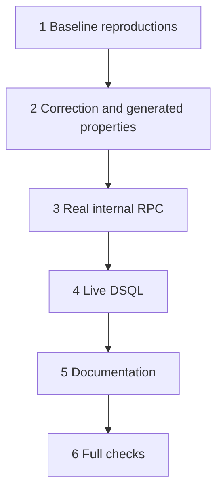

# Implementation Tasks: Activity Queue-Home Delivery

These tasks begin only after specification review. None is executed by this specification change, including the
exploration cases. [bugfix.md](bugfix.md) and [design.md](design.md) define the correction and preservation contract.

- [x] 1. Reproduce on unchanged main before implementation
  - [x] 1.1 Write the bug-condition exploration property for separate execution/queue owners with discovery paused.
    Exercise first schedule, retry/backoff including already-due registration, activity/workflow unpause, activity
    reset, options queue change, timeout retry, staged workflow reset and acquisition recovery. Assert prompt
    delivery and retain failing/shrunk cases before fixing the path.
    - _Requirements: 1.1, 1.2, 1.9, 2.1, 2.2_
    - DONE — Ten exploration properties, one per inventory path, ran 100 generated cases each on unchanged main and
      failed as intended: committed, due activity state never reached the parked remote poll without discovery.
      Each path has a disconnected variant, which passes. Shrunk counterexamples are kept.
  - [x] 1.2 Reproduce acquisition cancellation without discovery cleanup and deadline expiry without cancellation.
    Add replacement-generation/colocated-home controls and warm/cold read counters from dequeue through committed
    remote start. Record each load caller, physical SQL purpose and conflicts separately.
    - _Requirements: 1.6, 1.7, 1.8, 2.4_
    - DONE — On unchanged main, a waiting poll took an expired acquisition's offer; a cancelled acquisition kept its
      ready and in-flight offers; a cancelled registration remained and a paused page's reservation stayed live.
      The replacement and colocated-home controls pass. Over real two-runtime gRPC with in-memory storage, a
      conflict-free remote start loaded the run once at the queue home and once at the owner, warm or cold; one
      OCC conflict added one owner load. The zero-and-one target assertions fail as intended.
  - [x] 1.3 Checkpoint: confirm intended failures and passing preservation controls with clocks/barriers. If a
    defect case unexpectedly passes, recheck its source premise before writing the correction. No sleeps.
    - _Requirements: 1.1, 1.6, 1.7, 1.8, 2.5, 2.7_
    - DONE — Thirteen defect cases and four read-target cases fail for their stated reasons. Local publication,
      discovery recovery, eager non-publication, replacement and colocated-home controls pass.

- [x] 2. Implement the correction with required generated properties
  - [x] 2.1 Add the volatile envelope and `OfferActivityTask` messages/handler with the complete field policy.
    Thread execution-home metadata through local, discovered, pushed and rerouted offers. Reuse placement,
    `PeerChannels`, the existing push audience/credential lifecycle and bounded sender scheduling through an
    activity instance. Keep workflow sender behavior/budgets and the existing start messages unchanged.
    - _Requirements: 1.3, 1.5, 1.8, 1.10, 2.6, 2.8_
    - DONE — `ActivityQueueOffer` carries the execution home, original eligibility and an absolute deadline
      through local, discovered, pushed and rerouted offers. `OfferActivityTask` follows the field table and
      response enum under the existing push purpose and limits; no-peer modes answer `UNIMPLEMENTED`. An activity
      instance of the bounded sender keeps its own accounting, and workflow delivery's tests pass unchanged.
  - [x] 2.2 Route publication and due eligibility through the shared delivery entry. Cover immediate direct retries,
    restored due obligations and post-publication reset activation. Remove the two duplicate options-update broker
    branches. Add activity byte accounting, acquisition watchers and locked validity checks, then remove only the
    queue-home routing load from ordinary starts. Preserve every owner gate and fresh conflict reload.
    - _Requirements: 1.1, 1.2, 1.4, 1.6, 1.7, 1.8, 1.9, 2.1, 2.3, 2.4, 2.5, 2.7_
    - DONE — Publication, retries (including any already due at registration), recovery after activation and a staged
      reset after its barrier deliver through the shared entry, and timeout tracking is unchanged. Options updates no
      longer publish directly. Activity byte accounting, acquisition watchers and locked validity and
      serving-generation checks are in place. A polled start routes from the offer's home hint, so the queue home
      reads no run; a start without a hint, or whose hinted owner refuses it, derives the home as before. The owner
      keeps its read, every gate and the fresh read after a conflict.
  - [x] 2.3 Required PBT — **Property 1: Prompt delivery with durable recovery**, at least 100 generated cases.
    Vary every inventory path, due-at-registration versus future time, finite message/ack loss, unavailable homes,
    restart and saturation. Assert push with discovery paused; separately assert recovery with discovery driven.
    Check unchanged canonical rows on all offer-only outcomes and completed-obligation suppression on unrelated
    transitions. Place in runtime delivery/eligibility tests.
    - _Requirements: 1.1, 1.2, 2.1, 2.2_
    - DONE — Each inventory path pushes with discovery paused, and its disconnected control still shows no delivery.
      Generated fault prefixes cover loss before and after admission, refusal, `UNIMPLEMENTED`, `NotHome` and
      restart, and recovery runs with discovery driven. Canonical rows are unchanged after every admission outcome
      and sender error, and a signal does not rearm a completed obligation.
  - [x] 2.4 Required PBT — **Property 2: Bounded common admission and ordering**, at least 100 generated cases.
    Race local/push/discovery, expiry and delayed callbacks; exhaust each count/byte limit. Compare selections with
    existing local broker ordering under generated priority/fairness/rate configuration and versioned queues.
    Cover options routing changes, unchanged duplicate deadlines and rediscovery after expiry. Place near the
    activity broker/offer index; do not change priority comparison semantics.
    - _Requirements: 1.4, 1.5, 1.9, 2.1, 2.4_
    - DONE — Racing local, pushed and discovered arrivals admit one incarnation and select in the same order as an
      independent unmanaged broker, under generated priority, fairness, rate and versioned queues. The per-queue,
      per-home and byte bounds each fill and refuse, in-flight work included. Rerouting stays within them, and a
      duplicate never renews a deadline.
  - [x] 2.5 Required PBT — **Property 3: Prompt isolated retirement**, at least 100 generated cases.
    Cancel/expire/renew acquisitions while paused at admission, page-read, take and cleanup barriers. Verify ready,
    in-flight and reserved accounting is isolated from replacement generations and other homes without a tick.
    Include push-only homes with no poll registration and late token/reservation drops. Place in runtime.
    - _Requirements: 1.6, 1.7, 2.4_
    - DONE — Cancellation, expiry and renewal at the admission, reserve, take, page-read and cleanup barriers retire
      the ended acquisition's ready, in-flight and reserved accounting without a tick. Replacements, colocated homes
      and push-only homes keep their own, and late tokens and reservations change nothing.
  - [x] 2.6 Required PBT — **Property 4: Authorized nonblocking hints**, at least 100 generated cases.
    Generate bounded wire/metadata mutations, wrong-purpose identities, unknown enums, handler/sender saturation,
    placement changes and cancellation. Hold the publishing lane behind a barrier until ACK to expose any
    admission/start dependency. Exercise no-peer bootstrap without a file and finite diagnostics. Place in edge
    and runtime sender tests; fixed unit cases assert exact statuses and absent-method behavior.
    - _Requirements: 1.3, 1.5, 1.10, 2.1, 2.6, 2.8_
    - DONE — Generated wire, metadata and identity mutations meet the existing push policy with exact statuses,
      including handler saturation at 64. The sender keeps its entry, byte, concurrency and destination bounds, one
      trusted refresh and three attempts. Owner movement, cancellation and the no-peer bootstrap are covered, the
      publishing lane stays blocked until the acknowledgement, and diagnostics carry only bounded labels.
  - [x] 2.7 Required PBT — **Property 5: One authoritative start with fewer reads**, at least 100 generated cases.
    Generate forged home/namespace/queue/version coordinates, obsolete schedules/attempts/stamps, concurrent
    controls, competing starts, lost committed replies, warm/cold caches and OCC conflicts. Assert one committed
    start and unchanged replay/authorization/response limits. Attribute all reads, including retries and separate
    receipt observation; revise an unsupported target before removing checks. Place in runtime/edge.
    - _Requirements: 1.8, 2.3, 2.4_
    - DONE — Generated cases cover valid, forged and missing home hints, forged coordinates and credentials, obsolete
      incarnations, concurrent controls, competing starts, lost replies, warm and cold caches and conflicts. Each
      commits one start and attributes every read. A hinted start reads the run once, at its owner, plus once per
      conflict. A refused hint costs one extra owner read and then routes as before, and replay keeps its separate
      observation. Over two runtimes, the queue home reads no run and the owner reads it once, or twice with a
      conflict, warm or cold.
  - [x] 2.8 Required PBT — **Property 6: Preservation outside the defect**, at least 100 generated cases.
    Cover all eight feature interactions, eager nonpublication (including lost completion response), exact input/
    header/heartbeat payloads, local priority/rates, scoped workers and no-peer modes. Re-run affected workflow
    delivery regressions to detect changes from shared-mechanism extraction. Place in runtime/edge/engine.
    - _Requirements: 1.9, 2.3, 2.5, 2.7, 2.8_
    - DONE — Generated cases cover the eight feature interactions, eager starts with a lost completion response, exact
      input, header and heartbeat payloads, running and kept-paused resets, scoped workers and no-peer modes. Local
      priority and rate tests and the workflow-delivery regressions pass unchanged.
  - [x] 2.9 Checkpoint: focused checks pass; exploration cases now pass and deliberate disconnected controls still
    fail for the intended reason. All six properties have at least 100 executed cases with useful shrinking.
    Verify no durable/schema/public/credential/operator contract or workflow-delivery behavior changed.
    - _Requirements: 1.1, 1.4, 1.6, 1.8, 2.1, 2.7, 2.8_
    - DONE — Every exploration case passes, the disconnected controls still deliver nothing, and all six properties
      run at least 100 cases. Against the base commit, durable formats, schemas, public protos, credentials,
      configuration, operator steps and workflow-task delivery are unchanged; the only proto addition is the internal
      `OfferActivityTask` RPC.

- [x] 3. Exercise real multi-node internal RPCs
  - [x] 3.1 Use at least two runtimes with separate execution/queue homes, real internal gRPC and the protected
    credential file emitted by the existing daemon generator. Start without an external identity provider and
    continue across token renewal. Prove prompt first/retry/control/recovery delivery with discovery paused.
    Verify successful ACK while execution start is blocked, then complete the ordinary authenticated start.
    - _Requirements: 1.1, 1.2, 1.3, 1.5, 2.3, 2.6, 2.8_
    - DONE — Two runtimes over real internal gRPC, using the generated credential file and no external identity
      provider, push and start a first attempt, a retry, an unpaused activity and due work recovered after a restart,
      all with discovery paused. Pushes and starts continue after the token lifetime passes, an expired token is
      refused and the credential file is unchanged. The queue home acknowledges a push while the owner's start is
      held, and the start then completes once.
  - [x] 3.2 Add a third runtime for queue/owner movement and old/new acquisition overlap. Independently drop push,
    ACK and start reply; exercise old-peer `UNIMPLEMENTED`, wrong-purpose/public credentials, saturation and prompt
    retirement. Resume discovery for recovery; retain stable start request identity on ambiguous starts. Repeat
    the warm/cold read matrix across actual transport, separating all background and publication reads.
    - _Requirements: 1.4, 1.6, 1.7, 1.8, 1.10, 2.2, 2.3, 2.4_
    - DONE — With a third runtime and overlapping acquisitions, a queue-home move retires the old home's offers and
      reaches the new home after one trusted refresh, and an execution-home move keeps starts fenced with a stable
      retry identity; each commits one start, at 100 generated cases each. A lost push or ACK is recovered once
      discovery resumes, and a lost start reply is retried with the same request identity and replayed. An old peer
      answers `UNIMPLEMENTED`, wrong-purpose credentials `PERMISSION_DENIED` and public credentials `UNAUTHENTICATED`;
      with the 64 handler permits held by workflow pushes, an activity push gets `RESOURCE_EXHAUSTED`. None of them
      admits anything, and discovery recovers each. Retirement is prompt and leaves a replacement and other homes
      alone. Over real transport, warm or cold, the start reads no run at the queue home and reads it once at the
      owner, or twice with a conflict; publication and background reads are counted separately.
  - [x] 3.3 Checkpoint: real transport outcomes match property oracles and all affected focused suites pass.
    - _Requirements: 1.1, 1.3, 1.8, 2.3, 2.7_
    - DONE — The transport outcomes match the properties' oracles, and the runtime, edge, engine and proto suites
      pass, including the workflow push's transport tests, unchanged.

- [ ] 4. Execute live DSQL verification
  - [ ] 4.1 Follow [live-suite isolation/ordering](../../../docs/testing/dsql-live-suites.md) and
    [activity-dispatch selections](../../../docs/testing/activity-dispatch-verification.md#reproducible-selections).
    Run affected atomic/pair/staged/derivation, ordered/malformed-page, repair and replay-observation selections;
    retain exact production discovery-query plans to ensure fallback remains bounded. Run
    `activity_dispatch_live_acquisition_spans_recovery_pages` on its isolated empty database for restored due/future
    obligations. Preserve placement-before-live-leases ordering and existing physical limits.
    - _Requirements: 1.2, 2.1, 2.2, 2.3, 2.7, 2.8_
  - [ ] 4.2 Extend `activity_dispatch_live_read_counts` on a separate isolated database for pushed/discovered
    starts, warm/cold runtimes, inline/split state, conflict and receipt replay. Add real-RPC activity-push
    competing-start/takeover cases using the existing DSQL fence and generated credentials; run at least 100
    generated schedules for Properties 1, 3 and 5 against DSQL. Run the affected `dsql_activity_inputs` and
    `activity_dispatch_live_lost_publication_offered_by_next_pass` regressions.
    - _Requirements: 1.1, 1.6, 1.7, 1.8, 2.2, 2.3, 2.4_
  - [ ] 4.3 Checkpoint: prove every selected live body ran; retain query/read reports, failures/skips and cleanup
    evidence without credentials or live-run identifiers. A missing URL, skipped body or PostgreSQL run is no
    substitute. Clean owned fixtures/resources under the runbook.
    - _Requirements: 1.8, 1.10, 2.1, 2.2, 2.8_

- [ ] 5. Align documents with implementation
  - [ ] 5.1 Update [task-types.md](../../../docs/conformance/task-types.md)'s `ACTIVITY_TASK` row with prompt owner
    push, discovery backup, complete incarnation/start gates and Temporal's task-version check. Align its
    `ACTIVITY_RETRY_TIMER` row with due-time eligibility push. Update activity-dispatch's publication, retirement,
    recovery and start-read descriptions, the internal RPC contract, verification matrix and live-suite entries.
    Record measured counts and limitations; no new credential installation or rollout step.
    - _Requirements: 1.1, 1.2, 1.6, 1.8, 2.2, 2.8_

- [ ] 6. Run the full implementation checks
  - [ ] 6.1 Run the repository enforced bar: nightly formatting, locked workspace lint/check/nextest, locked
    doctests and warning-denied workspace documentation. Run applicable focused/live checks and offline Markdown
    links/whitespace. Report exact selections, outcomes and omissions; complete the traceability/field-policy
    quality gate. This task is for implementation, not this document-only change.
    - _Requirements: 1.1, 1.2, 1.3, 1.4, 1.5, 1.6, 1.7, 1.8, 1.9, 1.10, 2.1, 2.2, 2.3, 2.4, 2.5, 2.6, 2.7, 2.8_

## Task Dependency Graph

## Notes

- Every property test is required and uses `proptest` with at least 100 cases. Tag each with
  `// Feature: activity-queue-home-delivery, Property N: <title>` matching the design.
- Preserve independent source/clock/barrier controls so a discovery success cannot masquerade as prompt push.
- Read applicable crate contracts before implementation. Stop on any scope expansion listed in the bugfix boundary.
- Specification validation is only offline links, whitespace and the specification quality gate. No build, test,
  exploration execution, model execution, live database activity or changelog fragment belongs to this change.
