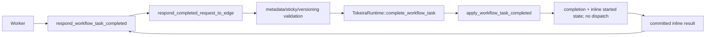

# Design Document: Workflow Task Completion API Conformance

## Overview

This design completes `RespondWorkflowTaskCompleted` by implementing completion metadata, sticky behavior, metering metadata, and worker deployment/versioning *preservation*, plus return-new-WFT semantics. Command application remains in the pure kernel; transport metadata is translated at the edge and runtime boundary. Field accounting is anchored to the v1.62.11 proto and behaviour to Temporal server tag `v1.31.0` (AGENTS.md §8).

## Dependencies and Non-Goals

- Sticky attributes update runtime sticky routing state and are included in subsequent dispatch decisions.
- `deployment_options` (current) and `versioning_behavior` are persisted as durable worker deployment/versioning metadata. **Applying** them to dispatch routing is owned by `worker-deployments`; this spec only preserves and threads them. Deprecated fields remain accepted; the structured worker stamp is also an operand of the pinned inline-start compatibility gate.
- `capabilities.discard_speculative_workflow_task_with_events` is preserved for the `speculative-wft` feature; this spec does not implement speculative-WFT discard behavior.
- `messages` is the update protocol transport, shared with `api-conformance-update-lifecycle`; this spec preserves it and does not own update semantics.
- `worker_instance_key` and `worker_control_task_queue` are left default; they belong to worker lifecycle/heartbeat and Nexus task transport respectively.
- Metering metadata is informational and is persisted with completion history metadata.
- Return-new-WFT follows the full pinned normal/speculative selection; the separately supported query-only response keeps its own quiescence guard.

## Return-New-WFT Safety

A real returned WFT starts as part of the completion's own authoritative transition,
for the completing worker on the new task's queue. `ReturnNewWorkflowTask` plus a
successful completion bypasses task generation; forced heartbeats, buffered events,
cancellation and deployment-transition work determine whether a Normal follow-up is
needed, while outgoing updates alone can select Speculative. A false return flag or
failed completion converts a speculative candidate to Normal. For Normal tasks,
a versioned stamp differing from a nonempty assigned build ID or an ongoing
deployment transition disables bypass. Old stamp-only versioning passes no stamp
to the inline start (`service/history/api/respondworkflowtaskcompleted/api.go:512-600 @ v1.31.0`).

Remove the edge's post-commit `try_claim_workflow_task`. No normal-queue or sticky
poll may observe the task before this decision. Suppress its enqueue operation;
final started state derives no workflow dispatch row. Reuse pure WFT-start logic
inside the completion builder so attempt, logical sequence, advice, event IDs,
identity and timeout tracking have one authority. Return an explicit started-task
result through runtime completion and the edge adapter rather than reloading and
claiming a possibly newer pending task.

**Speculative mapping.** Temporal schedules/starts a speculative follow-up after
persisting mutable state (`api.go:702-725 @ v1.31.0`), with virtual events. Tokeira
already persists speculative pending state and reconstructs its timers on reload
([speculative-wft](../speculative-wft/design.md)). Since the inline start happens in
the completion's own transition, Tokeira keeps that choice: the completion stores
the started speculative pending state atomically but emits no speculative
Scheduled/Started history until materialization. Build/expose its response only
after successful persistence. This is not a claim that Temporal persists
speculative starts. Verify rejection-only discard, reset-history pointer, timeout
conversion and owner reload; do not introduce a second public start or a broker
race to mimic the physical order.

**Response barriers.** Use the committed result, incremental history and
`is_sticky_match=true` for inline delivery even without a sticky poll
(`api.go:747-773 @ v1.31.0`). The recorded queue is still the new task's actual
queue. Reuse `decorate_workflow_task_response` only after completion-side update
resolution/reject-unprocessed processing; do not resend Sent updates on heartbeat
or unblock queries across an unfinished real WFT. Scope checks select inline work
before commit; provenance registration still precedes token exposure. A failed
provenance write or lost response leaves the task started for timeout recovery.

Heartbeat-only detection and the fixed limit belong to
[transient-wft Item C](../transient-wft/design.md#item-c--completion-heartbeat-limit).
Its timeout result must be a committed outcome mapped to NotFound, not a kernel
rejection that rolls back the timeout. The timeout successor follows Requirement 3
but is not returned; Item C specifies sticky reapplication, its fresh original
schedule time, update/query barriers and its subsequent start-to-close timeout.

## Architecture

## Components and Interfaces

- `crates/tokeira-edge/src/grpc/translate.rs`: preserve proto metadata fields using free translation functions, including `deployment_options`, `versioning_behavior`, `metering_metadata`, `sticky_attributes`, and `capabilities`.
- `crates/tokeira-edge/src/translate/to_internal.rs`: thread `sdk_metadata`, `metering_metadata`, current `deployment_options`/`versioning_behavior`, and the deprecated back-compat fields into kernel request DTOs.
- `crates/tokeira-kernel/src/command.rs`: carry metadata in `WorkflowTaskCompletedRequest`.
- `crates/tokeira-kernel/src/event.rs`: persist supported metadata in `WorkflowTaskCompleted`.
- `crates/tokeira-kernel/src/state.rs`: persist sticky attributes and deployment/versioning metadata needed for future dispatch (routing application owned by `worker-deployments`).
- `crates/tokeira-runtime/src/runtime/workflow_task.rs`: prepare inline operands and build committed results; `lane.rs` preserves per-run serialization, commit/publication ordering and timeout tracking. Reuse existing worker-deployment state for the eligibility gate.
- `crates/tokeira-edge/src/grpc/runtime_adapter.rs` and `workflow_service.rs`: carry the committed started-task result, remove the inline claim and preserve history decoration/provenance.
- `crates/tokeira-storage/src/workflow_dispatch.rs`: retain final-state derivation that excludes started/speculative tasks; prove the same invariant across memory, DSQL and repair.

## Data Models

The completion-inline amendment adds explicit request operands for inline intent,
authorization/routing, raw command/message emptiness and resolved heartbeat policy,
plus a result carrying committed started tasks or committed heartbeat timeout.
These are separate from the historical metadata additions below. Never append a
new field to a frozen postcard history variant merely to communicate the result.
The original-schedule state extension is owned by transient-wft Item C.

- `WorkflowTaskCompletedRequest` (`command.rs`): gains optional `sdk_metadata`, `metering_metadata`, `deployment_options`, and `versioning_behavior` fields alongside the existing token/commands/identity. Deprecated `worker_version_stamp.build_id` is retained for back-compat. All additions use `#[serde(default)]` for backward-compatible deserialization.
- `HistoryEventKind::WorkflowTaskCompleted` (`event.rs`): gains durable slots for `sdk_metadata`, `metering_metadata`, and the current deployment/versioning metadata so describe/history can reconstruct them.
- `WorkflowState` (`state.rs`): gains sticky-attribute state and deployment/versioning metadata. Sticky routing is consumed by the runtime; deployment/versioning metadata is stored for `worker-deployments` to apply.
- Sticky/deployment fields are kernel-internal durable envelope state; routing *application* is not modeled here.

## Correctness Properties

### Property 1: Metadata Fidelity

For any accepted completion metadata (`sdk_metadata`, `metering_metadata`, `deployment_options`, `versioning_behavior`), the emitted `WorkflowTaskCompleted` history event preserves the same value.

**Validates: Requirements 1.1, 1.2, 1.3**

### Property 2: Sticky Routing and Versioning Preservation

For any accepted `sticky_attributes`, committed state and subsequent workflow task dispatch reflect the sticky routing. For any accepted `versioning_behavior` / `deployment_options`, the durable state/history preserves the authored value (dispatch application is owned by `worker-deployments` and is not asserted here).

**Validates: Requirements 2.1, 2.2, 2.4**

### Property 3: Return-New-WFT Safety

*For any* completion, follow-up reason, worker stamp, deployment transition and competing poll trace, a real inline WFT SHALL be started only by the completion transition, have no dispatch row or offer, and remain unavailable to polls after response loss. The result SHALL obey Requirements 3.1–3.11, including speculative virtual history and query/update barriers.

**Validates: Requirements 3.1–3.11**

## Error Handling

| Condition | Error | gRPC status |
|---|---|---|
| Malformed task token | proto conversion error | `INVALID_ARGUMENT` |
| Unknown `versioning_behavior` enum | bad request | `INVALID_ARGUMENT` |
| Invalid sticky field | bad request | `INVALID_ARGUMENT` |
| Not shard owner | runtime not-owner | existing mapped status |

## Testing Strategy

- Translator tests for every metadata field across the full v1.62.11 message (20 fields), driven by the proto rather than `UNSUPPORTED_FIELDS.md`.
- Kernel tests for emitted history metadata (`sdk_metadata`, `metering_metadata`, `deployment_options`, `versioning_behavior`).
- A parked normal-queue poll from another worker must not take the inline follow-up, including a local-activity heartbeat; force the old publication-before-claim window and record failure on `main` first. With the return flag false, the poll must receive ordinary work. A publish-then-claim negative control must fail the corrected test.
- Required Property 3 PBT (at least 100 cases) over flags, follow-up causes, stamps, transitions and polls, with commit-count and no-row/no-offer oracles; test speculative discard/materialization, mismatch, transition and failed completion explicitly.
- Query/update barrier, sticky/no-sticky-poller, token/history, lost-response timeout and owner-reload tests.
- Property tests for metadata fidelity, sticky/versioning preservation, and token validation.
- Deprecated-field tests preserve metadata and exercise the structured stamp’s guarded inline compatibility decision.
- Restart/recovery tests for sticky and deployment/versioning metadata.

## Implementation risks to verify

- `WorkflowState.build_id` and `WorkflowVersioningInfo` are not named like Temporal's
  assigned-build state. Preserve the distinction between assigned build ID, most
  recent old worker stamp and deployment version when implementing the predicate;
  do not treat every V3 deployment as old build-ID versioning.
- `use_workflow_build_id` is currently dropped by activity command translation.
  Add a faithful operand and verify queue defaulting before eligibility, including
  the pinned invalid cross-queue compatible-version case.
- The activity-start receipt is currently appended by runtime after a separate
  kernel start. Completion-inline starts must record the same accepted identity
  atomically and retain it for transient started-event materialization; counting
  visible Started events alone cannot prove one start per attempt.
- Optional scope and response admission must bind the actual normalized target
  inside the serialized completion. A stale preflight target must not authorize
  a different queue/version after an OCC retry. Timeout tracking must use final
  started state even though no enqueue publication occurs.
- History-only rebuild cannot generally infer heartbeat-chain origins from legacy
  completion events, especially messages that emitted no history. Preserve the
  absent-time exception rather than guessing; verify reset/fork clock treatment
  against the pinned lineage behavior before changing replay.

## Related-document audit

The completion correction also updates the activity-inputs-from-history design,
workflow-rules requirements/design/tasks, edge-complete-implementation requirements,
scoped-worker-authorization design, speculative-wft requirements/design, and the
delivery-broker-simulator requirements (its Direct_Claim model no longer claims
completion-inline coverage).

Historical evidence is retained unchanged in `docs/testing/activity-dispatch-verification.md`
(the common ordinary/eager start checks), `docs/readiness/conformance.md` (the prior
sticky-queue inline claim and eager-rule checks), and `docs/readiness/corpus-evidence.md`
(the heartbeat exclusion). Those records need new executed evidence in the code
step, not a rewrite of old results. `docs/crates/runtime.md`'s command-sourced eager
payload statement remains valid; `docs/architecture/042-durable-actionable-state.md`
already excludes eager work from dispatch rows. The simulator's Tier A publish-time
reserved-poller match and reserved-poll-handoff's workflow-start mechanism are other
paths and remain unchanged. Generated configuration records remain unchanged.
