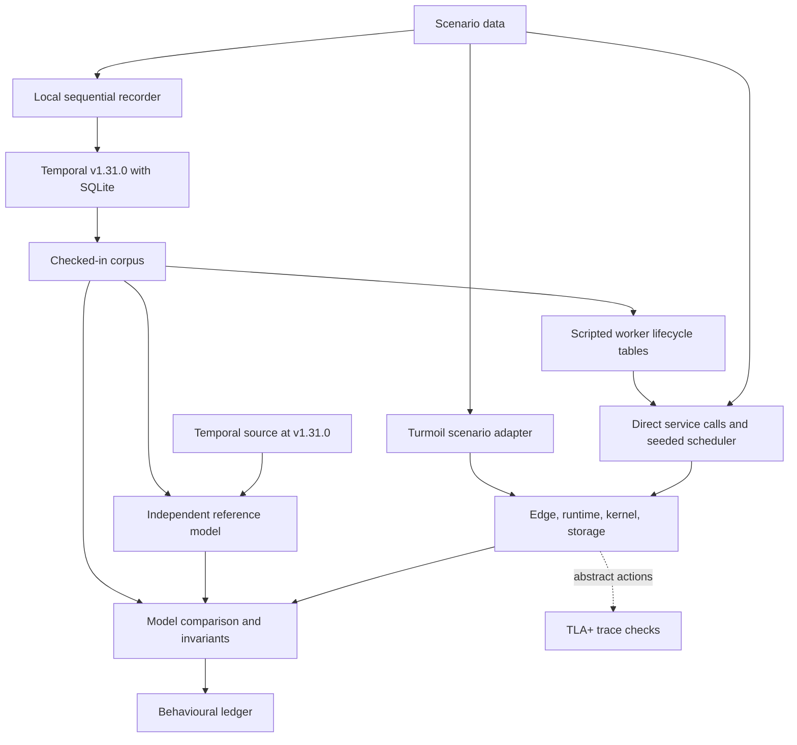

# Design Document: Behavioural Conformance

## 1. Overview

Behavioural conformance checks Tokeira against Temporal v1.31.0 as calls, time,
and background work interleave. This is Tier 1. It uses an independent reference
model, recorded Temporal runs, and invariants. The target remains
`TEMPORAL_SERVER_COMPAT = 1.31.0`; the vendored wire API remains `v1.62.11`.
The pins live in `crates/tokeira-build-info/src/pinned.rs`.

The contract has four parts:

- Sequential: responses and histories match the target for the same actions.
- Concurrent: overlapping calls admit an order that preserves completed-before-started
  relationships and produces the target's observable results.
- Durable: acknowledged changes survive crashes and ownership moves.
- Live: with finite execution timeouts, advancing time, and fair delivery, runs close
  and tasks are delivered or time out.

Describe is checked at each committed state. Eventually consistent List and Count
are checked after quiescence. Status codes and typed error details are exact.
Message text is exact where a cited rule makes it part of the client contract.

Wire shape comes from `proto/upstream/`. Behaviour comes from source read at
`v1.31.0`. Every expectation identifies its source, including rejection expectations.
The [conformance definition](../../../docs/conformance/v1.31.0/README.md) sets the
scope; this specification defines how to measure it. It contains no findings ledger.

## 2. Architecture and boundaries

Two workspace crates are planned:

- `crates/tokeira-behaviour-model/`: pure reference decisions and the observable
  reference state machine. Reference functions live here from the start.
- `crates/tokeira-behaviour-harness/`: scenarios, adapters, scheduler, scripted worker,
  checks, recorder, corpus reader, coverage, ledger rendering, and a local runner.

Both paths are planned. All module and artifact paths beneath them below are planned.
The model may depend on upstream API types from `tokeira-proto` and basic value
libraries. It never imports Tokeira's kernel, runtime, edge, storage, or compatibility
policy. The harness may import the real stack and compatibility metadata. Runtime
and store support is feature-gated as `test-support`; it is absent from production
builds. No harness mechanism belongs in the pure kernel.

### Five layers, in build order

| Layer | Check | Execution |
|---|---|---|
| L1: decision oracles | Every branch and boundary of a decision against a pure model function | Every PR; local mutation runs |
| L2: generated interleavings | Real edge, runtime, kernel, and in-memory storage against the model and invariants | Every PR with fixed area budgets; longer local runs |
| L3: differential runs | Sequential scenarios on Temporal and Tokeira; recordings validate the model and worker first | Local recording; checked-in corpus replay on every PR |
| L4: simulation faults | The same scenarios through the turmoil adapter, with crashes, partitions, lease stalls, and moves | Local seeded campaigns |
| L5: TLA+ trace checks | Abstract engine actions against existing TLA+ models | Optional last layer; local chosen seeds |

### Relationship to Tier 2

Tier 2 stays as specified in
[temporal-functional-conformance](../temporal-functional-conformance/design.md)
and its [runbook](../../../docs/testing/functional-conformance-harness.md).
It runs Temporal's own Go functional suites against `tokeirad` over gRPC through
the fork. Its assertions and outcome classification remain its own. Both tiers
consume the existing `FEATURE_MATRIX`. Tier 1 adds generated interleavings and
independent oracles; it does not replace Tier 2's transport and full-suite evidence.
Histories and responses from those suites run on Temporal v1.31.0 may join the
recorded corpus with their provenance. Tier 2 does not run inside Tier 1.

No SDK or external workload generator runs inside the harness. The scripted worker,
scenario language, recorder, and corpus format are original implementations.
`proptest-state-machine` supplies generation and shrinking; `cargo-mutants` measures
oracle strength locally. The turmoil workspace keeps its separate lock file.
Thread races wholly inside one store call, throughput measurement, and SDK-specific
replay suites are outside this design.

### Existing seams

| Existing repository source | Use |
|---|---|
| `crates/tokeira-edge/src/grpc/workflow_service.rs` and `operator_service.rs` in that directory | `WorkflowServiceGrpc` and `OperatorServiceGrpc` implement the service traits |
| `crates/tokeira-runtime/src/runtime/repair_tests.rs` | Named store pause points provide the scheduler precedent |
| `crates/tokeira-runtime/src/test_clock.rs` | Fixed-epoch clock follows paused Tokio time; currently crate-private |
| `crates/tokeira-runtime/src/scanner.rs`, `timeout.rs`, `activity_timeout.rs`, `activity_eligibility.rs` | Crate-private scanner passes to expose through test support |
| `crates/tokeira-runtime/src/chasm/` and `crates/tokeira-runtime/src/task_queue_config.rs` | Repair, sweep, rebuild, and refresh passes |
| `crates/tokeira-compatibility/src/matrix.rs` and `crates/tokeira-compatibility/src/coverage/` | Existing feature claims and RPC resolution |
| `tools/simulation/turmoil/` and `spec/tla/` | Fault execution and abstract safety models |
| `docs/architecture/042-durable-actionable-state.md` | Durable discovery, commit rechecks, and row lifecycle authority |

## 3. Reference model and decision rules

The model implements observable behaviour, not Temporal's service topology. Its
inputs are upstream requests, worker responses, explicit time, and observable state.
Its output is a response or error, emitted events, and the next observable state.
Pure decisions include retry, backoff, timeout selection, cancellation, activity
pause/unpause/reset, ID reuse/conflict, parent close policy, and schedule overlap
and catch-up. Runtime decisions spread across modules use an in-memory runtime
fixture driven against the same pure reference result.

Proposed interfaces, all planned:

| Interface | Contract |
|---|---|
| `ReferenceModel::apply(state, action, now) -> ExpectedTransition` | Pure; emits response, events, and next state with contributing rule keys |
| `decision(input) -> Decision` | Total over the declared input domain; exact boundary arithmetic |
| `RuleCatalog::validate(source_index) -> Result` | Rejects missing or invalid citations and duplicate rule keys |
| `ModelCoverage::supports(action, state) -> Support` | Explicitly distinguishes calibrated, source-only, and invariants-only coverage |

A rule record contains `key`, `area`, input domain, precondition, decision table or
state transition, observable outputs, source function, source path, inclusive line
range, tag, source-content digest, and either corpus case keys or the reason no
recording can reach the rule. Every row of a decision table has evidence. Wire fields cite the vendored proto path and field. Source
citations use `path:lines @ v1.31.0`; line ranges must exist at that tag. The cited
text must support the rule, not merely contain a matching function name.

The source index records the resolved tag commit, each cited file's line count and
content digest, and the digest of each cited range. It is generated from the tag
when rules change. Local validation reads the source; CI validates the checked-in
index and corpus without building Temporal. A hand-edited index is not source evidence.

`ModelState` contains namespace/configuration values, current-run bindings, execution
lineages, per-run status and history, workflow-task state, buffered inputs, pending
activity/timer/child/update/Nexus maps, deduplication identities, and logical deadlines.
Queue, schedule, and visibility state describe observable results only. They do not
mirror lanes, durable row layouts, or internal dispatch queues. `ExpectedTransition`
contains the call outcome, ordered events per run, next state, and contributing rule
keys. Fields representing public values retain their upstream message shape; model
bookkeeping uses stable logical labels and ordered collections. State for an area is
added with that area's source-derived rules, never guessed from storage snapshots.

Model rules come from v1.31.0 source alone. They are authored independently of
Tokeira implementations and specifications and enter separately from engine fixes.
Corpus calibration is a prerequisite for using a rule or lifecycle table to judge
Tokeira. Before recordings exist, L1 results are provisional and cannot count as
calibrated behavioural evidence. The exception is a source-only rule: one whose inputs
no recording can reach, such as an exact instant (§8). It judges Tokeira on its cited
source alone, states why no recording can reach it, and its evidence keeps the
source-only label. If a recording later reaches it, it needs calibration like any other
rule. Missing model coverage is visible as invariants-only; it is never a successful
model comparison.

For example, `activity.retry-window` admits a next attempt at the expiration instant
and stops only if its calculated start is later:
`service/history/workflow/retry.go:96-112 @ v1.31.0`.
The cancellation and pause precedence table comes from
`service/history/workflow/mutable_state_impl.go:6243-6319 @ v1.31.0`.
The model states these rules independently; it does not copy upstream implementation.

## 4. Scenario language and replay artifact

A versioned `Scenario` contains `key`, `area`, setup, workflow programs, steps,
feature pairs to cover, sometimes predicates, rule keys, and a finite drain policy.
Setup names namespaces, search attributes, queues, feature modes, finite execution
timeouts, and deterministic identity bindings. Requests use upstream message types.
A typed request variant exists for every descriptor method, including negative cases.

| Step | Fields and meaning |
|---|---|
| `Call` | Call handle, RPC key, request, metadata, and logical references to earlier results |
| `Poll` | Worker handle, workflow/activity/Nexus kind, queue, finite deadline; retains the returned task |
| `Respond` | Held-task handle and completion, failure, cancellation, or protocol response |
| `Heartbeat` | Activity handle, details, and cancellation behaviour |
| `Advance` | Nonnegative duration or next deadline; the only source of logical time advancement |
| `Pass` | One scanner, discovery, repair, sweep, rebuild, refresh, outbound, or projection pass |
| `Overlap` | Two or more finite child actions with a common launch barrier and separate completion records |
| `Quiesce` | Bounded fair passes and advances until the declared observation condition holds |

Poll and respond are separate steps. A held task may be left unanswered. Invalid
requests are explicit negative cases; generation otherwise respects state, such as
responding only to a held token. Overlaps can contain client calls, worker responses,
or passes. A blocking call may remain pending while subsequent steps act on the run.
All pending work has a deadline and is drained or cancelled at teardown.

Workflow programs are data. Their instructions cover activities, timers, waiting for
signals, accepting/rejecting/completing updates, children and parent close policies,
external signals and cancels, Nexus operations, search-attribute upserts, memo changes,
markers, continue-as-new, and complete/fail/cancel. Queries read replayed state.
Several commands may be emitted in one workflow task.

Each command declares whether to wait for completion, wait only for start, abandon,
or cancel before start, after start, or after completion. A later instruction can
wait for all outstanding commands. Activity cancellation supports try-cancel,
wait-for-completion, and abandon. Children also support wait-for-cancel-requested.
An activity attempt can complete, fail retryably or non-retryably, set a next retry
delay, heartbeat then stop, ignore cancellation, or never answer. Nexus handlers can
start, signal, update, or query workflows, use signal-with-start, or start activities.
These are worker-program choices; they are not extra server API fields.

`proptest-state-machine` generates valid steps from model state. Shrinking removes
steps, simplifies arguments and programs, shortens overlaps, and shrinks scheduler
choices toward zero. It rechecks preconditions and never leaves dangling handles.
A candidate is retained only if the same failure class and rule or invariant key
still fail. A deadlock cannot replace a history mismatch during shrinking.

A `ReplayCase` stores format version, engine and harness revisions, model/corpus
fingerprints, feature mode, generator version, root seed, explicit minimized scenario,
choice vector, fault choices, and expected failure identity. The seed regenerates the
original run for the same versions; the minimized scenario and choices replay the
shrunk case without relying on generator evolution. Neither a seed alone nor a log
of random numbers without its scenario is sufficient.

## 5. Direct cluster, scheduler, and time

### Fixture and interfaces

`TestCluster` owns the in-memory repositories, real runtime and kernel, projection
state, and `WorkflowServiceGrpc` / `OperatorServiceGrpc`. The direct adapter invokes
the generated service trait methods with `tonic::Request` and preserves metadata,
responses, and `tonic::Status`. It opens no socket and uses no loopback gRPC.
It does not submit kernel commands or implement admission rules itself.
Transport framing and router-only middleware remain Tier 2 concerns; direct calls
carry the explicit request context needed by the service methods.

Each fixture has isolated stores, namespaces, seeded identity allocation, and task
ownership. Normal shutdown joins all owned tasks. Failure and drop cancel remaining
tasks; the fixture supervisor verifies that none survive. History reads drain all
pages through the service adapter. Store reads are reserved for commit witnesses and
internal invariants. Enabled features receive the same service wiring as production,
including the CHASM activity bridge when needed.

Planned interfaces:

| Interface | Contract |
|---|---|
| `ScenarioTarget::invoke(call) -> PendingCall` | Direct, recording, DSQL, or simulation adapter; preserves call identity |
| `TestCluster::step(step) -> Observation` | Executes one language step and checks its completed observations |
| `Scheduler::choose(runnable, choice) -> TaskKey` | Stable runnable order; zero chooses its first member |
| `TestSupport::pass(kind) -> PassResult` | Calls one real background pass, without its periodic loop |
| `ScriptedWorker::respond(program, history, task) -> Commands` | Replay-driven response; described in §6 |

The current-thread Tokio runtime uses paused time and an injected fixed-epoch clock.
No wall clock or unseeded identifier enters engine observations. Paused Tokio time
must not auto-advance when all tasks wait: the harness controls advancement explicitly.
A host watchdog may stop a stuck run but cannot advance its clock or choose a winner.
Background periodic loops are disabled in this fixture. Their real single passes
run only as scenario steps, with their production periods recorded as virtual bounds.

The test-support export exposes `TestClock`, `scan_due_timers_once`,
`scan_workflow_timeouts_once`, `scan_activity_timeouts_once`, and
`scan_activity_eligibility_once`. It also provides access to the existing
`repair_once`, `sweep_once`, `rebuild_once`, and `refresh_once`, plus adapters for
workflow-task timeout, discovery, outbound, and projection passes. Wrappers call
production logic; they do not copy scanner logic. Test-support paths are planned.

### Two test-only hooks

The store hook surrounds every in-memory repository operation, including reads,
commits, and control-plane stores. It records entry, result, task key, operation key,
run/resource keys, and a stable occurrence number. A task parks before a call until
selected. Results are recorded before the task can continue. Commit observations
record the actual applied transition order, including multi-run atomic commits.
The hook must not hold a store lock while waiting for a scheduler choice.

The notification hook sits at runtime notification sends. It records the recipient
and durable work key and chooses delivery or drop. Dropping every hint for selected
work must still allow level-triggered discovery to find that work. Neither hook may
supply expected responses or alter a successful transition's contents.

A choice vector contains small integers selecting from stable runnable sets, reduced
modulo the set size. Missing choices select zero; unused suffixes are dropped from
the canonical replay artifact. Seeded priority schedules sample larger cases.
For bounded cases with two or three overlapping calls touching the same run, enumerate
all schedules at relevant store points. The bound is explicit in the case: exceeding
it yields incomplete exploration, never an exhaustive verdict. Independent resource
calls may be reduced only with a documented commutativity argument.

Store faults are a serialization conflict, a timeout before apply, and an ambiguous
reply after a successful apply. The first two leave no transition; the third records
the applied witness while returning an error. Retrying must not duplicate the effect.
A notification drop changes latency only within the declared discovery period once
the relevant pass receives its fair turn. Stale decisions made outside the lane are
refused at commit; only the designated lifecycle authority may remove a row.

### Commit-order witness

Record invocation and return boundaries as well as successful commits. Apply
mutations to the model in actual commit order, preserving any call that completed
before another began. Reads and no-op/rejected calls need an observation point within
their invocation interval; place them at the recorded read or at an admissible cut
between commits. The checker searches only unresolved cuts, not arbitrary mutation
orders. A call can span several commits; the checker must verify that its public
atomicity contract admits the resulting history, not assume that commits prove it.
This is needed for update-with-start and other cross-run actions.

An exhausted conflict retry has no applied transition. Other RPC errors can accompany
a durable effect when the target rule says so. The checker must not equate every
non-OK status with no mutation. Under ambiguous failure, retain both allowed outcomes
until subsequent observations disambiguate them. Acknowledged success always requires
its effect. Missing witness data is a harness error, never a conformance pass.

Equal-deadline events use the target rule's order when it specifies one. Where source
permits several orders, the model records that relation and the replay artifact fixes
one admissible choice. Hash iteration order cannot choose. Exact-instant comparisons
belong to L1 and L2; a local Temporal recording cannot supply an injected clock.
Two runtimes sharing one store add shard and queue-home move steps after the single
runtime path is stable. Calls wholly inside one store operation remain indivisible.

## 6. Scripted worker and command lifecycles

The worker interprets program data and history, matches commands to events in order,
and holds task tokens. It is shared by direct runs and local recordings. It contains
no SDK. Every command kind has a lifecycle table: activities, timers, children,
external signals, external cancels, updates, Nexus operations, continue-as-new,
workflow closure, and workflow tasks. Immediate commands such as markers and upserts
have single-step tables too.

Each transition row contains `key`, command kind, prior state, incoming event or
protocol message, guard, next state, emitted command/result, and source citations.
Rows are written one transition per line. A row cites the matching v1.31.0 behaviour;
worker-only bookkeeping cites this specification. Lifecycle-table notation and named
replay cases may follow SDK testing patterns, but SDK behaviour is not the authority.
The recorded v1.31.0 corpus must pass every covered table before that table judges
Tokeira. Unvisited rows stay visible as uncalibrated.

An event must belong to a known command and be accepted by its current state. External
inputs and execution-start events have explicit environment transitions; they do not
pretend to come from worker commands. Pending, transient, speculative, and buffered
events are distinct from committed history. An abandoned command remains tracked for
later server events even when the program no longer waits for it.

The worker records command batches by logical workflow-task boundary. At scenario end,
it replays each run's complete history from the first event and reproduces the live
accepted command batches. Failed or timed-out task attempts are retained separately;
commands that never entered history cannot be demanded of final-history replay.
The worker also replays each observed task history to check those attempts. A second
execution mode drops its cache after every response. Both modes must produce the same
commands for the same task observations, including queries and update messages.

Seed scenarios precede generators. They include a signal plus activity start and
completion between workflow-task scheduling and start, followed by task timeout;
a child cancelled before its start is recorded; late activity failure or timeout
after abandonment; and the timer-cancel-and-close case in §10. All become recorded
cases before they contribute calibrated evidence.

## 7. Comparisons and invariants

After every completed step, compare responses with the model and apply invariants.
After each commit, compare Describe at that commit boundary and check the committed
history prefix against the model. At the end, compare every run's complete history,
including event types, attributes, IDs, references, and times exactly under the
injected clock. Compare List and Count only after bounded projection quiescence.
Corpus comparisons use §8 normalization instead of exact generated IDs and times.
The first mismatch names the step, run, field or event position, and rule citation.

| Invariant | Check and scope |
|---|---|
| History structure | IDs start at one and are contiguous; references name earlier events of the right type; at most one close and nothing after it; workflow-task lifecycle is legal |
| Command lifecycle | Every event or protocol message fits the owning command table or an explicit environment transition |
| Replay | Final accepted commands and per-attempt task replay agree in both cache modes |
| At most once | Request IDs, signals, update IDs, activity attempts, and Nexus operations have one logical effect through retries, duplicate delivery, and ambiguity |
| Durability | Acknowledged state-changing effects remain after crashes and moves, until explicit deletion or retention removes them lawfully |
| Progress | With finite execution timeout, advancing time, fair passes, and faults eventually ending, every run closes; each task is delivered or times out |
| Poll progress | Eligible matching work cannot leave a live compatible poll waiting beyond one relevant discovery period plus its scheduled pass completion |
| Describe | Status agrees with history; pending entities agree with the observable state, including heartbeats and other updates that add no history event |
| Visibility | After quiescence, List and Count agree with the eligible runs and deletion state |
| Durable discovery | Lost notifications do not lose work; stale outside-lane decisions cannot commit; only a row's lifecycle authority removes it |
| Determinism | Identical versioned scenario, seed, and choices produce identical traces and verdicts |

A finite drain policy supplies execution timeout, pass periods, maximum virtual
horizon, and maximum steps. `Quiesce` does not silently run forever or close a workflow
on the worker's behalf. It advances through deadlines and fair passes, then requires
closure and task disposition. A stalled poll or open run yields a small failing case.
Retried and continue-as-new runs are tracked across the full execution lineage.

Invariants are always enabled, including areas the model does not cover yet. Such
areas are labelled invariants-only and do not count as full behavioural evidence.
Runtime state is observed for internal invariants and witness construction, never as
the source of expected public behaviour.

## 8. Recorder and corpus format

Build Temporal from `v1.31.0` in the local fork and run it with the tag's
`config/development-sqlite.yaml`. That configuration selects SQLite default and
visibility stores: `config/development-sqlite.yaml:5-45 @ v1.31.0`.
A checkout beyond the tag is not acceptable provenance. Recording needs the local
Go build; CI never builds or starts Temporal.

The recorder drives ordered API calls and the same scripted worker over gRPC.
Internal overlap schedules are not replayed inside Temporal. Their ordered API
counterparts are recorded. `Advance` becomes a bounded wait for the relevant
observable deadline; `Pass` becomes an observation barrier for the relevant
consequence. These mappings are declared per case. No claim is made that the recorder
can call Temporal's private passes or set its clock. A case without a stable mapping
is labelled unrecordable and stays in L1/L2, without corpus coverage. A rule that only
unrecordable cases reach is source-only (§3). Equal-instant races are checked by the
model, not approximated with host sleeps.

Planned corpus directory: `crates/tokeira-behaviour-harness/corpus/v1.31.0/`.
Each case has a scenario file and a canonical UTF-8 JSON Lines recording. The first
line is a header; every history event occupies exactly one subsequent line. Response
lines record RPC outcomes at observation boundaries. Each line has a tagged kind,
so responses cannot be mistaken for events. This is an original text format.

| Record | Data |
|---|---|
| Header | Format version, target tag and resolved source commit, proto pin, scenario digest, recorder version, SQLite config digest, feature mode, source suite/case if imported, rule keys |
| Response | Logical call label, RPC key, status, typed details, normalized response fields |
| Event | Logical run label, event type, normalized attributes and links in committed order |

Generated IDs, raw task tokens, event IDs, and absolute timestamps are omitted.
Logical labels and positional references preserve identity relationships without
retaining raw IDs. Explicit request-ID reuse comes from scenario bindings; it must
not be erased. Durations, retry counts, timeout kinds, payload bytes, metadata,
field presence, and nonvolatile attributes remain. Proto bytes have canonical base64
encoding; maps have sorted keys. Only a versioned field-path allowlist may normalize
volatile fields. Unknown fields and record versions fail closed. A normalization
change requires corpus regeneration and model recalibration.

The format round-trips normalized records exactly; it cannot reconstruct omitted
raw IDs and times. The in-memory trace retains those for §7 checks. Normalization
must preserve event order, command association, and each semantic field not on the
allowlist. It is never a filter for inconvenient differences.

Each recording first validates model output and worker lifecycle tables. Only then
is Tokeira compared against it. A disagreement in this calibration phase is a model
or table failure, not a Tokeira result. Importing Tier 2 recordings uses the same
normalizer and preserves suite identity. The importer rejects data without proof of
a v1.31.0 source run. Corpus refresh is explicit and never accepts Tokeira output as
the expected recording.

## 9. Surface, coverage, and ledger

### Manifest and state-aware gate

Enumerate the two public services from
`tokeira_proto::public::FILE_DESCRIPTOR_SET`. The current vendored protos contain
129 methods: the 121-method v1.31.0 surface plus eight newer wire methods.
The existing catalog verifies that partition in
`crates/tokeira-compatibility/src/matrix.rs`. Keep every descriptor method in the
manifest; keep the 121-method target denominator visible. Do not hard-code a truncated
RPC list or infer release membership from version numbers alone.

A manifest row contains RPC key, service, area, target origin, conformance
disposition, maturity/deprecation, feature state (axis K), feature mode, and evidence
requirements. Read these annotations from `FEATURE_MATRIX`, its catalog metadata,
`NEWER_VENDORED_WIRE_RPCS`, and the existing coverage resolver. No temporary local
axis-K overlay is needed. The advisory API tracker is not a gate input.

The served-surface check requires equality among descriptor methods, manifest keys,
and callable adapter coverage. Matrix ownership must be unique and complete. Missing,
stale, duplicate, unknown, or unmapped keys fail. A newly added descriptor method
cannot disappear because no scenario knows about it.

| Claim or disposition | Minimum evidence |
|---|---|
| `Implemented` | At least one executed, passing, calibrated behavioural scenario for that RPC |
| `Partial` | The same minimum, while retaining the `Partial` label and uncovered decisions |
| `Experimental` | Disabled-state contract in its disabled mode, and behavioural evidence for each claimed enabled mode |
| `Stubbed` / `Unsupported` | Executed rejection-contract scenario; this proves the declared posture, not behavioural equivalence where Temporal supports the operation |
| Newer wire only | Separately classified rejection or extension evidence; outside the 121-method target denominator |
| Deprecated or outside the behavioural claim | Catalog-defined contract evidence; deprecation alone cannot erase a stock-default rejection obligation |

Coverage evidence contains scenario key, actual observed RPC calls, mode, checked
response/history or read-only result, oracle kind, rule keys, corpus keys, and verdict.
A tag without an executed call and checked outcome is not evidence. Invariants-only
runs, stale runs from another revision, empty filters, and failed scenarios cannot
satisfy the behavioural gate. A valid domain error may be a passing behavioural case
when the model and corpus support it. GetSystemInfo capabilities are checked against
the matrix's actual capability mapping in each applicable mode, not against a guessed
one-to-one mapping between state and boolean.

### Strength measures

Count every lifecycle transition by area and command kind. Show unvisited and
uncalibrated transitions. Sometimes predicates count multi-step situations such as
signal-during-task, completion-loses-to-timeout, speculative-update-rejection,
cancel-during-backoff, and commit-conflict. Each required predicate must be nonzero
within its area's fixed budget; otherwise the run fails for inadequate generation.
Count declared feature pairs within one execution lineage, and list pairs never
reached. Pair coverage does not imply order coverage. Run `cargo-mutants` locally on
decision modules; surviving mutants identify oracle gaps and enter area evidence.

### Ledger data

The planned page `docs/conformance/behavioural-ledger.md` is created during model
implementation. It is partly generated from evidence, with explanatory decision
notes kept separately from generated cells. It is not created by this specification.

| Row kind | Fields |
|---|---|
| RPC | Key, target/claim metadata, scenarios exercised, corpus cases, model rules, Tier 2 suites, modes, evidence revisions and verdict |
| Decision | Stable key, area, v1.31.0 function/path/lines, Tokeira counterpart, test/scenario, corpus case or source-only label, verdict and reason |
| Area | Transitions reached/never reached, uncalibrated rows, sometimes counts and budgets, feature pairs reached/never reached, mutation evidence, DSQL and fault evidence |

Decision verdicts are `agrees`, `differed and fixed`, `differs, ignored with reason`,
and `not yet tested`. These are data values, not findings in this specification.
A verdict from a source-only rule carries that label.
New mismatches produce replay cases and candidate ledger rows. Resolve them per area
by correcting the engine or recording the precise decision and reason. An ignored
difference stays visible; it never turns a mismatching case into passing evidence or
satisfies an Implemented gate. Model defects are corrected from source and corpus
before generating engine verdicts. Generated rows are stable-sorted and reproducible.
Coverage summaries retain separate scenario, model, corpus, and Tier 2 measures;
there is no single percentage that implies all decisions were tested.

## 10. Interleaving catalogue and area order

Each area adds cited model rules, decision oracles, scenario steps, recordings,
lifecycle rows, sometimes predicates, and feature pairs. The entries below specify
cases to reach; unless an outcome is stated with a citation, their exact expectations
are derived from the target source when the area starts. Run ordered calls in L2/L3,
store overlaps and lost notifications in L2, and crashes/moves in L4. Put exact
instants in L1. This order is also the task order.

### First area: activities, workflow tasks, timers, and signals

- Activities: completion, failure, or heartbeat at start-to-close, heartbeat, and
  schedule-to-close deadlines; schedule-to-start expiry; old-attempt tokens.
- Retry against cancel, pause, unpause, reset, and options updates. Include backoff
  recalculation and retry-default paths. At the retry window's last instant, the next
  start is allowed at equality; it stops only strictly after expiration
  (`service/history/workflow/retry.go:96-112 @ v1.31.0`).
- A timeout must not invent a worker completion time. Worker failure records
  `LastAttemptCompleteTime` before retry; the timeout path retries without that
  write (`service/history/api/respondactivitytaskfailed/api.go:97-105 @ v1.31.0`;
  `service/history/workflow/mutable_state_impl.go:6336-6340 @ v1.31.0`;
  `service/history/timer_queue_active_task_executor.go:281-361 @ v1.31.0`).
- Cancel before/after activity start, complete after cancel request, heartbeat reporting
  cancel, by-ID/by-token responses, eager/normal start, closure/reset/continue-as-new
  with work pending, all cancellation modes, and late failure/timeout after abandon.
- Workflow tasks: signal, update, cancel, timer, activity, or child result while held;
  task timeout against reply; old tokens; failure retries and transient histories;
  sticky expiry, ResetStickyTaskQueue, ShutdownWorker, unanswered eager start; queries
  while held and after closure, with reject conditions.
- A close command with buffered events or messages fails as `UnhandledCommand`
  (`service/history/api/respondworkflowtaskcompleted/workflow_task_completed_handler.go:693-694 @ v1.31.0`,
  `service/history/api/respondworkflowtaskcompleted/workflow_task_completed_handler.go:748-749 @ v1.31.0`,
  `service/history/api/respondworkflowtaskcompleted/workflow_task_completed_handler.go:844-845 @ v1.31.0`,
  `service/history/api/respondworkflowtaskcompleted/workflow_task_completed_handler.go:939-940 @ v1.31.0`).
- Cancelling a timer can remove its buffered fire, then clear the buffered flag so a
  later close in the same task is allowed when nothing remains
  (`service/history/historybuilder/event_store.go:559-576 @ v1.31.0`;
  `service/history/api/respondworkflowtaskcompleted/workflow_task_completed_handler.go:826-836 @ v1.31.0`).
- Timer fire while a task is held; cancel against fire; fire after closure; reused IDs;
  several deadlines equal. Include the seed case of new events between task scheduling
  and start, then timeout.
- Signals: duplicate request IDs; closed and continuing runs, with/without run ID;
  signal-with-start against running, closing, and closed runs under reuse policies;
  external signals to missing, closing, and continuing workflows.
- Run every seed through the finite drain and require every workflow to finish.

### Later areas

| Order | Area | Required interleavings |
|---|---|---|
| 1 | Updates | Admission during held tasks; speculative delivery/rejection and conversion; duplicate IDs before/during/after outcome; admitted/accepted updates across closure and continue-as-new; all wait stages and outcome polling; update-with-start atomicity under conflict policies; in-flight and total limits |
| 2 | Starts, reuse, and conflict | Same workflow ID with equal/different request IDs; fail/use-existing/terminate-existing and on-conflict options; allow-duplicate/failed-only/reject-duplicate reuse; incumbent closes during start; delayed start with signal-with-start/cancel; overlapping-start status and typed detail preservation |
| 3 | Closing and continue-as-new | Duplicate cancel requests; terminate against completion; run/execution timeouts across retry, cron, and continue-as-new; next-run backoff and inherited fields; retry-window equality; signals/updates/cancels/starts across the boundary; no-run-ID describe/history/signal; memo, search attributes, headers, retry policy, versioning override; workflow pause/unpause with pending work |
| 4 | Children | All parent close policies with pending/started/closing children; result during parent task; child start ID conflict; cancel against child close; reset/terminate with pending child start; child continue-as-new; all child cancellation modes; retry defaults on child starts |
| 5 | Workflow reset | Reset-point selection, signal/update reapply and exclusions; running/closed reset with concurrent inputs; duplicate request ID; pending activities and children |
| 6 | Nexus | Sync/async start; callback against cancel and before recorded start response; timeout against completion; cancel before/after start and token selection; caller closure; callback retries; handlers acting on workflows or activities against caller cancel/timeout; newer standalone-operation RPC rejection classification |
| 7 | Standalone activities | Start reuse/conflict/dedup; poll/heartbeat/timeout/retry/cancel/terminate/delete; describe/list; pause/unpause/reset/options update against completion, heartbeat, timeout, and retry |
| 8 | Schedules | All six overlap policies with running actions; trigger/backfill/pause/update/delete during actions; catch-up over a clock jump; remaining-action exhaustion; workflow retry defaults on firing |
| 9 | Task queues and versioning | Poll deadline against arrival; cancellation immediately after match and re-offer; sync match/backlog; two queue homes offering one incarnation, one start; current/ramping changes, pinned/auto-upgrade, overrides, and drainage |
| 10 | Visibility and describe | Describe at commit boundaries; List/Count convergence; search attributes and memo while running; type errors; deletion projection |
| 11 | Namespaces, deletion, and batch | Delete against signals/starts/updates; retention against reads; namespace updates with open runs; batch terminate/cancel/signal/reset against direct calls; stopping a batch |

Speculative conversion must place workflow-task events before buffered events when
the transaction converts the task to normal:
`service/history/workflow/mutable_state_impl.go:7238-7249 @ v1.31.0`.
Newer standalone Nexus methods remain outside the 121-method target; their presence
in the vendored API is not evidence of implementation in the target release.

## 11. CI, local campaigns, and errors

Dagger runs L1, budgeted L2, checked-in L3 replay, and the surface/coverage checks on
every PR. Tests use nextest with `--locked`. A checked-in area budget fixes seed
counts, step limits, exhaustive bounds, and required counters. The initial execution
allocation is 15 seconds per active area, up to 12 areas, plus 90 seconds for fixed
cases, corpus, gate, and replay overhead: 270 seconds total. This is the warmed
conformance execution budget, not a cold workspace build promise. Budget exhaustion
fails as incomplete; it does not skip remaining areas. A host limit detects hangs.

The planned harness runner provides `run`, `replay`, `record`, `verify-surface`, and
`ledger`. Local run filters use area, RPC, mode, seed, and case count. Empty selections
fail. Partial runs remain visibly scoped and cannot publish a whole-surface passing
verdict. Dagger and the local runner call the same gate. Evidence and replay artifacts
are retained on failure. Ledger rendering consumes current evidence; it does not
infer success from test registration. Long generation, mutation, recording, DSQL,
fault simulation, and TLA+ runs stay local.

### DSQL campaign

DSQL remains the reference backend. After the first corpus stage, run every active
area's sequential scenarios and overlaps without the seeded scheduler against an
ephemeral DSQL cluster. Repeat after every three added areas and after the final area.
Use the same worker, model, invariants, and logical case identities. Exact-time cases
remain L1/L2; the campaign uses observable deadlines and records actual commit
witnesses where available. Nondeterministic storage scheduling is recorded, not
claimed reproducible from a seed. Retain shrunk input sequences and observations.

The campaign exercises actual serialization conflicts, ambiguous outcomes, limits,
and recovery. Its results are a separate ledger dimension; in-memory success cannot
stand in for DSQL evidence. Setup, failures, and teardown are explicit. No live DSQL
service is required by PR CI.

### Simulation and traces

L4 adds a scenario adapter in the existing `tools/simulation/turmoil/` workspace.
Require stable repeated-seed traces before trusting faults or shrinking. Resolve any
replay instability first. Preserve the workspace's separate lock file. Crashes,
partitions, held/released delivery, bounces, lease stalls, shard moves, and queue-home
moves combine with the shared scenarios and invariants. Ambiguous calls admit applied
or unapplied model outcomes, while acknowledged calls must survive. Progress is
checked after faults end and fair passes resume.

L5 is optional and last. Project L2/L4 observations into actions and state variables
for `spec/tla/00_execution_contract.tla`, `30_bundle_lease.tla`,
`40_dispatch_handoff.tla`, `41_dispatch_repair.tla`, `42_outbound_discovery.tla`, and
`43_activity_timeouts.tla` in that directory. Record offer, claim, start, timeout
decision, lease change, and other model actions with an explicit abstraction map.
TLC validates initial state, every transition or declared stutter, and invariants.
Missing mappings or truncated traces are incomplete, never accepted. This checks
finite trace safety; it is not a liveness proof or a Temporal behavioural oracle.

### Error handling

All failures identify area, case, seed, choices, step, and evidence references when
available. Expected RPC errors are observations, not harness failures by themselves.

| Condition | Harness classification | Outcome |
|---|---|---|
| Invalid setup, unsupported adapter mapping, bad input or empty filter | `Input` | Nonzero; no success evidence |
| Startup or shutdown cannot complete | `Fixture` | Nonzero; cancel and join owned tasks |
| RPC status differs from expectation | `ResponseMismatch` | Nonzero; preserve raw status/details |
| History, lifecycle, replay, or invariant mismatch | `BehaviourMismatch` | Nonzero; first divergence and replay artifact |
| Repeated seed changes trace | `Nondeterminism` | Nonzero harness failure; do not trust shrinking |
| Missing witness or no legal call order | `Witness` | Nonzero; retain invocation/commit trace |
| Missing/invalid citation or model/corpus disagreement | `Oracle` | Nonzero; block that rule's behavioural evidence |
| Malformed corpus, unknown version, missing provenance | `Corpus` | Nonzero; no partial acceptance |
| Surface drift, missing evidence, capability mismatch | `Coverage` | Nonzero; list all affected RPCs |
| Required counter stays zero or budget expires | `Incomplete` | Nonzero; record unmet obligations |
| DSQL or recorder infrastructure fails | `Environment` | Nonzero incomplete campaign; preserve evidence and tear down |
| Invalid or unmapped abstract trace | `Trace` | Nonzero; first invalid action or missing mapping |

## 12. Correctness properties and testing strategy

Each property is a required generated test of harness mechanics. Use at least 100
cases per property, with fixed examples for source ranges, API errors, and known
boundary instants. Place model/citation tests in the planned model crate's tests;
place other tests beside the owning harness modules. The simulation and trace
adapter properties live with those adapters when their layers are built. Each test
carries the `Feature: conformance-harness, Property N` tag.

### Property 1: Deterministic execution

For any versioned scenario, seed, choices, and mode, repeated L2 runs produce identical
responses, exact histories, witness, coverage counters, and verdict. Changing host
iteration order does not change them. **Validates: Requirements 4.1, 4.2, 4.4, 4.5.**

### Property 2: Shrinking preserves replay

For any failing generated case, every accepted shrink has valid references and retains
the failure identity; serializing and replaying its artifact reproduces that failure.
**Validates: Requirements 3.1, 3.2, 3.3, 3.4, 3.5.**

### Property 3: Corpus round-trip and normalization

For any supported normalized recording, decode(encode(recording)) equals the recording.
Normalization is idempotent, removes only allowed volatile fields, and preserves order
and semantic relationships. Malformed records are rejected.
**Validates: Requirements 8.3, 8.4, 8.5.**

### Property 4: Independent, resolvable rules

For any rule catalog, acceptance requires independent model dependencies and citations
whose ranges exist at the pinned tag and whose digests match. Missing or altered
source evidence invalidates the catalog. **Validates: Requirements 2.1, 2.2, 2.3.**

### Property 5: Gate soundness

For any manifest, mode, and evidence set, a passing gate implies every applicable RPC
obligation has current executed passing evidence of the right kind. Removing the sole
qualifying case or substituting a tag, invariants-only run, wrong mode, or failed case
cannot preserve a pass. **Validates: Requirements 9.3, 9.4, 9.5, 9.6.**

### Property 6: Served-surface completeness

For any descriptor and catalog, the manifest and adapter method sets equal the full
served surface or fail with every missing, stale, duplicate, or unclassified key.
The target and newer-wire partitions remain distinct.
**Validates: Requirements 9.1, 9.2.**

### Property 7: Fixture isolation and teardown

For any pair of direct fixtures and any completion or failure path, one fixture's
mutations are invisible to the other, no socket is opened, complete history pagination
is preserved, and no owned task survives teardown.
**Validates: Requirements 1.2, 1.3, 1.4, 1.5.**

### Property 8: Lifecycle and replay fidelity

For any calibrated program and history, every event maps to a legal command or
environment transition. Cold and cached task replay reproduce live commands; final
history reproduces accepted batches without inventing discarded attempts.
**Validates: Requirements 6.1, 6.2, 6.3, 6.4, 6.5.**

### Property 9: Witness validity

For any overlapping execution, an accepted witness respects real-time precedence,
actual mutation order, admissible read cuts, and public atomicity. Pre-apply faults
leave no effect; ambiguity admits only outcomes consistent with observations.
**Validates: Requirements 5.1, 5.2, 5.3, 5.4.**

### Property 10: Comparison precision

For any observation sequence with an injected mismatch, checks identify its first
semantic divergence. Exact L2 checks retain IDs and time; corpus checks omit only
allowlisted fields; invariants-only coverage never becomes model agreement.
**Validates: Requirements 2.4, 7.1, 7.2, 7.3, 7.4.**

### Property 11: Bounded progress

For any finite-timeout scenario with fair passes and eventually ending faults, the
drain either proves every lineage closes and every task is delivered or expires,
or fails within its declared bound with the unresolved work. It cannot pass by
abandoning a blocked poll. **Validates: Requirements 7.5, 7.6, 4.3.**

### Property 12: Discovery and fencing checks

For any notification-drop schedule, stale decision, or competing row remover, the
checker accepts only eventual discovery within its fair-pass bound, commit-time
revalidation, and legal lifecycle removal. Injected violations are detected.
**Validates: Requirements 5.5, 5.6, 7.7.**

### Property 13: Corpus calibration precedes verdicts

For any rule/table/corpus combination, a mismatching or missing calibration prevents
behavioural evidence. Valid provenance and successful model/table replay are required
before judging Tokeira. A source-only rule is accepted only with its stated reason, and
its evidence keeps the label. **Validates: Requirements 2.5, 2.6, 8.1, 8.2, 8.6, 8.7.**

### Property 14: Coverage cannot pass vacuously

For any declared transition, sometimes, and pair catalog, counts equal observed
occurrences, unseen entries remain visible, and a required zero sometimes count
fails within budget. Mutation survivors remain gaps.
**Validates: Requirements 10.1, 10.2, 10.3, 10.4.**

### Property 15: Ledger evidence integrity

For any evidence set, rendering is deterministic, retains provenance and all three
row kinds, preserves reasons, and never turns ignored differences or stale evidence
into passing behavioural coverage. **Validates: Requirements 11.1, 11.2, 11.3, 11.4.**

### Property 16: Execution scope and failure integrity

For any runner selection and budget, local and Dagger gate verdicts agree for the same
evidence. Empty, incomplete, or failing runs return nonzero and cannot claim whole
surface success. Failure artifacts retain reproducible inputs.
**Validates: Requirements 12.1, 12.2, 12.3, 12.4, 12.5.**

### Property 17: DSQL campaign accounting

For any active area list, campaign selection contains each area's sequential cases
and unscheduled overlaps. Missing runs or infrastructure failures remain incomplete;
in-memory evidence cannot fill DSQL cells.
**Validates: Requirements 13.1, 13.2, 13.3.**

### Property 18: Fault-adapter fidelity

For any supported scenario and fault script, the adapter preserves actions and shared
invariants. Repeated deterministic simulations agree; lost acknowledged effects fail;
ambiguous outcomes and eventual recovery respect the model.
**Validates: Requirements 14.1, 14.2, 14.3.**

### Property 19: Trace-check soundness

For any abstract trace, acceptance requires a valid initial state and allowed next or
stutter steps. Unknown, missing, truncated, or illegal actions fail or remain
incomplete, with no behavioural or liveness claim inferred.
**Validates: Requirements 15.1, 15.2, 15.3.**

### Property 20: Layer and area evidence completeness

For any enabled layer and area, its evidence names its prerequisites and required
catalogue cases. An area cannot claim completion without rules, decision cases,
scenarios, corpus calibration, invariants, and strength measures.
**Validates: Requirements 1.1, 1.6, 16.1, 16.2, 16.3.**

## Iteration and Feedback Notes

This revision replaces the loopback cluster, worker poller, hand-written expected
histories, and report schema with direct service calls, a scripted worker, independent
model and corpus checks, and a behavioural ledger. It keeps the descriptor-derived
surface and state-aware gate, using the existing feature matrix. It drops the
reconciliation against the advisory API tracker and the temporary local feature
overlay: the gate reads `FEATURE_MATRIX` directly. The five layers add
controlled concurrency, durability, and progress checks that isolated RPC examples
could not establish. Dagger runs the bounded suite; longer campaigns remain local.
