# Tasks: Behavioural Conformance

Stage 1 is this specification. Build the later stages in the order below. The model
and harness paths in these tasks are planned:
`crates/tokeira-behaviour-model/` and `crates/tokeira-behaviour-harness/`.
All property tests are required and use at least 100 generated cases. Tag them with
`Feature: conformance-harness, Property N`. Fixed source anchors and exact error cases
also receive example tests. Each checkpoint requires the applicable formatting,
lint, compile, nextest, documentation, and offline link checks to pass.

## Stage 2: Model crate and activity decisions

- [ ] 2. Establish the independent model and the first decision oracles.
  - [x] 2.1. Add the pure `tokeira-behaviour-model` crate with upstream request/value types, a rule catalog, typed observable state, and explicit model-support classification. Keep runtime, kernel, edge, storage, and compatibility policy out of its dependency graph. Reference functions originate here.
    _Requirements: 2.1, 2.2, 2.4._
  - [x] 2.2. Define source citations and a tag-derived source index with file lengths and content/range digests. Verify every range against v1.31.0 and carry evidence per decision row. Add Property 4 tests, including invalid ranges, wrong tags, altered digests, and forbidden dependencies.
    _Requirements: 2.1, 2.2, 2.3._
  - [x] 2.3. Read the activity retry, timeout, and cancellation paths at the tag. Write pure tables for retryability, cancellation precedence, pause precedence, attempt limits, retry windows, custom delays, maximum backoff, timeout selection, and completion-time provenance. Include options-update backoff inputs. Cite each branch; do not derive expectations from engine tests.
    _Requirements: 2.1, 2.3, 16.1._
  - [x] 2.4. Test the corresponding Tokeira decisions against model functions with branch tables and generated inputs. Cover equality, zero, maximum values, overflow, cancellation during retry, pause with exhausted retry budget, and worker failure versus timeout completion time. Use runtime/in-memory/clock fixtures where decisions span modules. Keep these results provisional until Stage 4 calibration, except those from source-only rules, which state why no recording can reach them.
    _Requirements: 2.4, 2.5, 2.6, 7.1, 7.2, 16.1._
  - [ ] 2.5. Create the planned `docs/conformance/behavioural-ledger.md` with RPC, decision, and area rows. Define the four decision verdicts, the source-only label, provenance, reasons, and generated/manual cell boundaries. Add Property 15 tests for stable rendering, stale evidence, and ignored-difference handling.
    _Requirements: 11.1, 11.2, 11.3, 11.4._
  - [ ] 2.6. Add local mutation execution for the activity decision modules and retain surviving mutants as gaps. Keep model changes separate from engine corrections; record any resulting decision evidence in the ledger.
    _Requirements: 2.1, 10.4, 11.3._
  - [ ] 2.7. Checkpoint: validate rule citations, independent dependencies, decision boundaries, and ledger rendering. No provisional result may claim calibrated behavioural coverage.
    _Requirements: 2.2, 2.3, 2.4, 2.5, 11.4._

## Stage 3: Harness core and first area

- [ ] 3. Build deterministic execution around activities, workflow tasks, timers, and signals.
  - [ ] 3.1. Add `tokeira-behaviour-harness` and the typed scenario/replay records. Implement setup, programs, Call, Poll, Respond, Heartbeat, Advance, Pass, Overlap, and Quiesce. Give every held call/task a finite lifecycle and validate all references.
    _Requirements: 1.1, 3.1, 3.4, 6.3._
  - [ ] 3.2. Build `TestCluster` over the real service objects, runtime, kernel, in-memory repositories, and projection state. Invoke service traits directly with preserved request metadata and status details. Add complete history pagination and task ownership/teardown. Implement Property 7 isolation and failure-path tests.
    _Requirements: 1.2, 1.3, 1.4, 1.5._
  - [ ] 3.3. Add test-support exports for the injected clock and real single passes named in Design §5. Disable periodic loops and implicit paused-time advancement in the fixture. Include workflow-task timeouts, discovery, outbound, projection, CHASM repair/sweep/rebuild, and policy refresh as applicable.
    _Requirements: 4.1, 4.3, 7.5._
  - [ ] 3.4. Add the store-operation and notification-send hooks. Record stable task/operation identities, resource keys, invocation/return points, and applied commit order. Never park while holding a store lock. Implement choice vectors, bounded exhaustive schedules, and seeded priority sampling. Add Property 1 determinism tests, including permuted map insertion order and equal deadlines.
    _Requirements: 4.1, 4.2, 4.4, 4.5._
  - [ ] 3.5. Implement conflict, timeout-before-apply, ambiguous-after-apply, and notification-drop choices. Check mutation order, read/no-op cuts, real-time precedence, cross-run atomicity, and retry deduplication. Add Properties 9 and 12 with deliberately invalid witnesses, stale decisions, lost hints, and wrong row removers.
    _Requirements: 5.1, 5.2, 5.3, 5.4, 5.5, 5.6, 7.7._
  - [ ] 3.6. Build the original scripted worker and lifecycle-table registry for every command kind in Design §6. Implement the first area's rows and explicit environment transitions, task holding, wait/cancel/abandon modes, and attempt outcomes. Keep uncalibrated rows visible. Add Property 8 for cached/cold task replay, final accepted batches, discarded attempts, and abandoned-command late events.
    _Requirements: 6.1, 6.2, 6.3, 6.4, 6.5._
  - [ ] 3.7. Write seed scenarios before generators: events between task schedule/start followed by timeout; timer fire/cancel/close; cancel during activity retry; pause/unpause/reset/options update against retry; late activity result after abandon; and child cancel before recorded start. Add the minimal child vocabulary needed by that seed without claiming the children area complete.
    _Requirements: 16.1, 6.2, 6.3, 7.5._
  - [ ] 3.8. Add response/history comparison and the full invariant registry. Read Describe at commit boundaries and List/Count after projection quiescence. Add Property 10 first-divergence tests and Property 11 bounded-progress tests. Drain finite-timeout lineages and require every workflow to finish, each task to resolve or time out, and matching polls to progress.
    _Requirements: 2.4, 7.1, 7.2, 7.3, 7.4, 7.5, 7.6, 7.7, 4.3._
  - [ ] 3.9. Integrate `proptest-state-machine` generation and shrinking. Simplify programs, arguments, overlaps, and schedule choices while preserving failure identity. Add Property 2 tests and a replay runner that consumes the explicit minimized case as well as the original seed.
    _Requirements: 3.1, 3.2, 3.3, 3.4, 3.5, 4.5._
  - [ ] 3.10. Derive the manifest from descriptors and consume the current feature catalog and coverage resolver. Check the 121-target/eight-newer partition, adapter coverage, state/mode obligations, actual calls, and capability mapping. Add Properties 5 and 6. Define baseline scenarios for every gate obligation; tags alone do not satisfy them. The whole-surface gate remains incomplete until these are calibrated in Stage 4.
    _Requirements: 9.1, 9.2, 9.3, 9.4, 9.5, 9.6._
  - [ ] 3.11. Add transition counts, sometimes predicates, and feature-pair accounting for the first area. Add Property 14, including missing situations and mutation-result ingestion, and Property 20 for layer prerequisites and area-completion accounting.
    _Requirements: 10.1, 10.2, 10.3, 10.4, 1.1, 1.6, 16.1, 16.2, 16.3._
  - [ ] 3.12. Implement runner selection, failure artifacts, error classifications, and fixed per-area budgets. Add Property 16 for nonzero incomplete outcomes, empty filters, partial-run scope, and shared local/Dagger gate logic. Keep the full gate's missing calibration visible.
    _Requirements: 12.1, 12.2, 12.3, 12.4, 12.5._
  - [ ] 3.13. Checkpoint: repeat seeds in both cache modes, shrink and replay injected failures, verify every store/notification path has a hook, and demonstrate finite draining without host-time sleeps.
    _Requirements: 4.2, 4.5, 6.5, 7.5, 7.6, 3.5._

## Stage 4: Recorder, corpus, and CI

- [ ] 4. Calibrate the model and worker against recorded target runs.
  - [ ] 4.1. Build the local recording adapter for Temporal built from v1.31.0 with the tag's SQLite configuration. Capture source commit, configuration digest, feature mode, scenario identity, and recorder version. Drive the shared scripted worker through real gRPC.
    _Requirements: 8.1, 8.2, 6.1._
  - [ ] 4.2. Define observable barriers for sequential clock/pass steps and ordered counterparts of overlaps. Reject unstable mappings as unrecordable; retain exact-instant cases in L1/L2. Add recorder deadlines and cleanup on failure.
    _Requirements: 8.2, 12.4._
  - [ ] 4.3. Implement the versioned text codec and normalizer, one event per line, with explicit volatile-field paths and logical identity bindings. Preserve payloads, durations, ordering, and field presence. Add Property 3 round-trip, idempotence, malformed-data, and semantic-preservation tests.
    _Requirements: 8.3, 8.4, 8.5._
  - [ ] 4.4. Record Stage 3 seed and sequential scenarios into the planned corpus directory. Require model and worker-table replay to match each recording before comparing Tokeira. Check each source-only rule's reason against the recorder's mappings; a rule a recording can reach needs calibration. Add Property 13 calibration/provenance tests; record uncalibrated rows explicitly.
    _Requirements: 2.5, 2.6, 8.1, 8.2, 8.6, 8.7._
  - [ ] 4.5. Add the minimal cited reference rules and recordings for the remaining per-RPC and per-mode baseline scenarios required by the state-aware gate. Calibrate those rules and worker rows before using the cases as behavioural evidence. Full area models follow in Stage 5. Keep uncovered decisions visible; do not weaken the gate to accommodate incremental construction.
    _Requirements: 2.1, 2.3, 2.5, 8.6, 9.3, 9.4, 9.5, 9.6, 11.4._
  - [ ] 4.6. Add import of v1.31.0 Tier 2 histories and responses with suite provenance. Use the same codec and calibration checks without changing Tier 2's execution, fork, or outcome classification.
    _Requirements: 1.6, 8.7._
  - [ ] 4.7. Wire the bounded suite into Dagger: decision oracles, first-area generation, checked-in corpus replay, surface gate, and evidence artifacts. Require the full gate to pass before enabling its green status. Measure the warmed run against 270 seconds; fail incomplete work rather than dropping cases. CI does not build Temporal.
    _Requirements: 12.1, 12.2, 12.3, 12.4, 8.7, 9.5._
  - [ ] 4.8. Add the local DSQL adapter and campaign selection with explicit setup/teardown. Run sequential scenarios and unscheduled overlaps for every active area. Add Property 17 for complete selection and separate backend evidence; retain observed schedules and incomplete outcomes. Repeat after every three additional areas and after the final area.
    _Requirements: 13.1, 13.2, 13.3._
  - [ ] 4.9. Checkpoint: require successful model/table calibration, Tokeira comparison, offline corpus replay, all gate obligations, fixed-budget counters, and the first DSQL campaign evidence.
    _Requirements: 2.5, 8.6, 9.3, 9.4, 10.2, 12.2, 13.1._

## Stage 5: Expand one area at a time

Refine each task when it starts. Each adds the corresponding Design §10 cases,
cited model rules, decision oracles, scenario vocabulary, lifecycle tables, corpus,
transition/sometimes/pair coverage, and ledger evidence. Calibrate before judging
Tokeira. Run local mutation checks and resolve findings per area. Repeat the DSQL
campaign after areas 3, 6, 9, and 11. No area completion is inferred from a baseline
RPC case alone.

- [ ] 5.1. Updates: speculative tasks, duplicate IDs, wait stages, limits, closure, and update-with-start atomicity.
  _Requirements: 2.1–2.5, 6.2, 7.1–7.7, 8.6, 10.1–10.4, 11.2–11.4, 16.2, 16.3._
- [ ] 5.2. Starts, reuse, and conflict: duplicate starts, every policy, incumbent closure, delayed start, and error details under overlap.
  _Requirements: 2.1–2.5, 5.1–5.4, 7.1–7.7, 8.6, 10.1–10.4, 11.2–11.4, 16.2, 16.3._
- [ ] 5.3. Closing and continue-as-new: cancel/terminate/timeouts, retry/cron, pause, lineage calls, inherited defaults and fields. Run the DSQL campaign.
  _Requirements: 2.1–2.5, 6.2, 7.1–7.7, 8.6, 10.1–10.4, 11.2–11.4, 13.2, 16.2, 16.3._
- [ ] 5.4. Children: parent close and cancellation modes, child start/result races, reset, and continue-as-new.
  _Requirements: 2.1–2.5, 6.2, 6.3, 7.1–7.7, 8.6, 10.1–10.4, 11.2–11.4, 16.2, 16.3._
- [ ] 5.5. Workflow reset: fork points, reapply, overlapping inputs, deduplication, and pending activities/children.
  _Requirements: 2.1–2.5, 6.2, 7.1–7.7, 8.6, 10.1–10.4, 11.2–11.4, 16.2, 16.3._
- [ ] 5.6. Nexus: callback/start/cancel races, tokens, timeouts, handler actions, caller closure, and newer standalone-method classification. Run the DSQL campaign.
  _Requirements: 2.1–2.5, 6.2, 6.3, 7.1–7.7, 8.6, 9.4, 10.1–10.4, 11.2–11.4, 13.2, 16.2, 16.3._
- [ ] 5.7. Standalone activities: start policies, worker outcomes, operator actions, and describe/list during lifecycle changes.
  _Requirements: 2.1–2.5, 6.2, 6.3, 7.1–7.7, 8.6, 10.1–10.4, 11.2–11.4, 16.2, 16.3._
- [ ] 5.8. Schedules: overlap policies, action lifecycle, catch-up, trigger/backfill/operator actions, and firing defaults.
  _Requirements: 2.1–2.5, 6.2, 7.1–7.7, 8.6, 10.1–10.4, 11.2–11.4, 16.2, 16.3._
- [ ] 5.9. Task queues and versioning: poll/match races, competing homes, routing changes, overrides, and drainage. Add two runtimes sharing one store with shard and queue-home moves. Run the DSQL campaign.
  _Requirements: 2.1–2.5, 5.1–5.6, 7.1–7.7, 8.6, 10.1–10.4, 11.2–11.4, 13.2, 16.2, 16.3._
- [ ] 5.10. Visibility and describe: commit observations, convergence, memo/search attributes, type errors, and deletion projection.
  _Requirements: 2.1–2.5, 7.1–7.7, 8.6, 10.1–10.4, 11.2–11.4, 16.2, 16.3._
- [ ] 5.11. Namespaces, deletion, and batch: retention, direct/batch conflicts, namespace changes, and stopping batches. Run the final active-area DSQL campaign.
  _Requirements: 2.1–2.5, 7.1–7.7, 8.6, 10.1–10.4, 11.2–11.4, 13.2, 16.2, 16.3._

## Stage 6: Faults in the simulation

- [ ] 6. Add the scenario adapter to the existing turmoil workspace after the language is stable. First establish deterministic repeated-seed replay. Preserve the separate lock file. Combine shared cases with crashes, partitions, holds/releases, bounces, lease stalls, and ownership moves. Add Property 18 for step fidelity, ambiguous outcomes, acknowledged durability, recovery, and shared invariants. Checkpoint: local fault seeds replay and all incomplete outcomes remain visible.
  _Requirements: 14.1, 14.2, 14.3, 5.4, 7.5, 7.7, 12.5._

## Stage 7: Optional trace checks

- [ ] 7. Add explicit abstraction maps from L2/L4 observations to the existing execution, bundle-lease, dispatch-handoff, repair, outbound-discovery, and activity-timeout TLA+ models. Validate chosen traces with TLC. Add Property 19 using generated legal traces and injected illegal, unknown, or truncated steps. Checkpoint: trace acceptance proves finite safety only; missing mappings stay incomplete. This stage may remain unselected without changing the other layers' claims.
  _Requirements: 15.1, 15.2, 15.3, 12.5._

- [ ] 8. Sweep delivered comments and documentation for `conformance-harness`, the new crate names, task references, and deferrals such as `TODO`, `deferred`, `until`, and `once`. Replace stale claims with delivered behaviour and preserve accurate remaining dependencies. Verify the requirement/property/task chain and evidence links.
  _Requirements: 11.4, 16.3._

## Task Dependency Graph

```mermaid
flowchart LR
    S2["2 Model and activity decisions"] --> S3["3 Core and first area"]
    S3 --> S4["4 Recorder, corpus, CI, DSQL"]
    S4 --> A1["5.1 Updates"] --> A2["5.2 Starts"]
    A2 --> A3["5.3 Closing and continue-as-new"] --> A4["5.4 Children"]
    A4 --> A5["5.5 Reset"] --> A6["5.6 Nexus"]
    A6 --> A7["5.7 Standalone activities"] --> A8["5.8 Schedules"]
    A8 --> A9["5.9 Queues and versioning"] --> A10["5.10 Visibility"]
    A10 --> A11["5.11 Namespaces, deletion, batch"]
    A11 --> S6["6 Simulation faults"] --> S7["7 Optional traces"]
    S6 --> Sweep["8 Deferral sweep"]
    S7 --> Sweep
```

## Notes

- Model rules and worker tables remain provisional until their corpus calibration, except source-only rules, which keep their label.
- Baseline RPC evidence is a minimum gate, not completion of an area's decisions.
- The full surface gate cannot be enabled as passing while required RPCs lack evidence.
- Direct execution does not establish transport or SDK conformance; Tier 2 retains that evidence.
- Store hooks do not expose races wholly inside one operation. DSQL scheduling is observed, not seed-controlled.
- The optional trace stage does not block completion of the mandatory layers.
