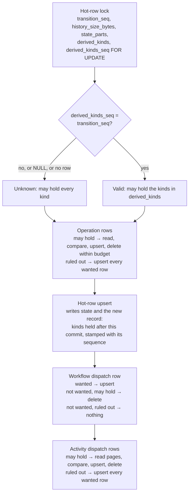

# Design Document

## Overview

A run's `workflow_hot` row gains a record of which kinds of derived row the run may hold:

- **`derived_kinds`**: one bit per kind (workflow dispatch row, activity dispatch rows, operation rows);
- **`derived_kinds_seq`**: the transition sequence the bits describe.

**Reading the record.**

- Every commit already locks the hot row before it writes, and reads its transition sequence, history size and state
  part count in that statement. It now reads the record there too.
- The record is valid when its stamp equals the transition sequence beside it.
- A valid record that leaves a kind out lets the commit skip that kind's read, or the workflow dispatch delete, because
  the run holds no such row.

**Writing the record.** Every commit writes the record it leaves behind, stamped with its own sequence, in the upsert
that already writes the row.

**Why a stamp.** It makes the record safe against anything that moves the row on without knowing the record. An older
release's commit advances `transition_seq` and leaves the record as it was, so the stamp no longer matches and the
record reads as unknown.

**Keeping the record sound.** The writers outside a commit that insert derived rows either insert only kinds the record
already includes, or leave the record unknown.

**What it saves.** In the lifecycle the live statement budget drives, the record skips 33 of 175 round trips. An activity
heartbeat goes from nine to six.

## Dependencies and Non-Goals

**Depends on:**

- the commit paths and derived-row maintenance of [activity-dispatch](../activity-dispatch/design.md),
  [workflow-dispatch](../workflow-dispatch/design.md) and
  [outbound-dispatch-recovery](../outbound-dispatch-recovery/design.md);
- the statement accounting and live statement budget of
  [dsql-observability-metrics](../dsql-observability-metrics/requirements.md) (Requirement 45).

**Non-goals:**

- Changing what any state derives, or how discovery, repair walks, delivery or the dispatcher's stale delete use derived
  rows.
- The in-memory store, the kernel, `Transition` and the `RunRepository` trait.
- A run's first commit (start, successor, staged publication). Its hot row doesn't exist yet, so its record is unknown
  and it keeps its reads. Rows can exist before the hot row: staged preparation and reset materialization write
  activity rows first.
- The parent-reference read, the lease-fence read, the close path's second hot-row read (`read_source`), and the
  statements of reads outside commits. Each is a separate cut.
- Recording other per-run tables (timers, intents, parent references). Their commits already write by explicit deltas or
  skip the read.

## Architecture



The commit's order doesn't change:

1. operation rows;
2. the hot row;
3. the workflow dispatch row;
4. history and dedupe;
5. activity dispatch rows;
6. timers, the current pointer and the projection log.

The record the hot-row upsert writes needs two things before that upsert:

- **Whether operation rows remain.** Operation maintenance runs first, so this is known in time.
- **Whether the state wants a workflow dispatch row or any activity dispatch rows.** The commit derives both wanted sets
  once, from the state it encodes, before the upsert, and hands each to its maintenance step.

## Components and Interfaces

### `derived_record.rs` (new, `crates/tokeira-storage/src/dsql/run_repository/`)

The record's encoding and every decision about it, as pure functions:

```rust
/// The kinds of derived row a run may hold. One bit per kind; bits are never reused.
#[derive(Clone, Copy, Debug, Default, PartialEq, Eq)]
pub(super) struct DerivedKinds(u8);

impl DerivedKinds {
    pub(super) const WORKFLOW_DISPATCH: Self = Self(1);
    pub(super) const ACTIVITY_DISPATCH: Self = Self(2);
    pub(super) const OPERATIONS: Self = Self(4);

    /// The kinds a commit leaves: what the next state wants, plus operation
    /// rows whose delete the commit deferred.
    pub(super) fn after_commit(workflow_dispatch: bool, activity_dispatch: bool, operations: bool) -> Self;
    pub(super) fn contains(self, kind: Self) -> bool;
    pub(super) fn to_column(self) -> i16;
}

/// The record read beside `transition_seq` in one statement. `None` is unknown:
/// a NULL column, or a stamp other than `transition_seq`. Bits this release
/// doesn't name are ignored; the bits it names keep their meaning.
pub(super) fn read_record(transition_seq: i64, kinds: Option<i16>, kinds_seq: Option<i64>) -> Option<DerivedKinds>;

/// Whether a run with `record` may hold rows of `kind`. Unknown may hold every kind.
pub(super) fn may_hold(record: Option<DerivedKinds>, kind: DerivedKinds) -> bool;

/// Whether a writer outside a commit that wrote rows of `kind` must leave the
/// record unknown: only when a valid record rules that kind out.
pub(super) fn must_forget(record: Option<DerivedKinds>, kind: DerivedKinds) -> bool;

/// `UPDATE workflow_hot SET derived_kinds_seq = NULL WHERE run_key = $1`.
pub(super) async fn forget(tx: &mut sqlx::Transaction<'_, sqlx::Postgres>, run: RunKey) -> Result<()>;
```

`forget` clears the stamp alone. A NULL stamp is unknown whatever the bits say, so no read-modify-write of the bits is
needed and no bitwise SQL operator is relied on.

### The hot-row lock (`commit.rs`, `pair.rs`, `successor.rs`, `preparation/publish.rs`)

- **One statement for all four.** The four commit-side locks use one constant, `LOCK_HOT_SQL`:

  ```sql
  SELECT transition_seq, history_size_bytes, state_parts, derived_kinds, derived_kinds_seq
  FROM workflow_hot WHERE run_key = $1 FOR UPDATE
  ```

  Each passes `read_record(seq, kinds, kinds_seq)` on as the prior record.
- **Absent rows.** The paired commit's successor, the successor commit's new run and a staged publication's new run lock
  absent rows. Each passes `None`.
- **Why the lock makes the record trustworthy.** The lock is `FOR UPDATE`, so the record the commit trusts is the one
  DSQL validates at commit. Any writer that changes the row after the commit's snapshot makes the commit conflict.

### `write_transition_mode` and its callers (`commit.rs`)

- **New parameter.** `write_transition`, `write_transition_with_intents`, `write_prepared_transition` and
  `write_transition_mode` gain `prior_derived: Option<DerivedKinds>`, after `prior_state_parts`.
  `write_prepared_transition` always passes `None`.
- **Deriving once.** After encoding the state, `write_transition_mode` derives
  `wanted_workflow = derive_workflow_dispatch(state, shard_id)` and
  `wanted_activities = derive_activity_dispatch(state, shard_id)?` once. It takes `operations_remain` from operation
  maintenance.
- **Writing the record.** It writes
  `DerivedKinds::after_commit(wanted_workflow.is_some(), !wanted_activities.is_empty(), operations_remain)`, stamped
  with `state.transition_seq`, through `insert_workflow_hot`.
- **Passing it on.** It hands each wanted set and `may_hold(prior_derived, kind)` to that kind's maintenance step.

### `WORKFLOW_HOT_UPSERT_SQL` and `insert_workflow_hot` (`commit.rs`)

- **The statement.** The upsert names `derived_kinds` and `derived_kinds_seq` (`$10`, `$11`) and sets both from
  `EXCLUDED` on conflict.
- **The signature.** `insert_workflow_hot` takes `record: Option<(DerivedKinds, TransitionSeq)>` and binds NULLs for
  `None`.
- **Reset materialization.** `finish_materialization` (`bulk_write.rs`) passes `None`. The run it creates holds the
  activity rows the copy pages staged, so its first commit must read them (Requirement 3.2).

### Operation maintenance (`outbound.rs`)

- **Returns more.** `maintain_operations` gains `may_hold: bool` and returns
  `OperationRows { upserted: bool, remain: bool }`:
  - `upserted`: it wrote at least one row;
  - `remain`: the run holds operation rows once the transaction lands, meaning `desired` is non-empty or deferred
    obsolete keys exist.
- **Ruled out.** With `may_hold` false it skips the `SELECT … FROM run_operation` and passes an empty prior to
  `close_batch::operation_changes`. That returns every wanted row as an upsert and no deletes: exactly what the read
  would have produced from an empty table.
- **The commit.** `outbound::maintain` passes the commit's `may_hold` and returns `remain` to `write_transition_mode`.
- **Reconciliation.** `do_reconcile_outbound_run` passes `true` and calls `forget` when `upserted` is true
  (Requirement 3.5). Reconciliation upserts only rows that differ from the stored state's wanted rows, so it rarely
  writes, and acquisition, which reconciles every repaired run, rarely pays the statement.

### Workflow dispatch row (`workflow_dispatch.rs`)

- **The commit.** `maintain` takes the wanted row and `may_hold: bool`:
  - `Some(row)`: upsert, as today;
  - `None` with `may_hold`: delete by run key, as today;
  - `None` without it: nothing.
- **Repair.** `do_reconcile_workflow_dispatch_run` adds `transition_seq, derived_kinds, derived_kinds_seq` to the hot
  read it already makes and passes `may_hold = true`. When it upserts and `must_forget(record, WORKFLOW_DISPATCH)`, it
  calls `forget`.
  - **Why the conditional write is safe.** The read is not `FOR UPDATE`, but `forget` writes the row. A commit that
    lands after the repair's snapshot therefore makes the repair conflict, and the existing retry repeats it.
  - **Why the write almost never happens.** A valid record comes from a commit that derived the same wanted row from the
    same state, so a repair that upserts finds the kind included.

### Activity dispatch rows (`activity_dispatch.rs`, `activity_repair.rs`)

- **The commit.** `maintain` takes the wanted set and `may_hold: bool`. Without `may_hold` it skips `existing_page` and
  upserts every wanted row. `upsert` keeps its hash-collision check.
- **Repair.** The activity repair page's `FOR UPDATE` hot read adds `derived_kinds, derived_kinds_seq`. When the page
  upserts a row and `must_forget(record, ACTIVITY_DISPATCH)`, it calls `forget` in the page's transaction. As with
  workflow dispatch repair, a page that upserts finds the kind included, except after a release that changed the
  derivation.

### The stopped-cluster outbound upgrade (`outbound_upgrade.rs`)

- **Operation pages.** Each transaction that writes operation rows calls `forget` for the run (Requirement 3.5). The
  upgrade runs with the cluster stopped, once, so the statement's cost doesn't matter.
- **Publication.** The publication's `UPDATE workflow_hot SET transition_seq = …` needs nothing more: if the sequence
  moves, the stamp no longer matches, and the pages have already forgotten the record.

### Writers that change nothing

- **Deleters.** The dispatcher's stale delete, the repairs' delete branches, reset cleanup, the upgrade's delete pages
  and run deletion only delete. A deleted row can't break "ruled out ⇒ none held", so they leave the record as it is
  (Requirement 3.3). A record that still includes a kind whose rows a deleter removed costs the next commit one read,
  and that commit writes an exact record.
- **The placement upgrade.** It moves `workflow_hot.shard_id` and changes no derived row, so the record stays true.
- **Staged preparation.** It writes activity rows before publication creates the run's hot row. Publication's new run
  has an unknown record and reads them.

## Data Models

| Column | Type | Meaning |
|---|---|---|
| `workflow_hot.derived_kinds` | `SMALLINT`, nullable | Bit 1: the workflow dispatch row. Bit 2: activity dispatch rows. Bit 4: operation rows. A set bit means the run may hold rows of that kind; a clear bit, under a valid stamp, means it holds none. |
| `workflow_hot.derived_kinds_seq` | `BIGINT`, nullable | The `transition_seq` the bits describe. The record is valid only when this equals the row's `transition_seq`. |

**Migrations:**

- `V133__workflow_hot_derived_kinds.sql`: `ALTER TABLE workflow_hot ADD COLUMN IF NOT EXISTS derived_kinds SMALLINT;`
- `V134__workflow_hot_derived_kinds_seq.sql`:
  `ALTER TABLE workflow_hot ADD COLUMN IF NOT EXISTS derived_kinds_seq BIGINT;`

Each is one statement in DSQL's DDL subset, with the same shape as `V085__workflow_hot_state_parts.sql`. The schema
contract, baseline lock, build information and migration-count tests move to the new head the way the V128–V132
migrations moved them. The next schema change becomes V135.

**Why two columns and not one.** The bits alone can't tell a record written by this commit's predecessor from one an
older release's commit has since overtaken. The stamp alone can't say which kinds are empty. A record per kind (three
sequence columns) would need three migrations and more row bytes for no extra power.

## Correctness Properties

### Property 1: The record is sound under every writer

*For any* sequence of operations applied to a model of one run's derived rows and hot row, *after every step*, when the
record is valid and rules out a kind, the run holds no row of that kind. The operations are:

- commits of arbitrary wanted sets, with arbitrary deferred obsolete operations, through `after_commit`, `may_hold` and
  `operation_changes`;
- activity and workflow dispatch repairs that write the stored state's wanted rows, through `must_forget`;
- repairs under a different derivation that write rows the stored state doesn't want;
- outbound reconciliation, upgrade pages, deleters and reset materialization;
- older-release commits, which write rows and advance the sequence but not the record.

**Validates: Requirements 3.1, 3.2, 3.3, 3.5, 4.1, 5.2, 5.3, 5.4**

### Property 2: A commit with a record leaves the same rows as one without

*For any* stored rows, any record that satisfies Property 1's invariant, and any next state and row budget, the rows
after a commit that uses the record equal the rows after the same commit with an unknown record.

**Validates: Requirements 1.1, 1.2, 1.3, 1.4, 1.5, 4.2**

### Property 3: Every commit writes an exact, valid record

*For any* commit, the record it writes is stamped with the sequence it writes, and its bits are exactly the kinds the
run holds once the commit lands, including deferred obsolete operation rows.

**Validates: Requirements 2.2, 2.3, 2.4, 2.5**

### Property 4: The record reads valid only under a matching stamp

*For any* `transition_seq`, `derived_kinds` and `derived_kinds_seq`, either NULL, `read_record` returns `Some` exactly
when both columns are set and the stamp equals the sequence. For any `DerivedKinds`,
`read_record(seq, Some(kinds.to_column()), Some(seq))` returns it. Bits outside the three named ones never change the
named bits' meaning.

**Validates: Requirements 5.2, 5.3, 5.4**

### Property 5: A ruled-out kind costs no statement

*For any* commit on a live cluster whose valid record rules out a kind, the statements the commit makes include no
`SELECT` of that kind's rows and, when the state wants no workflow dispatch row, no `workflow_dispatch` statement. The
commit makes no statement it doesn't make without a record.

**Validates: Requirements 1.1, 1.2, 1.3, 1.6, 2.1, 6.3, 7.3**

## Error Handling

| Condition | Handling |
|---|---|
| `derived_kinds` holds bits this release doesn't name | Ignored; the named bits keep their meaning (Property 4). |
| A NULL column, or a stamp other than `transition_seq` | Unknown record: the commit reads and maintains all three kinds. |
| A record that turns out to include a kind with no rows | No error: the commit reads, finds none, and writes an exact record. |
| A repair's `forget` conflicts with a commit | The existing OCC conflict handling of that repair retries the whole transaction. |
| A commit refused for growth or physical limits, or conflicting, or losing its fence | The whole transaction rolls back, record included (Requirement 2.6). |
| A statement fails | Propagated as today. |

## Testing Strategy

- **Property tests (pure, default suite):**
  - Properties 1–4, in `derived_record.rs`'s tests, over the real `after_commit`, `read_record`, `may_hold`,
    `must_forget` and `close_batch::operation_changes`, with a model of the three tables and the hot row.
  - Property 1 generates interleavings of every operation it names.
  - Property 2 runs each commit twice, once with the record and once unknown, and compares the rows.
- **DSQL integration tests (`dsql-integration`, throwaway cluster):**
  - For each kind, a commit sequence that crosses from wanting rows to wanting none and back. Assert the rows after
    each commit and the record's columns.
  - An older-release commit, simulated with the previous `WORKFLOW_HOT_UPSERT_SQL` text, followed by a commit that must
    read every kind.
  - A workflow dispatch repair and an activity repair under a record that rules their kind out, which must leave it
    unknown.
  - Reset materialization and staged publication, whose first commit must read.
  - The existing activity dispatch, workflow dispatch, outbound, bulk-write and large-value suites keep passing
    unchanged.
- **Live statement budget (`crates/tokeira-runtime/tests/dsql_statement_budget.rs`):**
  - Pin each committed step's round trips.
  - Assert the skipped statements are absent from each step's commit (Property 5).
  - Record the before and after counts on a throwaway cluster, deleted afterwards.

## Specs and Documentation This Changes

The implementation changes these, each saying what holds once the record exists:

- [activity-dispatch design](../activity-dispatch/design.md): its desired-set maintenance paragraph ("read existing rows
  in bounded key pages") notes the read is skipped when the run's record rules activity rows out.
- [workflow-dispatch design](../workflow-dispatch/design.md): its paragraph on one dispatch statement per commit
  ("including an idempotent delete when no row is wanted") says the delete is made only when the run may hold the row.
- [docs/architecture/050-dsql-storage.md](../../../docs/architecture/050-dsql-storage.md): `core.workflow_hot`'s role
  names the record.
- [crates/tokeira-storage/AGENTS.md](../../../crates/tokeira-storage/AGENTS.md): the migration list names V133–V134 and
  the next schema change, V135.

## Release

- **No stop needed.** The release needs no "Upgrade with every node stopped." An older node keeps working against the
  new columns. Its commits leave the record unknown through the stamp, and its repairs insert only the rows the stored
  state wants, under the same derivation.
- **Starting old nodes.** A node of an older release that checks its schema refuses to start once the migrations are
  applied, as it does for any newer schema.
- **Changelog.** The release's changelog fragment says a commit makes up to three round trips fewer to Aurora DSQL.
