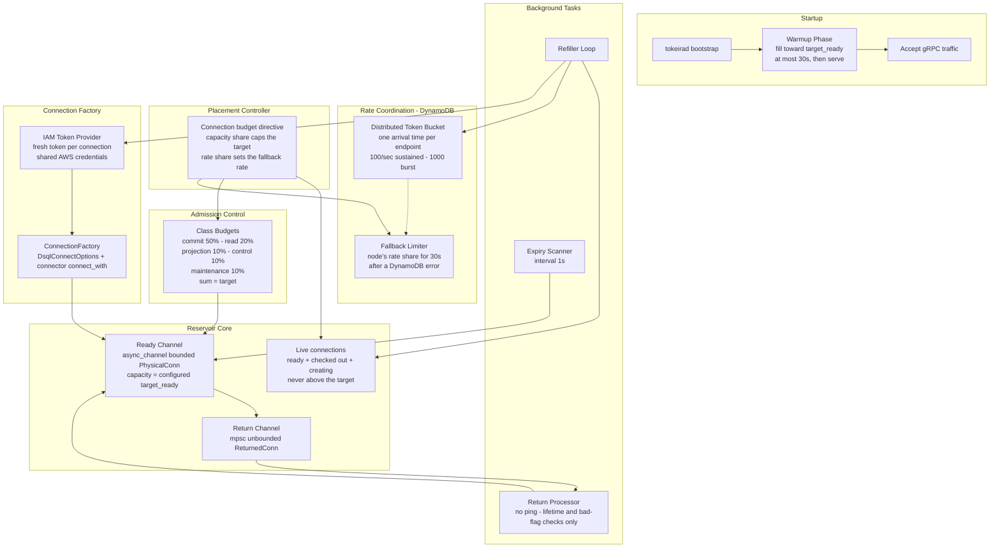

# Design Document: DSQL Reservoir Redesign

## Overview

This design eliminates the sqlx `PgPool` from the DSQL connection path entirely. The current implementation wraps a sqlx PgPool inside the reservoir: the refiller calls `pool.acquire()` to create connections, but the pool's `max_connections` equals `target_ready`, so when the reservoir holds all connections in its ready channel, the pool has nothing left for the refiller — causing `pool timed out` errors under load.

The redesign makes the reservoir the **sole connection owner**. Physical connections are created directly via IAM-authenticated TCP/TLS using `aurora_dsql_sqlx_connector::DsqlConnectOptions` and `aurora_dsql_sqlx_connector::connection::connect_with()`, bypassing the sqlx pool entirely. The reservoir IS the pool.

Three background tokio tasks manage the connection lifecycle:
1. **Refiller** — continuously creates connections to keep the node's live connections at `target_ready`.
2. **Expiry Scanner** — periodically retires connections approaching the end of their assigned lifetime.
3. **Return Processor** — validates returned connections (lifetime and bad-flag checks only, no ping) before reuse.

Two mechanisms keep a fleet of nodes within DSQL's cluster-wide limits:
- **Distributed Token Bucket** — one DynamoDB item per DSQL endpoint holds the cluster-wide 100/sec connection creation rate as a single arrival time, with a process-local fallback while DynamoDB fails.
- **Fleet connection capacity** — each node holds at most its target of live connections, and the placement controller caps each node's target to its share of the cluster's 10,000 connections. No shared record is kept per connection.

All connection management parameters are internal constants derived from DSQL's known constraints (requirements, *Introduction*). The operator provides an endpoint and credentials. Everything else is automatic.

**Key design change from current implementation:** The return processor no longer pings connections on return. Guard window lifetime checks are sufficient — a connection that was healthy during use and has remaining lifetime is safe to reuse without a network round-trip. This eliminates per-return latency and connection churn.

## Architecture



### Key Design Invariants

1. **The reservoir is the sole connection owner.** No sqlx PgPool exists. The reservoir creates, holds, and retires all DSQL connections.
2. **Checkout never does network I/O.** A checkout takes a ready connection at once, or waits up to `CHECKOUT_WAIT` for one to be returned or created by the refiller, then signals empty. It never creates a connection or calls DynamoDB itself.
3. **Connection creation failures never block checkout callers.** The refiller runs independently; its errors are logged and retried with backoff.
4. **No connection is ever handed out with remaining_lifetime < guard_window.** Both the expiry scanner and the return processor enforce this.
5. **Class budgets guarantee isolation.** Projection cannot consume commit-class permits — separate semaphore instances.
6. **DynamoDB coordination is mandatory for DSQL.** A missing or unreachable rate limiter table fails startup. After startup, a DynamoDB error switches creations to the fallback limiter for `FALLBACK_PERIOD`, with a warning and a gauge; creations never run without a limiter.
7. **No ping on return.** Lifetime check and bad-flag check only.
8. **Every live connection is counted out exactly once.** The refiller takes a place in the live count before it connects, as a `LiveCharge`. The charge travels with the attempt and then with the physical connection, through the ready channel, the permit and the return channel, and gives the place back when it is dropped. No path releases a place by hand, so none can release one twice or forget to.
9. **A class permit travels with its connection.** A caller's class permit goes back to its class only after the return processor has put the connection back in the ready channel or retired it. Otherwise the next caller of that class could be admitted while the connection it needs is still on its way back, and find the reservoir empty although no more callers hold connections than the budgets allow.
10. **A returned connection always fits in the ready channel.** The channel holds the configured `target_ready`. Live connections never exceed the target, a directive can lower the target but never raise it above the configured value, and ready connections are a subset of live ones. A return therefore never waits for room, and no healthy connection is retired for lack of it.
11. **A connection an operation broke is retired, not reused.** Each storage operation runs inside `in_operation`, which records every connection the operation checks out. When the operation fails with an IO, TLS or protocol error, or the server ends the session with a FATAL error, every recorded connection is flagged broken, and the return processor, checkout and the expiry scanner each retire a flagged connection when they meet it. The flag is set after the operation's permit dropped, so a caller that checks the connection out in that window fails on it the same way and flags it again.
12. **Admitted callers never outnumber live connections.** The class budgets sum to the target, and the target bounds live connections. A caller admitted by its class therefore has a connection to take unless one is between retirement and its replacement, which is the gap `CHECKOUT_WAIT` covers.
13. **A connection's lifetime fits inside DSQL's connection duration.** The longest assigned lifetime plus DSQL's 5-minute transaction limit is at most DSQL's 60-minute connection duration, so DSQL never closes a connection under a transaction the reservoir handed out before its guard window.


## Components and Interfaces

### 1. PhysicalConn and ReturnedConn

**Location:** `crates/tokeira-storage/src/dsql/reservoir.rs`

```rust
pub struct PhysicalConn {
    pub(crate) connection: PgConnection,  // raw, NOT PoolConnection<Postgres>
    pub(crate) created_at: Instant,
    pub(crate) lifetime: Duration,        // BASE_LIFETIME + 0..=LIFETIME_JITTER
    pub(crate) broken: BrokenFlag,        // set by a failed operation; shared by every holder
    pub(crate) live: LiveCharge,          // this connection's place in the live count (invariant 8)
}

impl PhysicalConn {
    pub fn remaining_lifetime(&self) -> Duration {
        self.lifetime.saturating_sub(self.created_at.elapsed())
    }
    pub fn within_guard_window(&self, guard_window: Duration) -> bool {
        self.remaining_lifetime() <= guard_window
    }
}

pub struct ReturnedConn {
    pub(crate) connection: PgConnection,
    pub(crate) created_at: Instant,
    pub(crate) lifetime: Duration,
    pub(crate) broken: BrokenFlag,
    pub(crate) live: LiveCharge,
    pub(crate) marked_bad: bool,
    // The caller's class permit, released by the return processor (invariant 9).
    pub(crate) class_permit: Option<OwnedSemaphorePermit>,
}

/// One place in the reservoir's live count. Taken by the refiller before a
/// connect, it is never cloned and gives its place back exactly once, on drop.
pub(crate) struct LiveCharge { live: Arc<LiveCount> }

pub(crate) struct LiveCount {
    count: AtomicUsize,
    target: AtomicUsize,
}

impl LiveCount {
    /// Take a place if the count is below the target. A compare-and-swap loop,
    /// so two refiller admissions can never both take the last place.
    pub fn try_charge(self: &Arc<Self>) -> Option<LiveCharge>;
    /// Live connections above the current target, which the return processor
    /// retires as they come back (Req 16.8).
    pub fn excess(&self) -> usize;
}
```

### 2. Connection Factory

**Location:** `crates/tokeira-storage/src/dsql/connection_factory.rs` (new file)

Creates raw `PgConnection` instances via IAM-authenticated TCP/TLS. Each call signs a fresh IAM token for that connection alone; tokens are never cached.

The AWS credentials that sign the tokens are shared by every connect. The factory builds the default credentials chain once and keeps the credentials it returns until five minutes before they expire, then fetches new ones; one connect fetches while concurrent connects wait for its result. The connector would otherwise build a new credentials chain for each connection, and its token signer asks the provider directly rather than through the SDK's credential cache, so every connect would fetch credentials from the ECS credentials endpoint or STS at up to the cluster's connection rate. With the credentials cached, signing a token is a local SigV4 computation, so a token per connection costs no network call.

```rust
pub const CONNECT_TIMEOUT: Duration = Duration::from_secs(30);
const CREDENTIALS_REFRESH_MARGIN: Duration = Duration::from_secs(5 * 60);

pub struct ConnectionFactory {
    pg_options: PgConnectOptions,         // endpoint, admin, postgres, port 5432, verify-full
    region: String,
    credentials: Arc<CredentialCache>,    // shared by every clone
}

impl ConnectionFactory {
    pub async fn create_connection(&self) -> Result<PgConnection, ConnectionFactoryError> {
        let credentials = self.credentials.current(&self.region).await?;
        // A static provider over the fetched credentials: the connector signs
        // with them as they are.
        let options = self.connect_options(Some(credentials))?;
        aurora_dsql_sqlx_connector::connection::connect_with(&options)
            .await
            .map_err(ConnectionFactoryError::from_dsql_error)
    }
}

/// Every reservoir connects through this bound, whichever factory it holds.
pub(crate) async fn create_within_timeout(
    factory: &dyn PhysicalConnectionFactory,
) -> Result<PgConnection, ConnectionFactoryError> {
    tokio::time::timeout(CONNECT_TIMEOUT, factory.create_connection())
        .await
        .unwrap_or(Err(ConnectionFactoryError::Timeout(CONNECT_TIMEOUT)))
}

#[derive(Debug, thiserror::Error)]
pub enum ConnectionFactoryError {
    #[error("DSQL connection configuration failed: {0}")] Config(String),
    #[error("DSQL IAM token generation failed: {0}")] Token(String),
    #[error("DSQL TCP/TLS connection failed: {0}")] Connection(String),
    #[error("DSQL database handshake failed: {0}")] Database(String),
    #[error("DSQL refused the connection: {0}")] Refused(String),
    #[error("DSQL connection attempt did not finish within {0:?}")] Timeout(Duration),
}
```

Neither sqlx nor the connector bounds a connect, so a peer that accepts TCP and never answers would hold an attempt, its in-flight permit and its place in the live count forever. `CONNECT_TIMEOUT` ends the attempt; the attempt then fails like any other and gives its place back. Until then it counts toward the target (Req 4.9), so a hung connect delays a replacement by at most `CONNECT_TIMEOUT` and never lets the node overshoot.

`from_dsql_error` classifies a refusal by its SQLSTATE before it looks at the error's type: the connector reports a refusal during the startup handshake as a connection error, with the server's error response inside it. `53400` (connection rate exceeded) and `53300` (too many connections) map to `Refused`, wherever in the error's source chain the server's error response appears; no other SQLSTATE does, and no text in a message does, so a payload that mentions a SQLSTATE cannot change a failure's kind. A refused connect lengthens the refiller's failure streak like any other failure, and the `refused` label on `tokeira_dsql_connection_error_total` lets an operator tell the cluster's limits from network trouble.

### 2.5 DSQL Coordination Config

**Location:** `crates/tokeira-storage/src/dsql/config.rs`

The DynamoDB coordination table name and client are runtime wiring, not
operator-tunable TOML. `apps/tokeirad` constructs this config from the effective
server config before calling `DsqlStore::connect(auth, pool_config)`.

```rust
#[derive(Clone, Debug)]
pub struct DsqlCoordinationConfig {
    pub rate_limiter_table: String,
    pub ddb_client: aws_sdk_dynamodb::Client,
}

#[derive(Clone, Debug)]
pub struct DsqlPoolConfig {
    pub reservoir: ReservoirConfig,
    pub migration: MigrationConfig,
    pub coordination: DsqlCoordinationConfig,
    // existing DSQL mechanical fields...
}
```

`DsqlPoolConfig` is constructed programmatically by the DSQL startup path. If
the existing serde derives conflict with the non-serializable DynamoDB client,
remove those derives from `DsqlPoolConfig` or move serde coverage to the
serializable sub-configs that still need it.

`apps/tokeirad/src/lib.rs` derives the table name from the effective project
identifier:

```rust
let project = &effective_config.infrastructure.cluster_name;
let rate_limiter_table = format!("{project}-dsql-rate-limiter");
let sdk_config = aws_config::defaults(aws_config::BehaviorVersion::latest())
    .region(aws_config::Region::new(auth.resolved_region().context("missing DSQL region")?))
    .load()
    .await;
let ddb_client = aws_sdk_dynamodb::Client::new(&sdk_config);

let pool_config = DsqlPoolConfig {
    coordination: DsqlCoordinationConfig {
        rate_limiter_table,
        ddb_client,
    },
    ..dsql_pool_config(&effective_config)
};
let dsql_store = DsqlStore::connect(auth, pool_config).await?;
```

`DsqlStore::connect` remains the single external entry point and uses
`config.coordination` internally to validate DynamoDB reachability, construct
the Distributed_Token_Bucket, start the reservoir, warm it, and build the
`DsqlConnectionDirector`.

Configurations written by earlier platform definitions may still carry
`infrastructure.dsql.conn_lease_table`. The configuration accepts the key so
that they load (unknown keys are rejected), and the startup path logs once that
the key is no longer used and can be removed (Req 14.8). Nothing reads its
value.

### 3. Reservoir

**Location:** `crates/tokeira-storage/src/dsql/reservoir.rs`

**Internal constants (NOT configurable):**

| Constant | Value | Derivation |
|----------|-------|------------|
| `TARGET_READY` | 50 | Expected peak concurrency for single-node |
| `MIN_TARGET` | 5 | One connection for each class (Req 9.7) |
| `BASE_LIFETIME` | 50 min | See *Lifetimes* below |
| `LIFETIME_JITTER` | up to 4 min, added | Spreads the retirement of connections created together over four minutes |
| `GUARD_WINDOW` | 45 sec | No connection is handed out this close to the end of its lifetime |
| `DSQL_MAX_CONNECTION_DURATION` | 60 min | DSQL closes a connection after this long |
| `DSQL_MAX_TRANSACTION` | 5 min | DSQL fails a transaction older than this |
| `INFLIGHT_LIMIT` | 8 | Max concurrent TCP/TLS handshakes |
| `SCAN_INTERVAL` | 1 sec | Expiry scanner frequency |
| `SCAN_BUDGET` | `TARGET_READY / 2` | Max ready entries examined per scan |
| `CHECKOUT_WAIT` | 1 sec | See *Bounded checkout* below |
| `WARMUP_TIMEOUT` | 30 sec | Longest a start waits for its reservoir to fill |
| `REFILLER_IDLE_INTERVAL` | 100ms | Check interval when full |
| `REFILLER_ERROR_BACKOFF` | 250ms | Backoff after the first failure; doubles per consecutive failure |
| `REFILLER_MAX_BACKOFF` | 10 sec | Backoff ceiling; a recovering cluster is retried at least this often |
| `CONNECT_TIMEOUT` | 30 sec | Bound on one connect: a credentials refresh plus a TLS handshake to a loaded cluster |
| `READY_CAPACITY` | configured `target_ready` | Ready channel capacity (invariant 10) |
| `DISTRIBUTED_RATE` | 100/sec | DSQL cluster-wide sustained rate |
| `DISTRIBUTED_BURST` | 1000 | DSQL cluster-wide burst capacity |
| `RATE_MAX_WAIT` | 30 sec | Longest an admission may be scheduled ahead |
| `FALLBACK_PERIOD` | 30 sec | How long the fallback limiter admits after a DynamoDB error |
| `FALLBACK_RATE` | 10/sec | Fallback rate for a node with no budget directive |

**Lifetimes.** DSQL checks a connection's IAM token only when the connection opens; an open connection stays valid after its token expires, until DSQL closes it at 60 minutes. The 15-minute token lifetime therefore does not bound how long the reservoir may keep a connection. The bound is the connection duration less the longest transaction: a connection handed out just before its guard window may begin a transaction that runs for up to 5 minutes, so the longest assigned lifetime is at most 55 minutes. A lifetime of 50 minutes plus up to 4 minutes of jitter leaves a minute of margin.

Long lifetimes save connection rate, which the whole fleet shares. A node of 50 connections replaces about one connection a minute at a 52-minute mean lifetime; at 10 minutes it replaced five. Two hundred such nodes (10,000 connections, DSQL's default limit) replace about 3 connections a second, against 17 at 10 minutes, out of the cluster's 100. The jitter spreads a fleet started together: 10,000 connections created in the same minute retire over four minutes, about 42 a second at the peak.

The embedded engine's reservoirs take the same lifetimes. The startup configuration check that rejects a lifetime past the cutoff (`DSQL_HARD_CUTOFF` in `config.rs`) bounds `base_lifetime + lifetime_jitter + guard_window` by `DSQL_MAX_CONNECTION_DURATION − DSQL_MAX_TRANSACTION`.

**Bounded checkout.** A caller that holds a class permit finds a connection unless one is between retirement and its replacement (invariant 12): the scanner retired it, an operation broke it, or the refiller cannot connect. The replacement is one connect away, a few hundred milliseconds against a loaded cluster, and a returned connection arrives within microseconds. `CHECKOUT_WAIT` of one second covers that gap with room to spare, and stays far below the deadlines SDKs set on their calls, so a reservoir that cannot refill still answers with `RESOURCE_EXHAUSTED` while the caller has time to retry. The wait does not consult the request's deadline: the storage layer does not receive it, the wait is short, and a cancelled request drops the wait (Req 3.6).

```rust
pub struct Reservoir {
    ready_rx: async_channel::Receiver<PhysicalConn>,
    ready_tx: async_channel::Sender<PhysicalConn>,
    return_tx: mpsc::UnboundedSender<ReturnedConn>,
    live: Arc<LiveCount>,
    refiller_handle: JoinHandle<()>,
    scanner_handle: JoinHandle<()>,
    return_processor_handle: JoinHandle<()>,
}

impl Reservoir {
    pub async fn start(factory: ConnectionFactory, limiter: Arc<DistributedTokenBucket>) -> Result<Self> { /* ... */ }

    /// Bounded checkout: a ready connection at once, or one that arrives within
    /// CHECKOUT_WAIT, or ErrReservoirEmpty. `recv` is cancel-safe: dropping
    /// the future never loses a connection (Req 3.6).
    pub async fn checkout(&self) -> Result<PhysicalConn, ReservoirError> {
        let deadline = Instant::now() + CHECKOUT_WAIT;
        loop {
            match timeout_at(deadline, self.ready_rx.recv()).await {
                // Flagged after it was returned (invariant 11): retire, look again.
                Ok(Ok(conn)) if conn.broken.is_set() => record_retirement("broken", conn.created_at.elapsed()),
                Ok(Ok(conn)) => { metrics::record_dsql_pool_connections_total(self.ready_rx.len()); return Ok(conn) }
                Ok(Err(_closed)) => return Err(ReservoirError::Closed),
                Err(_elapsed) => { metrics::record_dsql_pool_empty_reservoir(); return Err(ReservoirError::Empty) }
            }
        }
    }

    /// Lower (never raise above the configured value) the target, retire idle
    /// connections above it, and let the return processor retire the rest as
    /// they come back (Req 8.6). Floored at MIN_TARGET.
    pub fn reconfigure_target(&self, new_target: u32);
    pub async fn warmup(&self) -> WarmupOutcome { /* full, or the count held at WARMUP_TIMEOUT */ }
    pub fn return_sender(&self) -> mpsc::UnboundedSender<ReturnedConn> { self.return_tx.clone() }
    pub fn ready_count(&self) -> usize { self.ready_rx.len() }
    pub fn live_count(&self) -> usize { /* LiveCount::count */ }
}
```

### 4. Refiller Loop

One task admits connection creations and runs each in its own child task, so up to `INFLIGHT_LIMIT` connects proceed at once. A refill after a mass retirement takes about `target_ready / INFLIGHT_LIMIT` connect latencies rather than `target_ready`. The refiller sizes the reservoir by its live connections: ready, checked out and still being created. A connection in use is not replaced, so the node never holds more connections than its target, however many are checked out.

Consecutive failures share one streak: the refiller waits `refill_backoff(streak)` before admitting the next creation, and the first success resets the streak and cuts a running wait short, so a recovered cluster is refilled at once rather than after the longest backoff.

```rust
// Pseudocode — exact implementation mechanics
let mut creating = JoinSet::new();   // child creations; aborted with the refiller
loop {
    if failures > 0 {
        select! { sleep(refill_backoff(failures)), recovered.notified() }
    }
    let inflight_permit = inflight_sem.acquire_owned().await;  // max 8 concurrent
    reap_finished(&mut creating);
    let Some(live) = live_count.try_charge() else {            // live == target
        drop(inflight_permit); sleep(REFILLER_IDLE_INTERVAL); continue;
    };
    if let Err(e) = limiter.admit().await {                     // Distributed_Token_Bucket
        drop(live); log_warn(e); failures += 1; continue;       // the place goes back
    }
    creating.spawn(async move {
        let _inflight_permit = inflight_permit;        // held for the whole attempt
        match create_within_timeout(factory).await {   // CONNECT_TIMEOUT
            Ok(conn) => {
                failures = 0; recovered.notify_waiters();
                let entry = PhysicalConn { connection: conn, created_at: now(),
                                           lifetime: assign_jittered_lifetime(),
                                           broken: BrokenFlag::default(), live };
                let _ = ready_tx.send(entry).await;
                // A closed channel (shutdown) drops the entry, and its charge with it.
            }
            Err(e) => { failures += 1; log_warn(e); }  // dropping `live` gives the place back
        }
    });
}

/// REFILLER_ERROR_BACKOFF × 2^(failures - 1), capped at REFILLER_MAX_BACKOFF, with
/// equal jitter (half fixed, half random) so nodes refused together retry apart.
fn refill_backoff(failures: u32) -> Duration;

fn assign_jittered_lifetime() -> Duration {
    BASE_LIFETIME + Duration::from_secs(rand::gen_range(0..=LIFETIME_JITTER.as_secs()))
}
```

### 5. Expiry Scanner

Every connection the scanner drops carries its `LiveCharge`, so dropping it
gives its place back (invariant 8); the scanner never touches the count.

```rust
loop {
    sleep(SCAN_INTERVAL); // 1 second
    for _ in 0..SCAN_BUDGET {  // bounded: max 25 entries per pass
        match ready_rx.try_recv() {
            Ok(conn) if conn.broken.is_set() => {
                metrics::record_retirement("broken", conn.created_at.elapsed());
                drop(conn);
            }
            Ok(conn) if conn.within_guard_window(GUARD_WINDOW) => {
                metrics::record_retirement("guard_window", conn.created_at.elapsed());
                drop(conn);
            }
            Ok(conn) => {
                if let Err(err) = ready_tx.try_send(conn) {
                    drop(err.into_inner());
                }
            }
            Err(_) => break,
        }
    }
}
```

### 6. Return Processor

The return processor puts a returned connection back in the ready channel, or
drops it, and releases the caller's class permit last (invariant 9). A
connection that comes back while the node holds more live connections than its
target is retired: a directive lowered the target while it was checked out
(Req 16.8).

```rust
while let Some(returned) = return_rx.recv().await {
    let reason = if returned.marked_bad { Some("bad_flag") }
                 else if returned.broken.is_set() { Some("broken") }
                 else if returned.within_guard_window(GUARD_WINDOW) { Some("guard_window") }
                 else if live_count.excess() > 0 { Some("budget_cap") }
                 else { None };
    if let Some(reason) = reason {
        metrics::record_retirement(reason, returned.created_at.elapsed());
        continue; // discard; dropping `returned` gives its place back and releases its class permit
    }
    // Put back — NO PING, no network I/O, and never wait: the channel has room
    // for every return (invariant 10).
    match ready_tx.try_send(returned.conn()) {
        Ok(()) => {}
        Err(Full(conn)) => metrics::record_retirement("ready_channel_full", conn.created_at.elapsed()),
        Err(Closed(_)) => return,
    }
    drop(returned.class_permit);
}
```

### 7. Distributed Token Bucket

**Location:** `crates/tokeira-storage/src/dsql/distributed_bucket.rs`

**DynamoDB Table:** `{project}-dsql-rate-limiter`, one item per DSQL endpoint.

| Attribute | Type | Key | Description |
|-----------|------|-----|-------------|
| `pk` | String | PK | `dsql_connect_gcra#{endpoint}` |
| `tat_us` | Number | — | The Arrival_Time, in microseconds since the Unix epoch |
| `ttl_epoch` | Number | TTL | Unix seconds + 3600, refreshed by every admission |

**How it admits.** The bucket is the generic cell rate algorithm: it admits exactly what a token bucket of the same rate and burst admits, but its whole state is one time. Each admission is paid for by one interval of the sustained rate, `INTERVAL` = 10 ms at 100/sec, and the Arrival_Time is the time by which every admission granted so far would have been paid for. An admission at time `t` may run ahead of payment by the burst less one interval, `TOLERANCE` = 999 × 10 ms:

- If the Arrival_Time is before `t`, the bucket is idle (full): the admission runs now, and the Arrival_Time becomes `t + INTERVAL`.
- If the Arrival_Time is between `t` and `t + TOLERANCE + RATE_MAX_WAIT`, the admission is scheduled at `Arrival_Time − TOLERANCE` (now, if that has passed), and the Arrival_Time moves on by `INTERVAL`. The caller sleeps until its scheduled time.
- If the Arrival_Time is past `t + TOLERANCE + RATE_MAX_WAIT`, the admission would wait longer than `RATE_MAX_WAIT`: it is refused, and the item is unchanged.

Because one stored time and the admitting node's clock decide every admission, two nodes whose clocks differ by δ disagree about the bucket by at most δ's worth of admissions, a fixed offset. A token count refilled from the elapsed time since another node's write instead adds the writer's and reader's clock difference again on every write that changes hands between nodes, so its error grows with traffic.

**Wait protocol (Rust pseudocode):**

```rust
const INTERVAL_US: i64 = 1_000_000 / DISTRIBUTED_RATE;                  // 10_000
const TOLERANCE_US: i64 = (DISTRIBUTED_BURST - 1) * INTERVAL_US;        // 9_990_000
const HORIZON_US: i64 = TOLERANCE_US + RATE_MAX_WAIT.as_micros() as i64; // 39_990_000
const MAX_ATTEMPTS: u32 = 4;

/// Wait until one connection creation is admitted, cluster-wide.
///
/// The AWS SDK retries DynamoDB throttling and transient errors itself; a call
/// that still fails puts the node on the fallback limiter (Req 7.8). A failed
/// condition is not an error: it tells the bucket which branch to take.
pub async fn admit(&self) -> Result<(), AdmissionError> {
    if let Some(fallback) = self.fallback.active() {   // within FALLBACK_PERIOD of an error
        return fallback.admit().await;
    }
    // Guess the branch from the last Arrival_Time this node saw.
    let mut busy = self.last_seen_tat_us.load() >= now_us();
    for _ in 0..MAX_ATTEMPTS {
        let now = now_us();
        let outcome = if busy { self.admit_busy(now).await } else { self.admit_idle(now).await };
        match outcome {
            Ok(scheduled_at_us) => {
                sleep_until_wall(scheduled_at_us).await;   // zero or more
                return Ok(());
            }
            Err(Update::Condition { old_tat_us }) => match old_tat_us {
                None => busy = false,                                // no item yet
                Some(old) if old < now => busy = false,              // idle
                Some(old) if old > now + HORIZON_US => return Err(AdmissionError::WaitTooLong),
                Some(_) => busy = true,                              // busy
            },
            Err(Update::DynamoDb(error)) => {
                self.fallback.begin(error);                          // warn, gauge = 1
                return self.fallback.active().expect("just begun").admit().await;
            }
        }
    }
    Err(AdmissionError::Contended)   // treated as a refused admission: the refiller backs off
}

/// Busy branch: reserve the next interval after the stored Arrival_Time.
async fn admit_busy(&self, now: i64) -> Result<i64, Update> {
    // UpdateItem pk = dsql_connect_gcra#{endpoint}
    //   SET tat_us = tat_us + :interval, ttl_epoch = :ttl
    //   CONDITION tat_us BETWEEN :now AND :limit           (:limit = now + HORIZON_US)
    //   ReturnValues UPDATED_NEW
    //   ReturnValuesOnConditionCheckFailure ALL_OLD        (old item, or none)
    // On success: new_tat = returned tat_us; old = new_tat - INTERVAL_US;
    //   self.last_seen_tat_us = new_tat;
    //   Ok(max(now, old - TOLERANCE_US))
}

/// Idle branch: the bucket is full; this admission runs now.
async fn admit_idle(&self, now: i64) -> Result<i64, Update> {
    // UpdateItem pk = dsql_connect_gcra#{endpoint}
    //   SET tat_us = :next, ttl_epoch = :ttl                (:next = now + INTERVAL_US)
    //   CONDITION attribute_not_exists(tat_us) OR tat_us < :now
    //   ReturnValuesOnConditionCheckFailure ALL_OLD
    // On success: self.last_seen_tat_us = now + INTERVAL_US; Ok(now)
}
```

**Key implementation notes:**
- No read precedes a write. The busy update adds `INTERVAL` to whatever is stored, so concurrent busy admissions from any number of nodes each succeed without a retry; DynamoDB serializes them on the item. A wrong branch guess costs one failed condition, whose `ALL_OLD` return says which branch is right, so an admission takes one update, or two when the guess is wrong (Req 7.5). The idle update's condition fails only when another node has just made the bucket busy, after which the busy update succeeds; `MAX_ATTEMPTS` bounds the pathological case.
- The clock is the host's wall clock, read once per attempt. The scheduled time is a wall-clock time, so the sleep converts it to a duration against the same clock.
- `RATE_MAX_WAIT` = 30 sec bounds how far ahead an admission may be scheduled. A refused admission fails the refiller's attempt, which backs off (Req 7.7).
- The refiller waits for each admission before it asks for the next, so a node holds at most one scheduled admission at a time. A fleet of N nodes therefore schedules at most N intervals ahead of the burst, and an admission is refused for waiting too long only past 3,000 nodes.
- Integer microseconds avoid floating point in DynamoDB Number attributes.
- `ttl_epoch` lets DynamoDB delete an item an hour after the last admission; a deleted item is an idle bucket, which is what an hour without admissions is.
- The item key is new. While nodes of an earlier release and of this one run side by side during a rolling upgrade, each group follows its own item, and the fleet may create connections at up to twice the cluster's rate. DSQL refuses the excess with `53400`, and the refiller backs off from it. A rolling restart replaces one node's connections at a time, well within the burst, so in practice the overlap goes unnoticed.

**Fallback limiter.** A DynamoDB call that fails after the SDK's own retries, for any reason other than a failed condition (throttling, a network failure, a missing table or a denied permission), puts the node on a process-local limiter for `FALLBACK_PERIOD`. The first admission after that period calls DynamoDB again; another failure begins another period.

```rust
pub struct FallbackLimiter {
    until: Mutex<Option<Instant>>,      // end of the current fallback period
    rate_per_second: AtomicU64,         // f64 bits: the node's directive share, else FALLBACK_RATE
    gcra: LocalGcra,                    // same algorithm over an in-process Arrival_Time
}
// burst = max(1, ceil(rate_per_second)): one second's admissions (Req 7.9)
```

The fallback rate is the node's `rate_per_second` from its latest connection budget directive (shard placement membership Req 9.2.1): the controller divides the cluster's rate among the nodes it budgets, so a fleet that falls back together stays near the cluster's rate. A node that has received no directive, such as a deployment without a placement controller, falls back to `FALLBACK_RATE` (10/sec), which ten nodes can share before reaching the cluster's rate. Either way DSQL itself refuses connects past its rate with `53400`, which the refiller backs off from, so the fallback trades a few refused connects for refills that continue while DynamoDB is down. Entering the fallback logs a warning naming the error; `tokeira_dsql_pool_rate_limiter_fallback` reads one until DynamoDB answers again.

### 8. Fleet Connection Capacity

**Location:** `crates/tokeira-storage/src/dsql/reservoir.rs` (`LiveCount`) and `crates/tokeira-storage/src/dsql/connection.rs` (`apply_connection_budget`)

DSQL allows 10,000 connections per cluster by default; a connect past the limit is refused with `53300` and changes nothing else. The fleet stays within it by two rules, neither of which writes a shared record:

1. **A node holds no more live connections than its target** (Req 8.1). `LiveCount::try_charge` admits a creation only below the target, and live connections include those checked out and those being created.
2. **Every node's target is capped at its share of the cluster** (Req 8.2). The controller divides `dsql_connection_capacity_budget` (default 10,000) among the nodes it budgets and sends each its share as the directive's `capacity`. The node applies `min(configured target_ready, max_reservoir_size, capacity)`, floored at `MIN_TARGET`, through `DsqlConnectionDirector::apply_connection_budget`, which also recomputes the class budgets from the new target (Req 9.6). The targets of budgeted nodes therefore sum to at most the budget.

```rust
/// A connection budget directive's view as the reservoir applies it.
pub struct ConnectionBudget {
    pub rate_per_second: f64,    // the fallback limiter's rate (Req 7.9)
    pub capacity: u64,           // this node's share of the cluster's connections
    pub max_reservoir_size: u32, // an absolute ceiling from the controller
}

impl DsqlConnectionDirector {
    /// Returns the target applied. A directive only lowers the target.
    pub async fn apply_connection_budget(&self, budget: ConnectionBudget) -> Result<usize> {
        let target = configured_target_ready
            .min(budget.max_reservoir_size as usize)
            .min(usize::try_from(budget.capacity).unwrap_or(usize::MAX))
            .max(MIN_TARGET);
        reservoir.reconfigure_target(target);            // retires idle excess (Req 8.6)
        self.class_budgets.reconfigure(&default_allocations(target)).await?;  // Req 9.6
        reservoir.limiter().set_fallback_rate(budget.rate_per_second);
        Ok(target)
    }
}
```

When the controller cannot be reached, each node keeps the share it was last given (shard placement membership Req 9.2.4), so the shares still sum to at most the budget they were drawn from. A node that starts without a directive runs at its configured target (Req 8.5), as does every node of a deployment without a controller, whose connections are bounded by its node count times the target: 200 nodes at the default target reach the cluster's 10,000. Wherever these bounds are exceeded, DSQL refuses the extra connects with `53300`. The refiller backs off from them (Req 8.4), and the node keeps serving on the connections it holds.

A shared lease per block of connections would bound the fleet without a controller, but it puts DynamoDB on the path of every node's capacity: a node that cannot take a block at startup cannot start, and a node whose renewal fails long enough for another node to take its block is left with no capacity at all. Exceeding the connection limit costs a refused connect; losing a lease costs a node. The design keeps the cheaper failure.

### 9. Class-Based Admission Control

**Location:** `crates/tokeira-storage/src/dsql/connection.rs` (existing, modified)

```rust
impl ConnectionDirector for DsqlConnectionDirector {
    async fn acquire(&self, class: DbClass) -> Result<DsqlPermit> {
        let started = Instant::now();
        let class_guard = self.class_budgets.acquire(class).await?;  // may wait; cancelled with the caller
        match self.reservoir.checkout().await {                      // at most CHECKOUT_WAIT
            Ok(conn) => { /* build permit; the connection carries its LiveCharge */ }
            Err(ReservoirError::Empty) => {
                drop(class_guard);  // release permit on backpressure
                Err(anyhow::Error::new(ReservoirError::Empty).context(PersistenceCapacityExhausted))
            }
            Err(ReservoirError::Closed) => Err(anyhow::Error::new(ReservoirError::Closed)),
        }
    }
}
```

A caller waits at its class semaphore for as long as its class is full. The wait ends when a permit frees or the caller's future is dropped, which is what a cancelled request does; it needs no deadline of its own.

**Allocation (TARGET_READY = 50):**

| Class | % | Permits |
|-------|---|---------|
| Commit | 50% | 25 |
| Read | 20% | 10 |
| Projection | 10% | 5 |
| Control | 10% | 5 |
| Maintenance | 10% | 5 |

Every class first receives one permit and the remainder is divided by the percentages, so the allocations sum to the target for any target of at least `MIN_TARGET`. When a directive changes the target, the allocations are recomputed from it; permits already held stay valid and return to the new semaphores' accounting as they are released, so the permits in use fall to the new total as work completes.

### 10. DsqlPermit

Each permit holds its connection's `LiveCharge`, so every drop path gives the
connection's place back without a call of its own (invariant 8).

```rust
pub struct DsqlPermit {
    pub class: DbClass,
    connection: Option<PgConnection>,
    created_at: Instant,
    lifetime: Duration,
    marked_bad: bool,
    broken: BrokenFlag,                      // registered with the enclosing operation at checkout
    live: Option<LiveCharge>,                // travels to the return processor, or drops here
    class_guard: Option<OwnedSemaphorePermit>, // handed to the return processor on drop
    reservoir_return: mpsc::UnboundedSender<ReturnedConn>,
    director_in_flight: Arc<AtomicUsize>,
}

impl DsqlPermit {
    pub fn connection(&mut self) -> Result<&mut PgConnection> { /* ... */ }
    pub fn mark_bad(&mut self) { self.marked_bad = true; }
}

impl Drop for DsqlPermit {
    fn drop(&mut self) {
        self.director_in_flight.fetch_sub(1, Ordering::AcqRel);
        if let Some(conn) = self.connection.take() {
            if self.created_at.elapsed() >= self.lifetime {
                metrics::record_retirement("expired", self.created_at.elapsed());
                return; // the connection and its charge drop here
            }
            // A closed channel (shutdown) returns the ReturnedConn, which drops
            // with its charge.
            let _ = self.reservoir_return.send(ReturnedConn {
                connection: conn, created_at: self.created_at,
                lifetime: self.lifetime, broken: self.broken.clone(), marked_bad: self.marked_bad,
                live: self.live.take().expect("a checked-out connection carries its charge"),
                class_permit: self.class_guard.take(),
            });
        }
    }
}
```

### 11. Pool Warmup and Startup Sequence

```
1. Read `DsqlPoolConfig.coordination` for the DynamoDB table name and client;
   warn once if the configuration still sets `conn_lease_table` (Req 14.8).
2. Validate the rate limiter table is reachable (fail hard if not).
3. Start the DistributedTokenBucket.
4. Start the Reservoir (spawns refiller, scanner, return processor).
5. Warmup: wait until live connections reach TARGET_READY, or WARMUP_TIMEOUT
   (30s) passes. On timeout, warn with the count held and continue (Req 15.4).
6. Build DsqlConnectionDirector with class budgets.
7. Accept gRPC traffic. The refiller keeps filling.
```

If DynamoDB is unreachable during validation:
```
Error: DynamoDB table '{project}-dsql-rate-limiter' is unreachable.
DSQL deployments require the DynamoDB rate limiter table.
Run 'tkr infra apply' to provision it.
```

A warmup that times out does not fail the start. When a fleet starts at once,
the nodes share the cluster's burst of 1,000 connects and then its 100 a second:
100 nodes of 50 need 5,000 connections, the burst plus 40 seconds. Each node
then starts serving within `WARMUP_TIMEOUT` with part of its target and fills
the rest as the rate allows, rather than failing a start that a smaller fleet
would have finished. A node restarted alone refills within the burst.

### 12. Compose IaC DynamoDB Provisioning

**Location:** `platforms/compose/deployment.tkd` (and the ECS and EKS platform definitions, which provision the same table)

One DynamoDB table provisioned alongside the DSQL cluster:

| Table | Name | Purpose |
|-------|------|---------|
| Rate Limiter | `{project}-dsql-rate-limiter` | Distributed token bucket |

On-demand billing, TTL enabled on `ttl_epoch`, same region as DSQL, created by `tkr infra apply`, destroyed by `tkr infra destroy`. It is the only coordination table the definitions provision, and `infrastructure.dsql.rate_limiter_table` is the only coordination key they write back into the server configuration (Req 19.2).


## Data Models

### PhysicalConn

| Field | Type | Description |
|-------|------|-------------|
| `connection` | `PgConnection` | Raw PostgreSQL connection (no pool wrapper) |
| `created_at` | `Instant` | Monotonic creation timestamp |
| `lifetime` | `Duration` | Assigned lifetime: 50–54 minutes |
| `broken` | `BrokenFlag` | Set by an operation that broke the connection |
| `live` | `LiveCharge` | The connection's place in the live count |

### ReturnedConn

| Field | Type | Description |
|-------|------|-------------|
| `connection` | `PgConnection` | Connection being returned |
| `created_at` | `Instant` | Original creation timestamp |
| `lifetime` | `Duration` | Original assigned lifetime |
| `broken` | `BrokenFlag` | Set by an operation that broke the connection |
| `live` | `LiveCharge` | The connection's place in the live count |
| `marked_bad` | `bool` | Caller signals connection-level error |
| `class_permit` | `Option<OwnedSemaphorePermit>` | The caller's class permit, released by the return processor |

### DsqlCoordinationConfig

| Field | Type | Description |
|-------|------|-------------|
| `rate_limiter_table` | `String` | DynamoDB table used by Distributed_Token_Bucket |
| `ddb_client` | `aws_sdk_dynamodb::Client` | Runtime DynamoDB client constructed from the effective DSQL region and AWS credentials |

### DynamoDB: Rate Limiter (`{project}-dsql-rate-limiter`)

| Attribute | Type | Key | Description |
|-----------|------|-----|-------------|
| `pk` | String | PK | `dsql_connect_gcra#{endpoint}` |
| `tat_us` | Number | — | Arrival_Time, microseconds since the Unix epoch |
| `ttl_epoch` | Number | TTL | Unix seconds + 3600 |

### Metrics

| Metric Name | Type | Labels |
|-------------|------|--------|
| `tokeira_dsql_pool_connections_total` | Gauge | — |
| `tokeira_dsql_reservoir_live_connections` | Gauge | — |
| `tokeira_dsql_pool_checkout_duration_seconds` | Histogram | `class` |
| `tokeira_dsql_pool_empty_reservoir_total` | Counter | — |
| `tokeira_dsql_reservoir_connection_create_duration_seconds` | Histogram | — |
| `tokeira_dsql_reservoir_connection_age_seconds` | Histogram | `retirement_reason` |
| `tokeira_dsql_reservoir_in_flight` | Gauge | — |
| `tokeira_dsql_pool_rate_limiter_tokens` | Gauge | — |
| `tokeira_dsql_pool_rate_limiter_rate` | Gauge | — |
| `tokeira_dsql_pool_rate_limiter_fallback` | Gauge | — |
| `tokeira_dsql_pool_class_budget_total` | Gauge | `class` |
| `tokeira_dsql_pool_class_in_use` | Gauge | `class` |
| `tokeira_dsql_pool_class_waiters` | Gauge | `class` |
| `tokeira_dsql_class_permit_wait_duration_seconds` | Histogram | `class` |
| `tokeira_dsql_pool_connections_created_total` | Counter | — |
| `tokeira_dsql_pool_connections_retired_total` | Counter | `reason` |
| `tokeira_dsql_pool_connections_returned_total` | Counter | — |
| `tokeira_dsql_connection_error_total` | Counter | `error_kind` |

All metrics emitted unconditionally via the `metrics` crate. No configuration options. `tokeira_dsql_pool_rate_limiter_tokens` reports the admissions the bucket could grant at once after the node's latest admission, `(t + TOLERANCE − Arrival_Time) / INTERVAL + 1`, floored at zero. `tokeira_dsql_pool_empty_reservoir_total` counts checkouts that waited `CHECKOUT_WAIT` and returned `ReservoirError::Empty`.

## Correctness Properties

*A property is a characteristic or behavior that should hold true across all valid executions of a system — essentially, a formal statement about what the system should do. Properties serve as the bridge between human-readable specifications and machine-verifiable correctness guarantees.*

### Property 1: Lifetime Jitter Bounds

*For any* connection created by the refiller, its assigned lifetime SHALL be within `[BASE_LIFETIME, BASE_LIFETIME + LIFETIME_JITTER]` (50 to 54 minutes inclusive).

**Validates: Requirements 4.6, 11.3**

### Property 2: Lifetime Within DSQL's Connection Duration

*For any* reservoir configuration the startup check accepts, `base_lifetime + lifetime_jitter + guard_window + DSQL_MAX_TRANSACTION` SHALL NOT exceed `DSQL_MAX_CONNECTION_DURATION` (60 minutes), and no assigned lifetime SHALL depend on the IAM token's expiry. With the specified constants: 54 min + 45 sec + 5 min = 59:45 ≤ 60:00.

**Validates: Requirements 11.4, 11.5**

### Property 3: Guard Window Enforcement

*For any* connection where `remaining_lifetime() <= GUARD_WINDOW`, both the expiry scanner and the return processor SHALL discard it. No such connection SHALL be placed back in the ready channel or handed to a caller.

**Validates: Requirements 5.2, 6.2, 16.1, 16.2**

### Property 4: Bad Connection Discard

*For any* connection returned with `marked_bad = true`, the return processor SHALL discard it regardless of remaining lifetime.

**Validates: Requirements 16.3**

### Property 5: No-Network Return Path

*For any* connection returned outside the guard window and not marked bad, the return processor SHALL place it back in the ready channel without executing any network I/O.

**Validates: Requirements 16.4, 16.5**

### Property 6: Class Budget Sum Invariant

*For any* target of at least `MIN_TARGET`, including one a directive applies after startup, the sum of all class allocations SHALL equal the target, and each class SHALL have at least 1 permit. *For any* directive, the applied target SHALL NOT fall below `MIN_TARGET`.

**Validates: Requirements 9.1, 9.6, 9.7**

### Property 7: Class Isolation

*For any* valid system state, exhausting all permits in one class SHALL NOT reduce available permits in any other class.

**Validates: Requirements 9.4**

### Property 8: Bounded Scan Per Pass

*For any* expiry scanner pass, the scanner SHALL examine at most `SCAN_BUDGET` (`TARGET_READY / 2`) entries from the ready channel.

**Validates: Requirements 5.4**

### Property 9: Live Connections Within the Target

*For any* interleaving of creations, failed and timed-out creations, checkouts, returns, retirements by every path, and target changes, the live count SHALL equal the number of physical connections the reservoir and its callers hold plus the creations running; the refiller SHALL NOT start a creation while the live count is at or above the target; and once every connection checked out before a target was lowered has come back, the live count SHALL NOT exceed the target.

**Validates: Requirements 4.1, 4.2, 4.3, 4.4, 4.8, 4.9, 5.5, 5.6, 6.6, 6.7, 8.1, 8.6, 16.6, 16.7, 16.8**

### Property 10: Distributed Rate Bound

*For any* sequence of admission requests from any number of nodes whose clocks differ from one another by at most δ, and any interleaving of their DynamoDB updates, the admissions scheduled within any window of length `w` SHALL NOT exceed `DISTRIBUTED_BURST + DISTRIBUTED_RATE × (w + δ)`; every admission SHALL take at most two updates when no other node writes between them; and no admission SHALL be scheduled more than `RATE_MAX_WAIT` after it was requested.

**Validates: Requirements 7.3, 7.5, 7.6, 7.7, 15.5**

### Property 11: Bounded Checkout

*For any* state of the ready channel and any arrival times of returned or created connections, `checkout()` SHALL return a ready connection without network I/O, DynamoDB calls or connection creation; SHALL return a connection that arrives within `CHECKOUT_WAIT` of the call; SHALL return `ReservoirError::Empty` no later than `CHECKOUT_WAIT` after the call when none arrives; and, when its future is dropped while waiting, SHALL leave every connection in the ready channel.

**Validates: Requirements 3.1, 3.2, 3.5, 3.6, 12.2**

### Property 12: Inflight Concurrency Limit

*For any* state of the refiller, concurrent connection creation attempts SHALL NOT exceed `INFLIGHT_LIMIT` (8).

**Validates: Requirements 4.3**

### Property 13: Fallback Admissions

*For any* DynamoDB failure other than a failed condition, the bucket SHALL admit only through the fallback limiter until `FALLBACK_PERIOD` has passed, and the fallback limiter SHALL admit no more than `max(1, ⌈r⌉) + r × w` creations in any window of length `w`, where `r` is the node's directive rate share, or `FALLBACK_RATE` when it has none. A failed condition SHALL never begin a fallback.

**Validates: Requirements 7.8, 7.9, 7.10**

### Property 14: Refused Connects Are Classified by SQLSTATE

*For any* connect failure whose error carries SQLSTATE `53400` or `53300`, wherever in the error's source chain it appears, the factory SHALL report the `refused` kind; *for any* other failure it SHALL report the kind it reports today.

**Validates: Requirements 1.4, 1.5, 8.4**

## Error Handling

### Connection Creation Failures

| Error Category | Cause | Refiller Behavior | Caller Impact |
|---------------|-------|-------------------|---------------|
| `config` | The connector rejected the connection options | Back off, retry | None |
| `token` | No credentials, or IAM token generation failed | Back off, retry | None |
| `connection` | TCP or TLS failure, or DNS failure | Back off, retry | None |
| `database` | The database rejected the handshake | Back off, retry | None |
| `refused` | The cluster refused the connection: its connection rate is exceeded (`53400`) or it is at its connection limit (`53300`) | Back off, retry | None |
| `timeout` | The attempt did not finish within `CONNECT_TIMEOUT` | Back off, retry | None |

Every failure lengthens the shared failure streak: the refiller waits `refill_backoff(streak)` (250ms doubling to 10 sec, with equal jitter) before its next attempt, and the first success resets the streak. The refiller never propagates errors to checkout callers. It logs, backs off, and retries indefinitely.

### DynamoDB Coordination Failures

| Scenario | Behavior |
|----------|----------|
| Table missing or unreachable at startup | **Fail hard** — process exits with clear error |
| Condition failed | Normal — the failed update's old item says which update to send next |
| Admission would wait past `RATE_MAX_WAIT` | Refuse the admission; the refiller backs off |
| `MAX_ATTEMPTS` updates without an admission | Refuse the admission; the refiller backs off |
| Any other DynamoDB error, after the SDK's retries | Warn, set the fallback gauge, admit through the fallback limiter for `FALLBACK_PERIOD`, then try DynamoDB again |

### Checkout Failures

| Scenario | Behavior |
|----------|----------|
| Ready channel empty | Wait up to `CHECKOUT_WAIT` for a returned or created connection; then return `Err(ReservoirError::Empty)`. The director adds `PersistenceCapacityExhausted`, which the frontend answers with `RESOURCE_EXHAUSTED` (cause `RESOURCE_EXHAUSTED_CAUSE_PERSISTENCE_LIMIT`, scope `RESOURCE_EXHAUSTED_SCOPE_SYSTEM`), as Temporal does when its persistence rate limit is reached (`common/persistence/persistence_rate_limited_clients.go` @ v1.31.0) |
| Class budget exhausted | Wait at the semaphore until a permit is available or the caller is cancelled |
| Reservoir dropped | Return `Err` (channel closed) |

### Return Path

| Scenario | Behavior |
|----------|----------|
| Within guard window | Discard, emit metric |
| Marked bad | Discard, emit metric |
| Flagged broken by its operation | Discard, emit metric |
| Live connections above the target | Discard (`budget_cap`), emit metric |
| Ready channel full (unreachable: ready ≤ live ≤ configured target) | Discard, emit metric |
| Healthy, outside guard window | Put back (no ping) |

### Graceful Shutdown

1. Abort refiller, scanner, return processor tasks.
2. Close ready and return channels.
3. Drop all `PhysicalConn` instances (closes TCP connections).

## Testing Strategy

### Property-Based Tests (proptest)

Each correctness property maps to a property-based test with minimum 100 iterations:

| Property | Generator Strategy |
|----------|-------------------|
| 1: Lifetime Jitter Bounds | Random seeds, verify output in [50min, 54min] |
| 2: Lifetime Within Connection Duration | Random configurations; every one the check accepts satisfies the bound, and every one that breaks it is rejected |
| 3: Guard Window Enforcement | Random (age, lifetime) pairs, verify retirement decision |
| 4: Bad Connection Discard | Random lifetimes with bad=true, verify always discarded |
| 5: No-Network Return | Mock-based, verify no I/O calls on healthy return |
| 6: Class Budget Sum | `target in 1..500` applied by directive, verify floor and sum invariant |
| 7: Class Isolation | Exhaust one class, verify others unchanged |
| 8: Bounded Scan | `channel_size in 1..200`, verify ≤ SCAN_BUDGET examined |
| 9: Live Connections | Random interleavings of the reservoir's events, including target changes, against a model of the live count |
| 10: Distributed Rate Bound | Several simulated nodes with random clock offsets and request times over an in-process item with DynamoDB's conditional-update semantics; verify the window bound, the update count and the wait bound |
| 11: Bounded Checkout | Paused time, random arrival times and cancellation points; verify the result and the deadline |
| 12: Inflight Limit | `concurrent in 1..20`, verify semaphore enforcement |
| 13: Fallback Admissions | Random error kinds, rates and request times; verify the window bound and that conditions never begin a fallback |
| 14: Refused Classification | Random SQLSTATEs and wrappings of the connector's error types |

**Library:** `proptest` (already in workspace). **Tag format:** `Feature: dsql-reservoir-redesign, Property {N}: {title}`

The bucket's update logic is written over a small store trait with DynamoDB's conditional-update semantics, implemented by the DynamoDB client and by an in-process item, so Property 10 and the fleet scenarios run the production algorithm without DynamoDB.

### Unit Tests (example-based)

- Connection factory error classification (each variant → correct category)
- Warmup completes at target / times out gracefully and the start continues
- Checkout returns at once when a connection is ready, and after `CHECKOUT_WAIT` when none arrives
- DsqlPermit::drop sends ReturnedConn to return channel
- DsqlPermit::mark_bad propagates to ReturnedConn
- Class budget rejects zero-allocation configs
- Startup fails without the DynamoDB rate limiter table
- A configuration that sets `conn_lease_table` loads, and startup warns once
- Scanner retires expired connections, preserves healthy ones
- Return processor discards bad/expired, keeps healthy, and retires returns above a lowered target
- Connect timeout, credentials refresh margin, and the backoff's doubling and ceiling
- A failed operation flags every connection it checked out, and only when the failure broke a connection
- An idle and a busy admission each take one update; a wrong guess takes two
- A DynamoDB error begins the fallback at the directive's rate, or `FALLBACK_RATE` without one, and DynamoDB is tried again after `FALLBACK_PERIOD`

### Scenario Tests (paused time)

Real connections to a local server that answers only the startup handshake, opened before time is paused, are handed out by a scripted factory that connects, refuses or hangs with a virtual connect latency:

- After a mass retirement the reservoir refills in about `target_ready / INFLIGHT_LIMIT` connect latencies, never past its target, with no more than `INFLIGHT_LIMIT` connects at once
- A class permit comes back only with its connection: the next caller of the class is never refused for an empty reservoir while the connection is on its way back
- A burst within the class budgets never finds the reservoir empty and makes no more connections than the target
- A checkout that finds the reservoir empty takes the connection the refiller creates within `CHECKOUT_WAIT`
- A hung connect times out and gives its place back
- Refused connects back off within the expected attempt rate and the reservoir refills promptly on the first success
- A connection an operation broke is retired and replaced, including one flagged after its return
- A directive that lowers the target retires idle connections at once and the rest as they return, and recomputes the class budgets

### Fleet Scenarios (paused time)

Many reservoirs share one in-process rate limiter item and connect through a simulated cluster that enforces DSQL's limits: 100 connects a second with a burst of 1,000, refused with `53400` past them, and 10,000 connections, refused with `53300` past them. Each scenario reports how long the fleet took to reach its targets:

- **Fleet start.** One hundred nodes of 50 start at once. The cluster refuses no connect for its rate, every node starts serving within `WARMUP_TIMEOUT`, and the fleet reaches its 5,000 connections in about the burst plus 40 seconds.
- **Rolling restart.** The same fleet restarts one node at a time. The cluster refuses no connect for its rate, and each restarted node refills within the burst.
- **DynamoDB outage.** The shared item stops answering. Nodes fall back at their directive shares of 1 a second, refills continue, and the cluster refuses no more connects for its rate than the 100 that the nodes' one-connect fallback bursts add.
- **Connection limit.** Two hundred and ten nodes of 50 without directives fill toward 10,500 connections. The cluster refuses the last 500 with `53300`, the refusing nodes back off, and no node loses a connection it holds.

The controller outage, in which directives stop and every node keeps its share, is a membership scenario (shard placement membership Property 8).

### Integration Tests (require DynamoDB Local)

- Distributed token bucket: two nodes share rate budget through the real conditional updates
- An idle bucket, a busy bucket and a bucket at its horizon each answer the first update as the design says
- Full lifecycle: warmup → checkout → use → return → expiry → refill

### Live Tests (opt-in, throwaway cluster)

- A burst through a small reservoir never finds it empty
- A connection storm from several reservoirs past the cluster's connection burst: every refill completes, refused connects back off, and no place in a live count is lost
- Several reservoirs sharing a throwaway rate limiter table start together past the cluster's connection burst; every reservoir fills, and the test reports how many connects the cluster refused for its rate
