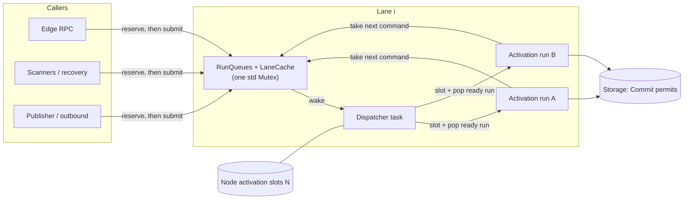

# Design Document: Concurrency Across Runs Within a Lane

## Overview

Each lane gets a queue per run and runs several runs' activations at once.

A lane keeps one queue for each run that has work. A small dispatcher task starts an activation for a run
when the run has work, no activation of its own in flight, and a node-wide activation slot is free. The
activation takes commands from the front of its run's queue, exactly as today's activation drains same-run
commands, then hands the run back. Different runs on one lane hold different slots and proceed together; one
run never holds two.

The ordering argument rests on one invariant: **a run has at most one activation in flight, and that
activation takes the run's commands in arrival order.** That is the same per-execution exclusion Temporal
v1.31.0 enforces with a weight-one semaphore on each workflow context (`ContextImpl.Lock`,
`service/history/workflow/context.go @ v1.31.0`), while callers for different executions take different
locks and proceed concurrently (`getOrCreateWorkflowExecutionInternal`,
`service/history/workflow/cache/cache.go @ v1.31.0`). Within a run, Tokeira's queue also keeps commands in
arrival order, as the serial lane does today.

Serialising different runs never protected anything. Run-key routing already spreads one shard's runs across
lanes, so any two different runs can already commit concurrently from different lanes
([dsql-throughput-optimization](../dsql-throughput-optimization/requirements.md), Requirement 9.3). A DSQL
commit locks only its own run's rows, and cross-run rows (`current_execution`, successor reservations) are
already guarded by their own `FOR UPDATE` reads and conflict checks. Concurrency inside a lane therefore adds
no new kind of cross-run interaction. It only makes the existing kind happen more often.

## Dependencies and Non-Goals

- Builds on [runtime-lane-occ-retry](../runtime-lane-occ-retry/design.md) (OCC retry, coalescing, publication
  after commit) and replaces its cross-run serialisation (its Requirements 2.6 and 3.4).
- Keeps the lane cache contract of [dsql-throughput-optimization](../dsql-throughput-optimization/design.md)
  Requirement 8, and its run-key routing (Requirement 9).
- Keeps the carry-over fix's two rules: a lane never sends to its own input, and commands run in arrival order.
- Keeps the serving gate, lease fences, and acquisition repair exactly as they are.
- **Depends on the admission decision.** Which callers are refused first is not decided here.
  `RunQueues::try_reserve` is the single place a future admission policy plugs in.
- **Non-goals:** changing lane routing or `lane_count`; any kernel change; any storage schema change; any new
  configuration option; priorities between callers.

## Architecture



A submit runs in the caller's task:

1. `LaneHandle::reserve(run_key)` locks the lane state, checks the run share and lane budget, and counts the
   claim, or returns a refusal. It never awaits.
2. The caller builds its command (for a signal, after its reads) and calls `SubmitReservation::submit`. Under
   the same lock the command joins the back of its run's queue. If the run was idle, it joins the back of the
   lane's ready order, and the caller wakes the dispatcher.
3. The caller awaits its reply.

The dispatcher, once per lane:

1. While the ready order is non-empty, acquire a node slot, pop the first ready run, mark it active, and spawn
   its activation into the lane's `JoinSet`.
2. When an activation task ends, mark its run idle. If the run's queue is non-empty, put the run at the back of
   the ready order.
3. Stop when every handle is gone, every queue is empty, and the `JoinSet` is empty.

An activation, in its own task, holding its slot:

1. Take the front command of its run's queue (this releases the command's reservation).
2. Run it through the existing path: optional poll reservation, load or reuse, kernel apply, fenced commit with
   OCC retry, publish, post-commit bookkeeping, reply.
3. Repeat while the run's queue is non-empty, fewer than `max_drain_per_activation` commands have run, and no
   command failed.

### Why each piece of existing machinery stays correct

| Machinery | Why it stays correct |
| --- | --- |
| Per-run order | One activation per run (dispatcher is the only writer of `active`), and it takes from the front of a FIFO filled under the lock in arrival order. |
| Same-run coalescing | An activation keeps taking its own run's commands up to `max_drain_per_activation`. Other runs' commands no longer interrupt the drain, so coalescing can only improve. Failure still ends the activation. |
| Fairness | A run that reaches the drain bound goes to the back of the ready order, behind runs that were waiting. |
| Never sending to its own input | Nothing in the lane submits to the lane. The dispatcher only moves run keys between `ready` and `active`. |
| Lane cache | Images carry the generation they were read under; an activation compares its own image's generation before commit instead of relying on whether it was the one that cleared the cache. Identity lookups install an image only for an idle run with no entry, so they can't replace an in-flight run's newer image. |
| OCC retry | Unchanged and per command. Different runs don't conflict on each other's rows; a stale identity-installed image costs at most one retry, as any stale cache entry does today. |
| Identity lookups | Served in the caller's task straight from the cache, or by a load there. No channel, so a busy lane can't starve them, and they never wait for an activation. |
| Outbound metadata commits | Become a command kind in the run's own queue, so they serialise with that run's commands in arrival order. They still evict the run's entry after committing. |
| `submit_reserving_poller` | The poll is still reserved when the lane *takes* the start, which now means after the start's activation holds a slot. A start waiting for a slot holds no poll. |
| Outbound, observed and activity-timeout fences | Unchanged: each is checked against the state its commit uses, inside the activation. |
| Serving gate | Each command takes a read permit, as today. The read side admits many holders, and repair's write side waits for all of them, on every lane. |
| Shard handoff and drain | A queued command for a relinquished shard runs, fails admission, and is answered with the not-shard-owner error. The fence stops a commit from a lapsed owner. Cache generations change on every acquisition and relinquishment. |
| Recovery | Sweeps submit through the same reservation. A refused sweep item stays in durable state for the next pass. |
| Shutdown | The dispatcher outlives every activation it spawned and ends only when all handles are gone and every queue is empty, so no accepted command loses its reply. |

## Components and Interfaces

All new runtime code lives in `crates/tokeira-runtime/src/lane/` beside `lane.rs`; storage gains one trait
method; the edge gains two error mappings. The kernel is untouched.

### `lane/run_queues.rs` — the pure core

A synchronous, I/O-free structure, so its accounting and ordering can be property-tested without Tokio.

```rust
pub(crate) struct RunQueues<T> {
    budget: usize,      // L
    share: usize,       // R = L / 2
    reserved: usize,    // claims held on this lane, queued or not
    runs: HashMap<RunKey, RunEntry<T>>,
    ready: VecDeque<RunKey>,
}

struct RunEntry<T> {
    queue: VecDeque<T>,
    reserved: usize,    // this run's claims, queued or not
    state: RunState,    // Idle | Ready | Active
}

pub(crate) enum LaneRefusal { RunShareFull, LaneBudgetFull }

impl<T> RunQueues<T> {
    pub(crate) fn try_reserve(&mut self, run: RunKey) -> Result<(), LaneRefusal>;
    pub(crate) fn release(&mut self, run: RunKey);                  // claim dropped unused
    pub(crate) fn enqueue(&mut self, run: RunKey, item: T) -> bool; // true: run became ready
    pub(crate) fn pop_ready(&mut self) -> Option<RunKey>;           // Ready -> Active
    pub(crate) fn take_next(&mut self, run: RunKey) -> Option<T>;   // releases that item's claim
    pub(crate) fn finish(&mut self, run: RunKey) -> bool;           // Active -> Ready or Idle
    pub(crate) fn is_active(&self, run: RunKey) -> bool;
    pub(crate) fn queued(&self) -> usize;
}
```

`try_reserve` checks the run share first, so a hot run's own submits see the busy-workflow refusal rather than
the lane-wide one. An entry is removed when it is idle with no claims and an empty queue, so the map stays
bounded by `L` plus the active runs.

### `lane/shared.rs` — the lane's shared state

```rust
pub(crate) struct LaneShared<T> {
    state: std::sync::Mutex<LaneState<T>>,
    wake: tokio::sync::mpsc::Sender<()>,   // capacity 1; try_send, Full is fine
}

struct LaneState<T> {
    queues: RunQueues<T>,
    cache: LaneCache,
}
```

One mutex covers both, so the identity install rule (Requirement 3.5) is one atomic check and no lock order
exists. It is never held across an await. Cloning a cached image happens under it, as the clone happens today.
The `wake` channel's receiver belongs to the dispatcher. When every `LaneHandle` (and so every sender) is gone,
`recv()` returns `None`, which is how the dispatcher learns the lane is closing.

### `LaneHandle` and `SubmitReservation`

```rust
impl LaneHandle {
    pub(crate) fn reserve(&self, run_key: RunKey) -> Result<SubmitReservation, LaneRefusal>;
    pub async fn submit(&self, run_key: RunKey, command: Command) -> Result<CommitResult>; // reserve + submit
    // submit_reserving_poller, submit_outbound, submit_observed, submit_activity_timeout,
    // submit_with_successor and commit_outbound_metadata keep their signatures and reserve first.
    pub(crate) async fn execution_identity(&self, run_key: RunKey) -> Result<(NamespaceId, WorkflowId)>;
    pub fn queued_depth(&self) -> usize;
    pub fn active_activations(&self) -> usize;
}

pub(crate) struct SubmitReservation { /* lane, run_key, spent */ }

impl SubmitReservation {
    pub(crate) async fn submit(self, item: LaneItem) -> Result<CommitResult>;
}

impl Drop for SubmitReservation { /* release unless spent */ }

pub(crate) enum LaneItem {
    Command(LaneMessage),
    OutboundMetadata(OutboundMetadataRequest),
}
```

`LaneRefusal` converts into the runtime errors `WorkflowBusy` and `LaneOverloaded` (see *Error Handling*).

### The dispatcher and the activation

`spawn_lane_with_id` keeps its signature plus one argument, the node's `Arc<tokio::sync::Semaphore>` of `N`
slots. It spawns the dispatcher. The activation context the dispatcher hands each task (kernel behind `Arc`,
repository and publisher clones, trackers, update registry, close-attempt set, config, clock, and
`Arc<LaneShared>`) is one `Arc<LaneContext<K, R, P>>`, built once.

The activation reuses `handle_message_with_successor` and the post-commit code of `run_activation_with_cache`
unchanged in behaviour. The `&mut LaneCache` parameter becomes a small `CacheAccess` that locks
`LaneShared::state` for each `get`, `insert` or `evict`, and carries the generation of the image it handed
out.

### Storage: the commit ceiling

```rust
// tokeira-storage, RunRepository
fn commit_concurrency_ceiling(&self) -> Option<usize> { None }
```

`DsqlRunRepository` returns the `Commit` allocation that `default_allocations` gives the reservoir's
configured `target_ready`, the most the live target can reach. `InMemoryStore` keeps the default. The
`Arc<T>` blanket impl and every delegating wrapper (such as the edge's `HistoryNotifyingRepository`) forward.

### Runtime: the node bound

`TokeiraRuntime` builds one semaphore of
`N = max(lane_count, repo.commit_concurrency_ceiling().unwrap_or(0))` slots and passes it to every lane.
Standalone `spawn_lane` uses `max(1, ceiling)`.

Why this bound:

- **`C`, the commit ceiling.** Every activation that writes needs a commit permit. Past `C`, extra activations
  can only queue on the commit semaphore while holding a loaded image and a serving-gate permit. That adds
  memory and makes repair's quiesce wait longer, and adds no throughput. The ceiling, not the live target, is
  used so the slot count is fixed. When a controller lowers the live target, the commit semaphore itself
  becomes the tighter limit.
- **The `lane_count` floor.** Today a node runs exactly one activation per lane, so with the floor no node
  runs fewer concurrent activations than it does today, even on a tiny connection budget.

### Signal path: admission before reads

`RuntimeAdapter::signal_workflow` (edge) receives the run key that `resolve_execution_run_key` produced. It
calls `TokeiraRuntime::reserve_submit(run_key)` first, before `execution_for_run`, and passes the reservation
down through `signal_workflow` and `signal_run` to `submit_admitted`, which spends it instead of reserving
again. `reserve_submit` is a pure in-memory check. If the runtime's own resolution yields a different run key
than the reservation's, the reservation is dropped and one is taken for the resolved key. Every early return
(duplicate, closing workflow, missing run) drops the reservation, which releases it. The batch operation's
signal goes through the same adapter call.

A refused signal now costs the edge's run-key resolution and nothing else. Today it costs that plus up to three
run loads and a second resolution.

## Data Models

There is no durable change. The in-memory changes are:

| Type | Field | Source |
| --- | --- | --- |
| `RunQueues` | `budget = L` | The lane's existing mailbox capacity, 1024, named as one constant. |
| `RunQueues` | `share = L / 2` | Half the lane budget. See *The run share* below. |
| `CachedRun` | `generation: u64` | The shard owner's `cache_generation()` when the image was read. |
| `RunEntry` | `state` | `Idle`, `Ready`, or `Active`. Only the dispatcher moves a run into or out of `Active`. |

### The run share

`R = L / 2` is the largest share that still guarantees every other run on the lane at least as much room as
the hot run takes. It also refuses no sooner than v1.31.0 would under the same load. Temporal serves waiters
on one execution one lock hold, and so one persistence round trip, at a time, and refuses a caller whose
deadline (less 500 ms) passes first (`lockWorkflowExecution`, `cache.go @ v1.31.0`). With round trips of tens
of milliseconds and a ten-second deadline, that refuses somewhere past a few hundred waiters. Tokeira serves
`max_drain_per_activation` commands per activation, so its 512 queued commands drain in 32 round trips. A run
with more than 512 commands queued is producing work faster than its own commits can retire it, which is the
condition v1.31.0 calls a busy workflow.

## Correctness Properties

### Property 1: Per-run order holds under concurrency

*For any* set of runs on one lane, any interleaving of their submissions, and any delays on their commits, each
run SHALL have at most one activation in flight, and the kernel SHALL see each run's commands in the order the
lane accepted them.

**Validates: Requirements 1.1, 1.2, 1.7, 4.2**

### Property 2: A slow run doesn't delay another run on the same lane

*For any* lane with at least two free activation slots, any run A whose commit is held indefinitely, and any
commands for other runs on that lane, every command for the other runs SHALL complete while A's commit is
still held.

**Validates: Requirements 2.1, 2.2, 2.4**

### Property 3: The bound on activations is never exceeded

*For any* workload over any number of lanes sharing `N` slots, the number of activations in flight on the node
SHALL never exceed `N`. With the work available, it SHALL reach `min(N, ready runs)`.

**Validates: Requirements 5.1, 5.6**

### Property 4: No command is lost or duplicated across a shard handoff

*For any* schedule of submissions interleaved with shard relinquishments, re-acquisitions and cache-generation
changes, every accepted command SHALL receive exactly one reply. The commands applied to the run's history
SHALL be exactly those whose reply is `Applied`, each once.

**Validates: Requirements 8.1, 8.2, 8.3, 3.3, 3.4**

### Property 5: Reservation accounting is exact and refusals don't wait

*For any* sequence of `try_reserve`, `release`, `enqueue`, `pop_ready`, `take_next` and `finish` operations,
the lane's claims SHALL never exceed `L`, a run's SHALL never exceed `R`, and both SHALL equal the claims taken
minus those released or started. A reservation past `R` SHALL return `RunShareFull`, and one past `L` with the
run within `R` SHALL return `LaneBudgetFull`, each without awaiting.

**Validates: Requirements 6.1, 6.2, 6.3, 6.4, 6.5, 6.6, 6.7**

### Property 6: Ready order and the drain bound

*For any* sequence of operations on `RunQueues`, a run SHALL be in the ready order at most once, never while
active. Runs SHALL leave the ready order in the order they entered it. An activation SHALL take at most
`max_drain_per_activation` commands, and a run finished with a non-empty queue SHALL re-enter the ready order
behind every run already in it.

**Validates: Requirements 1.3, 1.5, 2.3**

### Property 7: The cache never feeds a commit a stale-generation image

*For any* interleaving of activations, identity lookups, outbound metadata commits and cache-generation
changes, no commit SHALL use an image recorded under an older generation than the shard owner's at commit
time. An identity lookup SHALL never replace an entry, nor install one for an active run, and the cache SHALL
hold at most `cache_max_entries` entries.

**Validates: Requirements 3.1, 3.2, 3.3, 3.4, 3.5, 3.7**

### Property 8: A refused signal reads only its run key

*For any* lane at its budget (or run at its share), a signal to that run SHALL be refused with the matching
refusal, having issued no storage read besides the edge's run-key resolution. *For any* early return after a
successful reservation, the lane's claims SHALL return to their prior value.

**Validates: Requirements 7.1, 7.2, 7.3, 7.4**

### Property 9: Below the bounds, replies match the serial lane

*For any* per-run command sequences that keep every lane and run below its bound, the reply to each command,
and each run's committed history, SHALL equal those the serial lane produces for the same per-run sequences.

**Validates: Requirements 10.1, 10.2, 4.1, 4.5**

## Error Handling

| Condition | Internal error | External status |
| --- | --- | --- |
| Run share full | `errors::WorkflowBusy` | RESOURCE_EXHAUSTED, `ResourceExhaustedFailure{cause: BUSY_WORKFLOW, scope: NAMESPACE}`, message `Workflow is busy.` (`ErrResourceExhaustedBusyWorkflow`, `service/history/consts/const.go @ v1.31.0`). HTTP 429. |
| Lane budget full | `errors::LaneOverloaded` | RESOURCE_EXHAUSTED, `ResourceExhaustedFailure{cause: SYSTEM_OVERLOADED, scope: SYSTEM}` (the shape of `ErrCacheFull`, `common/cache/lru.go @ v1.31.0`), with a Tokeira message saying the server is at capacity and to retry after a backoff. HTTP 429. |
| Shard not owned when the activation admits the command | `NotShardOwner` (unchanged) | Unchanged. |
| Activation task ended without finishing | The command's reply sender is dropped; the caller sees the existing closed-reply error. The run is marked idle. | Unchanged from a lane failure today. |
| Lane closed | Unchanged closed-lane error. | Unchanged. |

Internal submitters (scanners, recovery, the publisher's follow-ups, the outbound driver) treat both refusals as
transient. Each already has a durable source it rescans or retries from. Temporal's queue executor does the same
with a busy-workflow refusal: it reschedules the task (`Nack`, `service/history/queues/executable.go @ v1.31.0`).

## Testing Strategy

- **Pure property tests** (`lane/run_queues.rs`, proptest, 256 cases): Properties 5 and 6 against a simple
  reference model of per-run FIFOs and counters.
- **Concurrent lane property tests** (`lane/tests/concurrency.rs`, proptest, 64 cases, each on a fresh
  multi-thread Tokio runtime): Properties 1, 2, 3, 4, 7 and 9. They use the in-memory store behind a test-only
  gated repository that parks chosen runs' commits on a `oneshot` and records kernel entry and exit per run.
  They synchronise on channels and `Notify`, never sleeps. Property 4 drives relinquish and acquire through
  `ShardOwner` and checks replies against the store's history.
- **Signal path** (runtime and edge tests): Property 8, with a counting repository wrapper that records every
  read by kind, and a lane filled to its budget through reservations.
- **Edge mapping examples**: one test per refusal asserts gRPC status, cause, scope and message, and the HTTP
  status.
- **Regression**: the existing lane tests stay green, including
  `lane_drains_full_mailbox_with_parked_submitters_in_arrival_order` (rewritten to fill the budget and expect
  refusals instead of parked submitters), `run_activation_honors_drain_limit`,
  `run_activation_stops_drain_on_error`, the cache tests, and the reserved-poll tests.
- **Live DSQL**: the [DSQL suite runbook](../../../docs/testing/dsql-live-suites.md) on an ephemeral cluster confirms that concurrent same-lane
  commits stay within commit permits. PostgreSQL isn't accepted as evidence.
