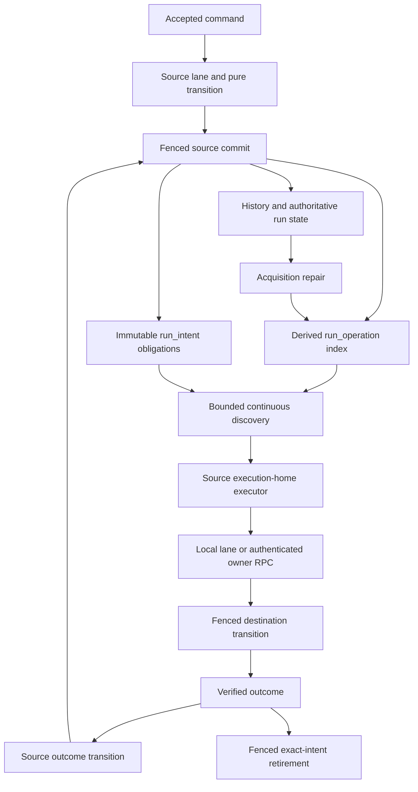

# Design: Recoverable Outbound Dispatches

## Review status and overview

Design and [tasks.md](tasks.md) approved on 31 October 2026, against the approved
[requirements](bugfix.md). All remaining item 1.9 changes belong to one implementation
PR. Baseline: `e057750774e38776019bb6c8e7043ebde902a1d5`.

Committed run state retains pending operations; a derived `run_operation` index makes
them continuously discoverable. A separate immutable `run_intent` record retains what
a close still owes. Source transitions own operation lifecycle; the executor retires
an intent only after a definitive outcome. Neither is a claim/acknowledgement queue.
Reset uses invisible preparation followed by atomic publication. A successor-size
fallback commits its frozen start and an execution-chain reservation with the close.

The behavioural sources are the tagged Temporal paths in the requirements. New source
inspection resolves reset ordering more precisely: `prepareResetWorkflow` authors the
fork-point task failure, `ResetWorkflow` reapplies events, performs post-reset options,
then schedules the fresh task before `persistToDB`
(`service/history/ndc/workflow_resetter.go @ v1.31.0`). Requirement 7.7's preservation of
event ordering means preserving correct ordering; the baseline's options-before-failure
sequence is corrected to this order. This explicit clarification is part of this design
review, not an assertion that the baseline order was already correct.

## Dependencies, ownership and non-goals

| Owner | Work in this PR |
|---|---|
| `tokeira-kernel` | Durable semantic identities, child first-task gating, idempotent child outcomes, attempt fencing, pure reset preparation; no I/O or queue-processing commands |
| `tokeira-storage` | Versioned encoding, operation derivation, intent/reservation/preparation repositories, atomic publication, bounded discovery and retention, memory/DSQL parity |
| `tokeira-runtime` | Preparation of delivery facts, continuous executors, source outcome transitions, routing, acquisition/drain integration, reset coordination |
| `tokeira-edge`, `tokeira-auth`, `tokeira-proto`, `apps/tokeirad` | Narrow internal outbound-delivery RPC, purpose-specific peer authentication, bootstrap and maintenance entry points; no workflow semantics in edge |
| Existing sibling specifications | Atomic successors, successor semantics, bounded bulk writes, large-value parts, recovery index, lease fencing, runtime child/external/Nexus operations and peer credentials |

No public Temporal RPC, vendored proto change, new dependency, package, or compatibility
pin is introduced. The new internal RPC is necessary when source and destination have
different owners; it does not complete general forwarding (4.6) or queue-home delivery
(4.7). Callback delivery retains its existing scanner. General activity reconciliation,
projection, CHASM and worker-compute are unchanged.

The proposed architecture 042 remains a proposal outside this PR's scope. This design
does not replace task queues, timer tables or visibility machinery wholesale.

## Architecture



A notification wakes discovery sooner; removing every notification loses no work.
Control-plane ownership determines where discovery may run. Destination ownership and
incarnation checks determine whether an attempted effect may commit. A source lease is
never used as permission to write a destination run.

External HTTP invocation is at least once. Stable Nexus/callback request identity lets
the recipient deduplicate; this PR cannot promise exactly-once side effects inside an
arbitrary third-party handler. Tokeira records at most one accepted semantic outcome
for the relevant incarnation/attempt.

### Lifecycle inventory

| Kind | Incarnation and dedupe identity | Discoverer / executor | Remover | Retry authority |
|---|---|---|---|---|
| Child start | Parent run + initiated event; stable prepared child run/request ID | Parent home / outbound executor | Parent failure or transition advancing to release phase | Executor's bounded attempt backoff; pending state remains durable |
| Child first-task release | Same initiation + confirmed child run | Parent home, including a closed ABANDON parent / outbound executor | Runtime source transition recording verified child release or obsolescence | Executor |
| External signal/cancel | Source run + kind + initiated event; existing stable request ID | Source home / outbound executor | Source resolution or authoritative cancellation of the obligation | Executor |
| Nexus start | Source run + scheduled event + durable attempt generation | Source home / Nexus adapter | Outcome/retry/timeout transition | Existing persisted Nexus attempt/deadline state |
| Nexus cancel | Scheduled event + cancellation-request event + attempt generation | Source home / Nexus adapter | Cancellation-attempt outcome or operation termination | Existing persisted cancellation state |
| Completion callback | Run + callback index + attempt | Existing callback scanner | Existing callback outcome transition | Existing persisted callback state |
| Parent-close action | Source close sequence + child initiation/first run + action kind | Closed parent's home / intent executor | Executor after proven application or terminal relationship outcome | Executor |
| Child result | Closed final child run + parent initiation + first child run | Closed child's home / intent executor | Executor after parent outcome or proven terminal absence/staleness | Executor |
| Oversized successor | Predecessor close + selected successor/request ID | Predecessor home / successor coordinator | Atomic successor publication plus reservation/intent retirement | Executor |
| Reset | Namespace/workflow + reset request + selected new run | Request coordinator / same execution home | Atomic publication or abandonment of invisible preparation | Caller retry before publication; no post-success follow-up task |

## Authoritative data and encoding

### Run metadata

Add an `OutboundState` field to `WorkflowState` as a separately versioned state
extension, not an appended positional postcard field. It holds runtime facts needed
for reconstruction: prepared child seeds, outstanding first-task releases, child-side
parent-confirmation gates, and attempt-generation additions not already present in
Nexus state. These are authoritative run metadata committed under `transition_seq`,
not executor claims. Runtime-only facts use a lane-serialized state-only `Transition`,
like existing heartbeat metadata in `runtime/activity.rs`, through the fenced commit
API. They do not add invented public history events.

The current state codec explicitly permits older readers to ignore unknown extension
tags. That is unsafe for this data: a reader could release a child early or erase a
prepared identity. Therefore write a **new state envelope version**, retain explicit
decoders for supported predecessor versions, and bump the schema writer contract.
An old writer must reject new-format state. Unknown required outbound versions fail
closed with a typed error; absence in a legacy envelope means legacy, not an empty
new-format obligation set.

Append a new internal child-initiation history variant carrying the accepted reuse
policy. Keep the old variant's postcard layout frozen. Write a new history envelope
version and read both supported formats explicitly. The edge maps both variants to
the existing upstream event; the new variant also populates the already-existing
`workflow_id_reuse_policy` wire field. A legacy event missing that policy is not
silently interpreted as ALLOW_DUPLICATE during recovery.

| Model / fields | Authority and purpose |
|---|---|
| `OperationKey { source_run, kind, initiating_event }` | Committed initiation/schedule; `kind` distinguishes signal, cancel, start and release slots |
| `OperationIncarnation { key, requested_event, attempt }` | Cancellation-request identity and recorded Nexus generation; zero/absent only where that kind has no such dimension |
| `ChildStartSeed { child_run_id, request_id, prepared_at, parent_namespace_name, root_identity, effective_priority, versioning_info }` | Runtime-selected values committed before any target start; static start fields remain in initiation history |
| `ChildReleaseState { initiating_event, child_run_id, parent_started_event_id, parent_close_policy }` | Parent start confirmation; survives parent close only when release remains owed |
| `ChildStartGate { parent_identity, initiating_event, first_child_run_id, released }` | Child creation and verified parent confirmation; prevents premature first-task eligibility |
| `ChildOutcomeIdentity { parent_initiated_event, child_first_run, child_final_run }` | Fences `ChildResolved` and prevents workflow-ID reuse from resolving a different child |
| `OutboundOrigin { source_run, operation_key, incarnation }` | Internal destination submission provenance; stored with request dedupe evidence and used to retain it while a source still needs confirmation |
| `IntentKey { source_run, close_seq, kind, ordinal }` | Stable deterministic ordering of obligations authored by one close; `ordinal` follows sorted child/operation identity |
| `IntentPayload::ParentClose` | Target namespace/workflow, parent identity, initiation, first child run, policy and reason; excludes ABANDON |
| `IntentPayload::ChildResult` | Parent/child lineage and immutable terminal-event reference; preserves result, failure, retry-state and cancellation details |
| `IntentPayload::Successor` | Versioned frozen `StartRequest`, predecessor identity and expected pointer; preserves PR 340's separate frozen clocks |
| `PreparedReset` | Reset request identity, base/current sequence expectations, fork prefix and principals, full replay/reapply result, ordered options, final dispatch and current-pointer expectation |
| `PreparationManifest` | Preparation ID/generation, source request identity, participant sequence expectations, content digest, staged-row counts, final state references and phase |

Use existing UUID generation outside the kernel. A child seed is selected in a fenced
source transition before the first attempt; a losing OCC attempt never dispatches its
candidate. Request IDs retain the existing external signal/cancel formats. New child
request IDs are domain-separated by parent run and initiation. No UUID feature or
hashing dependency is added. Random IDs and clocks are explicit inputs to pure logic.

Replay reconstructs semantic initiation and close facts from history. Runtime-selected
seeds come from committed authoritative metadata, not from `run_operation`. Reset
preparation carries or reconnects a seed only after verifying the corresponding child
lineage; replay of a history prefix never invents a replacement child for an already
materialized initiation.

### Physical storage

Add forward-only migrations above the actual schema head (V100 at this baseline).
Assign contiguous numbers at implementation time and update the schema target/digest
and build metadata together. Keep the immutable V001–V100 prefix unchanged. Each file
contains one statement; indexes use `CREATE INDEX ASYNC`; no new dependency on foreign
keys, CHECK constraints or sequences. Namespace identity is validated through the
source run and included in payload/routing identities, matching existing run tables.

| Table / index | Fields and lifecycle |
|---|---|
| `run_operation` | Primary key `(source_run_key, kind, initiating_event_id)`; source home, requested event, attempt generation, due time, target workflow key where applicable. No payload copy, claim, executor ID, delivery status or dead-letter column. Source commits upsert/delete changed derived entries. Index `(source_home, kind, source_run_key, initiating_event_id)` supports bounded rounds. |
| `run_intent` | Primary key `(source_run_key, intent_id)`; source home, close sequence, kind, creation time, versioned payload, part count. Immutable after insertion; executor deletes the exact key under its original home fence. Index `(source_home, source_run_key, intent_id)`. |
| `run_intent_part` | Primary key `(source_run_key, intent_id, part_no)`; bytes after the inline first part. Written/read/retired with the header, using existing `value_parts` invariants. |
| `successor_reservation` | Workflow-scoped key matching current-execution identity; home, predecessor key/close sequence, successor key and intent key. Created with fallback close; removed only with verified successor publication. Every current-pointer writer checks it. |
| `run_preparation` | Preparation ID, request-scoped key, target run, home, manifest version/digest, participant expectations, generation and phase. A unique request-key index makes repeated reset preparation select the same new run. This is bounded invisible-write bookkeeping, extending the existing materialization protocol, not a delivery queue. |
| `run_preparation_part` | Chunked immutable manifest data and prepared source mutations when not inline. Every page checks preparation generation/phase and the captured home fence. |
| `outbound_recovery_upgrade` | One algorithm-version record with revision, preflight/preparation/complete phase and bounded scan cursor. Completion marks the cutover boundary; it does not claim old close delivery was recovered. |
| `request_dedupe` additions | Nullable internal outbound source key/incarnation fields, with a source-reference lookup index. Destination commits write them with existing dedupe evidence; retention keeps evidence needed by unresolved source operations. |

The source commit derives operation changes from the authoritative before/after state,
not solely from dispatch effects. This covers state-only transitions, timeout paths,
paired commits and reset publication. Validate derivation in both backends. Repair
replaces only operation rows; it never reconstructs intent rows.

DSQL currently documents 1 MiB per non-indexed column, 2 MiB per row, 10 MiB changed
data and 3,000 mutated table rows per transaction. Retain existing 960 KiB parts and
conservative paged-write budgets; count new rows/parts and index-key bounds before
commit. `54000` also covers transaction age and key limits: fallback classification
requires a recognized transaction/row/value-size refusal, not SQLSTATE alone.
[AWS quotas](https://docs.aws.amazon.com/aurora-dsql/latest/userguide/CHAP_quotas.html).

Do not impose new generic DSQL refusals on the memory backend; share the atomicity
contract and mutation-cost model, and use injected refusals to test the fallback.
Live DSQL tests establish actual storage limits. No connection-pool settings change.

## Components and interfaces

Signatures below specify the contract; exact type placement follows existing module
conventions. New types derive Debug and appropriate serde traits. Large values are
boxed across async boundaries to avoid growing lane futures.

### Storage (`crates/tokeira-storage/src/outbound.rs`, `api.rs`)

```rust
fn derive_operations(state: &WorkflowState) -> Result<Vec<OperationRow>, RecoveryError>;
fn derive_close_intents(before: &WorkflowState, transition: &Transition)
    -> Result<Vec<NewIntent>, RecoveryError>;

async fn read_operation_page(&self, home: ShardId, round: OperationRound,
    after: Option<OperationKey>, limit: usize) -> Result<OperationPage>;
async fn read_intent_page(&self, home: ShardId, round: IntentRound,
    after: Option<IntentKey>, limit: usize) -> Result<IntentPage>;
async fn reconcile_outbound_run(&self, home: ShardId, run: RunKey,
    fence: WriteFence) -> Result<RepairResult>;
async fn retire_intent(&self, key: IntentKey, proof: DefinitiveOutcome,
    fence: WriteFence) -> Result<RetireResult>;

async fn commit_successor_fallback(&self, close: Box<Transition>,
    frozen_start: Box<StartRequest>, fence: WriteFence) -> Result<CommitResult>;
async fn publish_prepared_successor(&self, preparation: PreparationToken,
    reservation: ReservationIdentity, fence: WriteFence) -> Result<PublishResult>;
async fn prepare_reset(&self, reset: Box<PreparedReset>, fence: WriteFence)
    -> Result<PreparationToken>;
async fn commit_prepared_reset(&self, token: PreparationToken,
    fence: WriteFence) -> Result<ResetCommitResult>;
```

Existing single/pair commit methods remain the normal commit API and maintain outbound
state automatically. Mandatory methods have no successful empty default for authoritative
stores; wrappers forward them. `retire_intent` validates key, kind and proof identity,
then checks the captured lease fence in the delete transaction. Only a fully verified
runtime outcome can construct `DefinitiveOutcome`; a `CommitResult::Duplicate` alone
cannot. A missing exact intent is an idempotent retirement result.

`prepare_reset` writes invisible rows only. `commit_prepared_reset` rechecks every
participant sequence and the expected current pointer under one home fence, then
publishes base/current mutations, the complete new run and all derived rows/intents in
one transaction. No internal sequence of ordinary public commits may emulate it.

### Runtime (`src/outbound/`, `lane.rs`, `recovery.rs`)

```rust
async fn prepare_child_seed(&self, key: OperationKey) -> Result<ChildStartSeed>;
async fn drive_operation(&self, reference: OperationRef,
    acquisition: ShardAcquisition) -> Result<AttemptDisposition>;
async fn drive_intent(&self, reference: IntentRef,
    acquisition: ShardAcquisition) -> Result<AttemptDisposition>;
async fn attempt_destination(&self, reference: DeliveryReference)
    -> Result<DestinationOutcome>;
async fn prepare_and_commit_reset(&self, request: ResetRequest)
    -> Result<ResetWorkflowResult>;
```

Mechanical limits stay in `RuntimeConfig`/constants, not new TOML/env knobs: initial
design limits are 100 descriptors per page, 64 in-flight attempts per node and 8 per
home, with round-robin scheduling across homes and kinds. Characterize these in tests;
they can tune throughput without changing semantic guarantees. Individual attempts
have bounded timeouts and exponential backoff; exhausted local retries leave durable
work discoverable. An unresolved record is reported without stalling unrelated work.

Every discovery round captures a finite greatest key, walks keyset pages to that bound,
then starts a new round at the head. New lower keys wait only for the next round.
Persisted due times filter eligibility, not correctness of a one-way cursor. Local
in-flight/backoff maps suppress excess retries only; they vanish safely on takeover.
One failing record cannot monopolize the first page or prevent later records running.

Acquisition includes all legacy candidates and new source-only pending states, under
the existing exclusive writer barrier. Reconcile operations using the acquisition's
original fence on every retry; enable scanning only after that acquisition is Active.
Recovery of closed-run intents uses its own table, not the open-run recovery filter.
Losing ownership cancels further scheduling. Late responses cannot borrow a replacement
acquisition's fence. External I/O already sent may finish; destination/source commit
fences and idempotency absorb that race.

### Minimal internal transport

Use `proto/tokeira/internal/runtime/v1/command.proto` for a narrow `OutboundDelivery`
service, not a generic serialized `Command` endpoint. The request references committed
work; the receiver loads the recipe itself and revalidates the source incarnation.
All source resolution commits remain local to the source executor. Only effects on a
different execution home need the RPC.

| Wire field | Policy |
|---|---|
| `source_run_key` | Exactly one valid UUID; identifies committed authority, never supplied payload |
| `reference` oneof | Operation key/kind or exact intent ID; absent/unknown variants rejected |
| `initiating_event_id`, `requested_event_id`, `attempt` | Validated against the persisted operation; stale reference returns Obsolete |
| `destination_home` | Routing hint checked against resolved target identity and current local ownership |
| Response `outcome` | Closed enum: Applied, DuplicateVerified, Terminal, Obsolete, NotOwner, Retryable; unspecified rejected |
| Response `target_run_id`, `target_transition_seq` | Present only for verified target application; checked against expected lineage |
| Response `terminal_cause` | Kind-specific cause enum from requirements; no arbitrary error string becomes history |
| Response `reset_redirect_run_id` | Used only for child-result redirect; next hop is resolved from authoritative placement, not a returned URL |

Local and remote paths call the same runtime handler. Receivers never recursively
forward; a source refreshes placement and retries a bounded number of hops, then yields
to discovery. Authenticate before descriptor hydration. Enforce body/header/concurrency
limits and a fixed attempt deadline. Public Worker/Admin credentials are insufficient.

Reuse the existing protected peer material, signature validation and channel machinery,
with a **separate fixed outbound audience** derived from cluster ID. Make signer/verifier
purpose explicit; an offer token cannot authorize an outbound call and vice versa.
Do not broaden the current workflow-offer audience. No-peer modes expose no remote
route and continue using the same local handler. Bootstrap uses the existing protected
file; it neither generates credentials nor reads them into logs.

## Execution protocols

### Child start and first-task release

1. The initiation records accepted configuration, including reuse policy. A source
   preparation transition chooses and persists its child seed before any target I/O.
   Parent/registry reads used to derive versioning are checked against the source
   sequence when the seed commits. Subsequent attempts use that seed.
2. Load the pending initiation and seed, then submit the same child start to its owner.
   The start persists `ChildStartGate`; it records Started history but creates no
   runnable first workflow task. Run/execution timeout anchors still begin at creation.
   Missing namespace/existing workflow produce only the verified failure causes.
   The seed's preparation time is diagnostic, not the child's execution start clock:
   the destination supplies the creation clock for the committing attempt. Once created,
   that run's stored anchors win on retries. An outage before creation must not consume
   the child's run timeout merely because its source seed was prepared earlier.
3. On an ambiguous reply, verify the chosen child's start request and parent initiation
   against stored state/history/dedupe. Never accept an unrelated request-ID collision.
4. Commit parent `ChildStartConfirmed` idempotently. Matching repetition is a no-op;
   different child ID or initiation is stale. Advance the derived operation to
   first-task release, retaining the seed/confirmation proof.
5. The child receives a fact-bearing `ParentChildStartRecorded` transition after runtime
   verification of the parent started event. It removes its gate and schedules the
   first task, or leaves the original cron/start-delay deadline in control. An already
   elapsed delay schedules immediately; recovery does not restart delay or timeout
   clocks. This command records an observed relationship, not a request to do I/O.
6. A source runtime transition records verified release and removes the pending release
   metadata/row. Losing this final reply merely repeats an idempotent child transition.

A closed unconfirmed parent stops further starts. A confirmed ABANDON child retains
release work after parent close; other policies hand control to the close intent.
The parent transition preserves the necessary confirmation data before clearing its
ordinary children map. A materialized but unconfirmed child never becomes runnable
just because the source lookup failed. If the parent is definitively obsolete, the
start attempt stops; already-created child timeouts retain their normal authority.
These cases follow `processStartChildExecution @ v1.31.0`.

### External operations

Hydrate payloads from the exact initiation event; retain existing stable request IDs,
self-target rules, namespace mapping and optional-run targeting. The destination records
outbound provenance with dedupe evidence in the same transaction as the signal/cancel.
An ambiguous retry resolves that evidence before inventing a failure. Failed lookups,
OCC exhaustion, owner loss and unknown errors remain retryable.

The source resolution transition alone records signaled/cancel-requested/failed history
and removes the operation. A source that closed while delivery was in flight makes
further attempts obsolete; a completed target effect is not undone. Destination dedupe
evidence remains protected until the source no longer needs it.

### Nexus and callbacks

Scheduled Nexus starts and scheduled cancellations derive rows even with no timeout.
Backing-off operations retain their due time. At the due time, the source's existing
retry transition advances to scheduled; the executor reloads the new attempt identity
before invocation. Add an expected attempt generation to result inputs where the
scheduled/requested-event fence alone cannot reject a late result from an earlier
attempt. The same generation is carried by worker-backed Nexus task tokens.

The timeout scanner retains timeout evaluation only; remove its competing retry-dispatch
branch. Before invocation, evaluate committed timeout anchors and give due terminal
timeouts precedence. Accepted async operations wait for completion; do not re-start
them. Cancellation acknowledgment does not resolve the operation itself. Completion
callbacks keep their current scanner and authoritative attempt state; do not also put
them in `run_operation` in this PR.

### Close obligations and retention

Build parent-close intents from the pre-close child state before it is cleared. Build
child-result intents from the actual terminal event and full lineage; suppress retry,
cron, continue-as-new and reset intermediate closes. Sort before assigning ordinals.
Creation, payload parts and the close commit together.

Parent-close execution follows the matching child first-run chain and checks the parent
relationship. A reused workflow ID outside that chain is untouched. Child-result delivery
validates initiation and first child run, follows recorded reset redirects, and records
a missing child Started event before the terminal event where v1.31.0 does. Redirect
limits/cycles are retryable diagnostic conditions, not proof of delivery.

After verified application/duplicate or a justified terminal relationship outcome, delete
the exact intent under the source home's fence. Crash between target commit and delete
causes harmless redelivery. No acquisition sweep regenerates a deleted intent.

Retention/purge must keep referenced terminal history, prepared payloads and destination
dedupe evidence until obligations no longer need them. Add these references to bounded
purge eligibility. A public deletion tombstone keeps its existing visible semantics;
physical reclamation may be deferred. Deletion of a source cancels its ordinary pending
operations authoritatively, but must not silently erase close obligations that are still
owed. This is physical dependency retention, not a new queue acknowledgment protocol.

### Atomic reset preparation and publication

Move orchestration out of the lane's post-commit path. The coordinator reads the base,
current pointer/current run and required chain history, then prepares all semantic
changes before committing any of them. Capture sequence/last-event bounds for mutable
participants. A request-scoped preparation identity selects one new run across retries;
an identical committed request returns that same reset result while it is the matching
current reset. Public reset deduplication follows the current execution's reset request
identity (`service/history/api/resetworkflow/api.go @ v1.31.0`); the preparation registry
does not introduce permanent workflow-wide memoization across unrelated later current
runs. Include the observed current-run identity in an unpublished preparation's key and
retain the reset request identity on the published new run separately from its original
start-event request identity.

Replay the prefix before the fork, preserve event principals, refresh the existing reset
time anchors, author the fork-point task failure and in-flight-activity reset handling,
apply eligible signals/updates, apply post-reset options in order, then schedule the
fresh workflow task. Extract pure preparation helpers from the existing kernel paths so
intermediate steps cannot accidentally publish a workflow task. No generic side-effect
command is added. The base reset link and termination of a distinct open current run are
part of this prepared set, not later `submit` calls.

Large copied history/state is written in bounded pages behind a preparation generation
and the existing materializing visibility guard. Every page is idempotent and immutable
for that generation; mismatching bytes/digest are an error. All history, state, dispatch,
timer, resolution and recovery reads must exclude unpublished preparations. Raw indexed
candidate scans revalidate publication before returning actionable work.

For final publication, obtain the execution home's exclusive local writer barrier without
changing its ownership acquisition. Preparation does not hold this barrier. Do not await
another lane while holding it. Validate all participant sequences and the pointer in one
fenced storage transaction; write source/current mutations, expose the complete new run,
maintain derived state, record request dedupe and remove the preparation guard together.
Invalidate participating lane caches using shared generation stamps and install tracking
before releasing the barrier. A later actor cannot return a no-op from a pre-reset cache.
The durable OCC checks remain necessary across nodes.

A conflict invalidates that preparation generation and recomputes from current authority.
Unpublished abandoned rows are purged in bounded pages. A new generation may not reuse
the same run-key storage until the prior generation's purge has completed; phase and
generation checks prevent an old purger deleting a restarted or published preparation.
For fallback successors, abandonment leaves the source intent/reservation intact, so
the same frozen identity can be restaged after cleanup. A lost final reply is resolved
from request identity plus the published new run, never from mere stage existence. Remove
the old spawned options/failure path, separate current-run termination and polling loop
that eventually returns success even without the reset boundary.

If the final atomic write set still exceeds a storage limit, fail without changing base,
current or published pointer. Staged rows remain invisible and reclaimable. There is no
close-first reset fallback.

### Oversized-successor fallback

Keep the ordinary paired commit. On a positively classified size refusal with no writes,
call `commit_successor_fallback`: validate predecessor sequence and pointer; commit its
close, the frozen-start intent and a workflow-scoped successor reservation together.
If this smaller transaction is refused, expose none of it.

Keep the current pointer naming the closed predecessor while reserved. Every start,
signal-with-start, reset, pair commit and current-pointer deletion checks the reservation
in the same transaction that reads/writes the current row. An unrelated writer receives
a typed retryable reservation conflict; it cannot use a closed predecessor as evidence
that the workflow ID is free. Source close and pointer writes participate in the same
OCC conflict domain, preventing a missing-reservation read from bypassing the claim.

The executor stages the exact frozen successor when needed, then atomically publishes
it, moves the pointer and retires reservation/intent. Use the selected start clock rather
than `now` on rediscovery. Publication validates full identity/lineage and expected
reservation, not just request dedupe. It installs all ordinary derived dispatch/timer/
recovery state; publication notifications remain disposable.

If the successor itself already exists, verify its request ID, predecessor and first-run
lineage plus the pointer/reservation state before settling the intent. An unrelated row
or duplicate is a typed conflict with the obligation retained. Drain stops new external
admission but does not erase this internal obligation.

## Upgrade and legacy resolution

This is a **stopped-cluster cutover**, not a mixed-writer rolling upgrade. Old binaries
can ignore new tables and unknown extension fields. New schema/envelope checks reject
old readers after cutover, but cannot evict an already-running old process. Operator
shutdown is an explicit precondition, checked alongside absence of live leases and an
exclusive maintenance revision; the tool must not describe a lease check as proof that
unfenced old processes are stopped.

Add a maintenance plan/apply path under `tokeirad storage outbound-recovery`, following
the CLI review-before-action contract. The read-only plan reports schema/writer versions,
live leases, pending-work inventory and unresolved records. Apply requires an exact plan
digest, stopped-writer confirmation and matching repository revision. It writes bounded
upgrade pages and a final completion marker before runtime construction can activate
homes. New runtime startup refuses an incomplete preparation, not a silently reduced
recovery mode. No command is run against an operator database as part of spec authoring.

Legacy classification is explicit:

- Reconstructible external/Nexus/callback work is rebuilt from history/state.
- A child with a verifiable existing run can adopt that run only after matching parent,
  initiation and lineage evidence. Missing reuse policy matters when a new start is
  still required; it is never replaced by an assumed default.
- Otherwise emit `UnresolvedRecovery { run, kind, initiation, missing_fields }`. Plan
  diagnostics expose identifiers and field names, not workflow payloads or credentials.
  A guarded repair plan may supply operator-confirmed original policy or a verified
  existing child identity. Apply records that supplied evidence as a fenced source
  metadata transition, without rewriting old public history. Every repair requires the
  same source sequence/digest reviewed in its plan. A mismatch requires a new plan.
- Old closed runs lacking delivery receipts are reported as historical unknowns. Do
  not infer that close actions were delivered, or recreate them blindly. No automatic
  historical repair is claimed. The marker records this boundary separately from new
  obligations; unresolved pending work prevents completion of preparation.

An active unresolved record discovered after cutover remains durable and observable;
other records continue. A bounded inspection report and counters distinguish pending,
retrying, blocked-by-data and oldest age. No permanent dead-letter state removes it from
correctness. Code/docs must explain that reverting to an old binary after new-format
writes requires compatible data restoration, not an in-place rolling downgrade.

## Error handling

| Condition | Internal outcome/type | Caller-visible treatment |
|---|---|---|
| Source/destination lease lost, stale route | `NotShardOwner` / NotOwner | Internal retry; public request uses existing ownership/UNAVAILABLE mapping |
| OCC or pointer changed | Conflict / `PreparationConflict` | Recompute within bounded attempt; retryable failure after exhaustion |
| Pending successor reservation | `SuccessorReserved` | Retryable UNAVAILABLE for competing mutation; retained intent |
| Transport/storage/registry read failure or lost reply | Retryable | No manufactured terminal workflow-history event |
| Child duplicate without matching run proof | `UnverifiedDuplicate` | Retain operation; diagnose/retry |
| Proven child/external terminal refusal | Kind-specific terminal enum from requirements | Exactly the corresponding v1.31.0 source history cause |
| Stale initiation/chain/attempt or source no longer wants work | Obsolete | No mutation of replacement incarnation; source transition/reconciliation retires derived eligibility |
| Proven target success or matching duplicate | `DefinitiveOutcome` | Source resolution or fenced intent retirement |
| Missing namespace/child/parent | Typed lookup outcome, not arbitrary string matching | Terminal only for the applicable kind's verified Temporal case |
| Redirect limit/cycle | `UnresolvedRedirect` | Retain intent, bounded retry and diagnostic |
| Known size refusal | `WriteSizeRefused` | Successor fallback only; reset/source commit otherwise rolls back |
| Other `54000`, ambiguous commit error | Typed storage error / unknown outcome | No size fallback; resolve commit identity or retry |
| Missing/corrupt parts, unknown required envelope | `ValuePartsError` / `BlobFormatError` / `UnresolvedRecovery` | No invented payload; preserve work; fail preparation when required |
| Wrong peer purpose/cluster, malformed descriptor, overload | Auth/validation/admission error | UNAUTHENTICATED or PERMISSION_DENIED, INVALID_ARGUMENT, RESOURCE_EXHAUSTED respectively; no hydration/mutation |
| Invalid public reset/command | Existing kernel rejection and edge mapping | Preserve current targeted validation; no staged publication |

## Correctness properties

Each property is a required `proptest` test with at least 100 generated cases. Properties
are behavioural/reference-model assertions, not snapshots of implementation decisions.
Temporal fixed error strings and specific wire mappings also receive example tests.

### Property 1: Cause and derived operation atomicity

For any admitted transition and injected commit failure, source state/history and its
operation derivation SHALL appear together or remain unchanged; resolution SHALL leave
exactly the operations derivable from the resulting authoritative state.

**Validates: Requirements 1.1, 1.2, 1.3, 1.4, 1.5, 9.2.**

### Property 2: Intent retirement cannot lose or resurrect work

For any close obligation and sequence of target outcomes, retire failures and repairs,
the system SHALL retain it until a definitive outcome, and SHALL never regenerate it
after exact retirement. A stale executor cannot delete a different intent.

**Validates: Requirements 1.6, 1.7, 6.8, 6.9.**

### Property 3: Bounded discovery makes progress after volatile loss

For any finite pending set, inserted lower keys, transient failures and discarded local
state, fair healthy rounds SHALL eventually visit every eligible incarnation without
exceeding attempt/page bounds or requiring a notification.

**Validates: Requirements 2.1, 2.2, 2.3, 2.4, 2.8, 10.5.**

### Property 4: Ownership changes cannot authorize stale commits

For any interleaving of takeover, repair, attempt and outcome, stale acquisitions SHALL
neither publish work as the new owner nor commit/retire against its fence; destination
incarnation checks SHALL reject stale work independently of source caches.

**Validates: Requirements 2.5, 2.6, 2.7, 10.6.**

### Property 5: Child preparation survives restart without identity drift

For any accepted child configuration and OCC/restart sequence, the first dispatched seed
SHALL remain the seed of every later attempt; replay/hydration SHALL preserve its accepted
fields, and an unrelated duplicate SHALL never prove success.

**Validates: Requirements 3.1, 3.2, 3.3, 9.1, 10.1.**

### Property 6: Child start precedes execution exactly once

For any crash cut in child creation/confirmation/release and parent close-policy race,
the child SHALL become runnable only under the targeted parent-confirmation rule; the
parent SHALL record at most one start outcome; every still-owed release SHALL recover.

**Validates: Requirements 3.4, 3.5, 3.6, 3.7, 3.8, 3.9.**

### Property 7: External delivery records only definitive outcomes

For any signal/cancel payload, target selection and delivery/reply failures, retries SHALL
preserve request identity and record at most one matching target/source outcome; transient
or unknown failures SHALL not become terminal source history.

**Validates: Requirements 4.1, 4.2, 4.3, 4.4, 4.5, 4.6, 4.7.**

### Property 8: Nexus phase and attempt fencing

For any timed or untimed Nexus operation/cancellation, restart and late outcome sequence,
eligible first attempts SHALL remain discoverable, retry deadlines SHALL not move on
recovery, and stale/terminal phase outcomes SHALL not advance the operation.

**Validates: Requirements 5.1, 5.2, 5.3, 5.4, 5.5, 5.6, 5.8.**

### Property 9: Callback recovery preservation

For any callback state and loss of its first attempt or tracker, the existing scanner
SHALL recover precisely scheduled/due-backing-off work with the same terminal payload
and a single attempt lifecycle authority.

**Validates: Requirements 5.7, 5.8, 10.2.**

### Property 10: Parent-close actions respect child lineage

For any parent close, child successor chain and workflow-ID reuse, the committed close
SHALL retain its required actions, apply each only to the matching child chain, and
produce no ABANDON or reset-suppressed action.

**Validates: Requirements 6.1, 6.2, 6.3, 6.5.**

### Property 11: Child results resolve the correct initiation

For any child chain, parent reset redirect and result duplication/reordering, the parent
SHALL record the matching final outcome once, synthesize a missing start where required,
and leave a replacement child initiation unchanged.

**Validates: Requirements 6.4, 6.5, 6.6, 6.7.**

### Property 12: Reset publication is all or nothing

For any base/current/new-run arrangement, staged page loss and competing mutation, readers
SHALL observe either the pre-reset execution or the complete reset, never a published
partial branch or early fresh task; failed publication SHALL preserve prior authority.

**Validates: Requirements 7.1, 7.2, 7.3, 7.4, 7.6.**

### Property 13: Reset retry preserves request and semantic order

For any repeated reset request, exclusions, eligible reapply sequence and ordered options,
the system SHALL publish one selected new run with the targeted failure/reapply/options/
fresh-task order and valid child reconnection.

**Validates: Requirements 7.5, 7.7.**

### Property 14: Successor fallback preserves the chain claim

For any explicit size refusal, competing workflow start and crash cut, the fallback SHALL
retain the exact successor seed with the close, prevent pointer theft, and retire only
after verified publication; a failed fallback commit SHALL leave the predecessor intact.

**Validates: Requirements 8.1, 8.2, 8.3, 8.4, 8.5, 8.6, 8.7, 8.8, 8.9.**

### Property 15: Large recovery data round-trips within bounded writes

For any payload/manifest spanning part boundaries and interrupted page sequence, hydration
SHALL return the exact committed value or a typed error, and no visible commit SHALL omit
an obligation because its bytes or rows were not budgeted.

**Validates: Requirements 9.1, 9.2, 10.6.**

### Property 16: Legacy preparation never guesses or crosses an unchecked boundary

For any legacy inventory and upgrade/repair interruption, known work SHALL reconstruct
faithfully, unknown fields SHALL remain diagnosed, stale repair plans SHALL write nothing,
and only a completed compatible-writer preparation SHALL permit activation.

**Validates: Requirements 9.3, 9.4, 9.5, 9.6, 9.7.**

### Property 17: Unaffected semantics and pure transitions are preserved

For any input outside the bug condition, deterministic transition/reference traces SHALL
preserve existing validation, payloads, callbacks and successor metadata/clocks, except
for the explicitly reviewed recovery/ordering corrections.

**Validates: Requirements 10.1, 10.2, 10.3.**

### Property 18: Remote delivery grants no extra authority

For any local/remote placement and malformed, unauthorized or stale reference, local and
remote handlers SHALL produce equivalent semantic outcomes for authorized work and no
state change for rejected peer input, including cross-purpose token reuse.

**Validates: Requirements 2.5, 2.6, 2.7, 10.6.**

### Property 19: Retention cannot erase outstanding proof

For any purge interleaving with unresolved operations/intents, logical deletion SHALL not
physically erase payloads or dedupe evidence still needed to settle an owed obligation;
after retirement, bounded reclamation SHALL eventually remove the unreferenced data.

**Validates: Requirements 1.3, 1.7, 6.9, 9.1.**

### Property 20: End-to-end crash refinement

For any generated obligation class and crash/duplicate/owner-change trace, the real
runtime and repositories SHALL refine a model in which committed obligations remain
recoverable until a definitive outcome. The exploration version SHALL expose `C(X)`
on the baseline; the corrected version SHALL exclude it under the stated assumptions.

**Validates: Requirements 10.4, 10.5, 10.6, 10.7.**

## Testing and completion evidence

| Placement | Required coverage |
|---|---|
| `tokeira-runtime/src/outbound/bug_condition_exploration_tests.rs` | Property 20 first: baseline failures for every affected path; shrunk crash traces retained as fixtures |
| `tokeira-storage/src/outbound_tests.rs`, memory and DSQL repository suites | Properties 1, 2, 4, 12, 14, 15, 16, 19; shared semantic cases, injected conflicts/refusals, live fence and large-value cases |
| `tokeira-kernel` child/reset/Nexus test modules and codec tests | Properties 5, 6, 8, 11, 13, 17; deterministic generated identities/times and old/new encoded fixtures |
| `tokeira-runtime/src/outbound/tests.rs` | Properties 3, 5–11, 13, 14, 20; controlled executor, owner and transport faults |
| `tokeira-edge` internal RPC and `tokeira-auth::peer` tests | Property 18; purpose separation, bounded metadata, absent no-peer route, local/remote parity |
| Existing completion-callback and successor suites | Preservation regression evidence alongside focused new properties |

Use channels/barriers/Notify and injected clocks, not sleeps, for race tests. At least
100 generated cases per property; live DSQL may execute a bounded representative subset
of generated traces plus fixed transaction/fence tests, while the full count runs in
the shared memory/model suite. State the backend and selected counts in evidence.

Pinned functional coverage includes child starts/close policies/reuse/reset redirects,
external signals/cancellation, Nexus first attempts/cancellation/callbacks, reset
reapply/options and successor retry/cron/continue-as-new. Select actual v1.31.0 test names
from the local corpus at implementation time; record all selected outcomes and any
named skips using the existing harness rules. Functional outcomes do not replace crash
fault-injection tests. Requirements 10.8–10.9 are delivery gates, checked through that
evidence, the full root completion bar, the change record and a path-by-path ledger.

Review risks are the new required persisted format, stopped-writer cutover, multi-run
reset cache invalidation, cross-home transport and legacy records lacking original
intent. Tests and checkpoints are ordered to expose those before the final combined PR.
