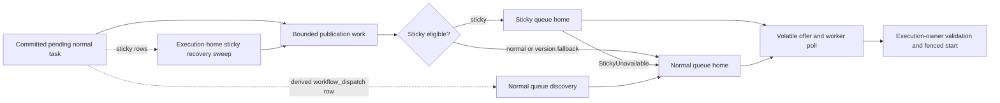

# Design Document

## Overview and dependencies

Scheduling commits durable intent before publication. Publication submits a bounded hint to the queue home, which
acknowledges admission without starting the task. The worker's poll still supplies the credentials for the existing
remote start. The execution owner validates and commits that start under its own current fence.

The dependencies are [workflow-dispatch](../workflow-dispatch/design.md), including its completed acquisition fence,
and [bundle-lease-fence](../bundle-lease-fence/design.md). A publisher's identity or epoch is not write authority.
Source evidence and Temporal v1.31.0 anchors are in [bugfix.md](bugfix.md). No upstream Temporal proto changes,
authoritative state-format changes, pair-commit changes, or speculative/activity delivery changes are required.



These are two recovery readers of the existing intent, not two durable queues. Normal discovery continues to read
non-sticky rows; the new sweep reads sticky rows whether or not their previous offer used the normal queue.

## Components and interfaces

Names below specify responsibility; implementation may follow local naming conventions without changing contracts.

| Component | Contract and location |
| --- | --- |
| `WorkflowOfferHint` | Storage/runtime dispatch envelope extended with execution home and immutable schedule order, plus optional sticky origin. Carries no worker credentials, input, history, updates or queries. |
| `WorkflowOfferSender::try_enqueue(hint, acquisition)` | Runtime-owned bounded publication queue. Returns immediately with queued/coalesced/refused. The lane never waits for remote I/O or a worker. |
| `RemoteWorkflowOfferSink::offer(hint, destination)` | Provider-agnostic async runtime trait; edge implements the internal RPC using routing and pooled channels. |
| `admit_workflow_offer(hint, current_home)` | Shared broker path for local publication, push and discovery. Ownership/generation validation and deduplication are serialized with retirement. |
| `list_sticky_workflow_dispatch(home, after_run_key, limit)` | Read-only repository page operation in both stores; returns candidates, last examined key and exhaustion. |
| Sticky recovery scheduler | Runtime task per active execution-home acquisition, coordinated under node-wide limits and cancelled with that acquisition. |
| `PreparedWorkflowStart` | Owner-local, non-serializable validation context from one state/statistics load, used by edge policy/envelope checks and runtime target resolution. Not an alternate commit API. |
| Peer dispatch credential/verifier adapters | Edge/auth boundary, with server configuration owned by `tokeira-config`; independent of the request-local public poll context. |

The kernel stays pure. Publisher and recovery may hydrate hints after commit, but neither changes state to reflect
delivery. Keep these loads separately observable from start-path loads. Existing placement determines queue and
execution homes; this design neither changes placement counts nor permits currently rejected unequal counts.

### Publication, admission and acknowledgement

1. After a successful scheduling commit, enqueue the normal task hint with the execution acquisition's token. Local
   delivery uses the same admission rules without a network hop. Remote I/O runs outside the publishing lane.
2. Resolve current queue-home placement. A receiver derives the queue home from the full queue identity and checks
   that the addressed home is locally serving. It captures its own acquisition generation; no caller-provided
   generation authorizes admission. Recheck that generation and cancellation under the broker's admission lock.
3. For sticky delivery, evaluate recent poller availability and current version-routing conditions before admission.
   The publisher may already establish a version fallback from its routing snapshot; the receiver also checks for
   newer routing. Policy lookup failure is transient failure, not evidence of sticky unavailability.
4. A positive acknowledgement means only that the hint is retained or already known in this acquisition. It must
   not await a poll, a start RPC or a lane message. A polling task may independently start immediately afterwards.
5. If the queue home moved, return `NotHome`; the sender refreshes placement once from its trusted routing source.
   Never follow a peer-supplied arbitrary endpoint. There is no server-side forwarding chain.

Use `(home, acquisition_generation, run_key, logical_seq)` as the deduplication scope. Within that scope there is one
ready/in-flight retention record. Local and discovered offers use the same scope. Across acquisitions or different
homes there may be two hints; the start transaction resolves that race. In particular, a normal fallback must not
be suppressed by an unrelated sticky-home record merely because both homes reside in the same process.

When a current routing/availability decision retargets an existing incarnation to another queue on the **same**
home, atomically replace its hint/revision rather than answering `Known` for the obsolete destination. Superseding
an in-flight hint cancels that local attempt and guards its late result by revision; cancellation cannot undo an
already committed start. The one retained record remains bounded. Do not retarget merely on arrival order of old
peer hints, or let an obsolete sticky offer suppress a valid normal fallback until the deadline.

An entry expires at the earlier of its existing retention/offer lease and any absolute sticky deadline. `Known`
does not extend either limit. Late start results retire only their original entry revision. Repeated admission after
expiry is legitimate; do not implement permanent deduplication or claim global exactly-once delivery.

### Internal RPC and field policy

Add `OfferWorkflowTask` to the existing `WorkflowTaskDispatch` service in
[dispatch.proto](../../../proto/tokeira/internal/runtime/v1/dispatch.proto). It is a hint-admission method only.
Existing `StartWorkflowTask` request/response behaviour and limits remain unchanged.

| Request field/group | Validation and interpretation | Failure / persistence impact |
| --- | --- | --- |
| `run_key`, `logical_seq` | UUID and valid durable incarnation; validate shape on admission, current identity again at start. | `InvalidArgument` for malformed shape; no durable write. |
| `execution_home` | Home ID carried from publication/dispatch row; route directly, then owner compares with the home derived from loaded authority. | Invalid shape rejected; stale/wrong hint cannot authorize a start. |
| `destination_home` | Expected queue-home ID, recomputed from queue placement by the receiver. | `NotHome` on mismatch or non-serving acquisition. |
| `namespace_id`, selected queue name, queue kind | Full coordinates, workflow tasks only; no digest-only identity check. | `InvalidArgument` for malformed/unknown kind; final namespace/queue binding at start. |
| Routing mode, deployment/build coordinates and version directive | Preserve absent versus present values; carry enough source routing information to evaluate deployment, redirect and compatible-set fallback. Re-resolve live policy; never freeze it in durable intent. | Malformed/inconsistent combinations rejected; lookup errors are transient. |
| Original `scheduled_at`, priority | Preserve committed scheduling order and existing priority semantics; bounded serialization. | Malformed value rejected; no new schedule time on retry. |
| Optional `sticky_origin` | Original sticky queue, original normal queue, worker identity and original absolute deadline. Required for sticky delivery and retained on its normal fallback. Selected normal delivery clears sticky preference, not this origin/deadline. | Missing/inconsistent origin rejected; elapsed deadline returns `Expired`. |

No publisher lease epoch, worker authorization headers, history, updates, queries or arbitrary command fields are
accepted. Unknown protobuf fields use normal protobuf compatibility rules; unknown enum variants and invalid field
combinations are rejected. A peer-authenticated hint still cannot bypass worker authorization at start.

| Response/outcome | Sender action |
| --- | --- |
| `Admitted`, `Known` | Finish this volatile attempt; durable intent remains until an authoritative transition changes it. |
| `StickyUnavailable(reason)` | Resolve the original normal queue under current version routing and attempt normal delivery, retaining the deadline. Reasons distinguish recent-poller absence, deployment change, redirect and compatible-set default change. |
| `NotHome` | Refresh trusted placement and retry once within the overall attempt budget. |
| `Full` | Drop the acceleration attempt; durable recovery will retry. |
| `Expired` | Drop this hint; the execution owner's existing timeout machinery performs the transition. |
| RPC failure/timeout or lost acknowledgement | Treat admission as uncertain; bounded retries/rediscovery are safe, and no durable acknowledgement is written. |

The normal fallback is a second destination, not a receiver recursively calling the normal home while holding
broker locks. The sender performs it through the same bounded work scheduler.

### Peer authorization and limits

Background work has no `ForwardedPoll`. Use a dedicated workload JWT policy for **only** `OfferWorkflowTask`,
reusing the existing JWT/JWKS verification primitives where appropriate, without changing public authentication
semantics. Configure exact issuer, JWKS source, a nonempty cluster-specific audience, exact allowed peer subjects,
and an externally refreshed token-file path for the sender. These are explicit edge/auth configuration fields;
they do not determine shard claims or controller behaviour. No new package dependency is assumed.

| Peer configuration field | Validation / effect |
| --- | --- |
| Issuer and JWKS source | Nonempty exact issuer and valid JWKS URL; use existing bounded key refresh and last-known-good-key discipline. No trust based on an unverified token's arbitrary URL. |
| Audience | Nonempty cluster-specific value; require exact membership in the signed audience claim. |
| Allowed subjects | Explicit nonempty exact-match set, without a wildcard or implicit public-role grant. |
| Token-file path | Explicit path for externally rotated credentials; missing/unreadable/oversized content fails the attempt without logging it. |

Server configuration rejects unknown fields. Mechanical concurrency, retry and page-size constants remain runtime
implementation settings, not new TOML or environment overrides.

Require a verified RS256/ES256 signature and allowed key, exact issuer/audience/subject, numeric `iat` and `exp`,
non-future issuance, unexpired validity, and valid `nbf` when present. Require `exp > iat` and bound lifetime to one
hour with at most 30 seconds of clock leeway.
Do not use the public mapper's optional-expiry or optional-audience policy for this endpoint. Public Worker/Admin
grants, custom worker scope claims and anonymous mode do not authorize peer offers. Missing peer configuration
fails closed for this method. Remote-delivery wiring validates the complete configuration when installed; direct
local delivery needs no network credential. Credentials must be supplied for the cross-node push guarantee.

The credential provider reads the externally rotated file for each attempt, bounded to 8 KiB, and never places its
token in a hint, persistent row, tracing event or error. Issuance/projection belongs to the operator's identity
provider; this change does not add an issuer or copy worker credentials. Tests inject a synthetic provider. The
receiver grants configured peers permission to submit hints across this cluster, not to poll, read history, or
write a run. The later worker start still uses request-local worker credentials and existing policy checks.

The existing peer channel uses the shared public listener over plaintext. This policy authenticates possession of
a credential; it does not provide confidentiality or resist a network observer replaying that credential within
its validity. That transport risk remains explicit; a separate listener and mutual TLS are deferred. Do not claim
that peer authentication fences the publisher or gives exactly-once processing.

Initial implementation constants, subject to evidence-backed spec amendment rather than silent enlargement:

| Resource | Bound |
| --- | --- |
| Serialized offer request / response | 64 KiB / 4 KiB; enforce request size before full decode. Existing start limits are unchanged. |
| Offer authentication metadata | 8 KiB; reject excessive metadata before verification. |
| Outbound queue | 1,024 entries and 16 MiB retained hint bytes per node, with incarnation coalescing. |
| Outbound concurrent RPCs | 32 per node, at most 8 per destination; fair scheduling between homes and publication/recovery. |
| Incoming offer handlers | 64 per node; reject overload without an unbounded waiter queue. |
| Retained offers | Existing 256 per queue and 8,192 per home, plus a node-wide 64 MiB serialized-hint budget; release reservations on every exit. |
| One attempt | 500 ms including credentials, routing and RPC, also enforced at the handler; at most one placement refresh, with all attempts and fallback bounded to 1 s total. |
| Sticky recovery | 64 rows per page, at most one page per home per second and 8 queries per node concurrently, with fair home scheduling. |

Bounded jittered retry is cancellation-aware and occurs outside the lane. No queue capacity waits are held inside
commit hooks. Ordinary recovery continues after a volatile attempt exhausts its budget. Oversized hints produce
diagnostics and use recovery; local normal discovery is not constrained by the RPC message cap. A sticky hint
that cannot travel still has its unchanged authoritative timeout transition as a recovery path. Memory admission
budgets count all sources, including discovered/local hints, and clean up dropped reservations.

## Sticky delivery and durable recovery

Recent availability is a physical sticky-queue observation at its home, including recently completed polls, not
just an outstanding long poll. Preserve worker shutdown handling and use the ten-second Temporal window. Version
checks use current registry data and the task's directive. Check all of these cases independently:

1. Missing partition or no recent poller.
2. Current deployment changed for this task's routing policy.
3. Redirect changes the assigned build id.
4. The assigned known build is no longer the default of its compatible version set. An unknown build alone is not
   a negative availability result (`checkVersionForStickyAdd @ v1.31.0`).

The original normal queue is carried with the sticky origin, not substituted from an unrelated poll. On fallback,
re-resolve that queue's current version target and route to **its** home, including when execution, sticky and normal
homes all differ. Preserve the pending absolute deadline even in the publisher's existing deployment-change
branch. A network timeout, wrong home, authentication failure or full broker is not `StickyUnavailable`.

The absolute deadline caps volatile retention and worker selection. Only the existing execution-owner timeout
transition changes pending state; a hint cannot clear affinity or schedule a replacement. If a start and timeout
race, existing incarnation/CAS checks decide the winner. A normal poll can consume a normal fallback at the normal
home; a sticky poll cannot bypass ownership by reaching into a different home's local normal queue.

### Sticky sweep and index

Use a separate execution-home sticky sweep rather than widening normal demand ranges. This avoids a new durable
fallback flag, queue-name hash column, or dependency on poll registration. Add one migration at the next free
number, without modifying any merged migration:

```sql
CREATE INDEX ASYNC IF NOT EXISTS idx_workflow_dispatch_sticky_home
ON workflow_dispatch (shard_id, run_key)
WHERE sticky = true;
```

This uses the existing row shape and atomic maintenance. DSQL supports asynchronous partial indexes
([CREATE INDEX](https://docs.aws.amazon.com/aurora-dsql/latest/userguide/create-index-syntax-support.html)); migration
readiness must wait for completion, as for the existing indexes
([asynchronous index lifecycle](https://docs.aws.amazon.com/aurora-dsql/latest/userguide/working-with-create-index-async.html)).
These documents establish syntax/lifecycle, not the plan of our query: live `EXPLAIN` of the actual repository
first-page and continuation SQL is required during implementation.

Select an index-covered page of keys with `shard_id = $home AND sticky = true`, adding `run_key > $cursor` on
continuation, ordered by `run_key`, limit 64. Fetch only that page's payloads in the same read snapshot, following
the existing materialized-candidate pattern. Verify the continuation is an index bound, not a filtered prefix
rescan. The memory implementation must have identical candidate, cursor and exhaustion semantics.

Start only after this execution acquisition is Active and repair is complete. For each candidate, verify ownership
and cancellation, hydrate current state/routing, and compare the derived incarnation/intent before enqueueing.
Stale rows are skipped; this read path performs no repairs or cross-home writes. Advance by the last examined key,
including skipped/refused rows. Keep the cursor on an incomplete read, then retry with backoff. After exhaustion,
wrap to the beginning on the next scheduled pass. New rows behind the cursor are found on that next traversal.

Do not persist a sweep cursor or a successful-delivery bit. A new acquisition restarts from the beginning. A lost
sticky push leaves its sticky row; a lost normal-fallback push also leaves that row. Both are revisited through the
same routing/availability decision. If affinity has already been cleared and the row becomes non-sticky, normal
queue discovery covers it instead. At deadline, existing timeout processing covers replacement with a new normal
incarnation. Recovery has bounded work, not a claim that every backlog fits within one sticky timeout.

## Ownership, retirement and failures

Each admission and dequeue checks the local home generation, cancellation and admission deadline. Connect cleanup
directly to the acquisition lifecycle, waking it on cancellation/loss rather than waiting for discovery's timer.
Serialize removal with admission; remove only entries, reservations and work belonging to that generation. A
dequeue guard makes cancellation effective even before asynchronous cleanup has freed the memory.

Cancel queued outbound work and sticky sweeps when their execution acquisition ends. Already transmitted hints
cannot be recalled and need not be rejected just because their publisher is now old. The receiving home may admit
one, but the current execution owner must validate its incarnation and commit under its own fence. Queue-home
loss similarly cancels in-flight delivery attempts; if a valid owner start has already committed, do not attempt
to undo it. A lost response has the existing timeout/retry semantics.

| Failure | Internal outcome / external mapping | Safety and recovery |
| --- | --- | --- |
| Malformed hint or inconsistent fields | `InvalidArgument` | No admission or state change. |
| Missing/invalid/expired peer credential | `Unauthenticated` | No admission; bounded credential diagnostic. |
| Verified identity outside peer policy | `PermissionDenied` | No admission; public grants do not substitute. |
| Oversized request/metadata or handler limit | `ResourceExhausted` | No unbounded allocation/queue; durable retry. |
| Full offer budget | `Full` typed response | No durable loss; release reservation. |
| Queue movement or cancelled generation | `NotHome` | Placement refresh; late cleanup cannot touch replacement. |
| Routing/JWKS/transport unavailable, deadline elapsed in RPC | `Unavailable` / `DeadlineExceeded` | Uncertain admission; no automatic sticky fallback from this alone. |
| Sticky semantic unavailability | `StickyUnavailable(reason)` | Normal-home attempt with original deadline. |
| Execution owner loses lease or incarnation changes | Existing start rejection/status mapping | Existing fenced transaction commits nothing for a stale writer/task. |

Record counters by delivery source/outcome, sticky fallback reason, queue/byte saturation, retirement reason,
sweep examined/enqueued/skipped counts, run-load phase and OCC retry count. Metrics have no run-key or credential
labels. Rate-limited structured diagnostics may name a run/home and check failure to aid investigation.

## Reducing start-path reads

Carry `execution_home` on all normal offers, including discovery and fallback. The queue home routes directly from
that hint and never fetches state just to find the execution owner. A stale hint is refused by the owner; current
placement refresh and rediscovery recover it. Preserve the existing handling of failed polls and withdrawn starts.

At the owner, authenticate the poll and resolve its namespace, then load state and history-size statistics once.
Use that same owner-local `PreparedWorkflowStart` for immutable namespace/normal-queue binding, sticky policy
binding, target/version resolution and metadata sizing. Repeat worker authorization against the authoritative
normal queue before a sticky start. Freeze update/query attachments and check the full response envelope before
committing, preserving the existing waiter ownership and attachment semantics.

Pass only the resulting validated context through the existing start path; it is not a client-supplied snapshot.
The execution component still validates its current incarnation, queue/version eligibility, serving state and
fence. If lane state differs from the prepared version, invalidate or revalidate affected decisions; never use
preflight state to force-overwrite fresher state. OCC retry reloads remain mandatory. Do not refactor generic
pair-commit, successor or update-admission logic to achieve a lower counter.

### Counting method and provisional target

Count logical repository run-state loads from offer dequeue through the start result, with a test-only correlated
start-attempt ID across nodes. `load_run_with_stats` counts once, not once for state and again for statistics.
Also report physical SQL statements and their purpose; combining statistics does not hide multiple statements.
Record queue-home and execution-owner loads separately, including admission caches, lane cache misses, preparation
refreshes and OCC reloads. Cache hits count zero. Exclude history/registry reads, publication hydration and discovery
hydration from the start metric, but report them separately so work moved outside the span remains visible.

| Remote start | Static baseline before lane misses/retries | Provisional conflict-free target |
| --- | --- | --- |
| Normal | At least 3 explicit run loads | Queue home 0; execution owner at most 1 warm / 2 cold |
| Sticky | At least 4 explicit run loads | Queue home 0; execution owner at most 1 warm / 2 cold |

Warm means all execution/admission caches used by this path are primed with the current version; cold means a new
execution cache over existing persisted state. Measure both normal and sticky paths before changing code, with
concurrent state changes as a separate series. Measure every RPC attempt and the total successful logical poll;
do not hide failed attempts. For each injected OCC conflict, show the required fresh reload and any revalidation
separately. The target is not permission to skip correctness reads: if the measured architecture requires more,
explain and revise the target before the fix, while still eliminating duplicate reads of the same preflight state.

## Correctness properties

Every property is a required generated test in [tasks.md](tasks.md), tagged `Feature: queue-home-delivery, Property N`.
Use generated finite schedules with explicit fairness suffixes for liveness, and barriers/injected clocks rather
than sleeps. Preserve shrunk counterexamples and distinguish model tests from real runtime/storage coverage.

### Property 1: Prompt push and eventual delivery

For any eligible normal task with split homes, draining a successful publication attempt SHALL admit at the
selected home without a discovery tick. For any finite fault prefix followed by the stated stable, fair recovery
conditions, a pending task SHALL eventually become offered/startable by push or the appropriate recovery reader.

**Validates: Requirements 2.1, 2.8, 2.9, 2.15.**

### Property 2: Bounded deduplication

For any interleaving of local publication, push, discovery, expiry and start results, each acquisition SHALL retain
at most one offer per incarnation within retention and respect every count/byte bound. Expiry SHALL permit later
admission; a late result SHALL not remove a replacement entry, including on a different colocated home. Retargeting
within one home SHALL replace the old destination without retaining a second entry or suppressing valid fallback.

**Validates: Requirements 2.2, 2.3, 2.14.**

### Property 3: Only a current writer and incarnation start

For any duplicate/old hint and takeover schedule, at most one start SHALL commit per incarnation; no obsolete
incarnation or stale fenced execution owner SHALL commit. A delayed old publisher's hint for a current incarnation
SHALL remain usable by a current writer. Offer admission SHALL confer no write authority.

**Validates: Requirements 2.3, 2.4, 3.2.**

### Property 4: Sticky routing and deadline preservation

For any poll history, version policy and delivery fault schedule, fallback SHALL agree with all four cited Temporal
conditions, retain the original deadline/affinity, and reach the normal home when selected. Unknown compatible-set
builds alone SHALL not cause fallback. A lost sticky or fallback push SHALL remain recoverable from durable state.

**Validates: Requirements 2.5, 2.6, 2.7, 2.8, 3.4.**

### Property 5: Acquisition retirement is immediate and isolated

For any loss, deadline expiry, replacement and late completion schedule, a retired generation SHALL admit/dequeue
no offers, even with discovery paused, and cleanup SHALL preserve the replacement generation's work.

**Validates: Requirements 2.10, 3.5.**

### Property 6: Fewer reads without weakened start checks

For any generated normal/sticky conflict-free start under the defined cache conditions, counts SHALL meet the
confirmed target. For forged bindings, policy changes, oversized attachments and OCC retries, consolidation SHALL
preserve rejection, pre-commit sizing and fresh reloads, as well as the existing worker-visible response.

**Validates: Requirements 2.11, 2.12, 3.1, 3.3.**

### Property 7: Authorized, bounded and non-blocking hints

For any generated credentials, message sizes, saturation and cancellation schedule, only allowed peer identities
SHALL admit remote hints, bounds SHALL hold, and an acknowledgement SHALL never depend on a publishing lane's
start. Failure SHALL leave durable intent unchanged and emit only the permitted diagnostics.

**Validates: Requirements 2.13, 2.14, 2.16, 3.2.**

### Property 8: Complete bounded sticky traversal

For any finite set of sticky/non-sticky rows across homes, page traversal SHALL visit exactly the eligible sticky
keys of its home in key order at a fixed snapshot, with bounded pages and strict continuation. Across mutations,
wrapping and restarting SHALL revisit still-pending rows without a persisted delivery bit. Cancelled acquisitions
SHALL not install work in a replacement; the memory and DSQL repositories SHALL agree.

**Validates: Requirements 2.8, 2.9, 2.15, 3.2, 3.5.**

### Property 9: Preservation outside the defect

For any generated trace using existing local, eager/reserved, speculative, query and completion/failure paths,
worker-visible outcomes SHALL remain unchanged except for the documented delivery/fallback fixes. Durable state
SHALL never depend on offer delivery or observation; existing repair/timeout semantics SHALL remain intact.

**Validates: Requirements 3.1, 3.2, 3.3, 3.4.**

## Testing, rollout and risks

First execute failing bug-condition exploration properties against the unfixed code, including normal/sticky
split-home reproduction and read attribution. An unexpected pass requires investigation before implementation.
Then implement the smallest components in dependency order, with properties beside runtime/broker/auth/storage
code and end-to-end tests over real internal gRPC. Use at least two runtimes; use three for distinct execution,
sticky and normal homes. Pause discovery to prove push, lose each push/ack in turn to prove recovery, and pause
the publishing lane to prove that admission acknowledgement cannot deadlock on a start.

Live DSQL validation follows [the suite runbook](../../../docs/testing/dsql-live-suites.md) on an ephemeral Aurora
DSQL cluster, including real statement plans, recovery pages and fenced competing-start/takeover cases. PostgreSQL
is not substitute evidence. Isolate or clean suite fixtures, respect placement-before-leases ordering, and verify
the URL gate actually executed the test. Publish outcomes only; keep cluster identifiers, live-run dates/times and
Region out of committed evidence. No live validation is claimed by this specification PR.

The implementation must align the affected portions of workflow-dispatch (the sticky backup and offer lifecycle),
schema contracts, peer configuration documentation and the live-suite runbook. This spec PR changes only its own
documents and an internal fragment. No mixed-version compatibility path is introduced.

Upgrade with every node stopped.

Known risks: peer credentials traverse the existing plaintext transport; the sticky sweep adds bounded read and
hydration work and may take multiple periods on a backlog; the new partial index adds write/index cost; a bounded
push may be refused, making recovery latency visible; liveness depends on fair capacity and working credentials;
read targets remain provisional until measured. Existing start request-ID retry limitations and the explicitly
deferred activity/speculative paths remain outside this fix.
