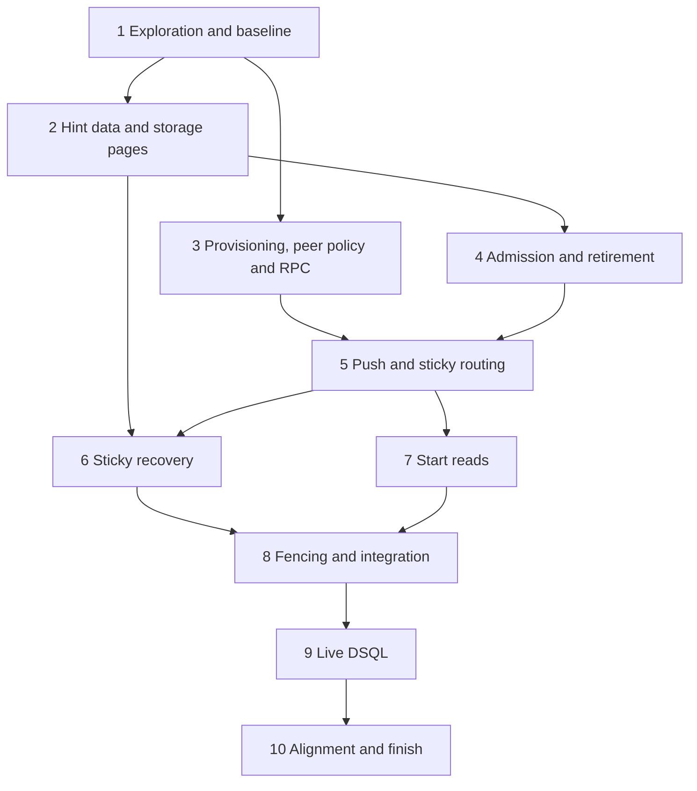

# Implementation Plan

## Overview

This is a specification-only PR. Every task below is future work, including exploration tests. Implementation starts
in a separate task after this spec merges. Read [bugfix.md](bugfix.md) and [design.md](design.md) together; their
contracts, provisional read target and scope boundaries govern this plan.

First demonstrate the defects and measure the actual read baseline. Then add the bounded hint contract, sticky
recovery query, provisioned peer credentials and authorization, admission/retirement, push and recovery, and
start-read consolidation. Keep each intermediate change green using appropriate focused checks; the full finish
bar belongs to the code PRs.

## Tasks

- [ ] 1. Bug-condition exploration properties, before any fix
  - [ ] 1.1 Add generated split-home traces which assert that an eligible normal task reaches its queue home without
    a discovery tick. Confirm failure on the unfixed implementation; record a shrunk counterexample.
    - _Requirements: 1.1, 2.1, 2.9_
  - [ ] 1.2 Add the sticky reproduction with execution owner holding neither queue home, a recently polled sticky
    worker at its actual home, and discovery controlled independently. Assert delivery without waiting out the
    sticky deadline, and immediate retirement when a queue home is lost with discovery paused. Confirm failures.
    - _Requirements: 1.2, 1.4, 2.5, 2.10_
  - [ ] 1.3 Instrument logical run loads and physical SQL attribution per start attempt without changing delivery.
    Measure normal/sticky, warm/cold caches, and an injected OCC retry, including admission-cache and lane loads.
    Assert the provisional read targets to expose the redundant reads; record the actual baseline and failures.
    Confirm or revise the target with a reason for each necessary read, in this spec, before implementing a fix.
    - _Requirements: 1.3, 2.11, 2.12_
  - [ ] 1.4 Checkpoint: exploration failures match the source-derived causes, not harness mistakes. If any assertion
    unexpectedly passes, investigate and correct the premise before proceeding. Use injected time/barriers, no sleeps.
    - _Requirements: 1.1, 1.2, 1.3, 1.4_

- [ ] 2. Hint data and bounded sticky storage pages
  - [ ] 2.1 Extend normal dispatch hints with execution home, original scheduling order and sticky origin/deadline.
    Preserve priority and exact/live routing distinctions; make credentials and authoritative commands impossible
    to carry in a hint. Keep speculative/eager/query constructors compatible with their existing contracts.
    - _Requirements: 2.1, 2.7, 2.11, 3.1, 3.3, 3.4_
  - [ ] 2.2 Add the sticky-home partial index in the next free migration with schema contracts, readiness and
    migration-policy updates required by storage's AGENTS.md. Do not change any merged migration or dispatch row
    format/maintenance. Add the bounded sticky execution-home page operation to memory and DSQL repositories.
    - _Requirements: 2.8, 2.15, 3.2_
  - [ ] 2.3 Write generated fixed-snapshot and mutation/continuation storage tests, with the same contract cases
    exercised by both stores. Expose the actual first/continuation query builders for later live plan checks.
    - **Property 8: Complete bounded sticky traversal** (storage portion; runtime portion in 6.2)
    - **Validates: Requirements 2.8, 2.9, 2.15, 3.2, 3.5.**

- [ ] 3. Internal offer RPC, managed credentials and dedicated peer policy
  - [ ] 3.1 Extend the Tokeira internal proto/service with `OfferWorkflowTask` and its typed outcomes. Implement the
    field-policy table, unknown-enum/shape validation, request/response bounds and handler concurrency cap. Preserve
    the existing start method and its larger response limit; do not modify upstream Temporal protos.
    - _Requirements: 2.1, 2.13, 2.14_
  - [ ] 3.2 Implement cluster ES256 material generation, bounded loading, five-minute local token signing/renewal and
    the strict receiver policy. Reuse existing cryptographic primitives and document any required dependency-edge
    changes; preserve public authentication. Validate key/public-profile agreement before peer-capable runtime
    readiness, and reject anonymous callers or public Worker/Admin credentials without the separate peer grant.
    Derive peer capability from the authoritative startup mode: single-node without a controller and embedded
    paths construct no new offer endpoint, sender or credential loader. Do not infer it from current membership.
    - _Requirements: 2.13, 2.14, 2.16, 2.17, 2.18, 2.19_
  - [ ] 3.3 Write generated credential, enum, envelope-size and handler-saturation tests, including exact limits,
    one-over limits, missing configuration, wrong issuer/audience/subject, missing expiry, expiry/rotation, future
    validity, corrupt/mismatched public key material and token redaction. Validate required peer wiring without
    changing shard claims; missing bootstrap credentials must not silently select discovery-only delivery.
    - **Property 7: Authorized, bounded and non-blocking hints** (auth/wire portion; scheduling portion in 5.3)
    - **Validates: Requirements 2.13, 2.14, 2.16, 3.2.**
  - [ ] 3.4 Add the platform-owned managed credential resource to the normal `tkr` plan/apply dependency graph.
    Generate no secrets during planning; create protected material once at apply, validate identity when adopting
    after an uncertain create, and keep secret bytes out of generic state. Model explicit generation replacement
    and destructive cleanup with the existing approval semantics; do not rotate on ordinary reapply or restart.
    - _Requirements: 2.17, 2.18_
  - [ ] 3.5 Wire Local/Compose protected files/read-only mounts and ECS/EKS generated Secrets Manager resources,
    exact-resource workload grants and provider bootstrap loaders. Render verifier configuration and credential
    references for all peer-capable runtimes in each standard definition set, including paired definition formats.
    Create no peer resource for no-peer modes. Document startup repair and stopped-node key rotation. Keep provider
    SDKs out of shared runtime/auth code.
    - _Requirements: 2.13, 2.16, 2.17, 2.18, 2.19_
  - [ ] 3.6 Write generated credential lifecycle tests with provider fakes and real local protected-file/signing
    adapters: fresh/repeated/concurrent apply, lost create response, missing/mismatched material, repeated display
    names across clusters, restart, scale-out, automatic renewal beyond token expiry, explicit stopped-node
    rotation, retired-key rejection and deletion/recovery. Assert redaction and absence of private material in
    plans, ordinary state, rendered manifests and image inputs. Validate each platform's generated graph/config.
    - **Property 10: Standard deployments have stable peer credentials**
    - **Validates: Requirements 2.13, 2.14, 2.16, 2.17, 2.18.**
  - [ ] 3.7 Extend the generated credential tests with startup modes and upgrades: directly started single-node
    `tokeirad` without `tkr` or credentials; in-memory, managed-DSQL and existing-DSQL embedded engines, including
    an attached public listener; and controller-managed mode with one current replica. Assert that no-peer paths
    become ready, resolve no credential and expose no offer push endpoint/sender, while peer-capable paths without
    credentials fail readiness. Test upgrade from an existing multi-node deployment without the resource: this
    release's reapply must use credential-capable platform definitions/engine wiring and supply matching material
    before new nodes start. Verify the missing-key diagnostic names the reapply remedy. Preserve the single-node
    claim/embedded ownership safeguards; do not implement or modify them here.
    - **Property 10: Standard deployments have stable peer credentials** (mode and upgrade cases)
    - **Validates: Requirements 2.13, 2.16, 2.17, 2.18, 2.19, 2.20.**

- [ ] 4. Shared admission and acquisition-driven retirement
  - [ ] 4.1 Route local, pushed and discovered normal offers through common bounded admission. Check generation,
    cancellation and admission deadline before `Known` or admission; isolate deduplication by home/acquisition and
    retain incarnation/revision checks through ready/in-flight expiry. Add the aggregate byte budget.
    - _Requirements: 2.2, 2.3, 2.10, 2.14, 3.5_
  - [ ] 4.2 Attach retirement to acquisition loss/deadline, guarded by generation, and make dequeue reject retired
    offers before asynchronous cleanup finishes. Cancel associated work/reservations and prevent cross-home sticky
    polls consuming a local normal queue they do not own.
    - _Requirements: 2.10, 3.1, 3.5_
  - [ ] 4.3 Generate publication/discovery races, expiry, delayed results, byte/count exhaustion, colocated distinct
    homes, same-home sticky-to-normal retargeting and replacement acquisitions; verify cleanup without advancing
    discovery's tick, and ensure late results cannot remove a retargeted offer.
    - **Property 2: Bounded deduplication**
    - **Property 5: Acquisition retirement is immediate and isolated**
    - **Validates: Requirements 2.2, 2.3, 2.10, 2.14, 3.5.**

- [ ] 5. Bounded push and all sticky fallback conditions
  - [ ] 5.1 Add the post-commit sender queue and provider-agnostic sink, wire the edge client to trusted placement and
    pooled channels, and connect local/remote admission. Keep all network waits outside the publishing lane and
    acknowledge admission independently of a start. Implement bounded coalescing, fairness, cancellation, deadline,
    refresh/retry and outcome diagnostics.
    - _Requirements: 2.1, 2.4, 2.13, 2.14, 2.16_
  - [ ] 5.2 Evaluate sticky availability at its home and preserve all Temporal v1.31.0 fallbacks: recent poller,
    deployment change, redirect and compatible-version-set default change. Route normal fallback to its home,
    preserving the absolute deadline and affinity. Test an unknown compatible-set build as a non-fallback control.
    Preserve the existing publisher deployment fallback while repairing its lost deadline.
    - _Requirements: 2.5, 2.6, 2.7, 3.4_
  - [ ] 5.3 Generate interleavings of push, duplicate discovery, unavailable/full/moving homes and lost replies.
    Pause the publishing lane until the admission response is received to detect an acknowledgement/start cycle.
    Test every sticky cause independently and in combinations, including recent completed polls without a waiter,
    unavailable routing data, shutdown workers, repeated fallback and deadline-versus-start races.
    - **Property 4: Sticky routing and deadline preservation** (routing portion; recovery portion in 6.2)
    - **Property 7: Authorized, bounded and non-blocking hints** (scheduling portion)
    - **Validates: Requirements 2.5, 2.6, 2.7, 2.8, 2.13, 2.14, 2.16, 3.2, 3.4.**
  - [ ] 5.4 Checkpoint: focused storage, runtime, edge and auth checks pass; no authoritative write depends on push
    admission, and neither activity nor speculative delivery has acquired an unsupported remote path.
    - _Requirements: 3.2, 3.3_

- [ ] 6. Complete sticky recovery and liveness
  - [ ] 6.1 Start a fair bounded sticky sweep after execution-home activation, using the new repository operation.
    Validate candidates against current state and republish through task 5. Advance skipped/refused candidates,
    wrap at exhaustion, retry incomplete reads, restart on acquisition, and cancel on loss. Leave ordinary normal
    discovery and the authoritative sticky timeout transition intact.
    - _Requirements: 2.8, 2.9, 2.15, 3.2, 3.4, 3.5_
  - [ ] 6.2 Generate lost sticky and lost normal-fallback pushes separately, with no useful sticky poll demand,
    process restart, queue-home movement, rows inserted behind the cursor, saturation and deadline expiry. Include
    affinity-cleared non-sticky rows covered by normal discovery and finite faults followed by a fair suffix.
    - **Property 1: Prompt push and eventual delivery**
    - **Property 4: Sticky routing and deadline preservation** (recovery portion)
    - **Property 8: Complete bounded sticky traversal** (runtime portion)
    - **Validates: Requirements 2.1, 2.5, 2.6, 2.7, 2.8, 2.9, 2.15, 3.2, 3.4, 3.5.**

- [ ] 7. Consolidate remote start reads under unchanged authorization
  - [ ] 7.1 Route from the hint's execution home without a queue-home run load. At the owner, reuse one local
    state/statistics preparation across namespace/queue/version binding, authoritative sticky authorization,
    metadata and attachment checks, and runtime target resolution. Invalidate affected preparation if state changes;
    retain serving/incarnation/lease checks, fresh OCC reloads and owner-held attachments/waiters.
    - _Requirements: 2.11, 2.12, 3.1, 3.3_
  - [ ] 7.2 Re-run the baseline matrix with counted retries. Generate forged execution-home, namespace, normal/sticky
    queue, worker and version coordinates; concurrent policy/state changes; exact and over-limit attachments; and
    cold/admission cache misses. Account for all moved or newly introduced reads explicitly.
    - **Property 6: Fewer reads without weakened start checks**
    - **Validates: Requirements 2.11, 2.12, 3.1, 3.3.**

- [ ] 8. Fencing, preservation and real multi-runtime integration
  - [ ] 8.1 Generate duplicate and obsolete incarnations, execution-owner loss before/during a start and queue-home
    movement mid-push. Include a delayed former publisher's still-current hint accepted by the current writer.
    Drive real memory-store transitions and retain the live DSQL variants for task 9.
    - **Property 3: Only a current writer and incarnation start**
    - **Validates: Requirements 2.3, 2.4, 3.2.**
  - [ ] 8.2 Write preservation properties for local delivery, priority, eager/reserved tasks, speculative tasks,
    query/update attachments and completion/failure routing, timeout reconstruction and repair. Re-run the existing
    affected contract suites, including no-peer startup without credentials; do not change the deferred paths to
    simplify a test.
    - **Property 9: Preservation outside the defect**
    - **Validates: Requirements 2.19, 3.1, 3.2, 3.3, 3.4.**
  - [ ] 8.3 Exercise actual internal gRPC with at least two runtimes for normal push and remote start, then three with
    distinct execution/sticky/normal homes for all sticky fallbacks. Prove push with discovery paused; separately
    drop sticky push, normal fallback and acknowledgement. Use configuration and credentials generated by the
    standard deployment path with no hand-authored peer fields, and keep it running past initial token expiry.
    Check peer-policy failures, saturation, takeover, prompt retirement, reply statuses and warm/cold read counters,
    without bypassing the wire authorization path or depending on an external identity provider.
    - _Requirements: 2.1, 2.2, 2.3, 2.4, 2.5, 2.6, 2.7, 2.8, 2.9, 2.10, 2.11, 2.12, 2.13, 2.14, 2.16, 2.17, 2.18, 3.5_
  - [ ] 8.4 Checkpoint: exploration tests now pass, negative controls fail for the intended reason, and all ten
    properties have executable coverage with deterministic synchronization and useful shrunk counterexamples.
    - _Requirements: 2.1, 2.2, 2.3, 2.4, 2.5, 2.6, 2.7, 2.8, 2.9, 2.10, 2.11, 2.12, 2.13, 2.14, 2.15, 2.16, 2.17, 2.18, 2.19, 2.20_

- [ ] 9. Live DSQL contracts and plans
  - [ ] 9.1 Under [the live-suite runbook](../../../docs/testing/dsql-live-suites.md), create and clean up an ephemeral
    Aurora DSQL cluster. Verify schema/index readiness and run generated sticky page contracts, including large
    unrelated homes and long continuations. `EXPLAIN` the exact first/continuation repository SQL; confirm a bounded
    sticky-home index seek and bounded payload fetch. Do not infer a good plan from an equivalent handwritten query.
    - **Property 8: Complete bounded sticky traversal** (DSQL execution)
    - **Validates: Requirements 2.8, 2.9, 2.15, 3.2, 3.5.**
  - [ ] 9.2 Run competing-start, stale-incarnation and takeover schedules against real DSQL with the existing fence.
    Run a split-home runtime case using the real repository and internal RPC, plus affected live regression suites.
    Account for schema bootstrap and fixture isolation; inspect gates to prove each intended live body ran.
    - **Property 3: Only a current writer and incarnation start** (DSQL execution)
    - _Requirements: 2.1, 2.3, 2.4, 2.8, 2.9, 3.2_
  - [ ] 9.3 Add executable suite entries, isolation/ordering rules and evidence of what ran and its outcome. Preserve
    the placement-before-live-leases order. Clean owned fixtures so unrelated suites do not multiply recovery work;
    do not raise time limits to hide shared-cluster contamination. No PostgreSQL substitute or URL-gated early-return
    pass counts as live DSQL evidence.
    - _Requirements: 2.15, 3.2_

- [ ] 10. Align documentation and finish the code PRs
  - [ ] 10.1 Align workflow-dispatch's sticky recovery, offer lifecycle and start-read descriptions, configuration
    and credential-provisioning docs and the suite runbook with the implemented contract. Record measured
    baseline/result counts, query plans, limitations and outcomes without cluster identifiers, live-run dates/times
    or Region. Preserve the one-line stopped-node upgrade instruction and the explicit activity/speculative/security
    deferrals. Add the design's existing-multi-node reapply step to rollout documentation and an implementation
    `changed` changelog fragment, making clear it runs with this release's `tkr` while all nodes are stopped and
    before new nodes start. State that no-peer single-node/embedded upgrades need no credential or `tkr` step.
    - _Requirements: 2.8, 2.10, 2.11, 2.13, 2.15, 2.16, 2.17, 2.18, 2.19, 2.20, 3.3_
  - [ ] 10.2 Run the full root AGENTS.md §10.4 bar for each code PR, plus its applicable focused/live checks and
    offline links/fragment validation. Report every omission and why; tick only work actually completed. Rebase at
    the PR boundary and follow the repository's attribution, review and exact-head merge protocol.
    - _Requirements: 2.1, 2.2, 2.3, 2.4, 2.5, 2.6, 2.7, 2.8, 2.9, 2.10, 2.11, 2.12, 2.13, 2.14, 2.15, 2.16, 2.17, 2.18, 2.19, 2.20, 3.1, 3.2, 3.3, 3.4, 3.5_

## Task Dependency Graph

## Notes

- Every property task is required. Use `proptest` tags `// Feature: queue-home-delivery, Property N: <title>` and
  distinguish model coverage from integration and live execution.
- Read the applicable crate AGENTS.md files before code changes. Keep the kernel pure; no new dependency or changes
  to the explicitly deferred paths are authorized by a desire to reduce measured loads.
- Add test-only pause points behind appropriate test/integration gates. Do not change release behaviour for tests.
- Spec-PR validation is limited to offline Markdown links, whitespace, metadata/traceability, and a changie scratch
  dry run. No build, exploration implementation, runtime test or live AWS activity belongs to this PR.
