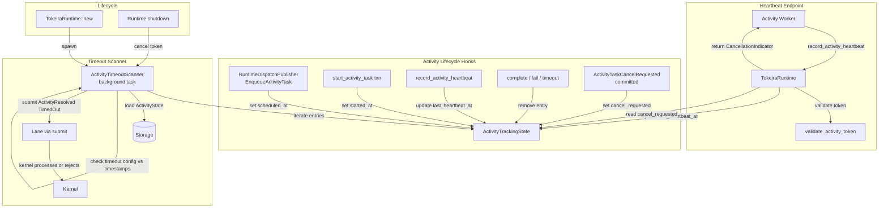

# Design Document: Activity Heartbeat and Timeouts

## Overview

This design adds activity heartbeat recording and four timeout detection mechanisms to `tokeira-runtime`, completing Feature 3 of the runtime roadmap. It builds on Feature 2 (Activity Pump), which provides the activity broker, poll/complete/fail facade methods, activity-task-start transactions, and `ActivityTaskToken` validation.

The feature has two distinct halves:

1. **Heartbeat endpoint.** A new `record_activity_heartbeat` method on `TokeiraRuntime` that accepts an `ActivityTaskToken` and heartbeat details, records the heartbeat durably, updates a runtime-local timestamp, and returns a cancellation indicator. It submits no kernel command and creates no history event. The heartbeat path reuses the existing token validation logic from Feature 2.

2. **Timeout scanner.** A background `tokio::spawn` task (`ActivityTimeoutScanner`) that wakes at cached deadlines, reconciles all entries every interval, and loads authoritative timeout configuration from the kernel's `ActivityState` via storage, and submits `Command::ActivityResolved(TimedOut)` through the lane when a timeout is detected. The scanner is non-authoritative: the commit path rechecks the observation against its transition base before applying the kernel mutation. Stale observations retain tracking for a reload; resolved activities are removed conditionally.

The runtime-local tracking state (`ActivityTrackingState`) is a new in-memory structure keyed by `(RunKey, String)` (run_key, activity_id). It records `scheduled_at`, `started_at`, `last_heartbeat_at`, and `cancel_requested` per activity. This state is populated by hooks in the existing activity lifecycle: dispatch publication sets `scheduled_at`, the activity-task-start transaction sets `started_at`, heartbeat calls update `last_heartbeat_at`, and activity resolution removes the entry.

The four timeout types follow Temporal's semantics:
- **Heartbeat timeout**: elapsed since `last_heartbeat_at` (or `started_at` if no heartbeat received) exceeds `ActivityState.heartbeat_timeout`. Only checked for started activities.
- **Schedule-to-start timeout**: elapsed since `scheduled_at` exceeds `ActivityState.schedule_to_start_timeout`. Only checked for unstarted activities.
- **Start-to-close timeout**: elapsed since `started_at` exceeds `ActivityState.start_to_close_timeout`. Only checked for started activities.
- **Schedule-to-close timeout**: elapsed since `scheduled_at` exceeds `ActivityState.schedule_to_close_timeout`. Checked regardless of start state. Takes precedence when multiple timeouts fire in the same scan cycle.

## Architecture



### Key design decisions

**Runtime-local tracking is a cache of durable attempt state.** The kernel's
`ActivityState` carries the authoritative schedule, start and durable heartbeat
anchors as well as timeout configuration. Runtime tracking adds volatile heartbeat
updates and deadline planning; recovery rebuilds it from durable state. Reloaded
anchors decide whether a timeout applies even if the cache is stale.

**Tracking updates are ordered by the image they carry.** A start, heartbeat or
retry updates tracking after its commit, and that update can land long after the
commit. Each update carries the committed image it was computed from, identified
by the run's transition sequence, and the entry records the image it holds. An
update applies unless the entry already holds a later image, so a late reply
cannot undo a later commit's start, heartbeat or reset. The attempt number cannot
order updates: a reset can return a started activity to attempt 1, and an activity
ID can be scheduled again, while every commit advances the transition sequence.
[43_activity_timeouts.tla](../../../spec/tla/43_activity_timeouts.tla) checks this
order, the reload rule below and the timeout commit's recheck.

**Heartbeat bookkeeping is runtime-owned.** `record_activity_heartbeat` validates
the token, records progress durably and updates the volatile heartbeat timestamp.
It submits no kernel command and creates no history event.

**Cached configuration selects wakes; storage authorizes decisions.** Tracking caches all four timeout durations and the pause flag beside the anchors. Each due entry reloads its `ActivityState` before evaluation and refreshes that cache, including when no timeout fires. A full pass every interval repairs a cache later than the real deadline; `UpdateActivityOptions` and other lane commits also refresh tracked configuration.

**Schedule-to-close takes precedence.** When multiple timeouts fire for the same activity in a single scan cycle, only the `SCHEDULE_TO_CLOSE` resolution is submitted. This matches Temporal's semantics: schedule-to-close is the outer bound that subsumes all other timeouts.

**Scanner submits through the lane, not directly to the kernel.** The scanner uses the same `self.submit(run_key, Command::ActivityResolved(...))` path as completions and failures. This preserves the lane's single-writer serialization for each run and ensures the kernel's fenced transition logic handles conflicts correctly.

**Bounded batches per scan cycle.** The scanner processes at most `max_timeouts_per_scan` activities per cycle to avoid starving other lane work. Unattempted due activities continue immediately in the next pass; attempted failures wait for the reconciliation interval.

**Graceful lifecycle management.** The scanner is spawned as a `tokio::JoinHandle` during `TokeiraRuntime::new` and cancelled via a `CancellationToken` on shutdown. Transient storage errors during scanning are logged and the scanner continues to the next cycle.

## Components and Interfaces

### ActivityTrackingState

In-memory state for timeout detection and heartbeat processing.

```rust
/// Per-activity tracking entry for timeout detection and heartbeat processing.
///
/// This is runtime-local state — not persisted, not part of the kernel's
/// ActivityState. It is populated from lifecycle hooks and consulted by the
/// heartbeat endpoint and timeout scanner.
#[derive(Clone, Debug)]
pub struct ActivityTrackingEntry {
    /// Four timeout durations and pause state; None requests an immediate reload.
    pub timeouts: Option<ActivityTimeouts>,
    pub run_key: RunKey,
    pub activity_id: String,
    /// Set once on first scheduling (attempt 1). Never
    /// overwritten on retry. Used for schedule-to-close.
    pub original_scheduled_at: OffsetDateTime,
    /// Updated on each dispatch (including retries). Used
    /// for schedule-to-start.
    pub last_dispatched_at: OffsetDateTime,
    pub started_at: Option<OffsetDateTime>,
    pub last_heartbeat_at: Option<OffsetDateTime>,
    pub cancel_requested: bool,
}

/// Thread-safe container for activity tracking entries.
///
/// Keyed by (RunKey, activity_id) for O(1) lookup from both heartbeat
/// processing and timeout scanning.
#[derive(Default, Clone)]
pub struct ActivityTrackingState {
    inner: Arc<Mutex<HashMap<(RunKey, String), ActivityTrackingEntry>>>,
}

impl ActivityTrackingState {
    /// Record that an activity was scheduled (called from dispatch publication).
    pub fn record_scheduled(&self, run_key: RunKey, activity_id: String, now: OffsetDateTime);

    /// Record that an activity was started (called from activity-task-start txn).
    pub fn record_started(&self, run_key: RunKey, activity_id: &str, now: OffsetDateTime);

    /// Update the last heartbeat timestamp (called from record_activity_heartbeat).
    pub fn record_heartbeat(&self, run_key: RunKey, activity_id: &str, now: OffsetDateTime);

    /// Mark an activity as having a pending cancellation.
    pub fn mark_cancel_requested(&self, run_key: RunKey, activity_id: &str);

    /// Check whether an activity has a pending cancellation.
    pub fn is_cancel_requested(&self, run_key: RunKey, activity_id: &str) -> bool;

    /// Remove an activity from tracking (called on resolution).
    pub fn remove(&self, run_key: RunKey, activity_id: &str);

    /// Snapshot all tracked entries for the scanner to iterate.
    pub fn snapshot(&self) -> Vec<ActivityTrackingEntry>;
}
```

### record_activity_heartbeat

New facade method on `TokeiraRuntime`:

```rust
impl<R> TokeiraRuntime<R> where R: RunRepository + 'static {
    /// Record a heartbeat from a running activity.
    ///
    /// This is a purely runtime-side operation: no kernel command, no history
    /// event, no storage commit. Returns true if the activity has a pending
    /// cancellation request.
    pub async fn record_activity_heartbeat(
        &self,
        token: ActivityTaskToken,
        _details: Payloads,
    ) -> Result<bool>;
}
```

The method:
1. Calls `validate_activity_token(&token)` (existing method from Feature 2).
2. Updates `last_heartbeat_at` in `ActivityTrackingState`.
3. Reads and returns `cancel_requested` from `ActivityTrackingState`.

### ActivityTimeoutScanner

Background task that detects timeout violations:

```rust
pub struct ActivityTimeoutScannerConfig {
    /// Full reconciliation interval. Default: 1 second.
    pub scan_interval: tokio::time::Duration,
    /// Maximum number of timeout commands to submit per scan cycle.
    pub max_timeouts_per_scan: usize,
}

impl Default for ActivityTimeoutScannerConfig {
    fn default() -> Self {
        Self {
            scan_interval: tokio::time::Duration::from_secs(1),
            max_timeouts_per_scan: 100,
        }
    }
}
```

The scanner loop:
1. Plan the earliest active timeout or unevaluated retry-eligibility deadline,
   bounded by the next full pass (`scan_interval`, one second by default).
2. Sleep until that time, cancellation, or an earlier-deadline notification.
3. Snapshot due entries in deadline order, with run/activity identity as the stable
   tie-break. Every interval, include all entries to reconcile stale caches.
4. Before each await, mark the captured entry revision attempted. Read its run
   unless this pass already read it, refresh cached timeouts and pause state, then
   evaluate authoritative activity state using the existing precedence, retry
   decisions and lane submission.
5. Retire successful/stale entries conditionally on revision and acquisition.
   Failed attempts wait for the next interval. A bounded pass leaves unattempted
   due entries ready for an immediate continuation, independently for timeout and
   eligibility caps; eligibility cursors remain acquisition-scoped.

A pass reads each run at most once and decides every selected activity of that
run from the one read. The read is kept only until the run's last selected entry,
so a pass with one activity per run holds no extra state. A failed or absent read
applies to all of the run's entries in that pass: an absent run removes each
captured entry, and a failed read leaves each one for the next full pass.
Reusing the read after an earlier entry of the same run has committed is safe:
the read only proposes a decision, and both commit paths recheck the captured
attempt and deadline against their own fenced base. A timeout or retry of one
activity leaves the attempt, anchors and options of the run's other activities
unchanged, so the older image gives each of them the same decision.

Reconciliation cost and bound: every `scan_interval`, the full pass reads each
shard-owned run with at least one tracked activity once, so its cost is the number
of such runs, not the number of tracked activities. Every tracked entry is
reconciled by the pass, so a stale cache is repaired within one `scan_interval`
unless its run's read fails, which leaves it for the next pass.
Losing the cache costs only the recovery rebuild from durable state.

`max_timeouts_per_scan` counts submissions (terminal timeouts and retry commits),
not reads. Submissions occupy lanes and write history, which is the work the cap
protects; reads are already bounded by one per run per pass. Counting reads would
not lower what a full pass reads, because unattempted refreshes continue at once
in the next wake.

Cache all four timeout values and the pause flag beside the timing anchors. Unknown
configuration is immediately due for one reload. Paused activities and zero/unset
timeouts have no deadline. Otherwise the earliest applicable strict deadline is
one nanosecond after the saturating deadline: schedule-to-close always applies;
started activities add start-to-close and heartbeat (the later of start and last
heartbeat); unstarted activities add schedule-to-start. Saturated deadlines cannot
expire. Publisher scheduling, committed state, ordinary starts and recovery supply
the cache; re-anchoring preserves it. Every lane commit refreshes changed options
and pause state of tracked activities without rearming unchanged entries. A changed
entry takes that commit's whole image, in the same order as other updates.

Wake planning shares the workflow-task scanner's notification rule. During a scan,
the planned wake is the scan's wake time, so future inserts do not trigger a rescan.
Unattempted overdue entries, including those inserted after the scan began, plan an
immediate continuation. Attempted overdue entries keep the interval. A revision
check across both index snapshots prevents an insert racing planning from being
lost. A stale-early cache costs one reload and refresh; a stale-late cache is repaired
by the full pass. These caches never authorize a timeout (Requirement 7.3).

An early offer can commit a start before schedule tracking exists, or before a
late schedule record clears its anchors, and a start's caller can lose the outcome
of a commit that applied. Every reload repairs a missing cached start from the
authoritative activity's start time and durable last heartbeat, retaining any newer
volatile heartbeat of the same start. The reload takes its read's image in the same
order as updates, under the captured acquisition, so a start or heartbeat whose
update landed while the read was in flight is not overwritten. The full pass discovers a missing start even when the
cache has no heartbeat or start-to-close deadline, so an expired heartbeat fires
by that pass. Durable start/heartbeat anchors also drive Temporal's timers
(`service/history/workflow/timer_sequence.go:298-355 @ v1.31.0`).

Authority: `service/history/workflow/timer_sequence.go:108-154` and
`service/history/queues/queue_scheduled.go:159-224,269 @ v1.31.0`.

### Timeout evaluation (pure function)

A writer that carries no image (a schedule record, recovery, or the lane's own
inserts and option resets) can leave the previous attempt's start, heartbeat and
dispatch time in the cache. Evaluation therefore reads startedness and the
start time from the reloaded activity, and uses its current attempt's scheduled
time for schedule-to-start (the original schedule if the current time is absent).
Schedule-to-close uses the reloaded original schedule. Only a heartbeat at or after
that start can extend a started attempt's deadline; the later durable or cached
heartbeat wins. An unstarted attempt has no heartbeat or start-to-close deadline.

The same reload reconciles the cache's schedule, start and heartbeat anchors in
image order. It clears the start and heartbeat for an unstarted retry, restores its
dispatch time, and retains newer heartbeats for a started attempt. A retry's own
update carries its image too, so a delayed retry reply cannot clear a newer start.
Thus the cache chooses wakes while the reloaded attempt decides which
timeouts apply. Temporal builds timers from mutable state under the workflow lock
and skips earlier attempts (`service/history/timer_queue_active_task_executor.go:204-258,292-295`;
`service/history/workflow/timer_sequence.go:229-257,291-355 @ v1.31.0`).

```rust
pub enum TimeoutViolation {
    ScheduleToClose,
    ScheduleToStart,
    StartToClose,
    Heartbeat,
}

/// Evaluate which timeout (if any) has been violated for an activity.
///
/// Returns the highest-precedence violation, or None if no timeout has fired.
/// Schedule-to-close takes precedence over all others.
pub fn evaluate_activity_timeout(
    entry: &ActivityTrackingEntry,
    activity: &ActivityState,
    now: OffsetDateTime,
) -> Option<TimeoutViolation>;
```

### Revalidate a timeout at its commit

The scanner carries an `ActivityTimeoutCheck` with the activity ID, schedule event,
attempt, observed transition sequence, detected timeout type and scanner time. This
is a volatile operand on the lane submission or retry target; stored commands and
worker resolutions keep their
existing forms. The detected type is retained even if retry exhaustion converts the
terminal failure to schedule-to-close.

Before applying the terminal resolution, the lane checks the observation against
its transition base, reloading a cached image that predates the scanner's read.
The direct retry commit loop does the same check after each load.
Both reuse the timeout evaluator's rules with the current durable anchors and
heartbeat, and both repeat the check after an OCC conflict. The expected transition
sequence fences that exact image: a concurrent start, heartbeat or retry cannot be
silently crossed. A stale lane rejection evicts its cached image so a subsequent
observation can make progress. This supplies Temporal's current-mutable-state check
under its workflow lock and rejection of an earlier attempt's timer
(`service/history/timer_queue_active_task_executor.go:204-258,292-295 @ v1.31.0`).

A typed stale rejection retains tracking and requests an immediate authoritative
reload under the same acquisition, even if a newer start or heartbeat changed its
revision. It changes no anchors. Only the scanner's next examination consumes that
request, or the full pass's request for every entry; no tracking update clears
either, so a late update cannot cancel the reload of an entry that missed a start.
Load or commit failures still wait for the full pass. A resolved activity instead
removes only the captured revision and acquisition. Worker completions, failures and
cancels carry no timeout observation and keep their existing handling.

### Updated TokeiraRuntime

```rust
pub struct TokeiraRuntime<R> {
    repo: Arc<R>,
    broker: InMemoryBroker,
    activity_broker: InMemoryActivityBroker,
    lanes: Vec<LaneHandle>,
    config: LaneConfig,
    // New fields:
    activity_tracking: ActivityTrackingState,
    scanner_handle: Option<tokio::task::JoinHandle<()>>,
    scanner_cancel: tokio_util::sync::CancellationToken,
}
```

### Lifecycle hooks (integration points)

The following existing methods are modified to update `ActivityTrackingState`:

| Method | Hook |
|--------|------|
| `RuntimeDispatchPublisher::publish` (EnqueueActivityTask) | `activity_tracking.record_scheduled(...)` |
| `start_activity_task` (on successful commit) | `activity_tracking.record_started_at(...)`: take the start's committed image unless the entry holds a later one. |
| `record_activity_heartbeat` (on successful commit) | Take the heartbeat's committed image unless the entry holds a later one. |
| `complete_activity_task` (on success) | `activity_tracking.remove(...)` |
| `fail_activity_task` (on terminal failure) | `activity_tracking.remove(...)` |
| `fail_activity_task` (on retry) | Take the retry's committed image unless the entry holds a later one: `last_dispatched_at` becomes the next attempt's scheduled time, and `started_at` and `last_heartbeat_at` clear. `original_scheduled_at` keeps the first schedule. |

The `cancel_requested` flag is set when the kernel commits an `ActivityTaskCancelRequested` history event. This requires a small hook in the lane's dispatch path: after a successful commit, if the transition's history events contain `ActivityTaskCancelRequested`, the runtime marks the activity in tracking state.

## Data Models

### New types

| Type | Crate | Role |
|------|-------|------|
| `ActivityTrackingEntry` | `tokeira-runtime` | Per-activity timestamps and cancellation flag for timeout detection |
| `ActivityTrackingState` | `tokeira-runtime` | Thread-safe container for tracking entries, keyed by `(RunKey, String)` |
| `ActivityTimeoutScannerConfig` | `tokeira-runtime` | Configurable scan interval and batch size |
| `TimeoutViolation` | `tokeira-runtime` | Enum of the four timeout types for evaluation results |
| `evaluate_activity_timeout` | `tokeira-runtime` | Pure function: `(entry, activity_state, now) -> Option<TimeoutViolation>` |

### Modified types

| Type | Crate | Change |
|------|-------|--------|
| `TokeiraRuntime` | `tokeira-runtime` | Add `activity_tracking: ActivityTrackingState`, `scanner_handle`, `scanner_cancel` fields |
| `RuntimeDispatchPublisher` | `tokeira-runtime` | Add `activity_tracking: ActivityTrackingState` field, call `record_scheduled` on `EnqueueActivityTask` |

### Tracking state model

```
ActivityTrackingState:
  inner: HashMap<(RunKey, String), TrackedActivity>

TrackedActivity:
  entry: ActivityTrackingEntry
  image: Option<TransitionSeq>           // committed image last taken; None until one is

ActivityTrackingEntry:
  run_key: RunKey
  activity_id: String
  original_scheduled_at: OffsetDateTime  // set once, never overwritten
  last_dispatched_at: OffsetDateTime     // updated on each retry
  started_at: Option<OffsetDateTime>
  last_heartbeat_at: Option<OffsetDateTime>
  cancel_requested: bool
```

### Timeout evaluation logic

```
evaluate_activity_timeout(entry, activity_state, now):
  // Schedule-to-close takes precedence (uses original scheduling time)
  if activity_state.schedule_to_close_timeout is Some(d):
    if now - activity_state.scheduled_at > d:
      return Some(ScheduleToClose)

  if activity_state.started_at is Some(started):
    // Heartbeat timeout (only for started activities)
    if activity_state.heartbeat_timeout is Some(d):
      let baseline = max(started, activity_state.last_heartbeat_at, entry.last_heartbeat_at)
      if now - baseline > d:
        return Some(Heartbeat)

    // Start-to-close timeout (only for started activities)
    if activity_state.start_to_close_timeout is Some(d):
      if now - started > d:
        return Some(StartToClose)
  else:
    // Schedule-to-start timeout (uses this attempt's authoritative schedule)
    if activity_state.schedule_to_start_timeout is Some(d):
      let scheduled = activity_state.current_attempt_scheduled_at.unwrap_or(activity_state.scheduled_at)
      if now - scheduled > d:
        return Some(ScheduleToStart)

  return None
```

### Scanner lifecycle

```
TokeiraRuntime::new:
  1. Create ActivityTrackingState (shared across runtime and publisher)
  2. Spawn ActivityTimeoutScanner with repo, shared timeout/eligibility wake, lane submit fn, cancel token
  3. Track the next full-pass time independently of earlier deadline wakes
  4. Store JoinHandle and CancellationToken

TokeiraRuntime::shutdown (or Drop):
  1. Cancel the CancellationToken
  2. Await the JoinHandle (with timeout)
```


## Correctness Properties

*A property is a characteristic or behavior that should hold true across all valid executions of a system — essentially, a formal statement about what the system should do. Properties serve as the bridge between human-readable specifications and machine-verifiable correctness guarantees.*

### Property 1: Heartbeat cancellation indicator reflects tracking state

*For any* `ActivityTrackingEntry` with `cancel_requested` set to some boolean value, calling `record_activity_heartbeat` with a valid token for that activity shall return a cancellation indicator equal to `cancel_requested`.

**Validates: Requirements 1.3, 1.4**

### Property 2: Heartbeat updates last_heartbeat_at

*For any* valid `ActivityTaskToken` and any `ActivityTrackingEntry` for that activity, calling `record_activity_heartbeat` shall update `last_heartbeat_at` in the `ActivityTrackingState` to a value that is >= the time immediately before the call.

**Validates: Requirements 1.2, 2.3**

### Property 3: Stale heartbeat token rejection preserves tracking state

*For any* `ActivityTaskToken` where the token fails validation (activity not found, attempt mismatch, or shard epoch mismatch), calling `record_activity_heartbeat` shall return an error, and the `ActivityTrackingState` shall remain unchanged (no entry added, modified, or removed).

**Validates: Requirements 1.5**

### Property 4: Heartbeat produces no kernel commands

*For any* valid heartbeat call (valid token, activity exists in tracking state), the runtime shall not submit any `Command` to the lane. The lane's command count before and after the heartbeat call shall be identical.

**Validates: Requirements 1.6**

### Property 5: Dispatch publication records scheduled_at in tracking state

*For any* `DispatchOp::EnqueueActivityTask` published through `RuntimeDispatchPublisher`, the `ActivityTrackingState` shall contain an entry keyed by `(run_key, activity_id)` with `scheduled_at` set and `started_at` equal to `None`.

**Validates: Requirements 2.1**

### Property 6: Activity resolution removes tracking entry

*For any* activity that is terminally resolved (completed, failed with exhausted retries, timed out, or canceled), the `ActivityTrackingState` shall no longer contain an entry for `(run_key, activity_id)` after the resolution is processed.

**Validates: Requirements 2.4**

### Property 7: Heartbeat timeout fires for started activities with expired heartbeat

*For any* cached entry and reloaded `ActivityState` with `started_at = Some(t)` and `heartbeat_timeout = Some(d)`, if `now - max(t, durable_last_heartbeat_at, cached_last_heartbeat_at) > d`, then `evaluate_activity_timeout` shall return `Some(Heartbeat)` — unless `schedule_to_close_timeout` also fires, in which case `ScheduleToClose` takes precedence. If `last_heartbeat_at` is `None`, the baseline shall be `started_at`. If `started_at` is `None`, the function shall never return `Heartbeat`.

**Validates: Requirements 3.1, 3.2, 3.3**

### Property 8: Schedule-to-start timeout fires only for unstarted activities

*For any* cached entry and reloaded `ActivityState` with `started_at = None` and `schedule_to_start_timeout = Some(d)`, if `now - current_attempt_scheduled_at.unwrap_or(scheduled_at) > d`, then `evaluate_activity_timeout` shall return `Some(ScheduleToStart)` — unless `schedule_to_close_timeout` also fires, in which case `ScheduleToClose` takes precedence. If `started_at` is `Some(_)`, the function shall never return `ScheduleToStart`.

**Validates: Requirements 4.1, 4.2**

### Property 9: Start-to-close timeout fires only for started activities

*For any* cached entry and reloaded `ActivityState` with `started_at = Some(t)` and `start_to_close_timeout = Some(d)`, if `now - t > d`, then `evaluate_activity_timeout` shall return `Some(StartToClose)` — unless `schedule_to_close_timeout` or `heartbeat_timeout` also fires with higher precedence. If `started_at` is `None`, the function shall never return `StartToClose`.

**Validates: Requirements 5.1, 5.2**

### Property 10: Schedule-to-close timeout fires regardless of start state

*For any* `ActivityTrackingEntry` (with or without `started_at`) and *for any* `ActivityState` with `schedule_to_close_timeout = Some(d)`, if `now - scheduled_at > d`, then `evaluate_activity_timeout` shall return `Some(ScheduleToClose)`.

**Validates: Requirements 6.1**

### Property 11: Schedule-to-close takes precedence over all other timeouts

*For any* `ActivityTrackingEntry` and `ActivityState` where `schedule_to_close_timeout` fires AND at least one other timeout (heartbeat, schedule-to-start, or start-to-close) also fires, `evaluate_activity_timeout` shall return `Some(ScheduleToClose)`.

**Validates: Requirements 6.2**

### Property 12: No timeout fires when no timeout is configured

*For any* `ActivityTrackingEntry` and *for any* `ActivityState` where all four timeout fields (`heartbeat_timeout`, `schedule_to_start_timeout`, `start_to_close_timeout`, `schedule_to_close_timeout`) are `None`, `evaluate_activity_timeout` shall return `None` regardless of the timestamps in the entry.

**Validates: Requirements 3.1, 4.1, 5.1, 6.1** (inverse)

### Property 13: Scanner batch bound

*For any* set of `N` timed-out activities in the `ActivityTrackingState` where `N > max_timeouts_per_scan`, the scanner shall submit at most `max_timeouts_per_scan` timeout commands per scan cycle.

**Validates: Requirements 7.6**

### Property 14: Scanner resilience to kernel rejections

*For any* `ActivityResolved(TimedOut)` command submitted by the scanner that the kernel rejects (unknown activity, run closed, activity already resolved), the scanner shall continue processing remaining entries without crashing or propagating the error.

**Validates: Requirements 7.5**

### Property 15: Scanner resilience to transient storage errors

*For any* transient error returned by `repo.load_run()` during a scan cycle, the scanner shall log the error and continue to the next entry (or next cycle) without crashing.

**Validates: Requirements 8.3**

## Error Handling

### Stale heartbeat token

When `record_activity_heartbeat` receives a token that fails `validate_activity_token` (activity not found, attempt mismatch, or shard epoch mismatch), the runtime returns an `anyhow::Error`. No tracking state is modified. This is the expected path for late-arriving heartbeats after failover or retry.

### Activity not in tracking state during heartbeat

If the token passes validation but the activity is not in `ActivityTrackingState` (e.g., the activity was just resolved between validation and tracking lookup), the heartbeat is treated as a no-op: no error, returns `false` for cancellation. This is a benign race condition.

### Scanner storage errors

If `repo.load_run()` fails during a scan cycle (transient network error, DSQL conflict), the scanner logs at `warn` level and skips that entry. The entry remains in tracking state and will be re-evaluated in the next cycle. The scanner does not crash or stop.

### Scanner kernel rejections

A timeout rejected as stale leaves the activity tracked and requests an immediate
reload. An absent activity or a closed run removes only the captured tracking
revision and acquisition. Other rejections retain the entry for reconciliation.

### Scanner lane submission errors

If `self.submit()` returns an `Err` (lane channel closed, OCC exhaustion), the scanner logs at `warn` level and continues to the next entry. The tracking entry is not removed, so the timeout will be retried in the next cycle.

### Race between heartbeat and timeout

A heartbeat committed after the scanner's read may extend the deadline. The lane
and direct retry commit loop re-evaluate the captured timeout against the current
durable heartbeat at the captured scanner time. A heartbeat that wins the commit
race forces an OCC reload and the same check; a moved deadline yields a stale
rejection and tracking remains for a fresh read.

### Race between resolution and scanner

If a terminal resolution wins the race with a scanner submission, validation or
the kernel reports the absent activity and the scanner conditionally removes its
captured entry. A worker failure that retries the activity instead changes its
attempt: the stale timeout keeps tracking and requests a reload.

## Testing Strategy

### Property-based testing

All 15 correctness properties will be implemented as property-based tests using the [`proptest`](https://docs.rs/proptest) crate, consistent with the existing test infrastructure in `tokeira-runtime`.

Each property test will:
- Run a minimum of 100 iterations (proptest default is 256).
- Be tagged with a comment referencing the design property.
- Tag format: `// Feature: runtime-activity-timeouts, Property N: <title>`

**Pure function properties (highest value):** Properties 7–12 test `evaluate_activity_timeout`, which is a pure function with a rich input space (four optional timeout durations, three optional timestamps, started/unstarted state). These are the highest-value property tests because they cover the core timeout logic without any mocking. Generators produce random `ActivityTrackingEntry` and `ActivityState` values with random timeout configurations and timestamps.

**Tracking state properties:** Properties 1–6 test `ActivityTrackingState` operations and the heartbeat endpoint. These require a mock `RunRepository` for token validation but the tracking state itself is in-memory and straightforward to test.

**Scanner properties:** Properties 13–15 test the scanner's batch bounding and error resilience. These require mock storage that can be configured to return errors or specific activity states.

### Unit tests

Unit tests complement property tests for specific examples and edge cases:

- **Heartbeat with no tracking entry**: verify that heartbeat for a valid token but missing tracking entry returns `false` (no cancellation) without error.
- **Scanner default config**: verify that `ActivityTimeoutScannerConfig::default()` has `scan_interval = 1s` and `max_timeouts_per_scan = 100`.
- **Timeout evaluation with all timeouts configured and all expired**: verify that `ScheduleToClose` is returned (precedence).
- **Timeout evaluation with zero-duration timeout**: verify that a timeout of `Duration::ZERO` fires immediately.
- **Scanner removes tracking entry after successful timeout submission**: verify the entry is gone after the scanner processes it.
- **Scanner removes tracking entry after kernel rejection**: verify the entry is gone even when the kernel rejects.

### Integration tests

Integration tests exercise the full `TokeiraRuntime` with `InMemoryStore`:

- Schedule an activity, poll it (start it), wait without heartbeating, and verify the scanner submits a heartbeat timeout that produces an `ActivityTaskTimedOut` history event.
- Schedule an activity, do not poll it, and verify the scanner submits a schedule-to-start timeout.
- Schedule an activity, poll it, send heartbeats, then stop heartbeating, and verify the heartbeat timeout fires after the configured interval.
- Schedule an activity with `schedule_to_close_timeout`, poll it, and verify the schedule-to-close timeout fires and takes precedence over start-to-close.
- Verify that `record_activity_heartbeat` returns `true` after a `RequestCancelActivity` command is processed.

### Test configuration

```toml
[dev-dependencies]
proptest = "1"
tokio-util = { version = "0.7", features = ["rt"] }  # for CancellationToken in tests
```

Each property test annotation:
```rust
// Feature: runtime-activity-timeouts, Property 7: Heartbeat timeout fires for started activities
proptest! {
    #[test]
    fn prop_heartbeat_timeout_detection(
        heartbeat_timeout_ms in 1i64..60_000,
        elapsed_ms in 0i64..120_000,
        has_heartbeat in any::<bool>(),
        has_started in any::<bool>(),
    ) {
        // ...
    }
}
```

Each correctness property MUST be implemented by a SINGLE property-based test. Property tests should run a minimum of 100 iterations.

### Property 16: Activity duration bounds and retry arithmetic

For any wire seconds/nanos pair or stored duration in this feature, conversion and deadline arithmetic SHALL be total. Accepted values SHALL preserve the specified cap, and rejected command values SHALL retain their cause and message. Every unrepresentable deadline SHALL saturate at the latest representable date, including underflow from malformed negative stored durations.

**Validates: Requirements 9.**

Ground truth: `chasm/lib/activity/validator.go:149-160`, `common/retrypolicy/retry_policy.go:65-77`, and `service/history/workflow/retry.go:96-110 @ v1.31.0`. Existing timeout normalization and retry-boundary comparisons are unchanged; saturation protects legacy rows.

Verification: `stored_retry_backoff_is_total`, `command_durations_preserve_failure_cause_and_message`. Admission uses `validate_and_cap_proto_duration`; stored deadlines use saturating arithmetic because earlier rows did not pass that admission boundary. No schema or dependency changes are required.

### Property 17: Deadline-bounded wake

For any active future timeout or retry-eligibility deadline, the planned sleep
shall end no later than that deadline or the next full-pass interval. Inactive
entries do not shorten it; attempted overdue entries wait for the interval, while
unattempted due entries continue immediately.

**Validates: Requirements 7.1, 7.7, 7.8.**

Verification uses at least 100 generated cases, supplied-clock deadline and
notification tests, counted reloads, cap/failure controls, and real scanner loops
with a one-hour interval, including the buffered activity/workflow timeout history.
