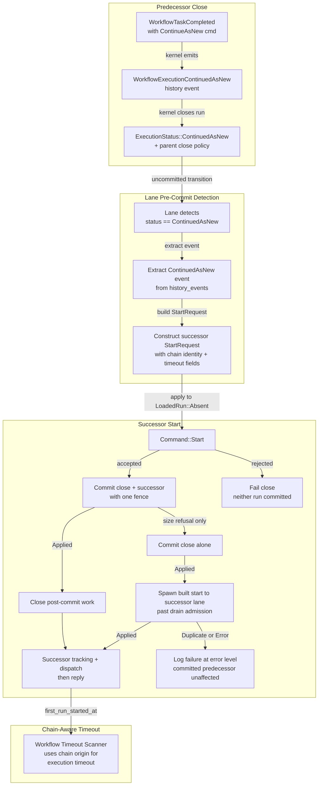

# Design Document: Continue-As-New

## Overview

This design wires the runtime's lane to detect when a run closes with `ExecutionStatus::ContinuedAsNew`, extract the successor parameters from the `WorkflowExecutionContinuedAsNew` history event, and apply a `Command::Start` for the successor run before committing both transitions together. It also completes the chain-aware execution timeout story deferred by Feature 5 (Workflow Timeouts) by propagating `first_run_started_at` through the `StartRequest`, `WorkflowState`, and `WorkflowTimeoutTrackingState`.

The kernel already handles the authoritative close: `WorkflowCommand::ContinueAsNew` emits a `WorkflowExecutionContinuedAsNew` history event carrying the successor's `new_run_id`, `workflow_type`, `task_queue`, `input`, `memo`, `search_attributes`, and timeout configuration, then closes the run with `ExecutionStatus::ContinuedAsNew` and applies parent close policy. The runtime's job is purely orchestration: detect this close, construct the successor `StartRequest`, apply it to `LoadedRun::Absent`, and commit the pair.

The feature has three parts:

1. **Successor detection and start.** Before committing the close, the lane detects `ExecutionStatus::ContinuedAsNew`, extracts the `WorkflowExecutionContinuedAsNew` event from the transition's `history_events`, constructs a `StartRequest`, and applies it to `LoadedRun::Absent`. The close and successor commit together under the close's fence. The close's post-commit work runs first, then the successor's tracking and dispatch, then the reply. Only a storage size refusal permits committing the close alone and spawning the built start through `publisher.submit_to_run`, past drain admission.

2. **Chain identity propagation.** The successor's `StartRequest` carries `continued_execution_run_id` (the predecessor's `run_id`) and `first_execution_run_id` (the very first run in the chain). If the predecessor already has a `first_execution_run_id`, it is forwarded; otherwise the predecessor's `run_id` becomes the chain origin.

3. **Chain-aware execution timeout.** A new `first_run_started_at: Option<OffsetDateTime>` field on `StartRequest` and `WorkflowState` carries the `started_at` timestamp of the first run in the chain. The `WorkflowTimeoutTrackingState` entry and `evaluate_workflow_timeout` use `first_run_started_at` (when present) for execution timeout measurement, while run timeout continues to use the current run's `started_at`.

This feature depends on Feature 1 (Lane OCC Retry), Feature 5 (Workflow Timeouts), and Feature 6 (Child Workflow Orchestration).

## Architecture



### Key design decisions

**Detection before the pair commit.** The lane detects `new_state.status == ExecutionStatus::ContinuedAsNew` after the kernel applies the close, before either run commits. The existing post-commit path still handles child resolution and predecessor timeout cleanup; successor tracking and dispatch follow that work.

**Event extraction from the transition's history_events.** The `WorkflowExecutionContinuedAsNew` event carries all successor parameters (`new_run_id`, `workflow_type`, `task_queue`, `input`, `memo`, `search_attributes`, timeout config). The lane scans these uncommitted events and builds the successor with the same field mappings. If the status is `ContinuedAsNew` but no matching event is found, this is an anomaly logged at error level.

**Apply and commit together.** The lane applies the built start to `LoadedRun::Absent`. A rejected start fails the close without committing either run, matching `service/history/api/respondworkflowtaskcompleted/workflow_task_completed_handler.go:1029-1039,1354-1369 @ v1.31.0`. Storage commits both transitions under the close's fence, as `common/persistence/sql/execution.go:401-439 @ v1.31.0` does. A conflict retries the close and successor together with the same successor identity. See [atomic-successors](../atomic-successors/design.md) for the pair checks and rollback contract.

**Only the size fallback uses `publisher.submit_to_run`.** An explicit storage size refusal writes nothing. The lane then commits the close alone and, only if it applies, spawns the already-built successor start to its own lane, past drain admission. The spawned submission avoids waiting on another command in the closing lane.

**Fallback failure handling with bounded retries.** The separate start uses the successor lane's OCC retry logic (`max_occ_retries`). The lane retries conflicts internally and surfaces exhaustion as `Err`. Failure is logged at error level and does not affect the predecessor's committed close. Other pair errors fail the close; they do not select this fallback.

**No duplicate-as-success path in the size fallback.** The storage contract returns `CommitResult::Duplicate` for request-dedupe collisions, not proof that the successor exists. All non-`Applied` fallback outcomes, including `Duplicate`, are treated as failures and logged at error level.

**`first_run_started_at` as a kernel-level field.** Adding `first_run_started_at` to `StartRequest` and `WorkflowState` makes the chain origin timestamp durable and available to any component that reads the workflow state. The kernel's `apply_start` populates `WorkflowState.first_run_started_at` from `StartRequest.first_run_started_at`. For the first run in a chain (no continue-as-new predecessor), this field is `None`.

**Execution timeout uses `first_run_started_at`, run timeout uses `started_at`.** The `WorkflowTimeoutEntry` gains a new `first_run_started_at: Option<OffsetDateTime>` field. The `evaluate_workflow_timeout` function uses `first_run_started_at.unwrap_or(started_at)` for execution timeout comparison, and always uses `started_at` for run timeout. This is backward-compatible: non-chain runs have `first_run_started_at = None` and fall back to `started_at`.

**Parent identity transfers.** Preserve the predecessor's parent linkage, including `parent_run_key` and `parent_workflow_id`. The child continues its existing execution chain, so its parent relationship survives (`service/history/workflow/mutable_state_impl.go:5690-5754 @ v1.31.0`). This is already implemented; successor-semantics preserves it.


## Components and Interfaces

### Modified StartRequest (tokeira-kernel)

One new optional field:

```rust
pub struct StartRequest {
    // ... existing fields ...
    /// Wall-clock `started_at` of the very first run in the
    /// execution chain. `None` for the first run; set by the
    /// runtime when constructing a continue-as-new successor.
    pub first_run_started_at: Option<OffsetDateTime>,
}
```

### Modified WorkflowState (tokeira-kernel)

One new optional field:

```rust
pub struct WorkflowState {
    // ... existing fields ...
    /// Wall-clock `started_at` of the very first run in the
    /// execution chain. `None` for the first run; populated
    /// from `StartRequest` during `apply_start`.
    pub first_run_started_at: Option<OffsetDateTime>,
}
```

### Modified apply_start (tokeira-kernel)

The kernel's `apply_start` populates the new field from the `StartRequest`:

```rust
let initial = WorkflowState {
    // ... existing fields ...
    first_run_started_at: req.first_run_started_at,
};
```

No other kernel changes are needed. The kernel does not interpret `first_run_started_at` — it is a pass-through field for the runtime's timeout scanner.

### Modified WorkflowTimeoutEntry (tokeira-runtime)

One new optional field:

```rust
pub struct WorkflowTimeoutEntry {
    pub run_key: RunKey,
    pub workflow_execution_timeout: Option<Duration>,
    pub workflow_run_timeout: Option<Duration>,
    pub started_at: OffsetDateTime,
    /// Chain origin timestamp for execution timeout.
    /// When present, execution timeout is measured from this
    /// timestamp instead of `started_at`.
    pub first_run_started_at: Option<OffsetDateTime>,
    pub has_retry_policy: bool,
}
```

### Modified evaluate_workflow_timeout (tokeira-runtime)

The execution timeout comparison changes to use the chain origin timestamp:

```rust
pub fn evaluate_workflow_timeout(
    entry: &WorkflowTimeoutEntry,
    now: OffsetDateTime,
) -> Option<WorkflowTimeoutViolation> {
    // Execution timeout: measured from chain origin
    if let Some(timeout) = entry.workflow_execution_timeout {
        let origin = entry.first_run_started_at.unwrap_or(entry.started_at);
        if now - origin > timeout || timeout.is_zero() && now >= origin {
            return Some(WorkflowTimeoutViolation::ExecutionTimeout);
        }
    }

    // Run timeout: always measured from current run's started_at
    if let Some(timeout) = entry.workflow_run_timeout {
        if now - entry.started_at > timeout
            || timeout.is_zero() && now >= entry.started_at
        {
            return Some(WorkflowTimeoutViolation::RunTimeout);
        }
    }

    None
}
```

### Modified start_workflow (tokeira-runtime)

The `WorkflowTimeoutEntry` insertion gains the new field:

```rust
self.workflow_timeout_tracking.insert(WorkflowTimeoutEntry {
    run_key: request.run_key,
    workflow_execution_timeout: request.workflow_execution_timeout,
    workflow_run_timeout: request.workflow_run_timeout,
    started_at: request.now,
    first_run_started_at: request.first_run_started_at,
    has_retry_policy: request.retry_policy.is_some(),
});
```

### Lane pre-commit: continue-as-new detection

After the kernel applies the close, the lane extracts the event and builds the successor before calling storage. The field construction is unchanged; the built successor identity is retained across conflict retries.

```rust
let new_state = &transition.next_state;
if new_state.status == ExecutionStatus::ContinuedAsNew {
    let maybe_event = transition.history_events.iter().find_map(|e| {
        match &e.kind {
            HistoryEventKind::WorkflowExecutionContinuedAsNew {
                new_run_id,
                workflow_type,
                task_queue,
                input,
                memo,
                search_attributes,
                workflow_execution_timeout,
                workflow_run_timeout,
                workflow_task_timeout,
                retry_policy,
            } => Some((
                new_run_id.clone(),
                workflow_type.clone(),
                task_queue.clone(),
                input.clone(),
                memo.clone(),
                search_attributes.clone(),
                *workflow_execution_timeout,
                *workflow_run_timeout,
                *workflow_task_timeout,
                retry_policy.clone(),
            )),
            _ => None,
        }
    });

    match maybe_event {
        Some((
            new_run_id,
            workflow_type,
            task_queue,
            input,
            memo,
            search_attributes,
            workflow_execution_timeout,
            workflow_run_timeout,
            workflow_task_timeout,
            retry_policy,
        )) => {
            let successor_run_key = RunKey::new();
            let first_execution_run_id = new_state
                .first_execution_run_id
                .unwrap_or(new_state.run_id);
            let first_run_started_at = Some(
                new_state
                    .first_run_started_at
                    .unwrap_or(new_state.started_at),
            );

            let start_request = StartRequest {
                run_key: successor_run_key,
                namespace_id: new_state.namespace_id,
                workflow_id: new_state.workflow_id.clone(),
                run_id: new_run_id,
                workflow_type,
                task_queue,
                input,
                memo,
                search_attributes,
                workflow_execution_timeout,
                workflow_run_timeout,
                workflow_task_timeout,
                retry_policy,
                attempt: 1,
                continued_execution_run_id: Some(new_state.run_id),
                first_execution_run_id: Some(first_execution_run_id),
                parent_run_key: new_state.parent_run_key,
                parent_workflow_id: new_state.parent_workflow_id.clone(),
                first_run_started_at,
                request: RequestContext {
                    request_id: RequestId(format!(
                        "continue-as-new-{:?}",
                        message.run_key
                    )),
                    caller_identity: Some(
                        "runtime-continue-as-new-orchestrator"
                            .to_string(),
                    ),
                    received_at: OffsetDateTime::now_utc(),
                },
                now: OffsetDateTime::now_utc(),
            };

            Some(start_request)
        }
        None => {
            tracing::error!(
                run_key = ?message.run_key,
                workflow_id = ?new_state.workflow_id,
                "ContinuedAsNew status but no WorkflowExecutionContinuedAsNew event found"
            );
            None
        }
    }
} else {
    None
}
```

The lane applies that start to `LoadedRun::Absent` before the pair commit. Rejection returns an error without writing the close:

```rust
let successor = kernel
    .apply(LoadedRun::Absent, Command::Start(start_request.clone()))
    .map_err(|reject| anyhow::Error::new(KernelRejected(reject)))?;
let result = repo
    .commit_transition_pair(
        message.run_key,
        transition.clone(),
        start_request.run_key,
        successor,
        fence.clone(),
    )
    .await?;
```

On `PairCommitResult::Applied`, the lane performs the close's post-commit work, then the successor's tracking and dispatch, then replies. The successor's timeout tracking still uses its committed state:

```rust
if start_request.workflow_execution_timeout.is_some()
    || start_request.workflow_run_timeout.is_some()
{
    workflow_timeout_tracking.insert(WorkflowTimeoutEntry {
        run_key: successor_run_key,
        workflow_execution_timeout: start_request.workflow_execution_timeout,
        workflow_run_timeout: start_request.workflow_run_timeout,
        started_at: successor_state.started_at,
        first_run_started_at: successor_state.first_run_started_at,
        has_retry_policy: successor_state.retry_policy.is_some(),
    });
}
```

A conflict retries both transitions together; a duplicate close is answered as before without writing a second successor. Only `PairCommitResult::SizeRefused` takes the fallback: commit the close alone, and only on `Applied` spawn the built start through `publisher.submit_to_run`. That start's lane installs its tracking and publishes its dispatch after its own commit. Its failure leaves the committed close unchanged:

```rust
// Spawned only after the size fallback's close has applied.
let result = publisher
    .submit_to_run(successor_run_key, Command::Start(start_request))
    .await;
if !matches!(result, Ok(CommitResult::Applied { .. })) {
    tracing::error!(
        ?result,
        ?predecessor_run_key,
        ?successor_run_key,
        "size-fallback successor start failed"
    );
}
```

The lane retains both transitions' history and dispatch effects through the commit. The close's effects run first and the committed successor's effects follow; only the size fallback carries a deferred start instead.

### Modified handle_message return type

```rust
async fn handle_message<K, R>(
    kernel: &K,
    repo: &R,
    run_key: RunKey,
    command: Command,
    max_retries: u32,
) -> Result<(CommitResult, SmallVec<[DispatchOp; 4]>, SmallVec<[HistoryEvent; 8]>)>
```

The history events are captured from the transition before commit and returned alongside the dispatch ops. Successor event extraction now happens before the commit. The lane also carries the committed successor's state, history and dispatch, or the size fallback's deferred start, into `run_activation` for post-commit work.


## Data Models

### Modified types

| Type | Crate | Change |
|------|-------|--------|
| `StartRequest` | `tokeira-kernel` | Add `first_run_started_at: Option<OffsetDateTime>` |
| `WorkflowState` | `tokeira-kernel` | Add `first_run_started_at: Option<OffsetDateTime>` |
| `apply_start` | `tokeira-kernel` | Populate `first_run_started_at` from `StartRequest` |
| `WorkflowTimeoutEntry` | `tokeira-runtime` | Add `first_run_started_at: Option<OffsetDateTime>` |
| `evaluate_workflow_timeout` | `tokeira-runtime` | Use `first_run_started_at.unwrap_or(started_at)` for execution timeout |
| `handle_message` return type | `tokeira-runtime` | Return `SmallVec<[HistoryEvent; 8]>` alongside dispatch ops |
| `run_activation` | `tokeira-runtime` | Apply successor post-commit effects after the close's; spawn a separate start only for the size fallback |
| `start_workflow` | `tokeira-runtime` | Pass `first_run_started_at` to `WorkflowTimeoutEntry` |

### New types

None. All new functionality is expressed through extensions to existing types.

### Existing types used (no changes needed)

| Type | Crate | Role |
|------|-------|------|
| `WorkflowExecutionContinuedAsNew` | `tokeira-kernel` | History event variant carrying successor parameters |
| `ExecutionStatus::ContinuedAsNew` | `tokeira-types` | Terminal status indicating continue-as-new close |
| `Command::Start` | `tokeira-kernel` | Command to create the successor run |
| `CommitResult` | `tokeira-storage` | `Applied`, `Conflict`, `Duplicate` |
| `DispatchPublisher::submit_to_run` | `tokeira-runtime` | Submit command to a specific run's lane |
| `WorkflowTimeoutTrackingState` | `tokeira-runtime` | In-memory timeout tracking |
| `RunKey` | `tokeira-types` | Durable identity of a workflow run |
| `RunId` | `tokeira-types` | Unique run identifier |
| `RequestContext` | `tokeira-types` | Request metadata for dedupe and tracing |

### Data flow: Continue-As-New successor creation

```
Predecessor WFT Completed with ContinueAsNew command
  → Kernel emits WorkflowExecutionContinuedAsNew history event
  → Kernel closes run with ExecutionStatus::ContinuedAsNew
  → Kernel applies parent close policy
  → Lane detects before commit: status == ContinuedAsNew
  → Lane extracts ContinuedAsNew event from history_events
  → Lane constructs successor StartRequest:
      - run_key: fresh RunKey
      - run_id: new_run_id from event
      - workflow_id: predecessor's workflow_id
      - namespace_id: predecessor's namespace_id
      - workflow_type, task_queue, input, memo, search_attributes: from event
      - timeout config: from event
      - retry_policy: resolved policy from the continued event
      - attempt: 1
      - continued_execution_run_id: predecessor's run_id
      - first_execution_run_id: predecessor's first_execution_run_id
                                 or predecessor's run_id
      - first_run_started_at: predecessor's first_run_started_at
                               or predecessor's started_at
      - parent_run_key: predecessor's parent_run_key
      - parent_workflow_id: predecessor's parent_workflow_id
  → Lane applies Command::Start to LoadedRun::Absent
  → On rejection: fail close, neither run committed
  → Lane commits close and successor with one fence
  → On Applied: close's post-commit work, successor tracking and dispatch, then reply
  → On conflict: retry both with the same successor identity
  → On size refusal only: commit close alone
      → If Applied: spawn publisher.submit_to_run with the built start, past drain admission
      → On fallback Applied: successor lane installs tracking and publishes dispatch
      → On fallback Duplicate or error: log failure at error level, predecessor unaffected
```

### Data flow: Chain-aware execution timeout

```
Successor run starts with first_run_started_at = Some(T0)
  → start_workflow inserts WorkflowTimeoutEntry with first_run_started_at
  → Workflow timeout scanner snapshots entries
  → evaluate_workflow_timeout:
      execution_timeout: now - first_run_started_at > workflow_execution_timeout
      run_timeout: now - started_at > workflow_run_timeout
  → If violated: submit WorkflowExecutionTimedOut command
```


## Correctness Properties

*A property is a characteristic or behavior that should hold true across all valid executions of a system — essentially, a formal statement about what the system should do. Properties serve as the bridge between human-readable specifications and machine-verifiable correctness guarantees.*

### Property 1: Successor StartRequest construction

The original-start links refinement is owned by
[successor-semantics Property 1](../successor-semantics/design.md): for any predecessor
started event, successor links equal that event's links, independently of later
attachments. **Validates: Requirements 2.10.** Its required PBT is tracked there.

*For any* predecessor `WorkflowState` closed with `ContinuedAsNew` and any `WorkflowExecutionContinuedAsNew` history event, the successor `StartRequest` shall have:
- `run_id` equal to the event's `new_run_id`
- `workflow_type`, `task_queue`, `input`, `memo`, `search_attributes`, `workflow_execution_timeout`, `workflow_run_timeout`, `workflow_task_timeout` equal to the corresponding event fields
- `run_key` that is freshly generated (not equal to the predecessor's `run_key`)
- `workflow_id` equal to the predecessor's `workflow_id`
- `namespace_id` equal to the predecessor's `namespace_id`
- `continued_execution_run_id` equal to `Some(predecessor.run_id)`
- `first_execution_run_id` equal to `Some(predecessor.first_execution_run_id.unwrap_or(predecessor.run_id))`
- `first_run_started_at` equal to `Some(predecessor.first_run_started_at.unwrap_or(predecessor.started_at))`
- `retry_policy` equal to the continued event's resolved `retry_policy`
- `attempt` equal to `1`
- `parent_run_key` equal to the predecessor's `parent_run_key`
- `parent_workflow_id` equal to the predecessor's `parent_workflow_id`

**Validates: Requirements 2.1, 2.2, 2.3, 2.4, 2.5, 2.6, 2.7, 2.8, 2.9, 3.1, 3.2, 4.3, 4.4**

### Property 2: Chain-aware execution timeout evaluation

*For any* `WorkflowTimeoutEntry` with arbitrary `started_at`, `first_run_started_at`, `workflow_execution_timeout`, `workflow_run_timeout`, and any `now` timestamp:
- Execution timeout fires when `now - first_run_started_at.unwrap_or(started_at) > workflow_execution_timeout`
- Run timeout fires when `now - started_at > workflow_run_timeout`
- Execution timeout takes precedence over run timeout when both fire
- When `first_run_started_at` is `None`, execution timeout uses `started_at` (backward-compatible)
- When `first_run_started_at` is `Some(t)`, execution timeout uses `t` regardless of `started_at`

**Validates: Requirements 4.5, 4.6**

### Property 3: Detection triggers only for ContinuedAsNew

*For any* committed transition that closes a run, successor creation shall be attempted if and only if the terminal status is `ExecutionStatus::ContinuedAsNew`. For all other terminal statuses (`Completed`, `Failed`, `Cancelled`, `Terminated`, `TimedOut`), no `Command::Start` shall be submitted for a successor.

**Validates: Requirements 1.1, 1.2**

### Property 4: apply_start populates first_run_started_at

*For any* `StartRequest` with arbitrary `first_run_started_at` (including `None`), after `apply_start` produces a `WorkflowState`, the state's `first_run_started_at` shall equal the request's `first_run_started_at`.

**Validates: Requirements 4.2**

### Property 5: Atomic successor with a size-only fallback

*For any* predecessor run that closes with `ContinuedAsNew`, the successor shall be built and applied before either run commits, and both transitions shall commit together. A rejected successor shall fail the close without committing either run. Only a storage size refusal shall permit committing the close alone and spawning the built start; any failure of that fallback start, including `Duplicate`, shall be logged at error level and shall not reopen or modify the committed predecessor.

**Validates: Requirements 5.3, 6.2**

### Property 6: Successor timeout tracking entry

*For any* successor `StartRequest` with a non-None `workflow_execution_timeout` or `workflow_run_timeout`, when the pair commits, the lane shall install tracking after the close's post-commit work and before replying. When the size fallback's start commits, its lane shall install the same tracking. The `WorkflowTimeoutTrackingState` shall contain an entry for the successor's `RunKey` with:
- `workflow_execution_timeout` and `workflow_run_timeout` matching the `StartRequest`
- `started_at` equal to the `StartRequest`'s `now`
- `first_run_started_at` equal to the `StartRequest`'s `first_run_started_at`
- `has_retry_policy` equal to `start_request.retry_policy.is_some()`

When the `StartRequest` has neither `workflow_execution_timeout` nor `workflow_run_timeout`, no tracking entry shall be inserted.

**Validates: Requirements 7.1, 7.2**

## Error Handling

### Successor start failure

If the kernel rejects the successor's `Command::Start`, the close's command fails with that rejection and neither run commits. A pair storage error fails the close, and conflicts retry both transitions together within the bounded OCC retry mechanism. Only a size refusal permits the separate start. If that fallback start fails (storage error, lane channel closed, OCC exhaustion), the failure is logged at `error` level with the predecessor's `run_key`, `workflow_id`, `run_id`, the successor's `new_run_id`, and the error details; the committed predecessor is not modified.

### Duplicate successor start

If the size fallback's `submit_to_run` returns `CommitResult::Duplicate`, this is a failure — the current storage contract returns `Duplicate` only for request-dedupe collisions, and a retried continue-as-new start uses a fresh `RunKey`. This is logged at `error` level. The sweeper (Feature 11) can reconcile.

### Missing ContinuedAsNew event

If the committed transition has `ExecutionStatus::ContinuedAsNew` but no `WorkflowExecutionContinuedAsNew` event is found in `history_events`, this is an internal consistency anomaly. It is logged at `error` level and successor creation is skipped. This should never happen in normal operation because the kernel always emits the event before setting the status.

### Successor commit and predecessor reply

Normally, the pair commits and the close's post-commit work runs, followed by the successor's tracking and dispatch, before replying through the lane message's `reply_tx`. Only the size fallback submits a separate start in a spawned task after the close applies; the reply does not wait for that start. A fallback start failure cannot change the committed close's result.

### Predecessor timeout tracking cleanup

When the predecessor closes with `ContinuedAsNew`, the existing `closed_at` check in the lane's post-commit path removes the predecessor's `WorkflowTimeoutEntry` from the tracking state. This is already implemented and requires no changes.

### Race between successor start and timeout scanner

If the successor is started and the timeout scanner runs before the tracking entry is inserted, the successor's timeout will not be checked in that scan cycle. This is acceptable because the tracking entry is inserted immediately after the successor start succeeds, and the scanner runs on a 1-second interval. The worst case is a 1-second delay in timeout detection.

## Testing Strategy

### Property-based testing

All 6 correctness properties will be implemented as property-based tests using the [`proptest`](https://docs.rs/proptest) crate, consistent with the existing test infrastructure in `tokeira-runtime` and `tokeira-kernel`.

Each property test will:
- Run a minimum of 100 iterations (proptest default is 256).
- Use mock implementations of `Kernel`, `RunRepository`, `DispatchPublisher`, and `LaneHandle` that are configurable per test.
- Be tagged with a comment referencing the design property.
- Tag format: `// Feature: runtime-continue-as-new, Property N: <title>`

Each correctness property MUST be implemented by a SINGLE property-based test.

**Property 1 (Successor StartRequest construction):** Generate predecessor state and continued-event fields independently, including distinct retry policies and optional parent linkage. Capture the start applied before the pair commit (or submitted after an explicit size refusal). Verify the event's resolved retry policy, predecessor parent identity, and the field mappings above. Unchanged lineage checks remain mandatory alongside the new original-start links property.

**Property 2 (Chain-aware execution timeout evaluation):** A generator produces random `WorkflowTimeoutEntry` values with random `started_at`, `first_run_started_at` (including `None`), `workflow_execution_timeout`, `workflow_run_timeout`, and random `now` timestamps. The test calls `evaluate_workflow_timeout` and verifies: execution timeout uses `first_run_started_at.unwrap_or(started_at)`, run timeout uses `started_at`, execution timeout takes precedence, and `None` timeouts produce `None` result.

**Property 3 (Detection triggers only for ContinuedAsNew):** A generator produces random terminal `ExecutionStatus` values. For `ContinuedAsNew`, a mock publisher captures the `Command::Start`. For all other statuses, the test verifies no `Command::Start` is submitted. The generator also produces random `WorkflowState` and `history_events` to ensure the detection logic is robust across different state configurations.

**Property 4 (apply_start populates first_run_started_at):** A generator produces random `StartRequest` values with random `first_run_started_at` (including `None`). The test calls `BasicKernel::apply_start` and verifies the resulting `WorkflowState.first_run_started_at` equals the request's value.

**Property 5 (Atomic successor with a size-only fallback):** Generate predecessor states and successor outcomes. Verify that accepted starts commit with the close and rejected starts leave both uncommitted. With an explicit size refusal, verify that the close applies before the separate start and that failed fallback outcomes, including `Duplicate`, are logged without modifying the committed predecessor.

**Property 6 (Successor timeout tracking entry):** A generator produces random successor `StartRequest` values with random timeout configurations (including `None` for both timeouts). A mock `WorkflowTimeoutTrackingState` captures insertions. After a pair commit, verify that tracking follows the close's post-commit work and precedes the reply; after a size-fallback start commit, verify the same entry is installed by the successor lane. When either timeout is configured, the entry has matching fields; when neither is configured, no entry is inserted.

### Unit tests

Unit tests complement property tests for specific examples and edge cases:

- **Missing ContinuedAsNew event:** Verify that when status is `ContinuedAsNew` but no matching event exists in `history_events`, no successor start is attempted and the anomaly is handled gracefully.
- **Duplicate successor start:** Verify that `CommitResult::Duplicate` from the size fallback's successor lane is treated as a failure and logged at error level.
- **Successor start conflict:** Verify that an exhausted size-fallback start conflict is logged at error level with all required context fields.
- **Chain identity across 3 runs:** Integration test creating a chain of 3 runs via continue-as-new, verifying `first_execution_run_id` and `first_run_started_at` are consistent across the chain.
- **Execution timeout fires from chain origin:** Integration test starting a chain of 2 runs where the execution timeout is set to a short duration. Verify the timeout fires based on the first run's `started_at`, not the successor's.
- **Run timeout fires from current run:** Integration test verifying run timeout uses the current run's `started_at`, not the chain origin.
- **Predecessor timeout entry removed:** Verify the predecessor's `WorkflowTimeoutEntry` is removed when it closes with `ContinuedAsNew`.
- **No timeout tracking for successor without timeouts:** Verify no `WorkflowTimeoutEntry` is inserted when the successor has no timeout configuration.

### Test configuration

```toml
[dev-dependencies]
proptest = "1"
```

Each property test annotation:
```rust
// Feature: runtime-continue-as-new, Property 1: Successor StartRequest construction
proptest! {
    #[test]
    fn prop_successor_start_request_construction(
        // ... generators ...
    ) {
        // ...
    }
}
```

Each correctness property MUST be implemented by a SINGLE property-based test. Property tests should run a minimum of 100 iterations.
