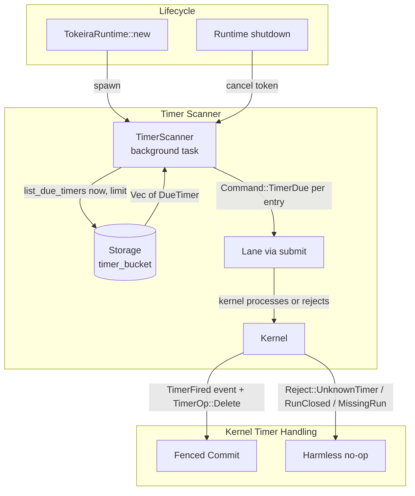

# Design Document: Timer Scanner

## Overview

This design adds a background timer scanner to `tokeira-runtime`, completing Feature 4 of the runtime roadmap. The scanner looks ahead for durable deadlines, wakes when they arrive and injects `Command::TimerDue` commands into the owning run's lane mailbox.

The feature is structurally parallel to the Activity Timeout Scanner from Feature 3. Both are background `tokio::spawn` tasks with deadline wakes and periodic reconciliation that inject commands through the lane. The key difference is the data source:

- **Activity Timeout Scanner** reads from runtime-local `ActivityTrackingState` (in-memory timestamps populated by lifecycle hooks).
- **Timer Scanner** reads from the storage layer's `list_due_timers(now, limit)` API, which queries the durable timer bucket managed authoritatively by the kernel via `TimerOp::Upsert` and `TimerOp::Delete`.

Timer scanning is non-authoritative. The scanner is a delivery mechanism, not a state authority. The authoritative state transition happens when the kernel processes the `TimerDue` command — it emits a `TimerFired` history event, removes the timer from the open set via `TimerOp::Delete`, and schedules a workflow task. If the scanner fires a stale or duplicate `TimerDue` (timer already canceled or fired, run already closed, run absent), the kernel rejects it harmlessly via `Reject::UnknownTimer`, `Reject::RunClosed`, or `Reject::MissingRun`.

Timer obligations remain in storage. Volatile shard cursors and deadline notifications reduce delivery latency; a full pass every interval repairs missed notifications.

## Architecture



### Key design decisions

**Storage-backed look-ahead.** Each active shard lists through `clock.now() + scan_interval`,
using checked deadline arithmetic. Due entries on different lanes are submitted concurrently,
each lane's share in listing order (below). The first future entry sets that shard's next wake.
The shared `DeadlineWake` combines these deadlines with
commit and acquisition notifications without losing an insertion during planning.

Successful lane commits announce their earliest `TimerOp::Upsert`, including delayed starts
and atomic successor transitions. Reset publication writes the full timer projection
reconstructed from its copied prefix. Reset and prepared successor runs announce their timers
only after preparation completes and listings can see them; recovery reconciliation does
likewise. Acquisition activation invalidates only its shard. These are volatile hints, never
an alternative to the stored obligation.

A deadline wake lists only shards whose cursor or notification is due. A full due page
continues immediately after its last entry. A new timer rewinds that shard's cursor so an
insertion behind it is not lost. Failed identities remain suppressed through these rewinds
until the next full pass. Every interval, all active shards restart from the beginning.
`command_for_due_timer` and stale-row cleanup remain unchanged.

**Concurrent submission, grouped by lane.** `submit_due_page` groups a page's due rows by
`lane_index_for_run_key`, the routing every submit path uses, so each group holds exactly the
rows whose commands land on one lane. Groups run concurrently on the scanner's own task. Within a
group, each submission waits for its reply before the next one starts. The lane executes one
command at a time, so queueing more of the scanner's commands on it would not commit any sooner:
it would only fill more of the lane's 1,024-slot mailbox that worker completions and polls share,
and it would hand the lane a run's later timer before the earlier one was settled. Waiting keeps
one run's timers in fire order and keeps the scanner to one mailbox slot per lane, so the work in
flight is bounded by the lane count and the page size, limits that already exist. It gives up
same-run coalescing in the lane, which a page of distinct runs' timers rarely reaches.

The acquisition check runs before every submission in every group, so a lost shard submits
nothing more. A failed submission is settled inside its group before that lane's next
submission; the page then adds its identity to the failed set. The cursor passes every due row
before submissions start. `run_timer_scanner_with_submit` takes the lane count next to its submit
closure, so tests drive the same grouping with a controlled submit. The test-only
`scan_due_timers_once*` helpers have no lanes and submit their page as a single group.

**Scanner submits through the lane, not directly to the kernel.** The scanner uses the same `self.submit(run_key, Command::TimerDue(...))` path as all other runtime commands. This preserves the lane's single-writer serialization for each run and ensures the kernel's fenced transition logic handles conflicts correctly.

**Non-authoritative delivery.** The scanner is a best-effort delivery mechanism. If it submits a `TimerDue` for a timer that has already been canceled or fired, the kernel rejects it with `Reject::UnknownTimer`. If the run is closed or absent, the kernel rejects with `Reject::RunClosed` or `Reject::MissingRun`. All rejections are harmless no-ops. This means duplicate firings from multiple scanner instances (e.g., during rolling deploys before shard-scoped scanning) are safe.

**Bounded batches per scan cycle.** The scanner processes at most `max_timers_per_scan` timers per cycle, passed directly as the `limit` parameter to `list_due_timers`. This bounds the work per cycle and prevents the scanner from starving other lane work. A full due page continues immediately using its last entry as the cursor.

**Configurable scan interval.** The default scan interval of 200ms provides sub-second timer resolution. Operators can tune this for their workload — lower for tighter timer precision, higher to reduce storage read pressure.

**Graceful lifecycle management.** The scanner is spawned during `TokeiraRuntime::new` and cancelled via a `CancellationToken` on shutdown, mirroring the activity timeout scanner pattern.

**Shard-scoped scanning.** Only active acquisitions are scanned, with acquisition identity rechecked before each submission.

## Components and Interfaces

### TimerScannerConfig

Configuration for the timer scanner background task:

```rust
/// Configuration for the background timer scanner.
pub struct TimerScannerConfig {
    /// Maximum interval between full passes. Default: 200ms.
    pub scan_interval: tokio::time::Duration,
    /// Maximum number of DueTimer entries processed per scan cycle.
    /// Passed as the `limit` parameter to `list_due_timers`.
    pub max_timers_per_scan: usize,
}

impl Default for TimerScannerConfig {
    fn default() -> Self {
        Self {
            scan_interval: tokio::time::Duration::from_millis(200),
            max_timers_per_scan: 100,
        }
    }
}
```

### Timer scanner loop (async function)

`run_timer_scanner` supplies the lane submit closure to `run_timer_scanner_with_submit`.
Both planning and `fired_at` use the node clock. Tokio supplies only the cancellable sleep.
The default 200 ms interval bounds reconciliation; it does not round timer deadlines.
Authority: `service/history/workflow/timer_sequence.go:69-106`,
`service/history/workflow/task_generator.go:372-402`, and
`service/history/queues/queue_scheduled.go:159-275 @ v1.31.0`.

### Updated TokeiraRuntime

```rust
pub struct TokeiraRuntime<R> {
    repo: Arc<R>,
    broker: InMemoryBroker,
    activity_broker: InMemoryActivityBroker,
    lanes: Vec<LaneHandle>,
    config: LaneConfig,
    // New fields for timer scanner:
    timer_scanner_handle: Option<tokio::task::JoinHandle<()>>,
    timer_scanner_cancel: CancellationToken,
}
```

The `new` method is extended to spawn the timer scanner:

```rust
impl<R> TokeiraRuntime<R>
where
    R: RunRepository + 'static,
{
    pub fn new(
        repo: Arc<R>,
        lane_count: usize,
        config: LaneConfig,
        timer_config: TimerScannerConfig,
    ) -> Self {
        let broker = InMemoryBroker::default();
        let activity_broker = InMemoryActivityBroker::default();
        let lanes = (0..lane_count.max(1))
            .map(|_| {
                let publisher = RuntimeDispatchPublisher::new(
                    broker.clone(),
                    activity_broker.clone(),
                );
                spawn_lane(
                    BasicKernel::default(),
                    repo.clone(),
                    publisher,
                    config.clone(),
                )
            })
            .collect::<Vec<_>>();

        let cancel = CancellationToken::new();
        let handle = tokio::spawn(run_timer_scanner(
            repo.clone(),
            lanes.clone(),
            lanes.len(),
            timer_config,
            cancel.clone(),
        ));

        Self {
            repo,
            broker,
            activity_broker,
            lanes,
            config,
            timer_scanner_handle: Some(handle),
            timer_scanner_cancel: cancel,
        }
    }

    /// Shut down the timer scanner gracefully.
    pub async fn shutdown_timer_scanner(&mut self) {
        self.timer_scanner_cancel.cancel();
        if let Some(handle) = self.timer_scanner_handle.take() {
            let _ = tokio::time::timeout(
                tokio::time::Duration::from_secs(5),
                handle,
            ).await;
        }
    }
}
```

### Lane routing helper

The scanner needs to route each `DueTimer` to the correct lane using the same hash-based routing as `TokeiraRuntime::pick_lane`:

```rust
fn pick_lane(lanes: &[LaneHandle], lane_count: usize, run_key: RunKey) -> &LaneHandle {
    let mut hasher = std::collections::hash_map::DefaultHasher::new();
    run_key.hash(&mut hasher);
    &lanes[(hasher.finish() as usize) % lane_count]
}
```

## Data Models

### New types

| Type | Crate | Role |
|------|-------|------|
| `TimerScannerConfig` | `tokeira-runtime` | Configurable scan interval and batch size |

### Modified types

| Type | Crate | Change |
|------|-------|--------|
| `TokeiraRuntime` | `tokeira-runtime` | Add `timer_scanner_handle: Option<JoinHandle<()>>` and `timer_scanner_cancel: CancellationToken` fields |
| `LaneHandle` | `tokeira-runtime` | Derive `Clone` — the inner `mpsc::Sender` is already `Arc`-backed, so cloning is cheap. Required so the scanner can hold its own `Vec<LaneHandle>` without borrowing the runtime. |

### Existing types used (no changes needed)

| Type | Crate | Role |
|------|-------|------|
| `DueTimer` | `tokeira-storage` | Storage query result: `{ run_key: RunKey, timer_id: String }` |
| `TimerDueRequest` | `tokeira-kernel` | Command payload: `{ timer_id: String, fired_at: OffsetDateTime }` |
| `Command::TimerDue` | `tokeira-kernel` | Kernel command variant wrapping `TimerDueRequest` |
| `Reject::UnknownTimer` | `tokeira-kernel` | Kernel rejection for timer not in open set |
| `Reject::RunClosed` | `tokeira-kernel` | Kernel rejection for closed run |
| `Reject::MissingRun` | `tokeira-kernel` | Kernel rejection for absent run |
| `RunRepository::list_due_timers` | `tokeira-storage` | Storage query: `(now, limit) -> Vec<DueTimer>` |
| `LaneHandle` | `tokeira-runtime` | Lane submission handle |
| `CancellationToken` | `tokio-util` | Cooperative shutdown signal |

### Scanner data flow

```
TimerScanner loop:
  1. Merge committed-timer and acquisition notifications into affected shard cursors.
  2. Plan the earliest shard deadline or full-pass deadline against clock.now().
  3. Wait on cancellation, an earlier-deadline notification, or the planned sleep.
  4. List only due active shards through clock.now() + scan_interval.
     - A full pass restarts every shard cursor and clears failed identities.
  5. Submit due rows through command_for_due_timer, different lanes concurrently, each lane's
     share in fire-time order, waiting for each reply before that lane's next submission.
     - A full due page continues immediately after its last row.
     - Remember the first future row's deadline for the next wake.
     - Retain failed identities until the full pass, even if a commit rewinds a cursor.
```


## Correctness Properties

*A property is a characteristic or behavior that should hold true across all valid executions of a system — essentially, a formal statement about what the system should do. Properties serve as the bridge between human-readable specifications and machine-verifiable correctness guarantees.*

### Property 1: Each due timer produces a correctly shaped TimerDue command

*For any* set of `DueTimer` entries returned by `list_due_timers`, the scanner shall submit exactly one `Command::TimerDue(TimerDueRequest { timer_id, fired_at })` per entry, where `timer_id` matches the `DueTimer.timer_id` and the command is routed to the lane determined by `hash(due.run_key) mod lane_count`.

**Validates: Requirements 1.2**

### Property 2: Batch limit is respected

*For any* `TimerScannerConfig` with `max_timers_per_scan = N`, the scanner shall pass `N` as the `limit` parameter to `list_due_timers`, ensuring at most `N` timers are processed per scan cycle.

**Validates: Requirements 1.4, 3.4**

### Property 3: All commands in a scan cycle share the same fired_at

*For any* set of `DueTimer` entries processed in a single scan cycle, all resulting `TimerDueRequest` commands shall have the same `fired_at` value — the wall-clock time captured at the start of that cycle.

**Validates: Requirements 1.5**

### Property 4: Scanner continues processing after per-entry failures

*For any* batch of `DueTimer` entries where `submit` fails for some entries (whether due to kernel rejection like `Reject::UnknownTimer`, `Reject::RunClosed`, `Reject::MissingRun`, or lane-level errors like channel closed or OCC exhaustion), the scanner shall attempt submission for all remaining entries in the batch without crashing or short-circuiting.

**Validates: Requirements 2.2, 2.3, 2.4, 5.2, 5.3**

### Property 5: Scanner survives transient storage errors

*For any* transient error returned by `list_due_timers`, the scanner shall log the error and proceed to the next scan cycle without crashing. The scanner's loop shall remain active after the error.

**Validates: Requirements 5.1**

### Property 6: Deterministic lane routing

*For any* `RunKey`, the scanner's lane selection shall be deterministic and consistent with `TokeiraRuntime::pick_lane` — i.e., `hash(run_key) mod lane_count` always produces the same lane index for the same `run_key`.

**Validates: Requirements 1.2**

## Error Handling

### Transient storage errors during list_due_timers

If `repo.list_due_timers(now, limit)` returns an error (transient network error, DSQL conflict), the scanner logs at `warn` level and skips the entire cycle. The scanner continues to the next cycle after sleeping for `scan_interval`. No timers are lost — they remain in the durable timer bucket and will be picked up in a subsequent cycle.

### Lane submission errors

If `lane.submit(run_key, command)` returns an `Err` that is not a kernel rejection (e.g., channel closed, OCC exhaustion), the scanner logs at `warn` level and continues to the next `DueTimer` entry. These are real delivery-path failures that operators should be aware of. The timer remains in the durable timer bucket and will be re-discovered in the next full pass; intervening deadline wakes skip that failed identity.

### Kernel rejections

The lane's `submit` path translates kernel `Reject` variants into `Err`. For timer scanning, the relevant rejections are:

- `Reject::UnknownTimer(timer_id)` — the timer was already fired or canceled, or its current fire time is later than the command observation after both are floored to milliseconds. This precision accepts due microsecond rows for nanosecond state. Harmless; a replacement timer row stays pending.
- `Reject::RunClosed(status)` — the run reached a terminal state. Harmless.
- `Reject::MissingRun` — the run does not exist in storage. Harmless.

All three are logged at `debug` level (not warn) and the scanner continues. These are expected during normal operation and should not generate noise in operator logs.

### Race between timer cancellation and scanner

If a `CancelTimer` workflow command is processed between the scanner's `list_due_timers` call and the `submit` call for that timer, the kernel will reject the `TimerDue` with `Reject::UnknownTimer` because the `CancelTimer` transition already removed the timer from the open set and emitted `TimerOp::Delete`. This is the intended non-authoritative behavior.

If the workflow starts a replacement under the same id before submission, the kernel also
checks its current `fire_at` against the command's `fired_at`, flooring both to milliseconds,
including before 1970. DSQL rows keep microseconds while state keeps nanoseconds; since the
scanner only submits rows at or before `fired_at`, this precision accepts current timers despite
that storage truncation. A replacement in a later millisecond is rejected with
`Reject::UnknownTimer`; the runtime keeps its row for its own deadline. No timer identity
fields or start-delay behavior change (Requirement 2.5;
`service/history/timer_queue_active_task_executor.go:163-175`,
`service/history/queues/queue_scheduled.go:286-301` and `common/constants.go:46 @ v1.31.0`).

### Race between duplicate scanner instances

If multiple runtime nodes run timer scanners concurrently (before shard-scoped scanning is implemented), they may both discover the same due timer. The first `TimerDue` command to be processed by the kernel will succeed and fire the timer. The second will be rejected with `Reject::UnknownTimer` because the timer was already removed from the open set. This is safe by design.

## Testing Strategy

### Property-based testing

All 6 correctness properties will be implemented as property-based tests using the [`proptest`](https://docs.rs/proptest) crate, consistent with the existing test infrastructure in `tokeira-runtime`.

Each property test will:
- Run a minimum of 100 iterations (proptest default is 256).
- Be tagged with a comment referencing the design property.
- Tag format: `// Feature: runtime-timer-scanner, Property N: <title>`

**Scanner command generation (Properties 1, 3):** These test the core scan-cycle logic. A generator produces random `Vec<DueTimer>` entries (random `RunKey` and `timer_id` values). A mock `RunRepository` returns these from `list_due_timers`. A mock lane captures submitted commands. The test verifies that each `DueTimer` produces a corresponding `Command::TimerDue` with matching `timer_id` and that all `fired_at` values in a cycle are identical.

**Batch limit (Property 2):** A generator produces random `max_timers_per_scan` values. A mock `RunRepository` records the `limit` parameter passed to `list_due_timers`. The test verifies the recorded limit equals the configured value.

**Error resilience (Properties 4, 5):** A generator produces random batches of `DueTimer` entries and random failure patterns (which entries fail submission, whether `list_due_timers` itself fails). Mock lanes are configured to fail on specific entries. The test verifies that all non-failing entries are still submitted (Property 4) and that the scanner loop continues after a `list_due_timers` error (Property 5).

**Lane routing (Property 6):** A generator produces random `RunKey` values and lane counts. The test verifies that the scanner's lane selection matches `TokeiraRuntime::lane_index` for the same inputs, and that the result is deterministic across repeated calls.

### Unit tests

Unit tests complement property tests for specific examples and edge cases:

- **Default config values**: verify that `TimerScannerConfig::default()` has `scan_interval = 200ms` and `max_timers_per_scan = 100`.
- **Empty scan cycle**: verify that when `list_due_timers` returns an empty vec, no commands are submitted.
- **Scanner shutdown**: verify that cancelling the `CancellationToken` causes the scanner task to complete within a bounded time.
- **Scanner spawned on runtime creation**: verify that `timer_scanner_handle` is `Some` after `TokeiraRuntime::new`.

### Integration tests

Integration tests exercise the full `TokeiraRuntime` with `InMemoryStore`:

- Start a workflow, schedule a timer via `WorkflowTaskCompleted` with a `StartTimer` command whose `fire_at` is in the past, and verify the scanner submits a `TimerDue` that produces a `TimerFired` history event.
- Start a workflow, schedule a timer, cancel it via `CancelTimer`, and verify the scanner does not produce a `TimerFired` event (the `TimerDue` is rejected harmlessly).
- Start a workflow, schedule multiple timers with past deadlines, and verify all are fired within a few scan cycles.

### Test configuration

```toml
[dev-dependencies]
proptest = "1"
tokio-util = { version = "0.7", features = ["rt"] }  # for CancellationToken in tests
```

Each property test annotation:
```rust
// Feature: runtime-timer-scanner, Property 1: Each due timer produces a correctly shaped TimerDue command
proptest! {
    #[test]
    fn prop_each_due_timer_produces_command(
        timer_count in 0usize..20,
        // ... generators for DueTimer entries
    ) {
        // ...
    }
}
```

Each correctness property MUST be implemented by a SINGLE property-based test. Property tests should run a minimum of 100 iterations.

### Property 7: Validated timer delays and checked fire times

For any wire seconds/nanos pair or stored duration in this feature, conversion and deadline arithmetic SHALL be total. Accepted values SHALL preserve the specified cap, and rejected command values SHALL retain their cause and message. Every unrepresentable deadline SHALL saturate at the latest representable date, including underflow from malformed negative stored durations.

**Validates: Requirements 7.**

Validation and the failure cause follow `service/history/api/command_attr_validator.go:136-157 @ v1.31.0`; the shared duration rule is `common/primitives/timestamp/duration.go:67-88 @ v1.31.0`. Saturating stored deadlines is a Tokeira representational safeguard.

Verification: `stored_start_delay_deadlines_are_total`, `command_durations_preserve_failure_cause_and_message`. Admission uses `validate_and_cap_proto_duration`; stored deadlines use saturating arithmetic because earlier rows did not pass that admission boundary. No schema or dependency changes are required.

The appended `StartTimerWithTimeout` command carries the validated duration to the transition clock. This makes `TimerStarted` record the exact capped value; translating an absolute fire time earlier would subtract transport and queueing time from the recorded timeout. The legacy `StartTimer` variant retains its positional encoding. `capped_command_durations_are_recorded_in_history` checks the resulting wire history.

### Property 8: Lanes submit concurrently, each lane in page order

*For any* page of due timers, submissions for different lanes may be in flight together, each
lane has at most one in flight and submits in page order, every due timer is submitted at most
once, a failed submission is settled once and suppressed until the next full pass, and no
submission follows a lost acquisition.

**Validates: Requirements 8.**

Verification: `due_timers_on_different_lanes_are_in_flight_together`,
`one_runs_due_timers_are_submitted_in_fire_order`, `failed_submission_is_settled_once_per_pass`,
`lost_acquisition_stops_every_lane`.
