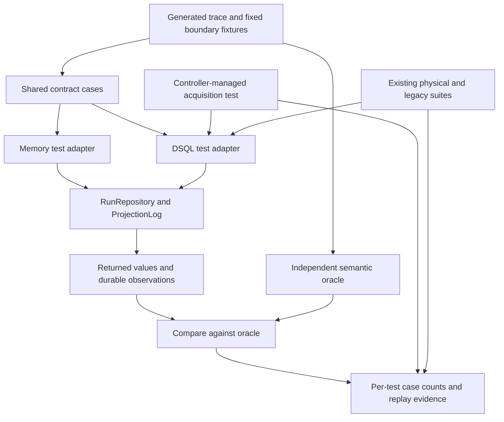

# Design: Storage Contract Tests

## Overview

Add a small shared contract suite for `RunRepository` and `ProjectionLog`, with
memory and live DSQL adapters running identical generated scenarios and semantic
assertions. Reuse existing suites for split values, bulk writes, legacy projection
seeding and lease interleavings. Extend the real runtime acquisition check to
cross a recovery-page boundary before activation.

This design implements the approved [requirements](requirements.md). Its source
baseline is `757ea24589ca8208d1a58f0801e03dd3a127816b`. The authority is the
storage interfaces and the owning specifications cited below. It introduces no
new Temporal API behavior; the compatibility target remains v1.31.0. Any public
behavior question discovered while implementing a failing trace must first be
resolved against the pinned Temporal source under root AGENTS.md §8.

## Dependencies and Non-Goals

| Existing owner | Contract consumed here |
|---|---|
| [Storage interfaces](../../../crates/tokeira-storage/src/api.rs) | Commit outcomes, history, recovery cursors, projection pages and exact deletion |
| [History pagination](../history-pagination/bugfix.md) | Full requested event pages and complete bounded suffix reads |
| [Recovery index](../recovery-index/requirements.md) | Current-format candidates; DSQL legacy and flagged phases |
| [Projection passes](../projection-passes/bugfix.md) | Key ordering, new passes and backend-specific legacy retention |
| [Lease fence](../bundle-lease-fence/bugfix.md) | Original owner/epoch checked within the write transaction |
| [Bounded bulk writes](../bounded-bulk-writes/bugfix.md) | Spill, materialization, publication and resumable deletion |
| [Large value parts](../large-value-parts/bugfix.md) | Whole-value hydration across bounded physical parts |
| [Runtime recovery](../../../crates/tokeira-runtime/src/recovery.rs) and [membership](../../../crates/tokeira-runtime/src/runtime/membership.rs) | Generation-scoped recovery before activation |
| [Live-suite runbook](../../../docs/testing/dsql-live-suites.md) | Serial execution, preparation before leases and isolated fixtures |

No new dependency, schema, production configuration, CI schedule or deployment
path is required. Do not add a database-limits facade to memory, move functional
conformance to DSQL, optimize queries, redesign projectors, or expand into
activity reconciliation or queue-home delivery. Existing sibling specifications
remain unchanged. A discovered implementation defect is handled against its
owning contract; it is not a reason to weaken the new oracle.

## Architecture

Scenario inputs define the expected results before any backend read. Adapters
provide real repositories, fixture-only legacy setup, durable inspection and
cleanup. They do not implement alternate paging or commit logic. The runtime
case uses its real acquisition control path and real DSQL lease repository;
dispatch and projection remain derived effects of committed state.



All contract machinery is test-only except the narrowly scoped transaction-start
cancellation repair specified in the amendment below. The kernel stays untouched. Test-only SQL may
seed an older representation or inspect an unexposed durable effect, but reads,
commits, projection deletion and acquisition under test call production APIs.

## Components and Interfaces

### Shared scenarios (`crates/tokeira-storage/src/contract_tests/`)

Register this module under `#[cfg(test)]` in `lib.rs`. Split history, recovery,
projection and commit scenarios into focused files; keep the shared adapter and
runner in `mod.rs`. Use the existing `proptest` dependency and `TestRunner`, not a
new property framework. Representative test-only interfaces are:

```rust
trait ContractBackend: Sync {
    fn repo(&self) -> &dyn RunRepository;
    fn projection_log(&self) -> &dyn ProjectionLog;
    async fn observe(&self, scope: &FixtureScope) -> Result<DurableObservation>;
    async fn cleanup(&self, scope: &FixtureScope) -> Result<()>;
}

async fn history_case(backend: &impl ContractBackend, case: &HistoryCase) -> Result<()>;
async fn recovery_case(backend: &impl ContractBackend, case: &RecoveryCase) -> Result<()>;
async fn projection_case(backend: &impl ContractBackend, case: &ProjectionCase) -> Result<()>;
async fn commit_case(backend: &impl ContractBackend, case: &CommitCase) -> Result<()>;
```

These are concrete test seams, not new public traits. Keep lease setup and legacy
row mutation in the applicable adapter instead of growing an adapter method for
every production repository method. Reuse fixture construction and applicable
cases from `history_event_tests`, `bulk_write_tests`, `large_value_tests`,
`lease_fence_tests` and `workflow_dispatch_tests`. Their existing adapter traits
need not be replaced. The new history oracle uses the authored event sequence;
it must not obtain its expected sequence through `read_history_to_end`.

### Backend adapters and isolation

Place the memory adapter in `memory/contract_tests.rs`, declared by `memory.rs`.
This gives test code access to its parent's private store without widening the
production API. Place the DSQL adapter in
`dsql/run_repository/contract_tests.rs`, gated by `test` and `dsql-integration`.
Use `DsqlStore::from_database_url_for_tests`, embedded migrations and the existing
SQLx test-connection pattern. Keep the pool's minimum and maximum connection
counts equal and disable idle eviction, preserving the storage pool invariant.

New live entries are ignored by default and require
`TOKEIRA_DSQL_TEST_DATABASE_URL` when explicitly executed. Missing configuration
is an error before the case starts, without printing the URL. Do not fall back
to another database variable. Existing URL-gated cases need not all be rewritten:
the live run's preflight must establish their configuration before selection.

Each trial, including a shrink attempt, owns fresh run and business identities.
Use recorded logical aliases in traces, with a fresh physical namespace per
attempt; alias normalization must never remove a semantic field under test.
Identity allocation preserves every generated key-order, equality, home and
partition relationship, so both backends execute the same logical trace despite
using different physical identities.
Choose microsecond-aligned timestamps so PostgreSQL precision does not create
irrelevant differences. Memory uses a fresh store per trial; a DSQL test family
may reuse its pool while cleaning each trial before the next.

Reserve explicit execution homes 4094 and 4095 with 4096 logical homes for new
recovery and lease cases, checking those scopes are unused. They do not overlap
the existing fixtures documented in the live-suite runbook. Explicit-home cases
also exercise identities whose hash-derived home differs from their placement.

Commit-generated projection images require special handling: memory partitions
by the low 32 bits of the run UUID modulo 16. Configure the DSQL fixture with the
same 16 partitions. Choose identities for a selected partition, run these cases
first on the disposable database, and check that its selected scope contains no
foreign images. A high artificial partition would bypass the commit path being
tested. Test-only decoys may use another partition/fanout to prove isolation.
Never filter out unexpected foreign rows to make an assertion pass, and never
delete them. Repeat trials remove only their own images and data.

### History and recovery cases

History cases construct complete events, optional principals and batch cuts,
then commit batches through the repository. For every selected exclusive cursor
and page size, slice the fixture vector to obtain the expected page. Compare
whole events, not only IDs or lengths. The attributed reader must preserve each
event/principal association. Fixed cases include zero, empty/absent runs, exact
batch edges, a suffix above 1,000 events, exact multiples of `HISTORY_READ_PAGE`
and a supported split-value batch. An exact multiple must perform the terminal
empty read instead of assuming the last full page ended the history.

Recovery fixtures assign an explicit eligible/ineligible category, home and
expected state to every authored run. The oracle selects by those fixture labels,
not `recovery_needed` or the production recovery-entry builder. Current-format
cases traverse using `next` until `None`, even after a short page, with a finite
progress guard that fails on a repeated cursor. Limit zero means one. Compare
complete decoded states, accounting explicitly for their committed projection
fold, and verify that deletion of the cursor row does not hide later keys.

DSQL-only legacy fixtures set the old recovery flag representation through a
dedicated setup hook. Exercise empty, short and exact-full legacy/flagged phases.
One controlled trace changes a visited legacy row to flagged before resumption:
the later flagged phase must still recover it. A repeat across phases is allowed
for this changing set. Raw fixture deletion of a cursor row tests keyset
resumption; it is not evidence for the production run-deletion lifecycle, which
is covered by the existing bulk suite.

### Projection cases

Commit images in deliberately different key and commit orders. Expected images
come from fixture-authored states and the existing frozen
`projection_accumulator_oracle::workflow_projection_context`, not the production
accumulator preparation helper. Validate backend-specific encoded history size
against that backend's history accounting; do not require byte-identical codecs.

Check `(run_key, transition_seq)` ordering, exclusive cursors, partition/fanout
isolation and zero reads. Insert an image below a live cursor and require a new
pass from the head to see it. Delete an observed subset, including repeated and
absent keys, and compare the exact surviving set. Commit a newer image after
reading a page and prove deleting that page cannot remove it. Reuse the existing
legacy-seed tests: memory may retain its last unseeded image; DSQL may load the
newer applied visibility value after deletion. Do not force those policies into
one identical deletion count. For `oldest_written_at`, check DSQL against seeded
timestamps and memory against its documented `None`.

### Commit observations and controlled concurrency

Generate well-formed non-noop transitions with distinguishable event, dedupe,
timer, activity/workflow dispatch, outbound and projection effects. Include both
`commit_transition` and `commit_transition_for_bundle`. Derive expected states
and write effects from the fixture before execution, including the projection
fold; never use an unexpected returned state as the next expected state.

Observe complete values, not just row counts, after writers have joined. For a
rejected attempt, compare each backend's full before/after observation. DSQL's
`read_transition_audit` reconstructs history-batch records and leaves operation
vectors empty; memory retains richer operation details. Compare those audits
within each backend and compare their common history semantics across backends.
This feature does not add durable audit storage to DSQL.

Two distinct same-sequence writers start behind a barrier; exactly one must
apply, and all durable effects must belong to that winner. Accept either winner.
Competing starts use different run IDs for the same business identity; after
both finish, one current pointer and no losing run's rows may remain. Depending
on the interleaving, the loser may report a sequence conflict or current-execution
conflict. A separate controlled probe exercises `CurrentExecutionConflict` and
checks its incumbent details. Exercise `Duplicate` with a current expected
sequence so stale-sequence precedence does not mask the dedupe branch.

Lease cases use real acquire/expire/takeover operations and the original captured
fence. Reuse `lease_fence_tests` synchronization hooks for DSQL interleavings
inside a commit transaction, including both commit entry points. Memory's mutex
serializes the operation; never pause a holder while awaiting another writer
that needs that mutex. Shared cases arrange takeover before the stale attempt;
DSQL-specific existing tests additionally prove the transactional race. Take the
rejection baseline after the intentional lease change, so it does not appear as
an attempted transition effect. No sleep-based scheduling is introduced.

### Controller-managed acquisition (`tokeira-runtime`)

Extend `runtime/dsql_tests.rs` with
`storage_contract_live_acquisition_spans_recovery_pages`. After migration, call
`prepare_execution_placement` while no leases exist and before seeding runs;
that helper already calls `ensure_outbound_prepared`. Construct a controller-
managed runtime over the real DSQL repositories and lease path.

Seed more than `RECOVERY_PAGE` recoverable current-format runs in the selected
home (currently 100, so at least 101 runs), with authored future workflow and
workflow-task deadlines. Re-arm the existing `pause_next_recovery` one-shot
before resuming each paused row, walking deterministically into the second page.
At that pause the acquisition must still be inactive. After releasing recovery
and awaiting acquisition, assert every seeded deadline is installed under the
active generation, including the last page's sentinel. Use future deadlines to
avoid delivery races; no external workflow execution is needed.

Retain and execute
`workflow_dispatch_live_acquisition_rejects_superseded_tracker_installs` for the
superseded-generation invariant. Keep its preparation before fixture writes if
needed for the now-shared prepared-store precondition. On success or error, stop
the runtime and its renewal tasks before releasing its own leases and deleting
its own runs. Never invoke global preparation after a lease-taking suite.

## Data Models

All added types are test-only; existing storage types and encodings stay intact.

| Type and fields | Source and use |
|---|---|
| `FixtureScope`: namespace/business identities, run aliases/keys, home IDs, projection partition/fanout, owned keys | Requirements 1.3, 3.1, 4.1, 8.8; bounds setup, observation and cleanup |
| `HistoryCase`: authored events, optional principals, batch cuts, cursors and page sizes | Requirements 2.1–2.6; independent ordered vector oracle |
| `RecoveryCase`: authored states, eligibility labels, homes, page sizes, legacy phase mutations and cursor-row deletion | Requirements 3.1–3.6; expected ordered candidates and allowed phase revisits |
| `ProjectionCase`: commit order, authored states/image keys, read cursors, inserted images and deletion sets | Requirements 4.1–4.6; reference image map with exact-key retirement |
| `CommitCase`: initial state, transitions, expected sequence, request identity, entry-point choice and lease schedule | Requirements 5.1–5.7; typed outcomes and winner-only write sets |
| `DurableObservation`: full state, history/principals/size, audit, dedupe, current pointer, timers, both dispatch kinds, outbound operations/intents/provenance, projection images | Requirement 5.2; API reads plus adapter-private inspection of the scope's unexposed rows; no count-only substitutes |
| Case evidence: property/test name, backend, seed, successful case count, logical failing trace and shrink input | Requirements 8.1–8.3, 8.7; replay without endpoints or credentials |
| Run evidence: source SHA and clean/dirty status, archive digest, feature flags, selected/executed names and outcomes, case counts, cleanup result | Requirements 8.4–8.9; distinguishes test completion from selection or configuration skips |

Physical identifiers allocated per attempt are separate from the logical replay
input. A before/after observation is collected while fixture writers are
quiescent; it does not claim that separate read APIs form one snapshot during
concurrent writing. Adapter inspection must include values of existing rows so
an overwrite with an unchanged count is detected.

## Correctness Properties

Properties 1–7 are required shared properties: execute at least 100 successful
generated cases per property on **each** backend. Property 8 is DSQL-only and
also requires at least 100 cases. Property 9 is a pure oracle test with at least
100 generated cases. Fixed boundary and physical examples supplement these
counts; they do not replace them.

### Property 1: History pages preserve the authored sequence

*For any* valid authored history, batch partition, attribution vector, exclusive
cursor and finite requested limit, each history reader returns the corresponding
ordered slice with exact event/principal pairing; whole-history readers return
the complete suffix and exact-event lookup returns only the requested event.
Zero/terminal reads return empty without mutation.

**Validates: Requirements 1.3, 1.4, 2.1, 2.2, 2.3, 2.4, 2.5, 2.6, 8.1, 8.2**

### Property 2: Current-format recovery traverses every eligible run

*For any* fixed authored set of eligible and ineligible current-format runs in
multiple homes and any requested page size, following every `next` cursor yields
exactly the selected home's eligible states once, in key order, using effective
limit `max(1, limit)`. Removing the row named by a cursor does not hide later
eligible keys. Completion follows the cursor, not page length.

**Validates: Requirements 1.3, 1.4, 3.1, 3.2, 3.3, 3.6, 8.1, 8.2**

### Property 3: Projection passes follow keys and discover late images

*For any* valid commit permutation, partition/fanout and page size, projection
reads return precisely the bounded image-key suffix in that scope. A new image
below a saved cursor is present in the next pass from the head. Zero reads leave
the log unchanged.

**Validates: Requirements 1.3, 1.4, 4.1, 4.2, 4.6, 8.1, 8.2**

### Property 4: Image retirement cannot erase an unobserved version

*For any* current-format image set, observed page and requested deletion subset,
deletion removes exactly the named existing keys in that scope, reports that
count and removes zero on repetition. Other scopes and images committed after
the observed page survive unless their exact keys were explicitly requested.
Legacy retention remains covered separately under its owning specification.

**Validates: Requirements 1.3, 1.4, 4.3, 4.4, 8.1, 8.2**

### Property 5: Commit outcomes publish all or none of the attempted writes

*For any* generated valid transition and controlled applied, sequence-conflict,
dedupe or current-execution precondition, either commit entry point returns the
specified semantic outcome. An applied transition's returned/reloaded state and
durable effects match its expected post-state; a rejected attempt leaves its
before/after observation unchanged, including existing row values.

**Validates: Requirements 1.3, 1.4, 5.1, 5.2, 5.5, 5.7, 8.1, 8.2**

### Property 6: Competing writers leave one coherent winner

*For any* two distinct valid non-noop transitions at one expected sequence,
concurrent completion admits exactly one transition and only its write set.
For any two valid starts of one open-current business identity, at most one
owns the pointer and the loser leaves no authoritative or derived orphan rows.
Both commit entry points obey this invariant; either winner is permitted.

**Validates: Requirements 1.3, 1.4, 5.2, 5.3, 5.4, 5.7, 8.1, 8.2**

### Property 7: An old lease cannot authorize a later transition

*For any* generated valid transition and controlled ownership change after the
caller captured its fence, both commit entry points reject the old owner/epoch
with `LeaseFenceLost` and expose none of that attempted write set. Synchronization
fixes the order of takeover and attempt; elapsed sleeps never establish it.

**Validates: Requirements 1.3, 5.2, 5.6, 5.7, 8.1, 8.2**

### Property 8: DSQL recovery resumes across legacy phases

*For any* authored legacy/flagged candidate sets and page size, traversal visits
legacy candidates before flagged candidates and follows phase cursors through
empty, short and exact-full boundaries. If a visited legacy candidate becomes
flagged before that phase is read, it remains reachable there; its permitted
second visit is not mistaken for a fixed-set duplicate.

**Validates: Requirements 1.4, 1.5, 3.2, 3.3, 3.4, 3.5, 8.1, 8.2**

### Property 9: The oracle rejects the failures it claims to detect

*For any* generated nondegenerate expected observation suitable for a selected
mutation, the comparison accepts the valid observation and rejects its truncated
page, reordered unequal entries, skipped nonempty continuation, or partial-write
variant. A partial-write mutation includes changing an existing value without
changing the row count. Mutations apply to observation copies, never production
code, and must actually change the checked invariant.

**Validates: Requirements 1.4, 8.3**

## Error Handling

These are test outcomes, not changes to public RPC status mapping.

| Condition | Existing/internal outcome | Test and external evidence |
|---|---|---|
| Sequence or concurrent-write conflict | `CommitResult::Conflict` | Assert no losing writes; no prose equality |
| Applicable dedupe request | `CommitResult::Duplicate` | Assert no additional effects; separate stale-sequence precedence |
| Existing open current execution | `CommitResult::CurrentExecutionConflict` | Compare incumbent run, status and request IDs |
| Captured lease no longer valid | `LeaseFenceLost` in the repository result | Downcast/classify; compare the entire attempted write scope |
| Wrong-home or malformed fixture input | Existing repository validation error | Fixed negative fixture; must not be relabeled as a lease-race success |
| Caller limit unrepresentable in a directly bound SQL limit | Existing conversion error | DSQL-only fixed case; read leaves data unchanged |
| Recognized transaction-size/row refusal | Existing DSQL error classification in `dsql_transaction_limits` | Require refusal and unchanged probe rows; unrelated SQL errors fail |
| Corrupt stored value or legacy seed | Existing decode/seed error | Retain owning-suite checks; no swallowing into an empty page |
| Missing live URL, unavailable database, migration or readiness failure | Test setup error | Fail explicitly selected new live entry; no executed-case credit |
| Foreign fixture data or lease in a claimed scope | Fixture precondition error | Fail without changing another owner's data |
| Oracle mismatch, repeated nonterminal cursor or broken synchronization | Test assertion/error | Fail with property, seed and logical trace |
| Case cannot finish within the existing live timeout | Nextest timeout/failure | No pass or retry credit; investigate or split named case batches |
| Cleanup failure after success or failure | Fixture cleanup error plus original result | Fail; preserve both diagnostics and require final cluster cleanup evidence |

History's DSQL reader binds a fixed internal batch page size, not the caller's
event limit. Do not assert that an otherwise valid very large caller limit must
fail there. Direct limit-binding checks belong to projection and recovery reads.
The transaction-limit probe's recognized refusal category is distinct from OCC;
retain its existing bounded conflict handling instead of treating any SQL error
as a successful limit test.

## Testing Strategy and Coverage Matrix

The implementation adds `docs/testing/storage-contract-tests.md` as the maintained
matrix and links it from the existing live-suite runbook. It must distinguish
planned entry points from executed evidence until a recorded run exists. The
following names are the planned stable leaf names; shared memory entries live
under `memory::contract_tests`, live storage entries under
`dsql::run_repository::contract_tests`, and the pure control under
`contract_tests`. Nextest's list output supplies the final fully qualified names.

| Contract | Memory entry | Live DSQL entry | Evidence class |
|---|---|---|---|
| Property 1 | `storage_contract_memory_history` | `storage_contract_live_history` | Shared; 100 cases per backend plus fixed history boundaries |
| Property 2 | `storage_contract_memory_recovery` | `storage_contract_live_recovery` | Shared; 100 cases per backend |
| Property 3 | `storage_contract_memory_projection_pages` | `storage_contract_live_projection_pages` | Shared; 100 cases per backend |
| Property 4 | `storage_contract_memory_projection_deletion` | `storage_contract_live_projection_deletion` | Shared; 100 cases per backend |
| Property 5 | `storage_contract_memory_commit_outcomes` | `storage_contract_live_commit_outcomes` | Shared; 100 cases per backend |
| Property 6 | `storage_contract_memory_competing_commits` | `storage_contract_live_competing_commits` | Shared; 100 cases per backend |
| Property 7 | `storage_contract_memory_lease_fence` | `storage_contract_live_lease_fence` | Shared; 100 cases per backend |
| Property 8 | Not applicable: no legacy phase | `storage_contract_live_legacy_recovery` | DSQL representation; 100 cases |
| Property 9 | `storage_contract_oracle_rejects_corruption` | Same pure oracle, no database claim | Pure; 100 cases covering all four corruption kinds |
| Direct SQL limit binding | No memory restriction | `storage_contract_live_limit_binding` | Fixed physical check for recovery/projection |
| Multi-page acquisition | Existing runtime recovery tests | `storage_contract_live_acquisition_spans_recovery_pages` | New runtime integration, more than one recovery page |
| Generation supersession | Existing generation-scoped tracker tests | `workflow_dispatch_live_acquisition_rejects_superseded_tracker_installs` | Existing runtime integration, rerun unchanged invariant |

The matrix also inventories existing evidence by **exact entry name**, rather
than copying its implementation into a new property. At minimum include:

| Existing shared/owning case | Memory entry | DSQL entry or selection |
|---|---|---|
| Exact event reads across batches | `memory_read_from_batches_of_any_size` | `dsql_history_event_read_from_batches_of_any_size` |
| Copied reset history | `memory_read_from_a_reset_successors_copied_batches` | `dsql_history_event_read_from_a_reset_successors_copied_batches` |
| Split history | `memory_batches_over_the_part_size_read_back` | `dsql_batches_over_the_part_size_read_back` |
| Split state | `memory_a_state_over_the_part_size_loads_back` | `dsql_a_state_over_the_part_size_loads_back` |
| Split reset/deletion | `memory_a_reset_copies_values_over_the_part_size`, `memory_deletion_of_a_run_with_split_values` | Corresponding `dsql_` entries in `large_value_tests.rs` |
| Legacy projection seeding | `projection_accumulator_survives_restart_and_legacy_projection` | `dsql_projection_accumulator_seeds_from_the_newer_of_image_and_applied_value` |
| Bounded backlog, reset and deletion | Shared cases in `bulk_write_tests.rs` | Exact `dsql_bulk_` names expanded from nextest listing, including interrupted deletion and abandoned materialization |
| Split-read concurrency | No DSQL part representation | `dsql_a_purge_held_after_each_transaction_leaves_whole_batches`, `dsql_a_history_read_held_before_its_parts_reads_whole_batches`, `dsql_a_load_held_before_its_parts_reads_one_state` |
| Physical transaction limits | Intentionally absent | All six exact entries in `tests/dsql_transaction_limits.rs` |
| Transactional fence interleavings | Shared lease cases | Existing `dsql::run_repository::lease_fence_tests` entries, including both stale commit APIs |
| Atomic successor publication | Existing shared successor contracts | `atomic_successors_live`, `outbound_live_successor_reservation_and_interrupted_publication` |

Do not claim existing properties with smaller iteration counts as the new
100-case properties. Existing source paths and nextest listings must resolve
every abbreviated matrix selection to exact names in the delivery evidence.
Worker-deployment, CHASM, visibility queries and the full functional-conformance
corpus remain sibling coverage, not implied new live verification.

### Reproducibility, negative controls and live evidence

Use the same explicit proptest seed and generator configuration for each shared
property on both backends. Record that seed, successful case count and failing
logical input; preserve shrinking with fresh isolated storage per attempt. No
case may pass by rejecting its generated input after doing no assertions. Fixed
edge cases ensure batch/page boundaries are exercised even when generation does
not draw them. Keep generated DSQL cases small; the existing physical examples
carry large payloads. If 100 cases cannot fit the unchanged twenty-minute
profile, split into named batches with recorded seeds and a verified total of
at least 100 for that property on each backend, rather than lowering coverage.

A small test helper emits machine-readable case evidence using the existing
serialization dependencies (for example TOML) to an optional operator-selected
local output directory and reports its count/seed in captured test output. No
new dependency is needed. Missing evidence is not a successful delivery. The
external run record associates those receipts with the source SHA, immutable
nextest archive digest, feature flags, exact test selection and nextest results.
Archives are built once from the reviewed source and copied unchanged to the
live runner; do not compile against a mutable remote checkout during execution.

Build/list both storage and runtime test targets with `dsql-integration`. Run
the new live entries explicitly with ignored tests enabled and the existing
serial `dsql-live` profile. Record selected versus actually executed tests,
passed/failed/skipped outcomes and generated counts. A URL-unset return from an
older test is unexecuted live coverage even if nextest calls it a pass. Default
workspace tests remain credential-free and new live tests remain ignored.

On the disposable database, order separate nextest commands as follows; a test
filter alone is not an ordering mechanism:

1. Migrate and prepare an empty store, then run new projection contracts while
   their real commit-generated partitions are empty. Clean each owned trial.
2. Run other new shared/legacy cases and the new multi-page acquisition case
   while the placement marker still records their 4096-home configuration.
   Release all fixture leases and remove owned recovery work before proceeding.
3. Run the existing preparation-sensitive group in its documented order. Its
   placement tests reset their fixture marker and prepare the eight-home layout
   used by the existing runtime cases. Do not run the 4096-home acquisition
   after that reset: placement rejects a mismatched recorded home count. Each
   runtime must stop and release its leases before the next preparation-sensitive
   case. The authority is `placement.rs::placement_page` and the existing
   `placement_tests.rs::reset_marker`; never delete another fixture's marker.
   Run the edge remote-start read baseline on a separate freshly migrated
   disposable database. Its two runtimes recover all eligible work in eight
   homes through the fixture's four-connection reservoir; retained placement
   work can exhaust that reservoir before the measured start. Preserve all 16
   scenarios and exact read assertions, and retain shared-cluster failures
   separately from the isolated execution evidence. Compare the exact logical
   read map for each start phase, excluding only the probe's `outside-start`
   bucket; retain that bucket in the full report. Discovery hydration is outside
   the start metric under the existing queue-home-delivery counting contract.
   A regression must reject extra, unknown and misplaced start-phase reads.
   Because this check owns a separate database, it may run after the shared
   checks in step 4; live test processes still execute serially.
4. Execute the selected existing history, legacy projection, large-value,
   bulk-write, successor, physical-limit and lease suites. Preserve the runbook's
   prescribed isolation reruns and counts; never run global preparation over
   their retained leases.

Cleanup is explicit async work after recording the case result, so an assertion
error does not bypass it through an early `?`. Delete only owned keys, including
their parts, dedupe, outbound and projection rows, and verify the scope is empty.
Preserve the original failure if cleanup also fails. Abrupt process termination
is covered by the operator's final ephemeral-cluster teardown, not an async
destructor claim. Public evidence records cleanup outcome only; resource IDs,
endpoints and credentials stay in private operator records. No live CI or
nightly automation is added.

### Completion checks

Run focused nextest cases during implementation and the full root AGENTS.md
§10.4 bar at the PR boundary. Check feature-enabled storage/runtime compilation,
offline links, the matrix against actual nextest names, all generated counts,
and live receipts. Add a change record following the repository convention.
Present omissions as omissions; neither this specification nor an unexecuted
test selector is evidence that a live contract passed.

## Review Status

Approved for implementation together with the task list. Shared memory checks
pass, as do storage/runtime DSQL-feature compilation and clippy and the full
workspace verification bar. Live history, current recovery, projection ordering,
image retirement, commit outcomes, competing writers, lease fencing and legacy
recovery each passed 100 cases. The fixed limit-binding checks and 101-run
multi-page acquisition check also pass, including fixture cleanup. Existing
runtime, physical-storage and supplemental repository checks also pass, including
the final repair/isolation reruns and all 16 isolated remote-start scenarios.
All 66 selected live executions and 17 generated receipts are reconciled;
ephemeral-resource cleanup is verified. The approved placement-marker ordering
and baseline-isolation amendments are incorporated above. Task completion is
tracked in [tasks.md](tasks.md), with archive provenance and outcomes in the
[runbook](../../../docs/testing/storage-contract-tests.md).

## Amendment: transaction startup cancellation discovered during verification

The superseded-acquisition check twice failed during its cleanup write with
`cannot execute SELECT FOR UPDATE in a read-only transaction`. The diagnostic
backtrace reaches `dsql/run_repository/commit.rs` from the cleanup transition.
SQLx 0.9.0 `sqlx-postgres/src/transaction.rs` queues BEGIN and awaits readiness
before incrementing transaction depth; its cancellation rollback guard does
nothing at depth zero. A cancelled BEGIN can therefore leave a server transaction
without a SQLx Transaction handle. `DsqlPermit::drop` currently returns it without
marking it bad. This violates the ready-connection guarantee.

Preserve the existing reservoir requirements 6 and 16: no ping, rollback or other
network work is added to connection return. Add permit-owned transaction-start
helpers that set the existing bad flag before awaiting SQLx BEGIN, restore the
previous flag only when startup succeeds, and leave it set on cancellation/error.
Route every transaction start on a reservoir-owned connection through this guard.
Snapshot helpers that currently accept only a raw PgConnection must receive the
permit at the point where they start their own transaction. Helpers operating
inside an already established transaction keep their existing connection API.
Audit raw BEGIN sites: document any dedicated non-reservoir connection or test-pool
site rather than silently treating it as covered. Any additional reuse path found
unsafe must be reported before broadening the repair beyond storage.

The change is limited to the storage connection layer, its repository transaction
entry points and regression tests. Existing reservoir implementations, migrations,
SQLx version, dependencies, healthy connection returns and runtime semantics remain
unchanged. Interrupted starts may cause replacement connections, still governed by
the existing rate and slot limits. This is intentional retirement of uncertain
session state, not a retry of the caller's transaction.

### Property 10: Cancelled transaction startup cannot contaminate a borrower

For any generated initial bad flag and start outcome (unpolled, pending then
cancelled, error, or success), cancellation/error after polling leaves the permit
bad; success preserves its original flag; an unpolled future changes nothing.
Only the existing retirement path releases the physical slot. A deterministic
live test cancels a read-only BEGIN before it returns its Transaction, drops the
permit and verifies a later borrower can execute a write transaction. Preserve
normal completed read-only/read-write transactions and rollback-on-drop behavior.
**Validates: Requirements 9.1, 9.2, 9.3, 9.4, 9.5, 9.6, 9.7.**
