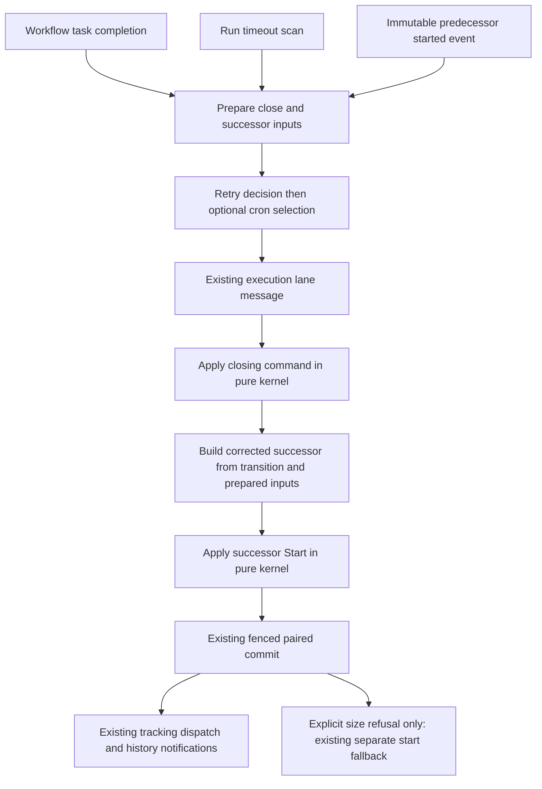

# Successor semantics design

## Overview

Correct the fields and continuation choice described by
[bugfix.md](bugfix.md) without changing the storage transaction that makes the
close and successor atomic. The runtime reads immutable start history, decides
retry versus cron, and carries the concrete input into the existing lane message.
The kernel records the selected outcome. The lane builds and applies one successor
before calling the existing paired repository commit.

Behaviour follows Temporal server v1.31.0, specifically
`service/history/workflow/retry.go`,
`service/history/api/respondworkflowtaskcompleted/workflow_task_completed_handler.go`,
`service/history/timer_queue_active_task_executor.go`, and
`service/history/workflow/mutable_state_impl.go`. Wire fields are the vendored
`proto/upstream/temporal/api/history/v1/message.proto` and
`proto/upstream/temporal/api/command/v1/message.proto`. The requirements' evidence
table gives the verified source anchors and field policy.

## Dependencies and non-goals

- [atomic-successors](../atomic-successors/design.md) owns paired commit, fence,
  pointer CAS, duplicate handling, growth limits, publication and the size fallback.
  Keep those mechanisms and their failure tests intact.
- [workflow-retry-chain](../workflow-retry-chain/design.md) owns retry eligibility.
  This change fixes successor choice after that decision, metadata and minimum
  delay. It does not revise custom retry delays or every policy boundary.
- [runtime-continue-as-new](../runtime-continue-as-new/design.md) owns explicit
  continue-as-new. Only its original-start links change; supported command fields
  and minimum-delay behaviour remain.
- [edge-history-parent-chain](../edge-history-parent-chain/design.md) owns wire
  serialization. Existing fields carry corrected data; no upstream proto change.
- [conformance-config-override](../conformance-config-override/requirements.md)
  keeps the one-second minimum interval kernel-excluded. No mutable configuration
  is read by the kernel and no new configuration key is introduced.
- No new table, migration, persisted event variant, state extension, dependency,
  queue authority, delivery executor, repair of old chains, or reset redesign.
  Callback, priority and worker-versioning policy are outside the corrections in
  this document; retaining those paths is not a claim of full conformance.

## Architecture



The started event is immutable, so taking its metadata before lane submission
does not race a later memo upsert or attached link. Those later mutations must not
become inheritance sources. The closing transition remains authoritative for the
actual close cause, successor id, current state and command-sourced continue-as-new
fields. The lane's existing OCC loop and pointer CAS remain the write boundary.

Read history only for a completion that can produce a successor; reuse a single
start-event read across cron discovery, retry inputs and continue-as-new links.
This is not a change to DSQL history-page sizing or a new history cache. If required
history is missing, malformed or unreadable, fail preparation before either run is
written. Do not manufacture empty input or silently downgrade to a terminal close.
Complete these fallible preparation reads before taking update-registry waiters
from their entries; otherwise an early return could strand a waiter even though
the workflow task has not committed. Preserve the existing post-commit resolution.

## Components and interfaces

### Immutable input extraction in `tokeira-runtime/src/successor.rs`

Add a runtime-private owned input type, extracted identically from legacy
`WorkflowExecutionStarted` and `WorkflowExecutionStartedV2`. Extraction takes a
semantic history event returned by `RunRepository::read_history`; it does not read
generated proto artifacts or encoded storage parts directly.

Representative interfaces (types imported at module scope):

```rust
fn started_event_inputs(event: &HistoryEvent) -> Result<SuccessorStartedEvent>;

async fn load_started_event_inputs<R: RunRepository>(
    repo: &R,
    run_key: RunKey,
) -> Result<SuccessorStartedEvent>;

fn build_successor_start(
    transition: &Transition,
    plan: Option<&SuccessorPlan>,
    now: OffsetDateTime,
) -> Result<Option<StartRequest>>;
```

`SuccessorStartedEvent` owns input, optional header, memo, search attributes, links,
optional cron schedule, optional last completion result and started versioning
information. Keep the existing versioning calculation as a consumer of the same
started versioning value; do not change versioning policy. This type is not
serialized or stored. Box it in the plan so adding header/maps does not inflate
every lane message and recreate the paired-future stack problem.

Extend `SuccessorPlan` with explicit continue-as-new links, and replace retry's
`timeout_prior_outcome` and cron's unrelated input copies with the shared owned
started-event inputs. A small runtime-only cause enum distinguishes workflow-task
close from run timeout. Carry the selected backoff and evaluation time explicitly;
do not infer the cause from whether a failure happens to be present.

### Continuation selection in `runtime/workflow_task.rs`

For a failing workflow task, evaluate retry first:

| Retry decision | Cron availability | Kernel command | Successor plan |
|---|---|---|---|
| Retry available | Any | Existing `WorkflowTaskCompletedWithRetry` | Retry |
| Terminal retry state | Valid next cron backoff | Existing `WorkflowTaskCompletedWithCron` | Cron, carrying that retry state |
| No retry policy | Valid next cron backoff | Existing `WorkflowTaskCompletedWithCron` | Cron, carrying `RetryPolicyNotSet` |
| Terminal or no policy | No cron continuation | Existing retry terminal command or plain completion, as applicable | None |

Successful completion continues to consider cron without evaluating a failure.
Explicit continue-as-new continues through its existing kernel command and event;
preparation supplies original links. Existing command validation and first-close
ordering remain authoritative: a prepared plan must match the close the kernel
actually emits, and a transition without a successor does not consume the plan.

Remove the cron helper's “any retry policy means no cron” guard. Compute a retry
decision once and pass it to cron preparation rather than performing a second
policy evaluation with a later clock. Preserve no-policy as a concrete retry
outcome when cron follows a failure. This matches
`workflow_task_completed_handler.go:779-809 @ v1.31.0`.

### Kernel handoff in `tokeira-kernel/src/command.rs` and `kernel.rs`

Add `failure_retry_state: RetryState` to `CronContinuation`. A failure fills it
from the declined retry decision; successful completion ignores it and uses
`RetryPolicyNotSet` as its conventional value. The failed-cron arm authors this
field instead of hardcoding `InProgress`. Keep its successor id independently.
No new kernel command is needed. The existing retry and cron command variants
remain mutually exclusive per completion.

`CronContinuation` is command input, not a field of persisted `WorkflowState` or
`HistoryEventKind`. Repository commits persist `Transition`, which contains state,
history and effects rather than serialized `Command`. Updating command literals
and their serialization tests is required; changing durable encodings is not.
Do not add a default that quietly converts an omitted decision to `InProgress`.

Expose the existing pure `continue_as_new_min_backoff` helper through the kernel
crate facade for runtime callers. Its one-second constant stays in one place.
Its inputs remain optional selected delay and concrete execution age; it reads no
clock or configuration. Preserve explicit continue-as-new's existing call and
behaviour. For the in-scope executing predecessors the age is non-negative; the
existing helper's defensive handling of negative age remains outside this change.

### Builders and clocks

`build_retry_successor_start` and `build_cron_successor_start` consume the prepared
started-event values rather than current memo/search attributes. Retry retains
the started cron schedule. Explicit continue-as-new takes links from the plan and
all its other in-scope fields from its close event, as before.

Use the requirements' outcome table, with explicit cause dispatch:

| Cause and successor | Continued failure | Last completion result |
|---|---|---|
| Workflow-task failure → retry | Failure from the closing event | None |
| Workflow-task failure → cron | Failure from the closing event | Started event's value |
| Workflow-task success → cron | None | Result from the closing event |
| Run timeout → retry or cron | Existing `workflow_run_timeout_failure()` | Started event's value |

Remove the pre-close close-result/failure snapshot. It is neither the newly
created timeout failure nor the carried result. Keep opaque failure payloads
intact; do not decode and reconstruct application failures in the builder.

Freeze one evaluation instant for each close attempt submitted to a lane: the
workflow-task request's `now` or timeout scan's supplied `now`. Carry it with the
selected delay. Derive execution age from the predecessor's start plus its own
first-task delay, and apply the minimum helper after retry/cron selection.

Separately retain the existing lane's once-per-submission successor start clock.
Use that clock for the successor started timestamp and delay timer, and retain
both clocks across OCC retries and explicit size fallback. Builders must not call
`now_utc()` again. The evaluation clock determines the selected/minimum delay;
the start clock determines when that delay begins. Temporal also constructs the
new mutable state's start time separately from its backoff calculation
(`service/history/api/respondworkflowtaskcompleted/workflow_task_completed_handler.go:handleRetry/handleCron` and
`service/history/workflow/retry.go:SetupNewWorkflowForRetryOrCron @ v1.31.0`).

Using the predecessor close timestamp as the new start timestamp causes a public
TaskId ordering regression with Tokeira's current timestamp-derived serializer:
the successor resets event ids to one. Preserve the prior start-clock separation
and test retry/cron as well as explicit continue-as-new at the wire boundary.
A shard-global durable TaskId allocator is outside this change; clock separation
does not claim to replace one.

The timeout cron path currently substitutes the nominal timeout deadline for
processing time. Use the supplied scan time for delay calculation and the lane's
processing-time clock for successor start. Cron phase is preserved by passing the
predecessor's execution time as the schedule anchor, not by backdating the new run. This follows
`GetCronBackoffDuration` and `ContinueAsNewMinBackoff` in
`mutable_state_impl.go @ v1.31.0`, and `t.Now()` in
`timer_queue_active_task_executor.go:683-754 @ v1.31.0`. Include delayed-scan tests.

Cron selected delays come from the real calendar helper, including its whole-second
ceiling and exact-fire zero boundary (`common/backoff/cron.go:33-63 @ v1.31.0`).
Tests must not manufacture a 100 ms calendar delay. The minimum helper itself is
tested over arbitrary non-negative delays separately.

### Lane and repository boundary

The lane still applies the close, builds the start, applies `Command::Start` to
`LoadedRun::Absent`, then calls `commit_transition_pair`. Use the same corrected
start for the explicit size fallback. Keep run/request identities, fence, expected
sequence, current-run CAS, history notifications and publication ordering intact.
No repository interface changes are needed. Missing/mismatched required plan data
fails before a write; it cannot authorize a close-only normal commit.

## Data model and persistence policy

| Input | Representation/owner | Contract source | Persistence impact |
|---|---|---|---|
| Original input/header/memo/search attributes | Existing payload types in runtime `SuccessorStartedEvent` | Started attributes fields 6/25/22/23; `SetupNewWorkflowForRetryOrCron @ v1.31.0` | Existing successor started fields and initial state |
| Original links | `Vec<Link>` in runtime input/continue-as-new plan | `HistoryEvent.links` 302; `AddContinueAsNewEvent @ v1.31.0` | Existing successor event links |
| Cron expression | `Option<String>` in runtime input | Started attributes field 20 | Existing successor started field |
| Carried result | `Option<Payloads>` in runtime input | Started attributes field 13; cause-specific handlers | Existing started `last_completion_result` |
| Started versioning | Existing `WorkflowVersioningInfo` in runtime input | Existing worker-versioning contract | No policy change |
| Failure retry state | `CronContinuation.failure_retry_state` | Failed-event retry state from `handleCommandFailWorkflow @ v1.31.0` | Existing failed-event field, no new variant |
| Close cause, selected delay, evaluation time | Runtime-private enum/timing values | Cause-specific handlers and minimum-delay helper | Existing first-task backoff |
| Successor start clock | Lane-local value, frozen before OCC retries | `handleRetry`/`handleCron @ v1.31.0`; preserved lane start timing | Existing start timestamp and delay-timer anchor |

Do not read `WorkflowState.links` for original links: it includes later attachments.
Do not persist the prepared input merely to avoid a history read. The started event
already owns those values, including large payloads hydrated by the repository.

## Correctness properties

Each property is required, with at least 100 generated cases. Assertions use
the field/decision model in the requirements, not copies of the old builders.

### Property 1: Original metadata survives each successor

For any valid legacy or V2 started event, arbitrary later metadata mutations,
and in-scope successor kind, the committed successor SHALL satisfy Requirement 1's
field-source policy, including exact absent/empty values and cron schedule on retry.

**Validates: Requirements 1.1, 1.2, 1.3, 1.4, 1.5, 1.6, 1.7**

### Property 2: Outcome data follows the actual cause

For any valid close cause and optional carried result, the committed successor
SHALL have exactly the failure/result pair in the outcome table, independently
of unrelated pre-close close-result/failure values.

**Validates: Requirements 2.1, 2.2, 2.3, 2.4, 2.5, 2.6, 2.7, 2.8, 2.9**

### Property 3: Retry outcome and successor kind are independent

For any generated eligible/declined/no-policy retry decision and cron availability,
the close and successor SHALL match the selection table, retaining the evaluated
retry state and the selected kind's run id, initiator and attempt. A multi-hop
retry then success/exhaustion retains enough schedule data to resume cron.

**Validates: Requirements 3.1, 3.2, 3.3, 3.4, 3.5, 3.6, 3.7, 3.8**

### Property 4: Minimum interval and timer agree

For any non-negative execution age and selected backoff, the successor SHALL use
`B` from the requirements and keep its first task ineligible until start plus `B`.
For cron integration cases, generate selected backoff from actual schedule/clock
inputs. Changing scanner lag must not change the schedule anchor or backdate start.
Assert the delay from the evaluation clock and eligibility from the independently
frozen successor start clock; OCC retries must not resample either clock.

**Validates: Requirements 4.1, 4.2, 4.3, 4.4**

### Property 5: Corrected metadata retains commit safety

For any generated corrected successor and injected pair failure, conflict,
duplicate or explicit size refusal, the lane SHALL preserve paired atomicity,
identity reuse and one-successor semantics; fallback uses the same corrected
fields. Transitions without a successor continue through the single-run path.

**Validates: Requirements 5.1, 5.2, 5.3, 5.6, 5.7**

### Property 6: Expired chains remain terminal

For any execution-timeout transition, including runs with retry and cron, the
runtime SHALL preserve the absence of a successor after the execution expires.

**Validates: Requirements 5.8**

### Property 7: Explicit continue-as-new keeps correct fields

For any supported continue-as-new command and predecessor metadata, the successor
SHALL preserve command-sourced header/memo/search attributes and existing
minimum-delay behaviour while inheriting only the original-start links.

**Validates: Requirements 5.4, 5.5**

### Property 8: Kernel result is deterministic

For any valid generated completion input with a concrete cron failure retry state,
repeated pure kernel applications SHALL produce equal transitions. Runtime-prepared
inputs do not add a clock, storage dependency or mutable configuration to the kernel.

**Validates: Requirements 5.9**

## Error handling

No new public validation rule is introduced. Existing `EdgeError::from(anyhow)`
and gRPC conversions in `crates/tokeira-edge/src/errors.rs` and
`grpc/errors.rs` remain the mapping authority.

| Condition | Internal handling | External outcome and writes |
|---|---|---|
| Required start history missing or wrong event kind | Contextual runtime error naming the run and failed invariant | Existing generic `INTERNAL`; neither run written |
| Repository history read failure | Propagate existing error, preserving its type | Existing mapping; generic unclassified errors are `INTERNAL`; neither run written |
| Plan missing or inconsistent with emitted successor | Existing preparation error, extended with cause context | `INTERNAL`; no normal close-only commit |
| No applicable retry/cron | Successful terminal decision | Existing successful close response; one run written |
| Invalid stored cron expression/calendar computation failure | Propagate `ScheduleError`; no empty-field substitution | Existing generic `INTERNAL`; no paired write |
| Kernel rejects a command/start | Preserve `KernelRejected` and completion rejection mapping | Existing cause-specific error; no pair commits |
| OCC conflict or duplicate | Existing lane retry/duplicate handling | Existing API result; no second successor |
| Lost ownership/lease | Existing fence/admission path | Existing ownership/error mapping; no unfenced write |
| Explicit pair size refusal | Existing size fallback using corrected `StartRequest` | Existing response; separate start remains the accepted durability limitation |

Timeout scanning has no synchronous public RPC response. A preparation/read failure
must leave the run eligible for a later scan; no success/removal of its tracking may
be inferred from failure to obtain metadata. Test the existing scan error path with
injected read failures while adding this extraction.

## Testing strategy

1. **Exploration first.** Before changing production code, write focused `proptest`
   cases against baseline runtime/memory and kernel entry points. Record shrunk
   counterexamples separately for original metadata, retry cron loss, timeout
   outcome, retry-to-cron selection/retry state, and minimum delay. Assert the
   corrected contract so these tests fail on the baseline. Stop on an unexpected
   pass and re-check the premise; do not count a compile failure as detection.
2. **Property placement.** Properties 1–4 and 6–7 live with runtime successor tests,
   using actual memory repository/history and `BasicKernel` for semantic effects.
   Property 5 extends lane atomic-successor tests; Property 8 lives with kernel
   completion tests. Add edge serializer assertions for generated persisted
   histories from Properties 1–3. Test-only mocks may inject failures but must not
   author the expected semantic transition in place of the real kernel.
3. **Example boundaries.** Explicit absent versus empty payload/maps, legacy/V2
   extraction, empty result on successful cron completion, missing started event,
   failed history read, exact cron tick, delayed scan, below/equal/above one second,
   first-task backoff on the predecessor, and default-minimum configuration
   disposition. Synchronize timers with controlled clocks/notifications, not sleeps.
4. **Preservation.** Keep pair/fence/current-pointer tests, wrapper history-waiter
   tests, draining and restart tests. Replace legacy-builder equivalence only for
   approved fields; retain comparison of unchanged lineage, versioning and
   idempotency fields. Test the same corrected metadata through normal and fallback
   starts. Existing DSQL pair tests remain applicable; run the live pair suite with
   representative inherited metadata for implementation acceptance.
5. **Conformance.** Run the pinned continue-as-new, retry, cron and cron-client suites
   via the [functional harness](../../../docs/testing/functional-conformance-harness.md),
   with skips governed by its registry. Add repository integration cases for
   metadata/result cases absent from that corpus; do not modify upstream test bodies.
6. **Completion bar.** Run all root §10.4 checks, DSQL-feature lint for affected
   runtime/engine consumers, and offline Markdown links. Record commands and actual
   outcomes; a specification PR does not mark implementation tasks complete.
