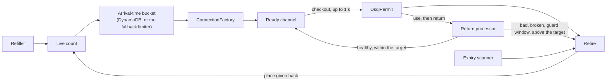

# 060 Connection Management

**Status:** accepted  
**Related docs:** [050-dsql-storage](050-dsql-storage.md), [055-admission-control](055-admission-control.md), [030-runtime-lanes](030-runtime-lanes.md)

## Purpose

Aurora DSQL connection management is a correctness and operability boundary. Tokeira works to these DSQL limits, from the Aurora DSQL quotas and authentication pages:

| Limit | Value | Past it |
|---|---|---|
| Connections per cluster | 10,000 | the connect is refused with SQLSTATE `53300` |
| Connection rate per cluster | 100 a second, burst 1,000 | the connect is refused with `53400` |
| Connection duration | 60 minutes | DSQL closes the connection |
| Transaction duration | 5 minutes | the transaction fails with `54000` |
| IAM authentication token | 15 minutes | checked only when a connection opens |

Tokeira therefore treats the DSQL reservoir as the sole owner of physical database connections. There is no sqlx `PgPool` in the runtime path.

The design goal is simple: an operation either gets an already-safe connection or receives storage backpressure within a second. A request never triggers a connection-open cascade.

## Reservoir Ownership

The storage crate owns a `Reservoir` per `DsqlStore`. The reservoir owns raw `PgConnection` values created through `aurora_dsql_sqlx_connector::connection::connect_with`. The connector mints an IAM token for each connection as it connects; Tokeira never caches tokens and does not instrument token refresh directly. A token is checked only when its connection opens, so a connection outlives its token safely; with the credentials cached, signing a token is a local computation, so sharing one token between connections would save nothing.

The AWS credentials that sign the tokens are a different matter. `ConnectionFactory` resolves them once through the default credentials chain and reuses them until five minutes before they expire. Left to itself, the connector would build a new credentials chain for every connection, and its signer bypasses the SDK's credential cache, so a refill of fifty connections would fetch credentials fifty times from the ECS credentials endpoint or STS.

Every connect is bounded by a 30-second timeout. Neither sqlx nor the connector bounds one, and a peer that accepts TCP and never answers would otherwise hold a creation slot forever. A connect DSQL refuses, with `53400` or `53300`, is reported with the `refused` kind, recognised by its SQLSTATE wherever the connector wraps it.

Connection lifecycle:



The reservoir has three background tasks:

- `Refiller`: takes a place in the live count, waits for the cluster-wide rate limiter to admit a creation, creates a raw connection, and places it in the ready channel. Up to eight creations run at once, so refilling fifty connections after a mass retirement takes a handful of connect latencies rather than fifty. Consecutive failures back off exponentially, from 250 ms doubling to 10 seconds with jitter, so nodes refused together retry apart; the first success ends the backoff at once.
- `Expiry scanner`: scans at most half of the target ready channel per pass and retires connections that are broken, inside the guard window, or above a lowered target.
- `Return processor`: accepts returned permits and validates only lifetime, the bad and broken flags and the live count. It performs no network ping and never waits for room: the ready channel holds the configured target, and ready connections are a subset of live ones.

## Live Connections

A node holds no more live connections than its target. Live connections are the ready ones, the ones checked out and the ones being created; counting the checked-out ones means a node under load does not replace connections that are only in use, so its connections never exceed its target however busy it is.

The refiller takes a place in the live count before it asks the rate limiter, so a node never spends the cluster's rate on a connection it has no room for. The place is a `LiveCharge` that travels with the attempt and then with the connection, through the ready channel, the caller's permit and the return path, and gives the place back when it is dropped. No path releases a place by hand, so none can release one twice or forget to: a failed, timed-out or cancelled connect, a retirement by any task, and a connection dropped at shutdown each give their place back by dropping the charge.

## Fleet Capacity

The fleet stays within DSQL's 10,000 connections because each node stays within its target and the placement controller divides the cluster's connections among the nodes it budgets. A connection budget directive carries the node's `capacity` share of the cluster's connections, its `rate_per_second` share of the connection rate, and a `max_reservoir_size` ceiling. The node's target becomes `min(configured target, max_reservoir_size, capacity)`, at least five, one connection for each operation class; idle connections above it retire at once, and checked-out ones as they come back, so a lower target never interrupts work. The class budgets are recomputed from the new target, so admitted callers never outnumber the connections the node may hold. A directive only lowers the target: the cluster's share is a ceiling on the node, not a licence to exceed its configuration.

A node keeps its last share through a controller outage, past the directive's `valid_until`, until the next directive arrives, and warns once that the share is stale. Shares kept this way sum to no more than the budget they came from; collapsing every node to one connection instead would take the fleet's capacity with the controller. Nodes that start during an outage run at their configured target and can push the fleet past the budget; DSQL refuses the excess with `53300`, and the refusing nodes back off while keeping the connections they hold.

There is no per-node lease on connection slots. A lease bounds the fleet without a controller, but it puts DynamoDB on the path of every node's capacity: a node that cannot take a lease cannot start, and a node whose renewal fails long enough to lose its only block is left with none. Exceeding the connection limit costs a refused connect, which the refiller backs off from.

## Admission Path

Every storage operation first acquires a class permit from `ClassBudgets`, then checks a connection out of the reservoir. If the class semaphore is saturated, the operation queues at the class boundary until a permit frees or the request is cancelled. Checkout takes a ready connection at once, or waits up to one second (`CHECKOUT_WAIT`) for one to be returned or created. If none arrives, the class permit is dropped and `ReservoirError::Empty` is returned. Checkout itself never connects or calls DynamoDB, and its wait is cancel-safe: a request dropped while it waits takes no connection out of the ready channel.

The class budgets sum to the target, so after admission only a connection between retirement and its replacement can be missing: a returned connection arrives within microseconds and a replacement within one connect. One second covers that gap with room to spare and stays far below the deadlines clients set on their calls. The storage layer does not see a request's deadline, so the wait is fixed rather than deadline-aware.

A class permit travels with its connection. When an operation finishes, its permit goes to the return processor along with the connection and returns to the class only once the connection is back in the ready channel or retired. If the permit came back first, the next caller of that class could be admitted while the connection it needs is still in the return queue, and find the reservoir empty although the class budgets were respected.

An empty reservoir reaches the client as `RESOURCE_EXHAUSTED`, with cause `RESOURCE_EXHAUSTED_CAUSE_PERSISTENCE_LIMIT` and scope `RESOURCE_EXHAUSTED_SCOPE_SYSTEM`: the director marks the error `PersistenceCapacityExhausted`, and the frontend answers it the way Temporal answers a persistence rate limit (`common/persistence/persistence_rate_limited_clients.go` @ v1.31.0). SDKs retry it with backoff.

Default classes match the runtime `DbClass` enum:

- `control`
- `commit`
- `read`
- `projection`
- `maintenance`

The default allocation is derived from the target and preserves at least one permit per class, so projection work can never starve commits of their permits. Commit gets the largest share because the transition log is the authoritative write path.

## Broken Connections

A connection whose transport failed, or whose session the server ended with a FATAL error, must not reach another caller, but nothing on the connection says so afterwards: sqlx has no synchronous health check, and the return path does no network I/O. So every storage operation runs inside `in_operation`, which records each connection the operation checks out. When the operation fails with an IO, TLS or protocol error, or a FATAL error response, every recorded connection is flagged broken. The return processor, checkout and the expiry scanner each retire a flagged connection when they meet it, and the refiller replaces it.

The flag is set once the operation has failed, after its permit has returned the connection, so a caller that checks the connection out in that short window fails on it the same way and flags it again. An operation that held more than one connection retires them all; such failures are rare, and a spare reconnect costs less than handing the next caller a dead connection.

## Distributed Rate Limiter

Coordination has two modes, selected by the deployment shape rather than configuration: served multi-node `tokeirad` coordinates through the DynamoDB-backed limiter below; a single-owner embedded engine coordinates process-locally (see [Embedded Coordination](#embedded-coordination)).

DSQL connection creation is limited cluster-wide. A local limiter per process would only move the thundering-herd problem from one process to many processes, so every node shares one limiter in DynamoDB. Its table is `{project}-dsql-rate-limiter`, with partition key `pk` and TTL attribute `ttl_epoch`, on-demand billing, in the cluster's Region. Every DSQL deployment provisions it, compose included, because any deployment can run several nodes against one cluster. It holds one small item per DSQL endpoint, so it costs one or two on-demand writes per connection created: a few writes a second while a fleet refills, and none while it is full.

The limiter is the generic cell rate algorithm. The item `dsql_connect_gcra#{endpoint}` holds one time, the arrival time `tat_us`: the time by which every admission granted so far would have been paid for at 100 a second. An admission at time `t` may run ahead of payment by the burst less one interval (9.99 seconds):

- an arrival time before `t` is an idle bucket: the creation runs now, and the arrival time becomes `t` plus one interval;
- an arrival time between `t` and the tolerance plus 30 seconds past `t` is a busy bucket: the creation is scheduled at the arrival time less the tolerance, and the arrival time moves on by one interval;
- a later arrival time would schedule the creation more than 30 seconds ahead, and the admission is refused; the refiller backs off and asks again.

Each branch is one conditional update, and no read precedes it. The node guesses the branch from the last arrival time it saw; a wrong guess fails its condition and returns the stored item, which says which branch is right. An admission therefore takes one update, or two after a wrong guess. Concurrent busy admissions from any number of nodes each succeed first time, because the busy update adds an interval to whatever is stored and DynamoDB serializes the updates on the item. One stored time and the admitting node's own clock decide every admission, so two nodes whose clocks differ by δ disagree about the bucket by a fixed δ's worth of admissions, an offset that does not grow with traffic. In any window of length `w` the fleet's admissions stay within `1,000 + 100 × (w + δ)`. The item expires an hour after its last update; a missing item is an idle bucket, which is what an hour without admissions is.

A node that cannot reach DynamoDB (an error other than a failed condition, after the SDK's own retries) admits through a process-local limiter for 30 seconds, then tries DynamoDB again. The fallback admits at the node's `rate_per_second` share from its latest connection budget directive, or 10 a second without one, with a burst of one second's admissions; the node warns when the fallback begins and reports `tokeira_dsql_pool_rate_limiter_fallback` until DynamoDB answers. Refills continue while DynamoDB is down, the shares sum to the cluster's rate, and DSQL refuses whatever the nodes' one-second bursts add. A node checks the table once at startup and does not start without it, so nodes that start together share the cluster's burst.

The acquisition order is:

1. acquire the local in-flight creation semaphore,
2. take a place in the live count,
3. wait for the rate limiter to admit the creation,
4. create the raw DSQL connection.

A step that fails gives back what the steps before it took.

## Startup

A node starts serving once its reservoir reaches its target, or after the 30-second warmup with the connections it holds, warning how many it has; the refiller keeps filling. A fleet started at once shares the cluster's burst and then its rate: a hundred nodes of fifty reach their 5,000 connections in about 40 seconds, and each holds a connection for every class within the first second.

## Embedded Coordination

A single-owner embedded engine has no peer processes to coordinate with, so it
constructs no DynamoDB resources. `Engine::embedded()` installs a process-local
coordinator (`ProcessLocalConnectionCoordinator`,
`crates/tokeira-storage/src/dsql/connection_coordinator.rs`): a monotonic token
bucket admits connection creation and an atomic slot budget caps active
connections. It takes a slot before a token, as the distributed path takes a
place in its live count before asking the rate limiter. The module is deliberately absent from the distributed `tokeirad` path —
the reservoir and rate limiter above are unchanged by it.

This applies to every embedded storage mode: in-memory, managed DSQL, and
adopted DSQL. The embedded engine is the sole owner of its cluster's connection
budget, so process-local admission is the whole coordination problem.

## Lifetime Rules

The reservoir uses internal constants:

- target ready connections: 50, at least 5
- in-flight connection creations: 8
- base lifetime: 50 minutes
- lifetime jitter: up to 4 minutes
- guard window: 45 seconds
- scan interval: 1 second
- scan budget: 25 entries per pass
- warmup timeout: 30 seconds
- checkout wait: 1 second
- connect timeout: 30 seconds
- refill backoff: 250 ms, doubling per consecutive failure to 10 seconds
- ready channel capacity: the configured target

The safety invariant is:

```text
base_lifetime + lifetime_jitter + guard_window + 5 minutes ≤ 60 minutes
```

DSQL closes a connection after 60 minutes, and a transaction may run for 5. A connection is handed out only before its guard window, so a transaction begun on it at the last moment still ends before DSQL closes it: 54 minutes plus 45 seconds plus 5 minutes is 59:45. The token does not bound the lifetime, because DSQL checks it only when the connection opens. Long lifetimes keep the fleet's replacement rate low: two hundred nodes of fifty replace about 3 connections a second, out of the cluster's 100. Jitter spreads the retirement of connections created together over four minutes.

## Schema Commands

Schema setup/status commands do not use the reservoir. They create one raw admin `PgConnection` through `ConnectionFactory` and pass it to the migration runner. This keeps schema operations simple and avoids warming a runtime reservoir for one-off CLI work.

## Metrics

Connection metrics use existing `tokeira_dsql_pool_*` names where a signal already existed. Important signals include:

- `tokeira_dsql_pool_connections_total`
- `tokeira_dsql_pool_checkout_duration_seconds`
- `tokeira_dsql_pool_empty_reservoir_total`
- `tokeira_dsql_pool_connections_created_total`
- `tokeira_dsql_pool_connections_retired_total`
- `tokeira_dsql_pool_connections_returned_total`
- `tokeira_dsql_pool_rate_limiter_tokens`
- `tokeira_dsql_pool_rate_limiter_rate`
- `tokeira_dsql_pool_rate_limiter_fallback`
- `tokeira_dsql_reservoir_live_connections`
- `tokeira_dsql_class_permit_wait_duration_seconds`
- `tokeira_dsql_connection_error_total`, whose `refused` kind counts connects DSQL refused

These metrics are emitted unconditionally through the `metrics` crate. Operators should read empty-reservoir rate as storage backpressure, the fallback gauge as a node that cannot reach the rate limiter table, and refused connects as a fleet at the cluster's connection rate or limit.

What a connection is used for is counted in round trips. `tokeira_dsql_operation_round_trips` records, for each DSQL operation, the statements it sent plus the BEGIN of each transaction, one sample per transaction it ended, labelled by operation, by the command or request that caused it, and by whether the transaction committed or rolled back. The process's tracing subscriber counts them from SQLx's statement events, whatever the log filter (`tokeira_observability::statement_accounting`). `tokeira_dsql_unattributed_statements_total` counts statements sent outside every operation and should stay at zero. A commit's latency is mostly its round trips, so a rise in a commit's samples is a rise in its latency, and `rolled_back` samples are round trips spent on attempts that lost.

## Shutdown

The reservoir aborts its background tasks on drop. It also exposes explicit shutdown paths through `Reservoir::shutdown`, `DsqlConnectionDirector::shutdown`, and `DsqlStore::shutdown` so embedding code can stop refilling before it drops the store. A node holds nothing in DynamoDB that outlives it: the rate limiter item records only admissions.
